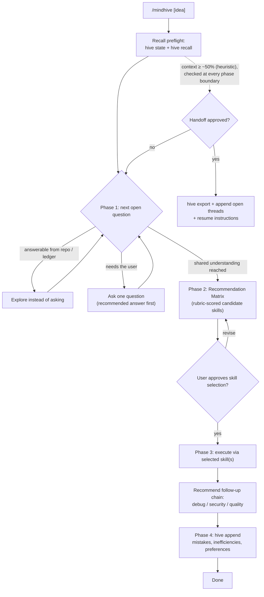

# feat: Add /mindhive orchestrator meta-skill

**Target repo:** mindhive

## Summary

Ship a `/mindhive [idea]` slash command plus model-invoked skill that turns an idea into executed work through a four-phase pipeline: memory-informed interview, skill Recommendation Matrix, execution with follow-up chaining, and improvement logging back into the MindHive ledger. It follows the existing `/circle` plugin pattern (command + skill + manifest + guard test) and drives the existing `hive` CLI — no new Python.

---

## Problem Frame

MindHive already captures decisions, failures, and lessons in an event ledger, and the machine has a large catalog of installed skills. But nothing connects the two at task-start time: the user must remember what was decided before, pick the right skill manually, and re-explain context each session. The orchestrator closes that loop — it recalls before it asks, recommends skills with an explicit scoring rubric, chains quality passes after execution, and writes what it learned back to the ledger so the next run is smarter.

---

## Assumptions

- "MindHive database" means the existing event ledger accessed through the `hive` CLI (`recall`, `state`, `append`, `export`). No new storage, schema, or backend work.
- `/mindhive` ships inside the existing mindhive plugin repo (version-controlled, guard-tested, listed in `.claude-plugin/marketplace.json`) rather than as a loose entry in the user-level skills directory.
- Exact context-token measurement is not available to an in-session skill; the 50% trigger is a best-effort heuristic (see KTD2).
- The pipeline orchestrates skills already installed on this machine; it does not install or author new skills.

---

## Requirements

**Orchestration pipeline**

- R1. `/mindhive [idea]` runs a strict four-phase pipeline: interview → Recommendation Matrix → execution + chaining → improvement logging.
- R2. Phase 1 asks one question at a time via the platform's blocking-question tool, each with a recommended answer listed first, and never asks a question answerable from the codebase or `hive recall`.
- R3. Phase 2 presents a Recommendation Matrix per candidate skill covering suitability, compatibility, probability of success, risk level, execution speed, resource cost, and a final verdict — with numeric values labeled as model estimates.
- R4. Phase 3 executes through the selected skill(s), then proactively recommends follow-up skills (debugging, security audit, code quality) with a rationale for each.
- R5. Phase 4 logs mistakes, inefficiencies, and newly stated preferences via `hive append decision|caveat|experiment_result` tagged `orchestrator`.

**Memory integration**

- R6. Before asking the user anything, the skill runs a recall preflight (`hive state`, `hive recall "<idea keywords>"`) and uses the results to pre-answer or skip interview questions.

**Context management**

- R7. The skill tracks context consumption heuristically and, at an estimated ~50%, halts, alerts the user, and requests permission to hand off.
- R8. An approved Handoff writes a portable summary via `hive export`, appends open threads to the ledger, and prints resume instructions for a fresh session.

**Packaging**

- R9. The feature ships as `commands/mindhive.md` + `skills/mindhive-orchestrator/SKILL.md`, activated by the existing `.claude-plugin/plugin.json` manifest.
- R10. A guard test protects the artifact shape (skill exists, frontmatter valid, command exists, manifest still valid), mirroring `tests/test_circle_skill.py`.
- R11. `USAGE.md` and `README.md` document the command in one or two lines each.

---

## Key Technical Decisions

- KTD1. **Markdown-only skill; no new Python.** Every operation the pipeline needs already exists on the `hive` CLI (`recall`, `state`, `append`, `export`, `graph related`). New code would add surface without capability.
- KTD2. **Context monitoring is heuristic, not measured.** The skill self-estimates from observable proxies (tool-call volume, files read, phases completed) and treats harness compaction notices and the existing PreCompact hook as the hard backstop. The SKILL.md states this honestly; exact budgeting stays with the headless loop, which already owns it.
- KTD3. **Handoff reuses `hive export`.** `export` already writes a portable `handoff.md` (see `src/mindhive/export.py`); the skill adds `hive append` entries for open threads rather than inventing a parallel handoff format.
- KTD4. **Matrix values are rubric-guided model judgment informed by ledger history.** `hive recall` surfaces past failures/successes with candidate skills; there is no per-skill telemetry backend, so the rubric requires percentages to be labeled estimates. Fabricating measured-looking numbers would mislead.
- KTD5. **Skill inventory comes from the session's available-skills list, verbatim.** It is the only authoritative runtime registry; the SKILL.md forbids recommending a skill name not present in that list (prevents hallucinated skill names).
- KTD6. **Ship in the mindhive plugin, following the `/circle` pattern.** Command + skill + manifest + guard test is the established, tested shape in this repo.

---

## High-Level Technical Design

The context check runs at phase boundaries (cheap, no mid-question interruptions). The Handoff branch can fire from any phase.

---

## Implementation Units

### U1. Orchestrator skill document

- **Goal:** The core `SKILL.md` defining the four-phase pipeline, recall preflight, interview rules, and phase-boundary context checks.
- **Requirements:** R1, R2, R4, R5, R6, R7
- **Dependencies:** none
- **Files:** `skills/mindhive-orchestrator/SKILL.md`
- **Approach:** Frontmatter (`name: mindhive-orchestrator`, trigger description covering `/mindhive`, "orchestrate this idea", "pick the right skill"). Body sections: recall preflight (exact `hive` commands via the project venv path, matching the `/circle` convention), Phase 1 interview loop with the explore-before-asking rule, Phase 3 execution + follow-up chaining table (task type → suggested follow-up skills), Phase 4 append recipes, and the context-check instruction pointing at the handoff protocol reference. Phase 2 details live in the U2 rubric reference to keep SKILL.md scannable.
- **Patterns to follow:** `skills/circle/SKILL.md` (frontmatter shape, venv-qualified CLI invocations, numbered Steps section, safety call-outs).
- **Test scenarios:**
  - Invoking `/mindhive "add a REST endpoint"` in a project with relevant ledger history: the skill runs `hive recall` first and does not re-ask questions the ledger answers.
  - Interview phase: questions arrive one at a time, each with a recommended answer listed first; no multi-question dumps.
  - A question answerable by reading the repo (e.g., "which framework is in use?") is resolved by exploration, not asked.
  - Phase 4 after a completed run: at least one `hive append` fires when a mistake or preference surfaced; none fires when nothing memorable happened (no noise events).
- **Verification:** Manual `/mindhive` dry run reaches Phase 2 without asking a repo-answerable question; U5 guard test passes.

### U2. Rubric and handoff protocol references

- **Goal:** Two reference files the skill loads on demand: the Recommendation Matrix rubric and the Handoff protocol.
- **Requirements:** R3, R7, R8
- **Dependencies:** U1 (referenced from SKILL.md)
- **Files:** `skills/mindhive-orchestrator/references/recommendation-matrix.md`, `skills/mindhive-orchestrator/references/handoff-protocol.md`
- **Approach:** The rubric defines the seven matrix parameters with anchored scales (e.g., risk: none/local/repo-wide/destructive), requires candidates to be resolved against the session's available-skills list verbatim (KTD5), requires a `hive recall "<skill name>"` check for prior outcomes per candidate, and mandates the "model estimate" label on probabilities. The handoff protocol defines the heuristic signals for the ~50% estimate, the alert wording, and the approved-handoff sequence: `hive export` → `hive append` open threads (tagged `orchestrator,handoff`) → print resume instructions (`hive state`, read `handoff.md`, re-invoke `/mindhive` with the remaining scope).
- **Patterns to follow:** ce-plan's own `references/` layout — small, single-purpose files loaded when the phase fires.
- **Test scenarios:**
  - Matrix output for two candidate skills renders all seven parameters plus verdict, and probability values carry the estimate label.
  - A candidate name not in the available-skills list is rejected by the rubric rule rather than presented.
  - Simulated long session (many tool calls): the skill offers — not forces — a handoff, and declining resumes the pipeline where it left off.
- **Verification:** Both reference files exist and are linked from SKILL.md; a sample matrix follows the rubric.

### U3. Slash command front door

- **Goal:** The typeable `/mindhive` entry point that forwards the idea to the skill.
- **Requirements:** R1, R9
- **Dependencies:** U1
- **Files:** `commands/mindhive.md`
- **Approach:** Frontmatter with `description` and `argument-hint: "[idea]"`; body instructs activation of the orchestrator pipeline with `$ARGUMENTS` as the idea, restates the four phases in one paragraph, and points at the skill for the full procedure — mirroring how `commands/circle.md` fronts `skills/circle`.
- **Patterns to follow:** `commands/circle.md`.
- **Test scenarios:**
  - `/mindhive build a csv importer` starts Phase 1 with the idea captured; `/mindhive` with no arguments asks for the idea instead of erroring.
- **Verification:** U5 guard test asserts the command file's existence and frontmatter.

### U4. Plugin manifest and docs

- **Goal:** Register and document the new command.
- **Requirements:** R9, R11
- **Dependencies:** U1, U3
- **Files:** `.claude-plugin/plugin.json`, `USAGE.md`, `README.md`
- **Approach:** Extend the plugin description to mention `/mindhive`, bump version `0.1.0` → `0.2.0`, add a one-line entry to USAGE.md's recall/command list and a short README section. No marketplace.json change needed — it lists the plugin, not individual commands.
- **Patterns to follow:** Existing plugin.json field shapes; USAGE.md's terse command-per-line style.
- **Test scenarios:** Test expectation: none — config and docs; shape is covered by U5's manifest-validity assertion.
- **Verification:** `plugin.json` parses; docs mention `/mindhive`.

### U5. Guard test

- **Goal:** Pytest guarding the plugin shape so a rename or delete cannot silently break activation.
- **Requirements:** R10
- **Dependencies:** U1, U3, U4
- **Files:** `tests/test_mindhive_orchestrator_skill.py`
- **Approach:** Mirror `tests/test_circle_skill.py`: assert SKILL.md exists with valid frontmatter (`name: mindhive-orchestrator`) and mentions `hive recall`; assert both reference files exist; assert `commands/mindhive.md` exists with frontmatter and `$ARGUMENTS`; assert `plugin.json` still parses and version ≥ 0.2.0.
- **Patterns to follow:** `tests/test_circle_skill.py` (path constants from repo root, plain asserts with messages).
- **Test scenarios:**
  - All five artifact assertions pass on the completed branch.
  - Deleting or renaming any of the four artifacts fails the corresponding assertion with a pointed message.
- **Verification:** `pytest tests/test_mindhive_orchestrator_skill.py` green; full `hive selftest` still green.

---

## Scope Boundaries

**Non-goals**

- No changes to the `hive loop` / `/circle` engine, the event schema, or the projector.
- No per-skill success-rate telemetry backend; matrix probabilities remain labeled estimates.
- Nothing touches the V17 live-trading setup or the `LIVE_LOCK` guard semantics.

### Deferred to Follow-Up Work

- Per-skill outcome telemetry: append structured `skill_outcome` events from Phase 4 and surface real historical success rates in the matrix.
- A `hive skills` CLI subcommand that inventories installed skills, replacing reliance on the session's available-skills list.

---

## Risks & Dependencies

- **Skill-name hallucination in the matrix.** Mitigated by KTD5's verbatim-list rule enforced in the rubric reference.
- **Context heuristic misfires (offers handoff too early or too late).** Low cost either way: the offer is user-approved and declinable, and the PreCompact hook remains the hard backstop.
- **Interview fatigue.** The explore-before-asking rule plus recall preflight keeps questions to genuinely user-owned decisions; SKILL.md caps the interview at decisions that change scope, architecture, or risk.
- **Prompt-artifact drift.** The U5 guard test catches structural breakage; behavioral drift is only caught by use — acceptable for a personal tool.

---

## Sources & Research

- `skills/circle/SKILL.md`, `commands/circle.md` — the plugin pattern this feature mirrors.
- `tests/test_circle_skill.py` — guard-test precedent and rationale comment.
- `src/mindhive/__main__.py` — CLI surface (`recall --semantic --limit`, `append --tags`, `export`, `state`, `briefing`, `graph related`).
- `src/mindhive/export.py` — `export` writes `handoff.md`; the handoff mechanism KTD3 reuses.
- `USAGE.md` — established handoff guidance ("hive export for a portable handoff") and command documentation style.
- `CONTEXT.md` — canonical glossary (event, memory, ledger terms used verbatim in this plan).
