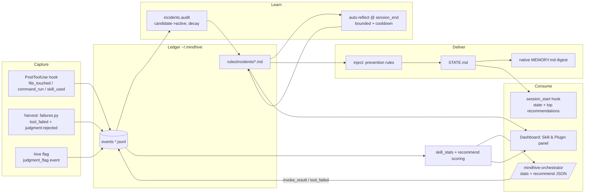

# feat: Close the learning loop and rebuild the Skill & Plugin panel

**Target repo:** `C:\Users\hanif\mindhive` (plus two narrowly-scoped user-config edits outside the repo, called out explicitly in U1 and U5).

---

## Summary

MindHive's learn-from-mistakes loop is built but has never closed: 104 incidents captured, 0 lessons produced, `inject()` empty everywhere, and the context the system injects each session costs more tokens than it saves. This plan (1) stops the context bleeding (Pensyve per-turn spec flooding, oversized MEMORY.md), (2) makes reflection run automatically so prevention rules actually reach the agent, (3) adds pragmatic capture of judgment errors and decays single-occurrence noise, and (4) rebuilds the dashboard "Skills & plugins" section as a **Skill & Plugin** panel — an Improvements-style view over real per-skill success/failure telemetry — with a deterministic recommendation engine that `/mindhive-orchestrator` consumes instead of model-estimated percentages.

Design contract (user's words): orchestrator + auto hooks + skills/plugins = the executor; the Skill & Plugin panel = the viewing panel over that database.

---

## Problem Frame

Measured from the real store at `~/.mindhive` (user-verified numbers):

1. **Context overhead is net-negative.** MEMORY.md ≈3,535 tokens/session; 21 project namespaces; Pensyve's UserPromptSubmit hook `cat`s its full spec into context on *every* turn (tens of thousands of tokens per session). Pensyve config flags don't help — the spec text is injected before any config check runs.
2. **Reflection has never run.** `reflect_incident()` (src/mindhive/reflect.py:58) fires only from a manual CLI call or a dashboard button. Every incident has `rule_source="none"`, so `_active_rules()` (src/mindhive/incidents.py:346) filters everything and `inject()` (incidents.py:372) returns `""` for all projects. Zero prevention rules have ever reached a session.
3. **Judgment errors are invisible.** Capture only records `tool_failed` (technical failures). Committing to master, misreading "continue" as merge permission — the most damaging error class — is structurally uncaptured. `failures.py` even *drops* user-rejection signals as noise.
4. **Signal is noise-dominated.** 40 of 49 incidents in one project are single-occurrence candidates below `THRESHOLD=2` that will sit forever un-reflected.
5. **The Plugins section and the orchestrator are disconnected.** `plugins.py` already tracks invoke outcomes in the ledger, but the UI barely surfaces them, and the orchestrator's recommendation matrix uses model-estimated percentages ("no measured per-skill telemetry" — its own documented gap).

## Requirements

- **R1** — Stop Pensyve's per-turn context injection; complete the staged Pensyve→MindHive cutover already recorded as the intended path in the user's MEMORY.md.
- **R2** — Cut MindHive's own per-session injection to a compact budget (target ≤ ~1,500 tokens for the native MEMORY.md digest) without losing state continuity.
- **R3** — Prevention rules flow automatically: reflection runs without manual action, and `inject()` output reaches every new session.
- **R4** — Capture judgment/decision errors pragmatically (self-flag channel + user-rejection signals), and stop single-occurrence noise from accumulating forever.
- **R5** — Rename the dashboard section to **Skill & Plugin**; list *all* installed plugins and skills with a short description expandable to the full description/purpose; style modeled on the Improvements section (status dots, legend, stat strip, filters, expandable cards).
- **R6** — Back the panel with real-time per-skill/plugin success-failure data from the ledger, including "what change is needed" (prevention rules from `skill:*` incidents).
- **R7** — A deterministic recommendation engine ranks the most-needed skills from measured data; when two skills overlap for one problem, prefer the one with the clearest context capture, cleanest execution, and best completion record.
- **R8** — `/mindhive-orchestrator` consumes measured stats/recommendations (not estimates), acts as the primary assistant/executor without conflicting with concurrently-running skills, and writes skill outcomes to the ledger in real time.
- **R9** — Auto hooks keep working, enhanced to continuously surface suggestions — printed at session start, refreshed into STATE.md at every projection rebuild, and re-surfaced by the orchestrator after each executed skill — without adding blocking latency.
- **C1 (constraint)** — Never disturb FABIO V17 `--live` or `~/.mindhive/LIVE_LOCK`. Hooks stay hang-proof and non-blocking. Dashboard stays zero-dependency stdlib. Windows/PowerShell environment. All work lands on a feature branch, never directly on `master`.

---

## Key Technical Decisions

- **KTD1 — Disable the Pensyve plugin, don't just flip its config.** Pensyve's hooks.json `cat`s full `.md` specs unconditionally; `prompt_enrichment: false` only changes what the agent *does after* the tokens are already spent. The only real fix is `"pensyve@claude-code-workflows": false` in `enabledPlugins` (user settings.json). Belt-and-braces: also set `prompt_enrichment: false` / `context_loading: off` in `pensyve-plugin.local.md` so a future re-enable doesn't resume flooding. This executes the cutover the user already planned.
- **KTD2 — STATE.md is the single delivery choke point for prevention rules.** `projector.py` appends the `inject()` block when building STATE.md; `session_start.ps1` already prints STATE.md and `sync.py` already propagates to native MEMORY.md. No new hook, no new injection path. `inject()` gains a hard cap: top ~10 rules ranked by occurrences then recency, with a `+N more: hive rules list` trailer line — the backlog drain must not be able to blow the context budget R2 protects.
- **KTD3 — Auto-reflect as a detached background job at session_end**, mirroring the existing `plugins autoscan` pattern (fire-and-forget, stale-gated). Bounded batch (default 3 incidents), cooldown marker (default 6h) so repeated session ends don't re-spawn Claude CLI calls. Reuses the existing cross-process reflect lock (PR #30). Re-entry safety: the cooldown marker is written **before** the first runner call, and the runner subprocess environment sets `MINDHIVE_HEADLESS=1`; every `hooks/*.ps1` exits immediately when that variable is present, so headless Claude sessions spawned by reflection can never re-fire the hooks (no recursion, no phantom session events polluting the very telemetry U5-U7 visualize). A batch that reflects zero incidents due to runner failure rolls the cooldown back (the window isn't consumed by failures); the marker records last-attempt/last-success timestamps plus last error class, surfaced as a one-line reflection-health notice in STATE.md when success lags attempts by >48h — an expired CLI auth must not silently regress the loop to its pre-plan state. After ≥1 successful reflection, the command re-runs `project` + `sync` for the namespace so new rules reach STATE.md/MEMORY.md before the next session, not two sessions later. A one-time `--all-projects` drain clears the 104-incident backlog under explicit user invocation, not automatically.
- **KTD4 — Judgment capture is a channel, not a classifier.** Three pragmatic sources: (a) a one-line CLI `hive flag "<what went wrong>"` writing a `judgment_flag` event, with `directives.py` instructing the agent to self-flag whenever the user corrects a decision; (b) `failures.py` stops discarding user-rejection/permission-denial tool results and records them as `judgment:rejected:<tool>:<context-stem>` signatures (the stem — command/action excerpt — keeps unrelated rejections from aggregating into one mush incident); (c) only explicit `judgment:flag:*` incidents activate at occurrence 1 (rare, high-value, human-initiated); `judgment:rejected:*` keeps THRESHOLD=2 like technical incidents, so routine benign denials cannot flood the reflect budget or `inject()`. Mechanically, `hive flag` appends a `tool_failed` event carrying signature `judgment:flag:<slug>` (mirroring `skills record`), so the entire existing incident projection (`_collect`, `audit`, `signal_stats`) works unchanged — no new event type to thread through the pipeline. No LLM-based judgment detection — that's the honest scope for now.
- **KTD5 — The "skill/plugin database" is the existing append-only ledger plus a read-time stats projection.** No new storage engine. `invoke_result`, `tool_failed(skill:*)`, and new `skill_used` events aggregate into per-skill counters (`skill_stats()`), which is real-time by construction (dashboard polls every 2.5s). The aggregate is labeled **completion rate** (ran without a tool error), never "success rate" — and `skills record` outcomes carry `agent-assessed` provenance, so the panel and orchestrator never present crash-freeness or self-grades as measured task effectiveness.
- **KTD6 — Recommendations are deterministic Python scoring, not LLM calls.** Score = measured success rate (primary, when ≥3 calls) with breadth score as prior (fallback when unmeasured), minus incident penalty, plus project-need match (recent failure categories ↔ skill description keywords). The overlap tie-break codifies the user's rule: description/trigger clarity, execution cleanliness (failure-free rate), completion record (finished-without-error streak).
- **KTD7 — Orchestrator becomes the coordinator, not a competitor.** SKILL.md gains a non-conflict protocol: when invoked alongside other skills it delegates execution to them and owns only selection, sequencing, and ledger write-back (single-writer discipline for `orchestrator` events). Matrix percentages are replaced by `hive skills stats --json` / `hive skills recommend --json` output; estimates allowed only for never-called skills and must be labeled as such.
- **KTD8 — Compact MEMORY.md digest.** `sync.py` writes state + active prevention rules + top-capped lessons/decisions instead of wrapping the full BRIEFING.md. Full BRIEFING.md stays on disk for on-demand reads (`hive briefing`, dashboard). Selection policy: lessons/caveats support a pinned/critical marker that is always included ahead of the cap (recency fills the remainder) — safety-critical caveats must not rotate out as newer lessons accumulate; the existing live-trading guardrails (FABIO V17 `--live`, LIVE_LOCK) are pinned during migration. The embedded state body is included without its appended rules section, so prevention rules appear exactly once in MEMORY.md.

---

## High-Level Technical Design

Closed learning loop and the panel over it (target state):

Prose is authoritative where they disagree. The dashed line of the whole design: everything writes to the one ledger; everything reads projections of it.

---

## Implementation Units

### U1. Pensyve cutover and context-flood stop

**Goal:** Zero Pensyve hook output in new sessions; the staged cutover recorded in MEMORY.md is completed.
**Requirements:** R1. **Dependencies:** none.
**Files (out-of-repo user config — the only unit that edits them):**
- `C:\Users\hanif\.claude\settings.json` — set `"pensyve@claude-code-workflows": false` in `enabledPlugins`. Touch *only* that key; this file also carries the MindHive hooks and must not be otherwise modified.
- `C:\Users\hanif\.claude\plugins\cache\claude-code-workflows\pensyve\1.3.0\pensyve-plugin.local.md` — `prompt_enrichment: false`, `context_loading: off`.
**Files (in-repo):** `docs/adr/` — short ADR recording the cutover decision and rollback (re-enable the plugin key).
**Approach:** Config-only. Do not delete the Pensyve plugin or its memory store — it remains the documented rollback safety net.
**Test scenarios:** `Test expectation: none — config change; verification is behavioral (see Verification).`
**Verification:** A fresh `claude` session shows no Pensyve SessionStart/UserPromptSubmit spec text; MindHive hooks still fire (session_start/session_end events appear in the ledger).

### U2. Prevention-rule delivery + compact MEMORY.md digest

**Goal:** `inject()` output reaches every session via STATE.md, and the native MEMORY.md drops to a compact digest.
**Requirements:** R2, R3 (delivery half). **Dependencies:** none (valuable even before auto-reflect fills rules).
**Files:** `src/mindhive/projector.py`, `src/mindhive/sync.py`, `src/mindhive/briefing.py` (cap constants only, if needed), `tests/test_projector.py`, `tests/test_sync.py`.
**Approach:** `projector.build_state()` appends the `incidents.inject()` block (when non-empty) after the state body. `inject()` is capped per KTD2 (top ~10 rules by occurrences then recency, `+N more` trailer). `sync.sync()` composes MEMORY.md as: usage note + current state (embedded without its rules section) + `PREVENTION RULES` block (single copy) + pinned lessons/caveats first then recency up to ~10 + top ~5 decisions, instead of fencing the whole BRIEFING.md. Pin the live-trading guardrail caveats during migration (KTD8). Keep BRIEFING.md generation unchanged for on-demand use.
**Test scenarios:**
- STATE.md contains the prevention-rules block when a reflected active incident exists; omits the header entirely when `inject()` is empty.
- With 30 active reflected rules, the injected block stays bounded (cap + `+N more` trailer) in both STATE.md and MEMORY.md, and each rule appears exactly once in MEMORY.md (no state-body/rules-block duplication).
- A pinned caveat survives a history long enough to overflow the lessons cap; unpinned entries rotate by recency.
- MEMORY.md for a project with a long history stays under the size cap (assert a character budget ≈ token target × 4) and still contains state + rules.
- Round-trip: a rule demoted after leaks disappears from the next STATE.md build.
**Verification:** `hive project && hive sync` on the real `mindhive` namespace yields a MEMORY.md ≤ ~6 KB containing the rules block.

### U3. Auto-reflection at session_end + backlog drain

**Goal:** Reflection runs without human action; the 104-incident backlog is drainable in one supervised command; `inject()` becomes non-empty in real projects.
**Requirements:** R3 (production half). **Dependencies:** U2 (so produced rules are actually delivered).
**Files:** `hooks/session_end.ps1`, `src/mindhive/__main__.py` (extend `rules reflect` with `--limit N`, `--cooldown-hours H`, `--all-projects`), `src/mindhive/incidents.py` or `reflect.py` (cooldown marker file per project, e.g. `rules/.last_reflect`), `tests/test_rules_cli.py`, `tests/test_reflect.py`.
**Approach:** session_end.ps1 spawns `python -m mindhive rules reflect --limit 3 --cooldown-hours 6` **detached** (same `Start-Process` fire-and-forget pattern session_start.ps1 uses for `plugins autoscan`) so the hook itself never waits on Claude CLI. Re-entry safety per KTD3: cooldown marker written before the first runner call; runner subprocess env sets `MINDHIVE_HEADLESS=1`; every hook script's first action is to exit when that variable is set. Empirically confirm early in this unit whether the installed Claude CLI fires SessionStart/SessionEnd hooks for `claude -p` (2-minute marker-file check) — the guard must hold either way. The command exits fast when the cooldown marker is fresh or no active un-reflected incidents exist; a batch that reflects zero incidents due to runner failure rolls the marker back and records attempt/success timestamps + error class (STATE.md reflection-health notice per KTD3). After ≥1 successful reflection, re-run `project` + `sync` for the namespace so rules land in the very next session. Existing cross-process reflect lock prevents overlapping runs. `--all-projects` iterates namespaces for the one-time backlog drain — run manually, never from the hook; expected cost ≈1 headless call per reflected incident, bounded by `--limit` per namespace, so plan several supervised passes rather than one shot. Skip any project namespace when `~/.mindhive/LIVE_LOCK` names it (defensive; reflection is read/write only inside `~/.mindhive`, but honor the lock anyway).
**Test scenarios:**
- With 5 active un-reflected incidents and `--limit 3`, exactly 3 are reflected (runner stubbed); the cooldown marker exists **before** the stub runner's first invocation.
- Second invocation inside the cooldown window is a no-op (no runner calls).
- Every hook script exits immediately (no mindhive CLI calls) when `MINDHIVE_HEADLESS=1` is set; the runner subprocess environment pins the variable.
- A batch whose runner fails for every incident does not advance the cooldown window, records the error class, and exits 0 without traceback (hook-safe).
- After a successful stubbed batch, the namespace's STATE.md contains the new rule without a further session_end (projection refresh ran).
- `--all-projects` with a stubbed runner touches each namespace containing active un-reflected incidents; a namespace matching LIVE_LOCK is skipped.
**Verification:** After one real session end plus cooldown expiry, at least one real incident gains an Auto Evaluation, `hive rules inject` prints a non-empty block, and STATE.md carries no reflection-health warning.

### U4. Judgment-error capture + candidate decay

**Goal:** Decision errors become ledger signal; single-occurrence noise stops accumulating.
**Requirements:** R4. **Dependencies:** none.
**Files:** `src/mindhive/events.py` (register `rule_expired` lifecycle type in VALID_TYPES), `src/mindhive/__main__.py` (`hive flag "<text>" [--category ...]`), `src/mindhive/failures.py` (record user-rejection/permission-denial as `judgment:rejected:<tool>:<context-stem>` instead of dropping; keep transient-infra noise filtered), `src/mindhive/incidents.py` (`judgment:flag:*` activates at occurrence 1, `judgment:rejected:*` at standard THRESHOLD=2; candidate decay via `rule_expired`), `src/mindhive/directives.py` (one directive line: "when the user corrects a decision you made, log it: `hive flag \"...\"`"), `tests/test_failures.py`, `tests/test_incidents.py`, `tests/test_cli.py`.
**Approach:** `hive flag` appends a `tool_failed` event with signature `judgment:flag:<slug>` and a `judgment` tag (mirroring U5's `skills record`), so the existing incident projection (`_collect`, `audit`, `signal_stats`) works unchanged — no separate event type to thread through the pipeline. Rejection capture reuses the existing transcript scan — the data is already parsed and currently discarded — emitting `judgment:rejected:<tool>:<context-stem>` signatures gated at THRESHOLD=2 (KTD4). Decay runs inside the existing `audit()` pass: expiry is persisted as a `rule_expired` lifecycle event (handled in `_status_and_flag` so a full `project` rebuild does not revert it), and re-entry counts only occurrences after the latest `rule_expired` event for that signature.
**Test scenarios:**
- `hive flag "committed to master without permission"` creates a judgment incident that is `active` at 1 occurrence.
- A transcript with a user-rejected tool result produces a `judgment:rejected:<tool>:<stem>` candidate at occurrence 1 that activates only at 2; transient-infra errors still produce nothing.
- A 1-occurrence technical candidate older than 14 days gains a `rule_expired` event on audit and stays `expired` across a full `project` rebuild; a `judgment:flag` incident of the same age does not expire.
- A signature recurring after expiry counts occurrences from the expiry point: re-enters as candidate at 1 post-expiry occurrence, activates at 2.
- Reflected judgment incidents appear in `inject()` alongside technical ones.
**Verification:** Improvements view shows a `judgment:*` lesson after a flag + reflect cycle.

### U5. Skill/plugin telemetry backbone

**Goal:** Every skill execution — in-agent via the Skill tool, or headless via the invoke channel — lands in the ledger, and per-skill stats are queryable.
**Requirements:** R6, R8 (data half). **Dependencies:** none.
**Files:** `src/mindhive/hookcapture.py` (parse Skill-tool PostToolUse payloads → `skill_used` event with skill name and error flag), `src/mindhive/events.py` (register `skill_used` in DETERMINISTIC_TYPES — `append_event` raises on unregistered types, so without this every capture is silently dropped to hooks_errors.log), `src/mindhive/plugins.py` (`skill_stats(project=None, all_projects=False)` → per-skill `{calls, ok, fail, rate, last_outcome, last_used, sources}` aggregated from `skill_used`/`invoke_result`/`tool_failed(skill:*)`), `src/mindhive/__main__.py` (`skills stats [--json]`, `skills record <name> --ok|--fail [--note]` for manual/orchestrator write-through), `src/mindhive/dashboard.py` (GET `/api/skills/stats`), `tests/test_hookcapture.py`, `tests/test_plugins.py`.
**Files (out-of-repo, one key):** `C:\Users\hanif\.claude\settings.json` — extend the PostToolUse matcher `Edit|Write|NotebookEdit|Bash|PowerShell` with `|Skill`. Same single-key discipline as U1.
**Approach:** Aggregation is read-time over `events.read_all()` (consistent with `call_status()`); cache by events-dir signature like the inventory scan if profiling shows need — don't pre-optimize. Stats are labeled per KTD5: the rate field is `completion_rate`, and `skills record` outcomes carry `agent-assessed` provenance. Dedup rule: when a passive `skill_used` capture and an explicit `skills record`/`invoke_result` cover the same execution (same skill, same session, overlapping window), the explicit record wins and the pair counts once — the two capture paths must not double-count.
**Test scenarios:**
- A Skill-tool PostToolUse payload yields a `skill_used` event with the correct name; a payload with `is_error` yields fail attribution.
- `skill_stats` merges the three event sources: 2 ok invokes + 1 skill fail → calls 3, completion_rate 2/3, last_outcome fail.
- Duplicate coverage (`skill_used` + `skills record` for the same execution) counts once, with the explicit record's outcome and provenance.
- `skills record ce-plan --fail --note "..."` appends a `tool_failed` with `skill:ce-plan` signature (feeds the incident pipeline unchanged).
- `/api/skills/stats` returns JSON keyed by skill name; unknown project → empty object, not 500.
**Verification:** In a fresh session after the settings-matcher edit, invoke one skill via the Skill tool and assert a `skill_used` event with today's timestamp appears in the ledger and in `hive skills stats --json`, and `hooks_errors.log` gained no new entries — historical dashboard-invoke counts alone cannot prove the new capture path is alive.

### U6. Deterministic recommendation engine

**Goal:** "Most-needed skills" ranked from measured data with the user's overlap tie-break codified.
**Requirements:** R7. **Dependencies:** U5.
**Files:** `src/mindhive/recommend.py` (new, pure functions), `src/mindhive/__main__.py` (`skills recommend [--json] [--top N]`), `src/mindhive/dashboard.py` (GET `/api/skills/recommend`), `tests/test_recommend.py`.
**Approach (directional, not prescriptive):** For each skill in the inventory: `score = w1·measured_rate (if calls≥3, else breadth_prior) − w2·open_incident_penalty + w3·need_match`, where `need_match` counts keyword overlap between the project's recent failure categories / open next_steps and the skill's frontmatter description. Overlap resolution: when ≥2 skills exceed a similarity threshold on description keywords for the same need, emit one recommendation with the winner chosen by (1) measured rate, (2) description clarity (has explicit "use when" triggers, shorter ambiguity), (3) completion record (consecutive failure-free calls), and list the losers as alternatives — this is the panel's "options available" requirement. Cold-start honesty: expose measured coverage (`N of M skills measured`) in stats/recommend output, and add a small deterministic exploration bonus for unmeasured skills whose `need_match` exceeds a threshold — surfaced as `try to measure` alternatives — so early measured winners don't permanently entrench behind the calls≥3 gate while 300+ skills sit unmeasured.
**Test scenarios:**
- Measured skill (4 calls, 100%) outranks unmeasured skill with higher breadth prior for the same need.
- An unmeasured skill with high `need_match` still surfaces as a `try to measure` alternative despite a measured incumbent (exploration term works).
- Skill with an open `skill:*` incident is penalized below its clean twin.
- Two overlapping skills produce one primary + alternatives, winner decided by the tie-break chain (construct fixtures where each tie-break level decides).
- Never-called skills appear with an `estimated` flag, never presented as measured.
- Empty ledger → recommendations fall back to breadth ranking without error.
**Verification:** `hive skills recommend --json` returns a ranked list with `measured|estimated` provenance on every entry.

### U7. Dashboard "Skill & Plugin" panel

**Goal:** The section renamed and rebuilt in the Improvements visual language as the viewing panel over the skill database.
**Requirements:** R5, R6 (view half). **Dependencies:** U5, U6.
**Files:** `src/mindhive/dashboard_page.py` (replace the current Skills & plugins view, reusing the Improvements CSS/JS patterns at lines ~326-563 as the model), `src/mindhive/dashboard.py` (wire new endpoints; keep existing `/api/plugins/*` and `/api/skills/*` routes working).
**Approach:** Nav label → **Skill & Plugin**. Layout mirrors Improvements: stat strip (plugins, skills, measured coverage `N of M`, completion-rate windows), legend (ok/fail/uncalled dots + `estimated` badge), filter row (source plugin, status, measured-only, search — search matches name + short description + plugin name, mirroring the Improvements query pattern; all filters default to all/unchecked), then expandable cards per skill. Cards render **collapsed by default** (dot + name + plugin badge + truncated short description only) — 300+ skills must not paint as a wall of open cards; expand state lives in a persistent Set keyed by skill name (the existing `IMP_EXPANDED` pattern) so it survives the 2.5s live repaint. Expanded card shows: full description/purpose, per-skill metrics (calls/ok/fail/completion rate/last outcome/last used — uncalled skills show `— (uncalled)`), call history, "Needed changes" (active prevention rule from its `skill:*` incident, if any), and a Call button that updates the card **in place** (spinner on the button, then dot/metrics/history refresh within the card — never the existing `showHTML` full-view replacement, which would lose scroll and filter state). The `estimated` badge is stamped on any card whose recommend score used the breadth prior, not only in the recommendations section. A **Recommended now** section at top renders `/api/skills/recommend` (primary + alternatives, including `try to measure` entries), built from the same skill-entry objects as the full list (single fetch per poll) so a Call from either location updates both in the same repaint. The plugins section below is a **compact index**, not a second card render: plugin name + version + aggregate dot + skill-name chips that scroll to the card above; it carries the existing `missing on disk` badge, and Call is suppressed for skills of a missing plugin. Live-poll via the existing 2.5s `liveFn` mechanism.
**Test scenarios:** `Test expectation: none — embedded static UI has no test harness in this repo; behavior is covered by U5/U6 endpoint tests. Manual verification below.`
**Verification:** `hive dashboard`: section renamed; a skill with a failed invoke shows red dot + its prevention rule under "Needed changes"; expanding a card shows the full SKILL.md description; recommendations show measured/estimated provenance.

### U8. Orchestrator SKILL.md upgrade + continuous hook suggestions

**Goal:** `/mindhive-orchestrator` is the primary coordinator consuming measured data, non-conflicting with concurrent skills, writing outcomes back in real time; session_start surfaces top suggestions continuously.
**Requirements:** R8, R9. **Dependencies:** U5, U6.
**Files:** `skills/mindhive-orchestrator/SKILL.md`, `skills/mindhive-orchestrator/references/recommendation-matrix.md`, `hooks/session_start.ps1`, `src/mindhive/__main__.py` (only if a `skills recommend --brief` one-line format is needed for the hook).
**Approach:**
- Matrix section rewritten: the orchestrator's internal Phase 2 — its recommendation-matrix step, a phase of the orchestrator skill's own documented workflow, not of this plan — MUST run `hive skills stats --json` and `hive skills recommend --json`; measured completion rates replace estimated percentages; estimates only for never-called skills, labeled `estimated`. Overlap tie-break (context-capture clarity → clean execution → completes fully) stated as the selection rule, matching U6's implementation.
- New **non-conflict protocol** section: orchestrator never re-implements another skill's job; when another skill is already active/invoked in the session, orchestrator restricts itself to selection, sequencing, and ledger write-back; single-writer rule — only the orchestrator appends `decision`/`experiment_result` events about skill choice, and every executed skill gets `hive skills record <name> --ok|--fail` immediately after completion (real-time learning, R8).
- Failure handling: on a red-status skill, read `hive rules show "skill:<name>"` (already specified) and now also consult `/api`-equivalent `hive skills stats` before retry-vs-substitute decisions.
- Continuous suggestions (R9) ride three surfaces, not a single session-start print: (1) `session_start.ps1` prints a 3-line "Suggested skills" block from `hive skills recommend --top 3 --brief` after STATE.md — cheap (reads cached inventory + ledger), still hang-proof (wrapped in the existing try/catch, no new blocking waits); (2) the same top-3 block is embedded into STATE.md at every projection rebuild, so refreshed suggestions reach MEMORY.md and any mid-session `hive state` call; (3) the orchestrator re-surfaces the next recommendation after each executed skill per the non-conflict protocol.
**Test scenarios:**
- Hook-level: `skills recommend --brief` completes < 2s on the real store and emits ≤ 3 lines (test the CLI flag; the .ps1 is covered by manual verification).
- SKILL.md is prose — verified by review: every percentage-bearing instruction references the stats/recommend commands; the non-conflict protocol section exists.
**Verification:** New session shows STATE.md + suggested-skills block; a full orchestrator run on a toy task records `skills record` outcomes visible in the panel within one poll cycle.

---

## Scope Boundaries

**In scope:** everything under Implementation Units above.

**Out of scope (true non-goals):**
- LLM-based judgment-error classification (KTD4 deliberately ships channels, not classifiers).
- Deleting or uninstalling Pensyve, or migrating its memory store — it stays as the rollback safety net.
- Any change to FABIO V17/V18 projects, their namespaces, or `LIVE_LOCK` semantics.
- Replacing the JSONL ledger (the Postgres cutover is a separate ADR-0006 track).

### Deferred to Follow-Up Work
- Namespace GC/archival for the 21 project namespaces (context cost is fixed per-loaded-project by U2; pruning dead namespaces is a separate cleanup).
- Auto-reflect triggered by PostToolUse thresholds (session_end + cooldown is sufficient until proven otherwise).
- Cross-project rule sharing (a rule learned in one namespace injected into another).
- Dashboard write-actions for editing prevention rules inline (exists via incident files/CLI today).

---

## Risks & Dependencies

- **Auto-reflect spawns headless Claude CLI** — cost, latency, and recursion risk. Mitigated: detached process, batch ≤3, 6h cooldown written before the first runner call, existing cross-process lock, exits-fast guards, and the `MINDHIVE_HEADLESS=1` hook guard so spawned sessions can't re-fire hooks or pollute telemetry with phantom session events. Failure mode is "no lesson yet", never a blocked session — but never *silently* forever: reflection-health timestamps surface a STATE.md notice when attempts keep failing (expired auth, stale model name). The supervised `--all-projects` drain costs ≈1 headless call per reflected incident; run it in bounded passes.
- **User-config edits (settings.json) are outside the repo and un-versioned.** Mitigated: single-key edits, ADR documents exact before/after, rollback is one boolean.
- **`|Skill` PostToolUse matcher may deliver payload shapes hookcapture hasn't seen.** Mitigated: hookcapture already logs parse failures to `hooks_errors.log` instead of raising; tests pin the expected payload shape.
- **Judgment rejection capture could re-introduce noise** (every benign permission prompt becoming an incident). Mitigated: only *user-rejected/denied* results count, `judgment:rejected:*` gates at THRESHOLD=2 with a context-stem signature (KTD4) so unrelated rejections neither activate at 1 nor aggregate into one mush incident, judgment incidents are visually separated by signature prefix, and dismiss/demote flows already exist. Before locking the threshold, do a one-off count of rejection results in the existing transcript store to size the actual noise volume.
- **Dashboard rework regresses existing invoke flow.** Mitigated: keep existing endpoints untouched; UI reuses proven Improvements patterns.
- **Branch discipline:** all work on a feature branch off `master`; merge via PR only. (This is itself the canonical judgment-error from the user's report — do not repeat it.)

---

## Verification (end-to-end)

1. `python -m pytest` green in `C:\Users\hanif\mindhive` (venv at `.venv\Scripts\python.exe`).
2. Fresh session: no Pensyve spec text; STATE.md + prevention rules + suggested skills printed by session_start; total injected MindHive context measurably below the prior ~3.5k-token MEMORY.md baseline.
3. Backlog drain (`hive rules reflect --all-projects --limit 3` run manually once): `hive rules inject` non-empty for at least the `mindhive` namespace.
4. `hive flag "test judgment"` → incident active at 1 occurrence → after reflect, appears in inject output and Improvements. Follow-up checkpoint after ~2 weeks of real use: count organic (non-test) `judgment:flag` events; if zero despite user corrections occurring, escalate the directive placement (e.g., into the session_start printed block).
5. Dashboard: Skill & Plugin panel renders all ~58 plugins / 300+ skills, expandable descriptions, measured dots, recommendations with provenance; invoking a skill updates its card within one 2.5s poll.
6. Orchestrator dry run on a toy task uses `skills stats/recommend --json` (visible in its matrix output) and writes `skills record` outcomes to the ledger.

---

## Sources & Research

- Exploration of `src/mindhive/` (incidents.py, reflect.py, failures.py, projector.py, briefing.py, sync.py, dashboard.py, dashboard_page.py, plugins.py, invoker.py, events.py, hookcapture.py) and `hooks/*.ps1` — session subagent reports, 2026-07-05.
- User-measured store data (104 incidents / 0 lessons / empty inject; 3,535-token MEMORY.md; 40-of-49 single-occurrence candidates) — user report in the task brief.
- Pensyve plugin internals: `~/.claude/plugins/cache/claude-code-workflows/pensyve/1.3.0/` (hooks.json, pensyve-plugin.local.md).
- Orchestrator: `skills/mindhive-orchestrator/SKILL.md` and its documented telemetry gap.
- User's MEMORY.md staged-cutover note (Pensyve as safety net pending MindHive confirmation).
