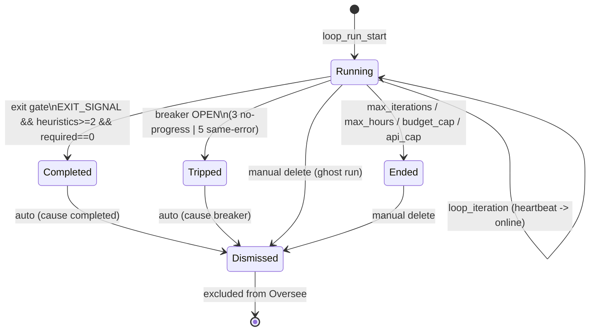
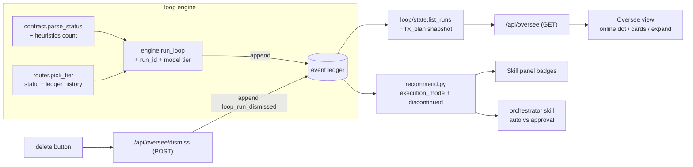

# feat: Oversee section, session lifecycle deletion, learning-gated skill execution, and orchestration increments

**Target repo:** `mindhive` (C:\Users\hanif\mindhive checkout; all paths below repo-relative)

---

## Summary

Add an **Oversee** dashboard section that shows live Claude work sessions (`hive loop` runs) with an online/offline indicator, an expandable per-session progress breakdown (done / doing / planned / not-yet), and lifecycle-driven removal: sessions disappear when the dual-condition exit gate passes, when the circuit breaker trips, or when the user deletes them manually. On top of the existing measured skill telemetry, add **learning-gated execution**: skills/plugins earn `auto` execution mode only with a proven track record, unproven ones stay suggest-only, failing ones are discontinued via their linked prevention rules, and loop iterations route to lighter models when depth isn't needed — escalating on measured failure.

## Problem Frame

The loop engine already implements the requested safeguards — `loop/safeguards.py` has the dual-condition exit gate and the circuit breaker (defaults already 3 no-progress / 5 same-error, `loop/config.py`) — but nothing in the dashboard shows a running loop: `loop/state.py` summarizes only the *last* run, there is no `/api/oversee` route, and finished runs linger in every projection forever (the store is append-only). Separately, the skill panel (landed on this branch) *measures* outcomes but does not *gate* on them: the orchestrator can auto-apply a never-used skill, a repeatedly failing skill keeps being recommended until its incident penalty happens to outweigh its score, and every loop iteration runs on one configured model regardless of task complexity. Memory hygiene has dedupe but no consolidation pass, and the agent still narrates memory provenance ("based on my memory…") instead of integrating it.

## Assumptions

Headless-planning inferences; each is the recommended reading of the request and can be revisited without invalidating the rest of the plan.

- **"Session" in Oversee = a `hive loop` run.** The requested mechanics (Ralph-style iterations, completion heuristics, `EXIT_SIGNAL: true`, stuck detection by files-unchanged / repeated-error counts) map one-to-one onto `loop_run_start` / `loop_iteration` / `loop_run_end` events. Interactive Claude Code sessions have no iteration contract to gate on.
- **"Delete" = projection-level dismissal, not physical deletion.** The event store is an append-only hash chain (`hive verify`); removing events would break chain verification for the whole project. Deletion is a `loop_run_dismissed` event that every Oversee projection excludes (KTD2).
- **Exit-gate strictness change is intended.** Requiring heuristics ≥ 2 *in addition to* the explicit signal tightens the current gate (today the explicit signal alone suffices). Implemented as specified, config-escapable (KTD3).
- **The Fable-5 memory narrative maps onto existing subsystems.** Typed JSON entries, tiered retrieval, and semantic vector search already exist (canonical-JSON events; ADR-0003 tiered context retrieval; `vectors.py`/chromadb). The real gaps are the consolidation ("dreaming") pass and the meta-comment prohibition — scoped as U10. Anthropic-internal mechanisms (prompt-cache breakpoint placement, `/mnt/memory` mounts, Mem0/Zep) are the CLI's/platform's concern or already-covered ground — see Scope Boundaries.
- **"Human-free GitHub workflow" already ships as `/engineering-loop`.** Only directive/skill-text clarity edits are in scope for the cross-cutting workflow principles (U9), not a new pipeline.

---

## Requirements

### Oversee section

- R1. The dashboard has an **Oversee** nav entry listing work sessions (loop runs) for the selected project, each titled by a one-line summary of what the run is doing.
- R2. Clicking a session title expands a progress detail: **done** (checked fix_plan items + past iteration summaries), **doing** (latest iteration summary), **planned** (unchecked required fix_plan items), and **not yet** (items under Future/Optional headings).
- R3. When a run is live, an **online/offline** indicator shows at the top of the section; it is absent when nothing is running. Live = `loop_run_start` without `loop_run_end` and a recent event heartbeat.
- R4. The section styling and refresh behavior match existing sections (cards/pills/hits CSS, `liveFn` 2.5 s silent refresh, project scoping).

### Session lifecycle & deletion

- R5. A session is removed from Oversee automatically when the run ends via the dual-condition exit gate (`reason=completed`) or the circuit breaker (`reason=breaker_open`).
- R6. The user can delete any session manually from the Oversee section (works for stale "running" ghosts too).
- R7. Deletion never breaks `hive verify`: it is an append-only dismissal event, and dismissed runs stay excluded after every projection rebuild.
- R8. The graceful exit gate requires **both** an explicit `EXIT_SIGNAL: true` **and** ≥ 2 natural-language completion heuristics in the reply text (configurable; required fix_plan items must also be complete, as today).

### Learning-gated skill/plugin execution

- R9. Every skill/plugin recommendation carries an **execution mode**: `auto` (proven: measured ≥ 3 calls, completion rate ≥ threshold, no open `skill:*` incident) or `suggest` (everything else — never-used skills are always suggest-only).
- R10. Skill outcomes surface in the panel with Improvements-style categories: success, failure, supervision-needed (agent-assessed with intervention), no-intervention-needed (clean auto run).
- R11. A skill whose linked prevention rule is active **and** whose trailing failure streak crosses a threshold is **discontinued**: excluded from recommendations and marked in the panel until its incident resolves or the user re-enables it.
- R12. The orchestrator consumes execution mode: auto-mode skills may be applied during the task without asking; suggest-mode skills are proposed and require user approval first.

### Dynamic model routing

- R13. Loop iterations route to a model tier by a deterministic complexity matrix (task size, historical failure signals); a lightweight-tier iteration that errors or trips breaker counters escalates the next iteration one tier. Each `loop_iteration` event records the model used so the matrix learns from ledger history.

### Orchestration & memory increments

- R14. Multiple loop runs can execute concurrently (distinct run ids); Oversee lists them all, and per-run projections do not bleed into each other.
- R15. The orchestrator skill documents parallel dispatch (independent tasks fan out to subagents/concurrent runs; dependent stages run sequentially with evaluation checkpoints that read failure logs and retry without user input).
- R16. A consolidation ("dreaming") command merges fragmented memory, archives stale entries, and rewrites the digest — bounded, manual/`session_end`-gated like reflect.
- R17. Recalled memory is integrated without mechanical meta-comments ("based on my memory", "my data shows"); enforced as a directive.

- C1 (constraint). Never disturb FABIO V17 `--live` / `LIVE_LOCK`; dashboard stays zero-dependency stdlib; hooks stay hang-proof; Windows/PowerShell environment; work lands on a feature branch, never `master`.

---

## Key Technical Decisions

- **KTD1 — Oversee reads the ledger; no new storage.** `list_runs()` projects `loop_run_start/iteration/end/dismissed` events plus the run's `.hive-loop/fix_plan.md` snapshot into per-run records. Real-time by construction (dashboard polls; events land as they're appended). Title = first line of PROMPT.md at start, superseded by the latest iteration `summary`.
- **KTD2 — Deletion is an append-only tombstone.** New deterministic event `loop_run_dismissed {run_id, cause: completed|breaker|manual}`. The engine appends it after `loop_run_end` when reason ∈ {completed, breaker_open}; the dashboard's delete button posts the manual variant. Projections filter dismissed run ids. Physical deletion is rejected because it breaks the hash chain (R7).
- **KTD3 — Exit-gate heuristics are additive and config-gated.** `contract.py` gains a completion-pattern counter (phrases like "all tasks have been completed", "everything is done", `STATUS: COMPLETE`, a fully-checked checklist echo). `should_exit` requires `exit_signal AND heuristic_count >= min_completion_heuristics AND required_remaining == 0`. Default `min_completion_heuristics = 2` per the request; `0` restores today's explicit-only behavior (loop.toml `[loop]`). Rationale: the request is explicit that BOTH conditions gate the graceful exit; the config knob keeps old task dirs runnable.
- **KTD4 — Execution mode is computed, never stored.** `recommend.py` derives `execution_mode` from existing measured stats + open incidents at read time (same pure-function style as the rest of the module). No new ledger writes; thresholds are module constants (`AUTO_MIN_CALLS = MEASURED_MIN_CALLS`, `AUTO_MIN_RATE = 0.8`). A stored flag would go stale the moment telemetry moves.
- **KTD5 — Discontinuation reuses the incident system.** `discontinued = active skill:<name> prevention rule AND failure streak ≥ DISCONTINUE_STREAK (3)`. Recovery is the existing incident lifecycle (rule resolves / dismissed) or an explicit `hive skills record <name> --ok`. No parallel blocklist to keep consistent.
- **KTD6 — Model routing is a deterministic tier table with measured escalation, not an LLM judgment.** Tiers `light → mid → heavy` (mapped to configurable model ids, default haiku/sonnet/opus class names in loop.toml). Initial tier from static signals (required fix_plan item count, prompt length); escalation from ledger signals (same-run error/no-progress events). Dynamic-learning = each run starts from the tier that last *succeeded* for this project's comparable task size, read from `loop_iteration.model` history. This honors "think it through, keep it dynamic" without adding an opaque scorer.
- **KTD7 — Concurrency by run id, not by a scheduler.** Each engine run mints a `run_id` stamped into its loop events; projections group by it. Parallelism = the user (or orchestrator) starting `hive loop` in several project/task dirs; the engine gets no in-process job scheduler. This delivers R14 with ~zero risk to the single-run path.
- **KTD8 — Consolidation follows the reflect pattern.** `hive consolidate` = bounded batch + cooldown marker + LIVE_LOCK guard, reusing `dedupe.py`/`hygiene.py` primitives; stale originals move to an archive segment rather than being destroyed (append-only discipline again).

---

## High-Level Technical Design

Session lifecycle (drives R5–R8; states map to `loop_run_*` events):

Component flow (directional guidance, not implementation spec):

---

## Implementation Units

### Phase 1 — Oversee (R1–R8)

### U1. Run projection: `list_runs()` and heartbeat

**Goal:** Project loop events into per-run records the dashboard can render.
**Requirements:** R1, R2, R3, R14 (grouping half)
**Dependencies:** none
**Files:** `src/mindhive/loop/state.py`, `src/mindhive/loop/engine.py` (run_id stamping), `tests/test_loop_state.py`, `tests/test_loop_engine.py`
**Approach:** Engine mints `run_id` (uuid4 hex or start-ts slug) into every `loop_run_start/iteration/end` payload; also records `goal_dir` (already present on start). `list_runs(project)` groups events by run_id (fallback: a legacy start groups everything until the next start, preserving old ledgers), returns `{run_id, title, status, online, iterations, done[], doing, planned[], not_yet[], total_cost_usd, total_tokens, started, last_event_ts}`. `online = status=="running" and now - last_event_ts < heartbeat_window` (default: iteration timeout + 60 s). Progress fields come from iteration summaries plus a fix_plan parse — extend `loop/task.py` with a `plan_items(fix_plan)` splitter returning (checked, unchecked-required, future/optional) using the regexes already there.
**Patterns to follow:** `last_run_status()` in `loop/state.py`; `required_remaining_count()` in `loop/task.py`.
**Test scenarios:**
  - Two interleaved runs (distinct run_ids) project into two records with non-bleeding iteration counts and costs.
  - A run with start + 2 iterations and no end reports `status="running"`; with a fresh `last_event_ts` it is `online=true`, with a stale one `online=false`.
  - Legacy events without run_id still produce one record (fallback grouping) — no crash, no dropped run.
  - fix_plan with checked, unchecked-required, and Future-heading items lands each in done/planned/not_yet respectively; empty fix_plan yields empty lists.
  - Title equals PROMPT.md first line at start and switches to the latest non-empty iteration summary.
**Verification:** `list_runs` returns correct records against a synthetic ledger in tests; `hive loop status` still works.

### U2. Dismissal lifecycle: `loop_run_dismissed`

**Goal:** Sessions leave Oversee on graceful exit, breaker trip, or manual delete — without touching the hash chain.
**Requirements:** R5, R6, R7
**Dependencies:** U1
**Files:** `src/mindhive/events.py` (register type), `src/mindhive/loop/engine.py`, `src/mindhive/loop/state.py`, `tests/test_loop_engine.py`, `tests/test_loop_state.py`, `tests/test_events.py`
**Approach:** Add `loop_run_dismissed` to `DETERMINISTIC_TYPES`. Engine appends it right after `loop_run_end` when `reason in {"completed", "breaker_open"}` with `cause` `completed`/`breaker`. `list_runs` excludes dismissed run_ids (but keeps a `dismissed` count for the section header if cheap). Manual dismissal is just an append with `cause:"manual"` — exposed via U3.
**Test scenarios:**
  - Engine run ending `completed` appends dismissal with cause `completed`; ending `breaker_open` appends cause `breaker`; ending `max_iterations`/`budget_cap` appends nothing.
  - A dismissed run no longer appears in `list_runs`; a manual dismissal of a still-`running` ghost also removes it.
  - `chain.verify` stays `ok` on a ledger containing dismissal events.
**Verification:** unit tests green; `hive verify` ok on a store exercised end-to-end.

### U3. Dashboard API: `/api/oversee` + `/api/oversee/dismiss`

**Goal:** Serve run records and accept manual deletion.
**Requirements:** R1, R3, R6
**Dependencies:** U1, U2
**Files:** `src/mindhive/dashboard.py`, `tests/test_dashboard.py`
**Approach:** `_get_oversee` returns `{runs: [...], any_online: bool}`; register in `_GET_ROUTES`. `_post_oversee_dismiss` validates `run_id`, appends the manual dismissal, returns `{ok: true}`; register in `_POST_ROUTES` (it mutates, so it stays behind the existing HIVE MIND read-only guard — reject `project=*`). Support `project=*` on GET by aggregating like `_get_improvements` does, labeling each run with its project.
**Test scenarios:**
  - GET returns runs for a project and `any_online` reflects a live run.
  - POST with a valid run_id appends the event and subsequent GET omits the run; POST with missing/unknown run_id returns an error payload, appends nothing.
  - POST with `project=*` is rejected by the read-only guard.
  - Both routes require the token (401 without).
**Verification:** `tests/test_dashboard.py` covers the four scenarios; manual smoke via `hive dashboard`.

### U4. Oversee view in the dashboard page

**Goal:** The user-facing section: online dot, titled cards, click-to-expand progress, delete button.
**Requirements:** R1, R2, R3, R4, R6
**Dependencies:** U3
**Files:** `src/mindhive/dashboard_page.py`, `tests/test_dashboard.py` (page contains nav entry + JS hooks)
**Approach:** New nav group **Work** above Memory with an **Oversee** button. `showOversee()` sets `liveFn = renderOversee`. Header strip: online/offline pill only when `any_online` (green pulsing dot reusing `.dot.busy`-style animation; absent otherwise per R3 — render nothing when no run is working). Each run renders as a `.hits li` card: status glyph (▶ running, ✔ completed-pending-dismiss, ⚡ tripped, ■ ended) + title + iterations/cost pills + mini **delete** button (confirm dialog, like `dismissLesson`). Clicking the title toggles an expanded body listing **Done / Doing / Planned / Not yet** groups; expansion state in a `Set` keyed by run_id so live refresh doesn't collapse it (mirror `IMP_EXPANDED`).
**Test scenarios:** Test expectation: rendering is exercised through `test_dashboard.py` page-content assertions (nav entry present, oversee JS function names present); interactive behavior is manual-smoke, consistent with how existing views are tested.
**Verification:** dashboard smoke: run `hive loop --dry-run`-seeded fake events, confirm card, expansion, delete, and online dot behave; other views unaffected.

### U5. Stricter exit gate: completion heuristics ≥ 2

**Goal:** Graceful exit only when the explicit signal AND ≥ 2 completion heuristics agree.
**Requirements:** R8
**Dependencies:** none (parallel to U1–U4)
**Files:** `src/mindhive/loop/contract.py`, `src/mindhive/loop/safeguards.py`, `src/mindhive/loop/engine.py`, `src/mindhive/loop/config.py`, `tests/test_loop_contract.py`, `tests/test_loop_safeguards.py`, `tests/test_loop_config.py`
**Approach:** `parse_status` gains `heuristic_count`: number of distinct completion patterns matched (curated list: "all tasks … complete(d)", "everything is done", "nothing left/remaining", `STATUS: COMPLETE`, an all-boxes-checked echo). `should_exit(status, required_remaining, json_mode, min_heuristics)` requires `exit_signal is True and status.heuristic_count >= min_heuristics` (in addition to the required-items check); `min_heuristics=0` reproduces current behavior, default from `LoopConfig.min_completion_heuristics = 2` (`[loop]` in loop.toml). Keep `exit_signal is False → continue` precedence. The loop prompt (`loop/prompt.py` contract text) tells the agent to state completion in prose *and* emit the signal, so a genuinely-done run passes the gate naturally.
**Test scenarios:**
  - Explicit signal + 0 heuristics → no exit (`reason no_completion_signal` variant); explicit + 2 heuristics + 0 required → exit `completed`.
  - Explicit + 2 heuristics + required items remaining → no exit.
  - `EXIT_SIGNAL: false` with 3 heuristics → continue (explicit veto wins).
  - `min_heuristics=0` restores the old explicit-only pass.
  - Config round-trip: loop.toml value overrides the default; missing key falls back to 2.
**Verification:** existing safeguard/engine tests updated and green; a dry-run loop against a canned COMPLETE transcript exits only under the dual condition.

### Phase 2 — Learning-gated execution (R9–R13)

### U6. Execution mode + outcome categories in recommend/panel

**Goal:** Proven skills run auto; unproven suggest-only; outcomes read like the Improvements categories.
**Requirements:** R9, R10, R12 (data half)
**Dependencies:** none
**Files:** `src/mindhive/recommend.py`, `src/mindhive/plugins.py` (stats: supervision/no-intervention derivation), `src/mindhive/dashboard.py` (`_get_skills_recommend` passthrough), `src/mindhive/dashboard_page.py` (badges), `tests/test_recommend.py`, `tests/test_plugins.py`
**Approach:** `score_skill` output gains `execution_mode`: `"auto"` iff `provenance=="measured" and completion_rate >= AUTO_MIN_RATE (0.8) and open_incidents == 0`, else `"suggest"`. Outcome category per skill derived at read time from existing ledger events: `failure` (last outcome fail), `supervision-needed` (`agent-assessed` provenance on recent records — the in-session write-through channel), `no-intervention-needed` (recent invoke-channel successes), `success` (measured rate ≥ threshold overall). Panel shows a mode badge (`auto` green pill / `suggest` amber pill) and the category chip next to the status dot.
**Patterns to follow:** provenance handling and pill styling already in `recommend.py` / skill panel.
**Test scenarios:**
  - Skill with 5/5 measured ok, no incidents → `auto`; same with one open `skill:*` incident → `suggest`.
  - 2 calls (below MEASURED_MIN_CALLS) with 100% rate → `suggest` (never-used/unproven can't auto).
  - Measured 0.6 rate → `suggest` (below AUTO_MIN_RATE).
  - Category derivation: last-fail → failure; agent-assessed recents → supervision-needed; invoke-channel ok streak → no-intervention-needed.
**Verification:** `hive skills recommend --json` includes `execution_mode`; panel renders badges.

### U7. Discontinuation via linked prevention rules

**Goal:** A failing method is stopped, not just down-ranked — and comes back through the incident lifecycle.
**Requirements:** R11
**Dependencies:** U6
**Files:** `src/mindhive/recommend.py`, `src/mindhive/incidents.py` (expose active-rule lookup if not already queryable), `src/mindhive/dashboard_page.py`, `tests/test_recommend.py`
**Approach:** `discontinued = has_active_skill_rule and failure_streak >= DISCONTINUE_STREAK (3)` where failure_streak = trailing consecutive failed calls from stats. Discontinued entries are excluded from `recommendations` (listed in a separate `discontinued` array with the triggering rule text so the UI/orchestrator can show *why*), never granted `auto`, and recover when the incident resolves/dismisses or a new successful call breaks the streak.
**Test scenarios:**
  - Active `skill:x` rule + 3 trailing failures → x absent from recommendations, present in `discontinued` with reason.
  - Same rule but streak 2 → still recommended (penalized, as today).
  - Streak 3 but rule dismissed → not discontinued.
  - A subsequent `--ok` record breaks the streak → skill returns to the ranked list.
**Verification:** recommend output shape asserted in tests; panel shows a `discontinued` marker.

### U8. Dynamic model routing for loop iterations

**Goal:** Route iterations to the lightest sufficient model; escalate on measured failure; learn the starting tier from history.
**Requirements:** R13
**Dependencies:** U1 (model recorded per iteration event)
**Files:** `src/mindhive/loop/router.py` (new), `src/mindhive/loop/config.py`, `src/mindhive/loop/engine.py`, `tests/test_loop_router.py` (new), `tests/test_loop_engine.py`, `tests/test_loop_config.py`
**Approach:** `[model.tiers]` in loop.toml maps `light/mid/heavy` to model ids (defaults naming the current lightweight/mid/flagship claude aliases; explicit `[model].model` set by the user bypasses routing entirely — user choice wins). `pick_initial_tier(tasks, history)`: start from static size signals (required item count, prompt length thresholds), then override with the lowest tier that completed a comparable-size run for this project in ledger history. `escalate(tier)` bumps one level; engine escalates when the previous iteration had `error_sig` or no progress, and stamps `model` into each `loop_iteration` payload. Pure functions; engine wiring mirrors how the breaker is consulted.
**Execution note:** implement router pure functions test-first; engine wiring after.
**Test scenarios:**
  - Small fix_plan (≤2 required, short prompt) with no history → light; large plan → heavy.
  - History showing light-tier completed a comparable run → start light even for a mid-sized plan; history showing light failed → start mid.
  - Iteration error escalates the next iteration light→mid→heavy and never past heavy.
  - Explicit `model` in config bypasses routing (router never consulted).
  - `loop_iteration` events carry the model actually used.
**Verification:** dry-run output (`hive loop --dry-run`) prints the projected tier; router tests green.

### Phase 3 — Orchestration & memory increments (R14–R17)

### U9. Orchestrator/engineering-loop skill updates: auto-vs-approval, parallel dispatch, checkpoints

**Goal:** The orchestrator consumes execution modes and documents the parallel/dependent-stage protocol.
**Requirements:** R12 (behavior half), R15, and the cross-cutting workflow principles
**Dependencies:** U6, U7
**Files:** `skills/mindhive-orchestrator/SKILL.md`, `skills/engineering-loop/SKILL.md`, `commands/mindhive.md`, `tests/test_mindhive_orchestrator_skill.py`, `tests/test_engineering_loop_skill.py`
**Approach:** Recommendation Matrix section reads `execution_mode`/`discontinued` from `hive skills recommend --json`: auto-mode skills apply without asking; suggest-mode listed as proposals awaiting approval; discontinued skills shown with their rule, never invoked. Add a **parallel dispatch** subsection: independent tasks fan out (subagents or concurrent `hive loop` runs per KTD7); dependent stages run sequentially with an evaluation checkpoint that on failure reads the failure log/stack trace, re-verifies assumptions, and retries within the loop's existing breaker/budget bounds — never bouncing back to the user on first failure. Fold the one-question-at-a-time and codebase-first-facts rules (already partially present) into a single clarity protocol paragraph.
**Test scenarios:** the two skill test files assert the presence of the load-bearing strings (execution-mode consumption, discontinued handling, parallel/checkpoint protocol), consistent with how those tests already validate skill text.
**Verification:** skill tests green; `/mindhive` matrix renders modes when run manually.

### U10. Memory consolidation ("dreaming") + meta-comment prohibition

**Goal:** Bounded consolidation pass; recalled memory integrates naturally without provenance narration.
**Requirements:** R16, R17
**Dependencies:** none
**Files:** `src/mindhive/hygiene.py` or new `src/mindhive/consolidate.py`, `src/mindhive/__main__.py` (CLI subcommand), `src/mindhive/directives.py`, `tests/test_hygiene.py` or new `tests/test_consolidate.py`, `tests/test_directives.py`, `tests/test_cli.py`
**Approach:** `hive consolidate [--limit N]`: reuse `dedupe.py` similarity to merge near-duplicate semantic events into one surviving digest record, mark stale superseded entries (append a `rule_expired`-style tombstone or archive segment move — follow the append-only discipline of KTD2), and rewrite the MEMORY.md digest via the existing `sync` path. Cooldown marker + LIVE_LOCK guard copied from the reflect pattern (KTD8). `directives.py` gains a §: never cite memory mechanically ("based on my memory", "my records show"); state recalled facts plainly or as shared context ("as we discussed").
**Test scenarios:**
  - Two near-duplicate caveats consolidate to one surviving entry; unrelated events untouched.
  - Consolidation respects the batch limit and the cooldown marker (second run within cooldown is a no-op).
  - LIVE_LOCK present → refuses without `--force`.
  - `hive verify` ok after a consolidation pass.
  - Directives text includes the prohibition (string assertion, matching existing directives tests).
**Verification:** CLI run on a synthetic store shrinks duplicates, digest rebuilt, chain verifies.

---

## Scope Boundaries

**In scope:** everything under Implementation Units, on branch work in this repo.

**Out of scope (not this product's concern):**
- Anthropic-internal Fable 5 mechanics — prompt-cache breakpoint placement, `/mnt/memory` sandbox mounts, Managed Agents framework internals. MindHive drives the `claude` CLI; cache geometry belongs to the CLI/platform. The existing late-context injection (STATE.md via `--append-system-prompt`) already follows the "dynamic memory appended late" principle.
- Mem0/Zep integration — semantic vector retrieval already exists (`vectors.py`/chromadb, `hive recall --semantic`); adding a third-party memory layer duplicates it.
- Physical event deletion or ledger rewriting — breaks the hash chain by design.
- An in-process multi-agent scheduler inside the loop engine — concurrency is delivered by run-id separation (KTD7); a scheduler is a separate project-sized effort.

**Deferred to follow-up work:**
- Per-iteration live transcript streaming into the Oversee detail (needs `stream-json` plumbing through the driver).
- Auto-starting parallel `hive loop` runs *from* the dashboard (Oversee is read+dismiss for now; starting runs stays CLI/orchestrator-driven).
- A learned (regression-based) routing matrix replacing the tier table once enough `loop_iteration.model` history accumulates.
- Vector-index maintenance inside `hive consolidate` (re-embed after archive) — run `hive embed --force` manually after large consolidations until then.

---

## Risks & Dependencies

- **Exit-gate tightening can strand legacy task dirs** whose prompts never elicit prose completion statements. Mitigated by the loop-prompt contract update (U5) and the `min_completion_heuristics=0` escape hatch.
- **Auto-dismissal hides post-mortem context** for tripped runs. Mitigated: dismissal removes runs from *Oversee* only; all events remain in the ledger, and breaker trips still flow into the Improvements loop via existing failure capture.
- **Model-tier aliases drift** as model names change. Mitigated: tiers are config-mapped names, not hardcoded ids; defaults live in one place (`loop/config.py`).
- **Heartbeat false-offline** on very long single iterations. Window derives from `iteration_timeout_minutes` + slack, so a legal iteration can't exceed it.
- **Windows/PS 5.1 quoting** for any new CLI examples — follow the existing stdin-JSON convention in README.

---

## Sources & Research

- Exit gate + breaker already implemented: `src/mindhive/loop/safeguards.py` (thresholds default 3/5 in `src/mindhive/loop/config.py`) — the request's numbers are already the defaults.
- Contract parsing (`EXIT_SIGNAL`, `STATUS`): `src/mindhive/loop/contract.py`; Ralph precedence documented inline.
- Run summarization precedent: `src/mindhive/loop/state.py` (`last_run_status`).
- Dashboard route/view conventions: `src/mindhive/dashboard.py` (`_GET_ROUTES`/`_POST_ROUTES`, HIVE MIND read-only guard), `src/mindhive/dashboard_page.py` (`liveFn`, `IMP_EXPANDED`, card/pill CSS).
- Measured recommendation engine + provenance: `src/mindhive/recommend.py` (KTD6 of the 2026-07-05 plan); telemetry events registered in `src/mindhive/events.py`.
- Tiered retrieval already decided: `docs/adr/0003-tiered-context-retrieval.md`; append-only/verify discipline: `docs/adr/0006`, `CONTEXT.md` (golden parity gate, storage backend).
- Prior plan this branch shipped: `docs/plans/2026-07-05-001-feat-learning-loop-skill-panel-plan.md` (KTD5/KTD6 there define the stats/provenance this plan gates on).
