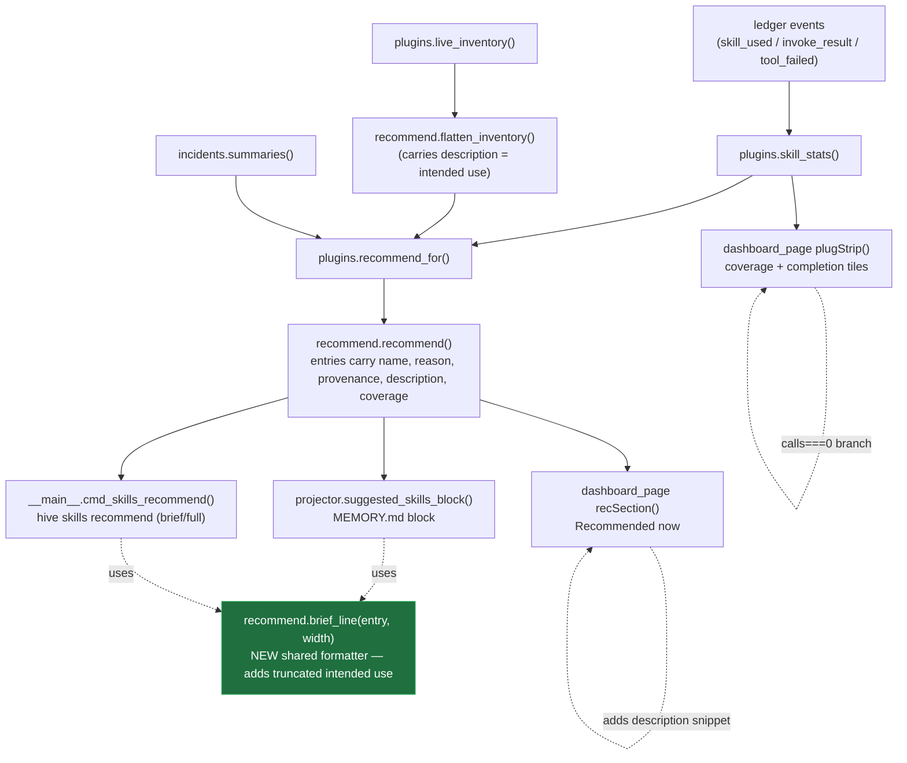

# fix: Surface skill intended-use in auto-triggered recommendations + honest cold-start coverage

## Summary

The deterministic skill-recommendation engine (`src/mindhive/recommend.py`) already runs
**automatically** — `projector.suggested_skills_block()` calls `plugins.recommend_for()` on every
projection rebuild, so the `# SUGGESTED SKILLS (deterministic — hive skills recommend)` block is
regenerated into `STATE.md` / `MEMORY.md` each session with no manual step. Two things are wrong,
and they map exactly to the two asks:

1. **The AI can't grasp the scope of each skill.** Every recommendation surface (the projector's
   `MEMORY.md` block, `hive skills recommend`, and the dashboard "Recommended now" section) prints
   `name — reason (provenance)` and **omits the skill's description — its *intended use*.** The
   recommend entries already carry `description`; it is simply dropped before rendering. So the
   agent reading `MEMORY.md` sees `nodejs-backend-patterns — never called — breadth-estimated,
   matches current needs (estimated)` with no statement of what the skill is *for*.

2. **The Skills panel shows "0 of 276" and "completion rate · 0/0 calls".** These are honest
   cold-start values from `plugStrip()` in `src/mindhive/dashboard_page.py` (measured-coverage
   tile + completion-rate sublabel), but they render as if something is broken. At zero recorded
   calls the panel should say so in words, not print `0/0`.

This plan surfaces each recommended skill's intended use consistently across all three surfaces
(via one shared formatter, so they can't drift), adds a light adherence nudge to the block header,
and makes the cold-start coverage/completion tiles read honestly.

---

## Problem Frame

**Who is affected:** the agent that auto-loads `MEMORY.md` at session start (it must "fully grasp
the scope of my skills" to pick the right one), and the human reading the dashboard Skills panel.

**Why it matters:** a recommendation without the skill's intended use forces the agent to already
know what `nodejs-backend-patterns` does, defeating the point of a recommendation. And a panel
that says "0 of 276 / 0/0" reads as a bug, undermining trust in the whole learning-loop surface.

**Root causes (verified in code):**

- `src/mindhive/projector.py` → `suggested_skills_block()` renders `f"- {e['name']} — {e['reason']} ({e['provenance']})"`
  — no `e['description']`.
- `src/mindhive/__main__.py` → `cmd_skills_recommend()` renders the same shape in `--brief`
  (`{name} — {reason} ({provenance})`) and a `[score, provenance]` + `reason` line in full mode —
  neither includes the description.
- `src/mindhive/dashboard_page.py` → `recSection()` renders name/provenance/mode/score/reason for
  each rec but no description (the full card list *does* show `e.trigger`, but the ranked
  "Recommended now" section does not).
- `src/mindhive/dashboard_page.py` → `plugStrip()` renders `(cov.measured ?? 0) + ' of ' + (cov.total …)`
  and a completion-rate sublabel `ok + '/' + calls + ' calls'`; at cold-start these are `0` and
  `0/0`. The big rate value is already guarded to `—`; the **sublabel and the measured tile are
  not** guarded for the zero-calls case.

---

## Assumptions

*(Headless/pipeline run — these decisions were made without a confirmation gate. Each is a
correctable bet; the first is load-bearing and gates the whole plan.)*

1. **Branch base — this work targets `feat/oversee-interactive-sessions`, not `master`.** The task
   branch `claude/estimated-auto-trigger-completion-fix-a42482` was cut from `master`, but every
   file to be changed (`recommend.py`, the new `projector.py`, `plugins.skill_stats`/`recommend_for`,
   the dashboard skill panel) exists **only** on `feat/oversee-interactive-sessions` (tip
   `7243b29`). `master` has none of it. The task branch has **zero commits beyond master**, so it
   can be safely retargeted. See **Prerequisites** — this must happen before any Implementation
   Unit. The PR for this fix should target `feat/oversee-interactive-sessions` (or that feature
   must merge to `master` first). Per project standing guidance, **do not** merge the feature into
   `master` to make this work; base the fix on the feature instead.

2. **"0 of 276 / 0/0" is cold-start display honesty, not a data-wiring bug.** Telemetry capture is
   wired: `hooks` emit `skill_used`, and `invoke_result` / `tool_failed` feed
   `plugins.skill_stats`; the dashboard fetches `/api/skills/stats` and assigns `PLUG_STATS`
   correctly. The zeros reflect that no skill has ≥3 recorded calls yet in the viewed project. The
   fix is to render the zero state in words. A *possible* deeper cause — skill calls recorded under
   a different project namespace than the panel's selected project — is **deferred** to a follow-up
   investigation rather than assumed here (see Scope Boundaries).

3. **Intended use = the skill's `description`** (the `trigger` / frontmatter description that
   `flatten_inventory` already threads into each recommend entry as `description`). No new data
   source is needed.

4. **Truncation width for the `MEMORY.md` block:** intended-use text is truncated to keep the
   auto-loaded briefing compact (`MEMORY.md` is read every session). Default target ~140 chars with
   an ellipsis; exact constant chosen at implementation. Full descriptions remain available in the
   dashboard card list and `hive skills detail`.

---

## Requirements

- **R1** — Every recommendation surface states each recommended skill's intended use (its
  description), so an agent can grasp scope without prior knowledge of the skill. Covers ask #1.
- **R2** — The `MEMORY.md` `SUGGESTED SKILLS` block remains compact (bounded lines, truncated
  intended use) and continues to regenerate automatically on every projection rebuild.
- **R3** — Provenance honesty is preserved: `measured` vs `estimated` still labels every entry;
  surfacing intended use must not make an estimate look measured.
- **R4** — The block header nudges the agent to consult each skill's intended use before invoking.
- **R5** — At zero recorded calls, the Skills panel shows an honest, worded state instead of
  `completion rate · 0/0 calls`; the measured-coverage tile reads clearly (not a bare "0 of 276").
- **R6** — All three text surfaces (projector block, CLI brief, CLI full) render intended use via
  one shared formatter so they cannot drift.
- **R7** — No regression: an empty recommendation set still yields an empty block ("" from the
  projector); a recommendation failure must never break the state build.

---

## Key Technical Decisions

- **KTD1 — One shared brief-line formatter in `recommend.py`.** Add a pure function
  `brief_line(entry, width=…) -> str` (name + reason + provenance + truncated intended use). The
  projector block and both CLI modes call it, satisfying R6 and keeping `recommend.py` (already the
  single engine behind all surfaces) as the one place format lives. Rationale: the three surfaces
  already duplicate `f"{name} — {reason} ({provenance})"`; centralizing prevents the intended-use
  clause from being added to two of three and forgotten in the third.
- **KTD2 — Truncate intended use for text surfaces, full text for the web card.** `MEMORY.md` and
  CLI brief truncate (KTD Assumption 4); the dashboard card list already shows the full description
  and stays as-is. This honors R2 (compact briefing) without hiding detail where space allows.
- **KTD3 — Cold-start rendering is a `calls === 0` branch in `plugStrip()`, not new data.** Keep
  the honest counts when calls > 0; only replace the `0/0` sublabel and clarify the measured tile
  when calls === 0. Rationale: minimal, reversible, and does not touch the telemetry pipeline.
- **KTD4 — Header adherence nudge, not enforcement.** R4 is met by one line in the block header
  ("consult each skill's intended use before invoking"), not a runtime gate. The learning-gated
  `execution_mode` (`auto` vs `suggest`) already governs what may run automatically; this plan does
  not change that gate.

---

## High-Level Technical Design

The recommendation already flows from telemetry to three surfaces. This plan adds the
intended-use clause at the render boundary of each surface (via one formatter) and fixes the
cold-start branch of the dashboard strip. Nothing upstream of rendering changes.

*Directional — the boxes are existing functions; only `brief_line` is new, plus the two render
tweaks (`recSection` description snippet, `plugStrip` cold-start branch).*

---

## Prerequisites

**P0 — Retarget the working branch onto the feature (do this first, in `ce-work`).** The task
branch equals `master` and lacks all target files. Rebase/retarget it onto
`feat/oversee-interactive-sessions` (tip `7243b29`) so the feature code is present, then create the
fix commits on top. The eventual PR base is `feat/oversee-interactive-sessions`. This is a hard gate:
none of the Implementation Units can be applied until the target files exist in the tree.

---

## Implementation Units

### U1. Shared intended-use brief formatter in the recommend engine

- **Goal:** One pure function that renders a recommendation as a compact line including the skill's
  truncated intended use, so all text surfaces share it (R1, R3, R6).
- **Requirements:** R1, R3, R6.
- **Dependencies:** P0.
- **Files:**
  - `src/mindhive/recommend.py` (add `brief_line()` + a truncation constant)
  - `tests/test_recommend.py` (extend, or add if absent)
- **Approach:** Add `brief_line(entry, width=INTENDED_USE_WIDTH) -> str` returning
  `"{name} — {reason} ({provenance})"` and, when `entry['description']` is non-empty, appending a
  clearly-delimited intended-use clause with the description truncated to `width` (ellipsis on
  overflow, trim on a word boundary if cheap). Do not alter provenance text. Keep it pure (no disk,
  no ledger). Export the truncation constant so callers/tests can reference it.
- **Patterns to follow:** existing pure-helper style in `recommend.py` (`_reason`, `breadth_prior`);
  keyword/word helpers show the module's plain-stdlib idiom.
- **Test scenarios:**
  - `measured` entry with a description → line contains name, `measured N/M completion`,
    `(measured)`, and the description text.
  - `estimated` entry, never called → line contains `never called — breadth-estimated`,
    `(estimated)`, and the description; provenance still reads `estimated` (R3).
  - description longer than `width` → truncated with an ellipsis; length ≤ `width` (+ellipsis).
  - empty/whitespace description → intended-use clause omitted entirely; no trailing delimiter.
  - description with the delimiter character embedded → not mis-parsed / no crash.
- **Verification:** `pytest tests/test_recommend.py` green; `brief_line` importable from
  `mindhive.recommend`.

### U2. Projector SUGGESTED SKILLS block surfaces intended use + adherence nudge

- **Goal:** The auto-generated `MEMORY.md` block states each recommended skill's intended use and
  nudges the agent to honor it (R1, R2, R4, R7).
- **Requirements:** R1, R2, R4, R7.
- **Dependencies:** U1.
- **Files:**
  - `src/mindhive/projector.py` (`suggested_skills_block`)
  - `tests/test_projector.py` or `tests/test_graph.py` (extend whichever covers state composition)
- **Approach:** Replace the inline `f"- {e['name']} — {e['reason']} ({e['provenance']})"` with a
  call to `recommend.brief_line(e)` (prefixed `- `). Add one header sub-line under the existing
  `# SUGGESTED SKILLS …` header nudging the agent to consult each skill's intended use before
  invoking (R4). Preserve the `SUGGEST_CAP` cap and the "empty string on ANY failure" contract
  (R7). Keep the lazy import of the plugins/recommend stack.
- **Patterns to follow:** the existing `try/except → return ""` isolation and `SUGGEST_CAP` slice in
  `suggested_skills_block`.
- **Test scenarios:**
  - recs present → block contains each skill's name **and** its (truncated) intended-use text and
    the adherence-nudge header line.
  - no recs → returns `""` (R7).
  - `recommend_for` raises → returns `""`, state build unaffected (R7).
  - block honors `SUGGEST_CAP` (no more than cap skills).
  - `Covers` — provenance label still present per line (R3).
- **Verification:** `pytest` for the projector/state tests green; a manually composed state string
  contains the intended-use text.

### U3. `hive skills recommend` surfaces intended use (brief + full)

- **Goal:** The CLI shows intended use in both `--brief` and full output (R1, R6).
- **Requirements:** R1, R6.
- **Dependencies:** U1.
- **Files:**
  - `src/mindhive/__main__.py` (`cmd_skills_recommend`)
  - `tests/test_cli_new.py` (extend)
- **Approach:** In `--brief`, print `recommend.brief_line(e)` instead of the local f-string. In full
  mode, add an intended-use line beneath the existing `reason` line (full width or a wider
  truncation, since the terminal has room). Leave the `[score, provenance]` and `alt:` lines intact.
- **Patterns to follow:** existing print loop in `cmd_skills_recommend` (lines ~352–368 on tip).
- **Test scenarios:**
  - `--brief` output for a skill with a description contains the description text and the
    `(provenance)` suffix.
  - full output contains an intended-use line for the primary recommendation.
  - a skill with an empty description prints cleanly (no dangling delimiter) in both modes.
- **Verification:** `pytest tests/test_cli_new.py` green; `python -m mindhive skills recommend --brief`
  shows intended use locally.

### U4. Dashboard "Recommended now" section shows intended use

- **Goal:** The ranked "Recommended now" list shows each skill's intended use, matching the text
  surfaces (R1).
- **Requirements:** R1.
- **Dependencies:** P0.
- **Files:** `src/mindhive/dashboard_page.py` (`recSection`)
- **Approach:** In the `recs.map(...)` render, append a description snippet for each rec when
  `r.description` is present — mirror the existing `.snip` styling used by the full card list
  (`e.trigger`). No new endpoint: `recommend_for` entries already carry `description`, returned via
  `/api/skills/recommend`. Verify the served payload includes `description` per entry (it does —
  `score_skill` returns it); if a future trim drops it, keep it.
- **Patterns to follow:** the `.snip` / `.snip.dup` rows already used in `recSection` for `reason`
  and in `skillCard` for `e.trigger`.
- **Test scenarios:** `Test expectation: none — client-side render with no Python test harness.`
  Behavioral check belongs to browser verification (see Verification), not pytest.
- **Verification:** exercised in `ce-test-browser`: open the Skills panel, confirm each
  "Recommended now" row shows the skill's intended-use text.

### U5. Honest cold-start coverage + completion tiles

- **Goal:** At zero recorded calls the Skills panel reads honestly instead of "0 of 276 /
  completion rate · 0/0 calls" (R5).
- **Requirements:** R5.
- **Dependencies:** P0.
- **Files:** `src/mindhive/dashboard_page.py` (`plugStrip`)
- **Approach:** In `plugStrip()`:
  - Completion-rate tile: when `calls === 0`, render the sublabel as a worded zero state (e.g.
    "no calls recorded yet") rather than `ok + '/' + calls + ' calls'`. Keep the existing `—` big
    value. When `calls > 0`, keep the current `N/M calls` sublabel unchanged.
  - Measured-coverage tile: keep `measured of total`, but when `measured === 0` add a brief
    clarifying sublabel (e.g. "start calling skills to measure") so "0 of 276" reads as a state,
    not an error. Keep the `cov.total ?? skills_total` fallback.
- **Patterns to follow:** the existing `calls ? … : '—'` guard already in `plugStrip` (line
  ~801 on tip); extend the same conditional to the sublabel.
- **Test scenarios:** `Test expectation: none — client-side render with no Python test harness.`
  Behavioral check belongs to browser verification.
- **Verification:** in `ce-test-browser`, load the panel against a project with zero skill calls and
  confirm the worded state; against a project with calls, confirm the real `N/M` / percentage
  still shows.

---

## Scope Boundaries

**In scope:** surfacing intended use across the projector block, CLI (brief + full), and the
dashboard "Recommended now" section via one shared formatter; an adherence-nudge header line; the
cold-start rendering of the coverage/completion tiles.

**Out of scope (not this product's job here):**

- Changing the learning-gated `execution_mode` (`auto` vs `suggest`) policy or `AUTO_MIN_RATE`.
  "Estimated" skills remain suggest-only by design; the ask is to make them *understandable*, not
  auto-runnable.
- Altering telemetry capture, dedup, or the `MEASURED_MIN_CALLS` threshold.

### Deferred to Follow-Up Work

- **Project-scoping audit of skill telemetry.** Investigate whether skill calls can be recorded
  under a different project namespace than the dashboard's selected project (which would make
  measured-coverage read 0 even when calls exist elsewhere). If confirmed, reconcile
  `skill_stats(project=…)` scoping with the panel's project selector. Assumption 2 treats the
  current zeros as genuine cold-start; this follow-up tests that assumption.
- **Full-description-on-demand in the CLI** (e.g. a `--verbose` that prints untruncated intended
  use) if truncation proves too tight in practice.

---

## Risks & Dependencies

- **R-risk1 (high) — branch base.** If P0 is skipped, `ce-work` will edit non-existent files or, worse,
  re-implement the feature on `master`. Mitigation: P0 is a hard gate; the PR targets
  `feat/oversee-interactive-sessions`.
- **R-risk2 (medium) — PR surface.** A PR from a branch retargeted onto the feature must use the
  feature as its base, or it will show the entire feature diff against `master`. Mitigation:
  `ce-commit-push-pr` should set `--base feat/oversee-interactive-sessions`.
- **R-risk3 (low) — `MEMORY.md` bloat.** Adding intended use to every suggested line lengthens the
  auto-loaded briefing. Mitigation: truncation (KTD2) + the existing `SUGGEST_CAP` cap.
- **R-risk4 (low) — format drift regression.** Tests assert the projector/CLI shape; changing the
  shared formatter must keep provenance labels (R3) — covered by U1/U2/U3 scenarios.

---

## Verification Strategy

- **Python units (U1–U3):** `pytest` — new/extended tests in `tests/test_recommend.py`,
  `tests/test_projector.py` (or `test_graph.py`), `tests/test_cli_new.py`. Run the full suite to
  confirm no regression in state composition or CLI output.
- **UI units (U4–U5):** browser verification via `ce-test-browser` against the Skills panel — one
  project with zero skill calls (cold-start wording) and, if available, one with recorded calls
  (real coverage + intended-use snippets).
- **End-to-end sanity:** rebuild a projection (`python -m mindhive` sync/project path) and confirm
  the regenerated `STATE.md` / `MEMORY.md` `SUGGESTED SKILLS` block carries intended use and the
  adherence nudge.

---

## Sources & Research

- `src/mindhive/recommend.py` (feature branch) — engine; entries carry `description`, `reason`,
  `provenance`, `coverage`.
- `src/mindhive/projector.py` — `suggested_skills_block()` auto-generation into `STATE.md`.
- `src/mindhive/plugins.py` — `skill_stats()`, `recommend_for()`, `_skill_calls()` telemetry;
  `flatten_inventory` threads `description`.
- `src/mindhive/dashboard_page.py` — `plugStrip()` (coverage/completion tiles), `recSection()`
  ("Recommended now"), `skillCard()` (full card list already shows the description).
- `src/mindhive/dashboard.py` — `/api/skills/stats`, `/api/skills/recommend` endpoints.
- `src/mindhive/hookcapture.py`, `hooks/session_start.ps1` — `skill_used` capture + stale-gated
  autoscan (confirms telemetry/recommend already fire automatically).
- All feature code verified on `feat/oversee-interactive-sessions` (tip `7243b29`); confirmed
  **absent** from `master` and the current task branch.
