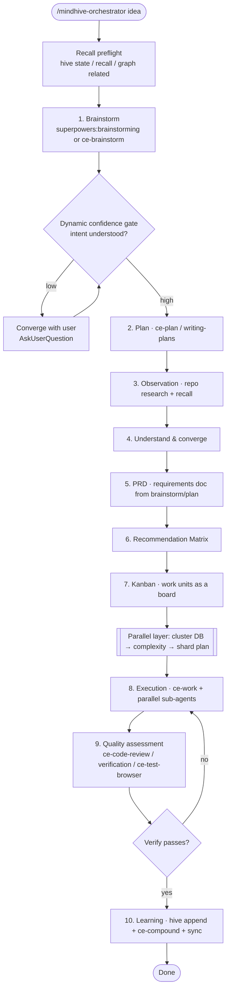
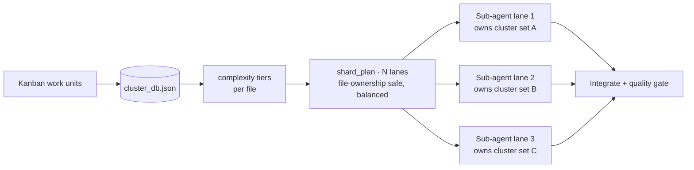

# feat: `/mindhive-orchestrator` — one sequential, dynamic pipeline + a parallel multi-agent execution layer

**Target repo:** mindhive

## Summary

Consolidate MindHive's centralized "idea → executed work" pipeline behind a single trigger, `/mindhive-orchestrator`, and rebuild it as a **ten-stage sequential workflow** — brainstorm → plan → observation → understand/converge → PRD → matrix → kanban → execution → quality assessment → learning. The workflow's **main execution engine is restricted to the `superpowers` and `compound-engineering` plugins** (either may run, or both may be combined per stage); every other installed skill/plugin is a **complement/sub** that only raises quality, never the backbone. Each stage advances through a **dynamic confidence gate**: when the AI's understanding of the user's intent is high (from recall + codebase exploration), it auto-advances (automatic); when it is low, it pauses to converge with the user (semi-automatic). At the execution stage, an **upper parallel-orchestration layer ("like Fable 5")** kicks in: a deterministic Python module builds a **cluster database** of the repo, **classifies file complexity**, and emits a **file-ownership-safe shard plan** the orchestrator uses to dispatch **parallel sub-agents** via the Task/Agent tool.

The centralized pipeline is **removed as a responsibility from `/circle`, `/mindhive`(`mindhive:mindhive`), and `mindhive:circle`** — those revert to being narrow primitives (the headless loop) that the orchestrator may call, not competing front doors to the pipeline.

---

## Problem Frame

MindHive today spreads "run a whole piece of work end-to-end" across three overlapping surfaces: `/mindhive` (the 4-phase orchestrator), `/circle` (the headless autonomous loop), and `/engineering-loop` (a circle×lfg fusion). A user cannot tell which is *the* pipeline, and the orchestrator's execution stage is single-threaded — it chains one skill at a time with no notion of sharding independent work across agents. The user wants: (1) exactly one canonical pipeline, triggered only by `/mindhive-orchestrator`; (2) a richer, explicitly-sequenced workflow whose backbone is strictly the two highest-signal plugins already on the machine (`superpowers`, `compound-engineering`); (3) a pipeline that is *dynamic* — it decides for itself when it understands the user well enough to proceed automatically versus when it must stop and ask; and (4) a parallel multi-agent execution layer that classifies the codebase and fans work out to sub-agents instead of grinding serially.

---

## Assumptions

_Pipeline mode ran this plan headless; the following are inferred decisions the user can correct._

- **A1. "Remove the centralized pipeline from `/circle`, `/mindhive:mindhive`, `/mindhive:circle`" means decouple, not delete the framework.** `/circle` stays as the pure headless-loop primitive; the orchestrator may *drive* it, but circle no longer frames itself as the end-to-end pipeline. The old `/mindhive` front door (`commands/mindhive.md`) is retired so the orchestrator is reachable *only* via `/mindhive-orchestrator`.
- **A2. `/engineering-loop` is not named by the user but is a second centralized pipeline.** To honor "the trigger I want /mindhive-orchestrator only," it is reframed as a subordinate **execution engine** the orchestrator's execution stage may invoke — not a competing front door. Its file is kept; its framing changes. (If the user prefers it deleted, that is a one-line scope change.)
- **A3. "PRD" is satisfied by the requirements document that `compound-engineering:ce-brainstorm` / `ce-plan` already emit** (`docs/brainstorms/*-requirements.md`, `docs/plans/*-plan.md`). No separate PRD templating engine is introduced; a non-backbone PRD skill may complement it.
- **A4. "Cluster database" is a derived, overwrite-in-place JSON sidecar** (`cluster_db.json`), following the existing `plugin_catalog.json` pattern — not a new persistent datastore, schema, or service.
- **A5. The parallel layer's Python scope is the deterministic *planner*** (cluster + complexity + shard plan). Actual parallel sub-agent execution is orchestrated by the SKILL via the Task/Agent tool using `superpowers:dispatching-parallel-agents` — Python never spawns agents.
- **A6. Backbone = `superpowers` + `compound-engineering` only.** Candidate skill names are still resolved verbatim from the session available-skills list at run time; the restriction is enforced in the SKILL's stage→skill mapping, not in code.

---

## Requirements

**Trigger consolidation**

- R1. The centralized pipeline is triggered **only** by `/mindhive-orchestrator` (a new slash command) and the model-invoked `mindhive-orchestrator` skill.
- R2. `/circle`, the retired `/mindhive` surface, and `mindhive:circle` no longer host or advertise the centralized pipeline; `/circle` remains the headless-loop primitive.
- R3. The `mindhive-orchestrator` skill frontmatter advertises `/mindhive-orchestrator` (not `/mindhive`) as its trigger, so activation and the plugin manifest stay consistent.

**Sequential dynamic workflow**

- R4. The skill runs a ten-stage sequence in order: **brainstorm → plan → observation → understand-and-converge → PRD → recommendation matrix → kanban → execution → quality assessment → learning**.
- R5. Each stage's **main execution** uses only `superpowers` and/or `compound-engineering` skills; the skill names one backbone skill (or a combination) per stage, resolved verbatim from the available-skills list.
- R6. Non-backbone skills/plugins may be recommended **only as complements** that improve quality (design, security, accessibility, etc.), never as the stage backbone.
- R7. Each stage passes through a **dynamic confidence gate**: high intent-confidence (seeded by `hive recall` + codebase exploration) auto-advances (automatic); low confidence pauses to converge with the user via the blocking-question tool (semi-automatic). The gate rule is explicit and reproducible, not vibes.
- R8. The "prime directive — recall before you ask" survives: no stage asks a question answerable from the codebase or the MindHive ledger.
- R9. The workflow keeps a **learning stage** that appends durable lessons to the ledger (`hive append …`) and runs `hive sync`, only when something memorable happened.

**Parallel multi-agent layer ("like Fable 5")**

- R10. A deterministic module builds a **cluster database** of the repo: files grouped into work-clusters by module/directory proximity, persisted as an overwrite-in-place JSON sidecar.
- R11. The module **classifies each file's complexity** from deterministic static metrics (LOC, max nesting depth, a cheap branch/def count) into a tier, with optional git-churn weighting when git is available.
- R12. The module emits a **shard plan** that partitions clusters across N parallel lanes with **file-ownership boundaries** (no file appears in two lanes) and balances aggregate complexity across lanes. `N` is clamped server-side and rejects non-numeric input.
- R13. A `hive clusters …` CLI subcommand exposes build / show / plan, wired into the existing argparse dispatcher.
- R14. The orchestrator's execution stage consumes the shard plan to dispatch **parallel sub-agents** (Task/Agent tool, driven by `superpowers:dispatching-parallel-agents`), each owning one lane, then integrates and runs the quality gate.

**Guardrails preserved**

- R15. The plugin/marketplace manifests and README are updated to describe the new trigger and layer, with versions bumped in lockstep (marketplace pins == plugin version).
- R16. The V17 `~/.mindhive/LIVE_LOCK` guard and existing loop safeguards are never weakened by this change.

---

## Key Technical Decisions

- **KTD1. New command file, retired old front door.** Create `commands/mindhive-orchestrator.md`; delete `commands/mindhive.md`. Retiring (not repointing) `/mindhive` is the cleanest way to satisfy "remove the pipeline from `mindhive:mindhive`" — there is exactly one front door afterward. _(see origin request: "the trigger I want /mindhive-orchestrator only")_
- **KTD2. Backbone restriction lives in the SKILL, enforced by a stage→skill mapping table, not in Python.** Skill selection is inherently a runtime decision against the live available-skills list; encoding an allow-list in code would fossilize plugin names. The reference file lists the exact backbone skills per stage and the complement rule.
- **KTD3. The dynamic gate is a documented confidence heuristic, not a solver.** Confidence is estimated from observable proxies (recall-hit density, whether codebase exploration answered the open question, interview coverage of scope/architecture/risk). ≥ threshold → auto-advance; below → converge. This mirrors the existing handoff-protocol heuristic already trusted in this repo (no exact meter exists in-session).
- **KTD4. Cluster/complexity is one dependency-free deterministic module** (`src/mindhive/clusters.py`), matching `plugins.py` house style: hand-rolled metrics, no third-party deps, pure functions that are trivially unit-testable. Git churn is *optional* and guarded with `shutil.which("git")` so tests stay deterministic and Windows `.cmd`-shim issues are avoided _(see origin: prior Windows subprocess lesson)_.
- **KTD5. Shard planning is a balanced bin-packing over clusters, keyed on file ownership.** Clusters (not individual files) are the ownership unit, so a lane owns whole modules and parallel agents never contend on the same file. Lanes are filled greedily by descending cluster complexity into the currently-lightest lane. `--lanes` is clamped to `[1, len(clusters)]` and non-numeric input is rejected _(see origin: prior "clamp batch limit server-side, reject non-numeric" lesson)_.
- **KTD6. Parallel execution is SKILL-orchestrated, Python-planned.** The Python module returns data (the shard plan); the SKILL dispatches Agent/Task sub-agents. This keeps the risky "spawn N agents" concern in the agent runtime (where `superpowers:dispatching-parallel-agents` already governs it) and the deterministic planning in testable Python.
- **KTD7. `/circle` and `/engineering-loop` become primitives.** Their skills are edited to drop "centralized pipeline / front door" framing and describe themselves as execution engines the orchestrator may drive. Circle's loop behavior is unchanged.

---

## High-Level Technical Design

### The ten-stage sequential pipeline with dynamic gates



The gate `G` is drawn once for clarity but conceptually guards **every** stage boundary: each stage estimates intent-confidence and either auto-advances or converges. `superpowers` and `compound-engineering` skills are the only backbone options shown; complements attach to a stage without replacing its backbone.

### The parallel fan-out at the execution stage



_Directional guidance for reviewers, not implementation specification._ The Python module produces everything up to and including `SP`; the SKILL turns each lane into a dispatched Agent task.

---

## Output Structure

New and changed files (repo-relative):

```text
commands/
  mindhive-orchestrator.md          # NEW — the only pipeline front door
  mindhive.md                       # DELETED — retired /mindhive front door
  circle.md                         # EDIT — drop pipeline framing
skills/
  mindhive-orchestrator/
    SKILL.md                        # REWRITE — ten-stage dynamic pipeline
    references/
      pipeline-stages.md            # NEW — stage→backbone-skill map + gate rules
      parallel-orchestration.md     # NEW — cluster/complexity/shard + dispatch protocol
      recommendation-matrix.md      # KEEP (matrix stage still uses it)
      handoff-protocol.md           # KEEP
  circle/SKILL.md                   # EDIT — reframe as loop primitive
  engineering-loop/SKILL.md         # EDIT — reframe as subordinate execution engine
src/mindhive/
  clusters.py                       # NEW — cluster DB + complexity + shard plan
  __main__.py                       # EDIT — add `hive clusters` subcommand
.claude-plugin/
  plugin.json                       # EDIT — description + version bump
  marketplace.json                  # EDIT — description + version (lockstep)
tests/
  test_mindhive_orchestrator_skill.py   # EDIT — new command/trigger shape
  test_circle_skill.py                  # EDIT — assert no pipeline framing
  test_engineering_loop_skill.py        # EDIT — assert subordinate framing
  test_clusters.py                      # NEW — module unit tests
  test_cli_clusters.py                  # NEW — CLI subcommand tests
README.md                           # EDIT — document new trigger + layer
```

---

## Implementation Units

### U1. Create `/mindhive-orchestrator` command and retire `/mindhive`

**Goal:** Establish the single canonical trigger.
**Requirements:** R1, R2, R3.
**Dependencies:** none.
**Files:** `commands/mindhive-orchestrator.md` (create), `commands/mindhive.md` (delete).
**Approach:** Author `mindhive-orchestrator.md` frontmatter (`description`, `argument-hint: "[your idea]"`) and a body that forwards `$ARGUMENTS` to the `mindhive-orchestrator` skill and names the ten stages briefly (the skill holds the full procedure). Delete `commands/mindhive.md`. Ensure no remaining file references `/mindhive` as the pipeline entry point (grep after).
**Patterns to follow:** existing `commands/circle.md` / `commands/mindhive.md` structure (frontmatter + numbered short procedure + "$ARGUMENTS" forwarding).
**Test scenarios:**
- Covers R1. `commands/mindhive-orchestrator.md` exists, starts with frontmatter, contains `$ARGUMENTS`, and references `mindhive-orchestrator`.
- Covers R2. `commands/mindhive.md` no longer exists.
- A repo grep for the pipeline entry finds `/mindhive-orchestrator` and not a live `/mindhive` pipeline front door.
**Verification:** `git status` shows the add + delete; guard test (U8) passes.

### U2. Rewrite the orchestrator SKILL as the ten-stage dynamic pipeline

**Goal:** Replace the 4-phase body with the ordered ten-stage sequential workflow whose backbone is `superpowers` + `compound-engineering`, with dynamic per-stage gates.
**Requirements:** R3, R4, R5, R6, R7, R8, R9, R14.
**Dependencies:** U1, U3.
**Files:** `skills/mindhive-orchestrator/SKILL.md`.
**Approach:** Keep the "prime directive: recall before you ask" section. Replace the pipeline body with ten stages, each stating: its purpose, its **backbone skill(s)** (verbatim `superpowers:*` / `compound-engineering:*` names, or a combination), allowed complement categories, and the **dynamic gate** decision (auto-advance vs converge). Point the matrix stage at `references/recommendation-matrix.md`, the execution/parallel behavior at `references/parallel-orchestration.md`, and the stage map at `references/pipeline-stages.md`. Update frontmatter `description` so triggers read `/mindhive-orchestrator` (not `/mindhive`). Preserve the handoff-at-~50% section.
**Patterns to follow:** the current `SKILL.md` voice and the `references/` load pattern.
**Test scenarios:**
- Covers R4. SKILL body names all ten stages in order.
- Covers R5/R6. SKILL states the backbone is restricted to `superpowers` + `compound-engineering` and that others are complements only.
- Covers R7. SKILL describes the dynamic auto/semi-auto confidence gate.
- Covers R8. "recall before you ask" / `mindhive recall` survives (guarded by existing test).
- Frontmatter `name: mindhive-orchestrator` preserved; description mentions `/mindhive-orchestrator`.
**Verification:** Skill reads as a coherent ordered pipeline; U8 guard test passes.

### U3. Author the two new reference files

**Goal:** Externalize the stage→skill map, gate rule, and parallel protocol so the SKILL stays scannable.
**Requirements:** R5, R6, R7, R10–R14.
**Dependencies:** none (content-authored; consumed by U2).
**Files:** `skills/mindhive-orchestrator/references/pipeline-stages.md` (create), `skills/mindhive-orchestrator/references/parallel-orchestration.md` (create).
**Approach:**
- `pipeline-stages.md`: a table mapping each of the ten stages to its backbone skill(s) (exact `superpowers:*` / `compound-engineering:*` names) and its permitted complement categories; then the **dynamic confidence gate** rule — the proxies used, the threshold, and the auto-advance-vs-converge decision — plus the hard rule that backbone selection is resolved verbatim from the live available-skills list.
- `parallel-orchestration.md`: the "like Fable 5" protocol — how to run `hive clusters build/plan`, how to read the shard plan, how to dispatch one Agent/Task sub-agent per lane under `superpowers:dispatching-parallel-agents` with file-ownership boundaries, how to integrate lanes, and how to fall back to serial execution when clusters are trivial or git is unavailable.
**Patterns to follow:** existing `references/recommendation-matrix.md` and `references/handoff-protocol.md` (concise, rule-first).
**Test scenarios:**
- Covers R5. `pipeline-stages.md` names backbone skills from `superpowers`/`compound-engineering` and states the complement-only rule.
- Covers R14. `parallel-orchestration.md` references `hive clusters` and file-ownership boundaries.
- (Guard test in U8 asserts both reference files exist and carry their key rule strings.)
**Test expectation:** shape assertions in U8; no runtime behavior of its own.

### U4. Decouple `/circle` and `/engineering-loop` from the centralized pipeline

**Goal:** Reframe circle and engineering-loop as primitives/subordinate engines, not front doors.
**Requirements:** R2, R7 (no competing pipeline), R16.
**Dependencies:** none.
**Files:** `commands/circle.md`, `skills/circle/SKILL.md`, `skills/engineering-loop/SKILL.md`.
**Approach:** In circle, remove any language positioning it as the end-to-end/centralized work pipeline; keep the loop steps intact and add one line noting the orchestrator may drive it. In engineering-loop, change the "primary autonomous engineering foundation / front door" framing to "an execution engine the `/mindhive-orchestrator` pipeline may invoke," leaving the loop mechanics documented. Do not touch loop safeguards or the LIVE_LOCK guard.
**Patterns to follow:** existing skill voice; minimal, surgical edits.
**Test scenarios:**
- Covers R2. `skills/circle/SKILL.md` no longer claims to be the centralized pipeline (guard asserts framing strings absent) while retaining the loop steps.
- Covers R16. `LIVE_LOCK` / loop-safeguard references remain present in circle.
- `engineering-loop/SKILL.md` describes itself as subordinate to `/mindhive-orchestrator`.
**Verification:** U8 guard tests pass; loop behavior unchanged.

### U5. New deterministic cluster/complexity/shard module

**Goal:** Build the cluster database, classify file complexity, and emit a file-ownership-safe balanced shard plan.
**Requirements:** R10, R11, R12.
**Dependencies:** none.
**Files:** `src/mindhive/clusters.py` (create), `tests/test_clusters.py` (create).
**Approach:** Pure functions, dependency-free:
- `build_clusters(root, tracked_files)` → group files into clusters keyed by module/top-level directory proximity; return an ordered mapping cluster→file list.
- `file_complexity(path_text)` → deterministic score from LOC + max indentation depth + a cheap branch/`def`/`class` count; map to a tier (`low`/`med`/`high`).
- `git_churn(path)` → optional commit-count weight, guarded by `shutil.which("git")`; returns 0 when git is absent (keeps tests deterministic).
- `shard_plan(clusters, complexity, lanes)` → clamp `lanes` to `[1, len(clusters)]`; reject non-numeric; greedily pack clusters (descending complexity) into the lightest lane; return lanes each with `{files, est_complexity}` and guarantee **no file in two lanes**.
- Persistence: `build_and_store(project)` writes `cluster_db.json` overwrite-in-place via `paths.project_dir`, mirroring `plugins._write_catalog`.
**Patterns to follow:** `src/mindhive/plugins.py` (deterministic scan/score, sidecar write, `paths` usage), the atomic `tmp.replace(p)` write.
**Execution note:** Implement the pure metric + shard functions test-first — their correctness (monotonic complexity, no-overlap partition, balance) is the load-bearing contract.
**Test scenarios (`tests/test_clusters.py`):**
- Covers R10. `build_clusters` groups files under the same module into one cluster deterministically (same input → same output ordering).
- Covers R11. A large, deeply-nested file scores strictly higher complexity than a tiny flat file; tier boundaries are monotonic.
- `git_churn` returns 0 (no crash) when `shutil.which("git")` is stubbed to None.
- Covers R12. `shard_plan` with N lanes produces ≤ N lanes, every input file appears in exactly one lane (no overlap, no drop), and aggregate complexity is balanced within a tolerance.
- Covers R12. `shard_plan(lanes="3")` numeric-string is accepted/clamped; `shard_plan(lanes="abc")` raises/rejects; `lanes=0` clamps to 1; `lanes > len(clusters)` clamps down.
- `build_and_store` writes `cluster_db.json` and it round-trips via json load.

### U6. Wire the `hive clusters` CLI subcommand

**Goal:** Expose build/show/plan through the existing dispatcher.
**Requirements:** R12, R13.
**Dependencies:** U5.
**Files:** `src/mindhive/__main__.py` (edit), `tests/test_cli_clusters.py` (create).
**Approach:** Add `cmd_clusters_build/show/plan` handlers and a `clusters` subparser with `build`, `show`, `plan --lanes N` (mirroring the `graph`/`review` nested-subparser pattern). `plan` prints the lanes; `build` writes the sidecar and prints a one-line summary; `show` prints the latest sidecar or a "never built" notice. Validate `--lanes` as int at the argparse layer and clamp in `shard_plan` (defense in depth).
**Patterns to follow:** `cmd_graph_*` + `gsub = gp.add_subparsers(...)` registration; `cmd_plugins_*` for sidecar reads.
**Test scenarios (`tests/test_cli_clusters.py`):**
- Covers R13. `hive clusters build` on a tmp project exits 0 and writes `cluster_db.json`.
- `hive clusters plan --lanes 3` prints at most 3 lanes and exits 0.
- Covers R12. `hive clusters plan --lanes -5` clamps to 1 (exit 0, one lane); a non-integer `--lanes` is rejected by argparse (exit ≠ 0), never crashing.
- `hive clusters show` before any build prints a graceful "never built" message and exits 0.
**Verification:** `python -m mindhive clusters build` works end-to-end on the repo.

### U7. Update manifests and README

**Goal:** Advertise the new trigger and layer; keep versions in lockstep.
**Requirements:** R15.
**Dependencies:** U1, U2.
**Files:** `.claude-plugin/plugin.json`, `.claude-plugin/marketplace.json`, `README.md`.
**Approach:** Update both manifest `description` fields to describe `/mindhive-orchestrator` as the single pipeline (ten stages, backbone = superpowers + compound-engineering, parallel multi-agent layer) and note `/circle` as the loop primitive. Bump `version` in both **identically** (e.g., `0.3.0` → `0.4.0`). In README, replace the `/mindhive` bullet with `/mindhive-orchestrator`, describe the ten-stage dynamic pipeline and the parallel `hive clusters` layer, and reframe `/circle` and `/engineering-loop`.
**Patterns to follow:** existing manifest description prose; README command-bullet style.
**Test scenarios:**
- Covers R15. `plugin.json` version == `marketplace.json` mindhive entry version (existing lockstep guard, updated threshold).
- Manifest descriptions mention `/mindhive-orchestrator`.
- README references `/mindhive-orchestrator` and `hive clusters`.
**Verification:** lockstep guard test passes at the new version.

### U8. Update guard tests for the new shape

**Goal:** Keep the shape tests honest against the reworked command/skill/manifest surface.
**Requirements:** R1–R3, R15 (guarded).
**Dependencies:** U1, U2, U3, U4, U7.
**Files:** `tests/test_mindhive_orchestrator_skill.py`, `tests/test_circle_skill.py`, `tests/test_engineering_loop_skill.py`.
**Approach:** In the orchestrator test: point `_COMMAND` at `commands/mindhive-orchestrator.md`, assert it forwards `$ARGUMENTS` and references the skill; assert `commands/mindhive.md` is gone; assert the two new reference files exist and carry their key rule strings (backbone-restriction, `hive clusters`); keep the `mindhive recall` and version-lockstep assertions (bump the floor). In circle/engineering-loop tests: assert the reframing (no "centralized pipeline" front-door strings; loop mechanics + LIVE_LOCK preserved).
**Patterns to follow:** the existing shape-guard tests (`Path` existence + substring asserts + numeric-tuple version compare).
**Test scenarios:**
- All updated guard tests pass against the reworked files.
- Version floor comparison uses numeric-tuple (not lexicographic) — preserved from the existing test.
**Verification:** `python -m pytest tests/test_*_skill.py tests/test_clusters.py tests/test_cli_clusters.py` green.

---

## Scope Boundaries

**In scope**
- The single `/mindhive-orchestrator` trigger and the ten-stage dynamic SKILL.
- Decoupling the pipeline framing from `/circle` / `/mindhive` / `/engineering-loop`.
- The deterministic cluster/complexity/shard Python module + `hive clusters` CLI.
- The SKILL-level protocol for dispatching parallel sub-agents from the shard plan.
- Manifest/README/guard-test updates.

**Out of scope (true non-goals)**
- A real per-skill success-rate telemetry backend (matrix percentages stay honest estimates).
- Changing the headless loop engine, its budgets, breaker, or the LIVE_LOCK guard.
- Any new persistent datastore or schema beyond the JSON sidecar.
- Python code that itself spawns agents (dispatch stays in the agent runtime).

**Deferred to Follow-Up Work**
- Feeding parallel-lane outcomes back as green/red `invoke_result` / `tool_failed` events for the dashboard (natural next step once lanes run).
- A dashboard view visualizing the cluster DB and shard lanes.
- Auto-tuning the dynamic-gate threshold from historical converge/auto-advance outcomes.

---

## Risks & Dependencies

- **Risk: over-parallelization contends on shared files.** Mitigated by clustering at the module level and the no-file-in-two-lanes invariant (R12), plus a serial fallback for trivial cluster counts.
- **Risk: deleting `/mindhive` breaks muscle memory / existing docs.** Mitigated by the README update and by making `/mindhive-orchestrator` discoverable; the old command's removal is guard-tested so nothing silently resurrects it.
- **Risk: git-churn weighting is non-deterministic / Windows `.cmd`-shim fragile.** Mitigated by making churn optional and `shutil.which`-guarded (KTD4); default metrics are pure-static.
- **Risk: `--lanes` abuse (huge/negative/non-numeric).** Mitigated by argparse int validation + `shard_plan` clamping (KTD5, R12).
- **Dependency:** `superpowers` and `compound-engineering` plugins installed (already present); backbone skill names resolved verbatim at run time.

---

## System-Wide Impact

- **Users** gain one unambiguous pipeline entry and faster execution on multi-module work; they lose the `/mindhive` alias (documented).
- **The plugin manifest surface** changes (command rename), so a version bump + lockstep marketplace update is mandatory (R15) or installs serve a stale-labeled build.
- **The CLI** grows one subcommand family (`hive clusters`) — additive, no existing command changes.
- **Tests** shift shape but stay guard-tests; no runtime coupling added to product code beyond the new module.

---

## Open Questions / Deferred

- Should `/engineering-loop` ultimately be deleted rather than reframed? Deferred to the user (A2); reframing is the reversible default.
- Exact complexity-tier thresholds and lane-balance tolerance — tune during U5 against the real repo; recorded as an implementation-time decision, not pre-committed here.
- Whether the dynamic gate should ever hard-block versus always offer an override — default is "converge, don't block," matching the repo's handoff-protocol posture.

---

## Sources & Research

- `skills/mindhive-orchestrator/SKILL.md`, `references/recommendation-matrix.md`, `references/handoff-protocol.md` — current 4-phase pipeline this rework supersedes.
- `skills/circle/SKILL.md`, `skills/engineering-loop/SKILL.md`, `commands/circle.md`, `commands/mindhive.md` — surfaces being decoupled.
- `src/mindhive/plugins.py` — house pattern for deterministic scan/score + overwrite-in-place JSON sidecar (`plugin_catalog.json`), reused for `cluster_db.json`.
- `src/mindhive/__main__.py` — argparse dispatcher + nested subparser pattern (`graph`, `review`) reused for `hive clusters`.
- `src/mindhive/invoker.py`, `plugins.call_status` — green/red event model (referenced for the deferred lane-outcome wiring).
- `tests/test_mindhive_orchestrator_skill.py`, `tests/test_circle_skill.py`, `tests/test_engineering_loop_skill.py`, `tests/test_plugins.py` — guard-test conventions the new tests follow.
- Available-skills list (this session) — source of verbatim backbone skill names: `superpowers:brainstorming`, `superpowers:writing-plans`, `superpowers:executing-plans`, `superpowers:dispatching-parallel-agents`, `superpowers:subagent-driven-development`, `superpowers:verification-before-completion`; `compound-engineering:ce-brainstorm`, `ce-plan`, `ce-work`, `ce-code-review`, `ce-simplify-code`, `ce-test-browser`, `ce-compound`, `ce-commit-push-pr`.
- MindHive prevention-rule ledger — Windows subprocess `.cmd`-shim (resolve via `shutil.which`) and "clamp batch limit server-side / reject non-numeric" lessons, applied in KTD4/KTD5.
