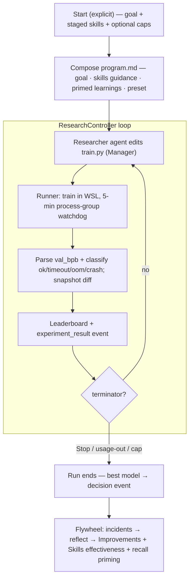
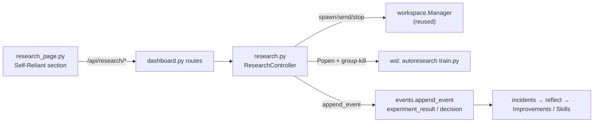

# feat: Self-Reliant — autonomous autoresearch section for MindHive

## Summary

Add a **Self-Reliant** dashboard section — a sibling to MindParallel — that wraps `karpathy/autoresearch` as an autonomous, self-pacing experiment loop running on the local RTX 3050 through WSL2. A Claude Code researcher agent (reusing the existing `workspace.Manager` substrate) iterates experiments; deterministic Python owns the 5-minute-per-experiment watchdog, the leaderboard, the stop conditions, and the write-back of results into MindHive memory. The loop runs only on an explicit Start, defaults to unbounded (until Stop or account-usage exhaustion), and every result flows back through the existing event → incidents → reflect → Improvements pipeline so future runs are primed by what past runs learned.

---

## Problem Frame

MindHive already runs headless Claude agents in parallel (MindParallel) with a human in the loop. It has no way to let an agent *autonomously* optimize something over many iterations and learn across nights. `autoresearch` is purpose-built for exactly that shape: an agent edits `train.py`, trains for a fixed 5-minute wall-clock budget, reads a comparable score (`val_bpb`, lower is better), and iterates — ~12 experiments/hour, ~100 overnight. The 5-minute cap is what makes experiments comparable and forces the agent to find the best model reachable in that budget.

Running autoresearch standalone would waste MindHive's core asset: its memory. The value of building it *inside* MindHive is the flywheel — results become append-only events that the graph, recall, skills-health, and Improvements surfaces already ingest, so tomorrow's run stands on tonight's findings and the system biases toward strategies that measurably move `val_bpb`.

The hardware reality shapes the whole design: the target machine is an RTX 3050 Laptop (6 GB VRAM) with WSL2 Ubuntu — not autoresearch's H100. The 5-minute cap still holds and still yields comparability *on this machine*; "most optimal model" means the best `val_bpb` a 3050 can reach in 5 minutes, on a scaled-down preset. OOM is an expected per-experiment outcome until the preset is tuned, so it must be a logged failure, never a stall.

---

## Requirements

- **R1** — A new "Self-Reliant" dashboard section, a sibling to MindParallel, that runs `autoresearch`.
- **R2** — Each experiment's training run is hard-capped at 5 minutes wall-clock regardless of hardware; throughput target ~12/hour.
- **R3** — The autonomous loop runs *only* on an explicit Start and defaults to unbounded.
- **R4** — Terminators: manual Stop (immediate); account-usage exhaustion (graceful end); optional user-set caps (max experiments and/or time budget) chosen at launch.
- **R5** — Drag-and-drop skills/plugins that act as *strategy guidance* for the researcher agent, using the same interaction as MindParallel.
- **R6** — Runs on the RTX 3050 via WSL2 with a scaled-down small-GPU preset.
- **R7** — A live leaderboard ranked by `val_bpb`, with per-experiment logs.
- **R8** — Two-way memory flywheel: prime each run from relevant past learnings; write each result back as an `experiment_result` event and the best-of-run as a `decision`.
- **R9** — Results feed the Skills & Plugins effectiveness and Improvements surfaces so the system biases toward strategies that work.
- **R10** — OOM / crash / hang is recorded as a failed experiment and the loop continues; it never stalls the schedule.
- **R11** — Optional account-profile failover to extend runtime past one account's usage limit.
- **R12** — A no-GPU mock trainer serves as the automated test seam so the loop is verifiable without burning GPU.

---

## Key Technical Decisions

- **KTD1 — Approach C: agent explores, Python enforces.** The researcher is a headless Claude Code agent run through the existing `workspace.Manager`; deterministic Python (`research.py`) owns the schedule, the watchdog, result parsing, the leaderboard, stop conditions, and write-back. Rationale: faithful to autoresearch's `program.md`/`train.py` contract, maximal reuse of the MindParallel substrate, and timing/safety live in code that can't drift. The deterministic "propose-edit-only" variant (Approach B) is retained as a documented fallback for the researcher brain if agent token cost becomes a problem — the runner, UI, and write-back do not change if the brain is swapped.
- **KTD2 — The 5-minute cap is an outer process-group watchdog.** Python wall-clocks the training subprocess and hard-kills its process tree at the cap, independent of autoresearch's own internal budget (belt-and-suspenders). This is what guarantees the schedule when a run hangs or OOMs. The cap applies to the *training subprocess*, not the agent's thinking time — that is what preserves autoresearch's comparability and the ~12/hour throughput.
- **KTD3 — autoresearch executes inside WSL2 (Linux).** nanochat/torch+CUDA is Linux-first; MindHive invokes training via `wsl …`. The checkout lives in a WSL sibling directory (e.g. `~/autoresearch`), never in the MindHive repo, since the agent mutates `train.py`.
- **KTD4 — Skills are strategy guidance, not executable code.** Staged skills compose into the researcher's `program.md` / system prompt (reusing the `compose_recipe_prompt` pattern from `workspace.py`), steering *how* it edits `train.py`. No skill code enters the training loop in v1.
- **KTD5 — Write-back reuses the existing event pipeline.** Results are written with `events.append_event` as semantic `experiment_result` events (best-of-run as `decision`), tagged with a `self-reliant` tag and per-skill signatures. These already flow into incidents → reflect → Improvements and into the graph/recall with no new pipeline (confirmed in `workspace.py` module docstring and the shipped Improvements-view epic).
- **KTD6 — Usage-exhaustion is a first-class graceful terminator.** The loop reads the researcher agent's result envelope; a usage-limit condition (distinct from a 401/auth expiry, which `claude_cli.envelope_ok` already detects) ends the run cleanly with the leaderboard preserved. Exact detection strings are an execution-time discovery (see Deferred).
- **KTD7 — Per-experiment isolation via diff snapshot.** Before each run the current `train.py` is snapshotted; after, the diff/summary is stored with the result so the leaderboard and events record *what changed*.
- **KTD8 — Skill-effectiveness is presence-correlation in v1.** A staged skill earns credit when experiments run with it beat the running-best `val_bpb`. A richer attribution model is deferred.
- **KTD9 — Bring-up is a tracked unit behind a manual-confirm gate.** The heavy one-time WSL clone + torch/CUDA + data-prep is captured as an implementation unit for reproducibility, but the destructive/heavy install only runs after an explicit user confirm, and it is not part of the automated test path.
- **KTD10 — The mock trainer is the test seam.** A no-GPU script emitting a synthetic `val_bpb` after N seconds lets the entire runner/loop/leaderboard/UI be tested deterministically; the runner takes its trainer command via injection so tests never touch WSL or the GPU.
- **KTD11 — Iteration contract: one experiment = one agent edit-turn + one Python-owned run.** The researcher agent edits `train.py` only and ends its turn to signal ready; it never runs training itself, so Python's watchdog (KTD2) stays authoritative. Python runs the experiment and feeds the result back as the agent's next prompt. A per-iteration agent-turn timeout bounds the edit step so a stuck turn cannot stall throughput (R2). Rationale: without this contract the agent could run training outside the watchdog, or the loop could race on when an edit is "ready".

---

## High-Level Technical Design

Autonomous loop and the boundary between the agent (explore) and Python (enforce):



Component boundary (who owns what):



---

## Output Structure

New and modified files (repo-relative):

```
src/mindhive/
  research.py            # NEW — ResearchController, runner, watchdog, leaderboard, write-back
  research_page.py       # NEW — Self-Reliant full-page view (render_research)
  dashboard.py           # MOD — import render_research; /api/research/* routes; serve page
  dashboard_page.py      # MOD — nav button: showWorkspace('research')
scripts/self_reliant/
  bring_up.sh            # NEW — WSL clone + venv + torch/CUDA + prepare + verify (manual-gated)
  mock_trainer.py        # NEW — no-GPU synthetic val_bpb trainer (test seam)
tests/
  test_research.py       # NEW — runner/watchdog/parser/leaderboard/stop/write-back
docs/
  self-reliant-setup.md  # NEW — bring-up + preset runbook
```

---

## Implementation Units

### Phase 1 — Environment & runner foundation (de-risk)

### U1. autoresearch WSL bring-up + small-GPU preset

- **Goal:** A reproducible, idempotent WSL2 bring-up of `autoresearch` on the RTX 3050 plus a captured small-GPU preset, verified by one real 5-minute run producing a `val_bpb`.
- **Requirements:** R6, R10; enables R1, R2.
- **Dependencies:** none.
- **Files:** `scripts/self_reliant/bring_up.sh`, `docs/self-reliant-setup.md`, preset constant in `src/mindhive/research.py`.
- **Approach:** Script clones `karpathy/autoresearch` into `~/autoresearch` inside WSL Ubuntu, creates a venv, installs a CUDA-enabled torch matching the 3050 driver, runs `prepare.py`, and runs one training with a scaled-down preset (reduced model dims / batch / sequence length / eval cadence) to confirm CUDA is used and a `val_bpb` is emitted within the budget. The preset knobs autoresearch actually exposes are read from its real files during this unit (execution-time discovery) and recorded in `docs/self-reliant-setup.md` and the preset constant. The heavy install runs only after an explicit user confirm (KTD9).
- **Patterns to follow:** none in-repo; mirror the runbook style of `docs/self-reliant-setup.md` siblings under `docs/`.
- **Execution note:** Manual, gated. Do not run the heavy install without explicit user go-ahead; capture the discovered preset knobs as the deliverable.
- **Test scenarios:** Test expectation: none — environment setup, verified manually by observing one real `val_bpb` and `nvidia-smi` GPU utilization inside WSL.
- **Verification:** One 5-minute run inside WSL prints a `val_bpb`; GPU shows utilization; the preset is recorded and re-runnable.

### U2. Experiment runner + 5-minute watchdog

- **Goal:** Run exactly one experiment: launch the (injectable) trainer command, hard-kill its process tree at the 5-minute cap, capture stdout, and classify the outcome.
- **Requirements:** R2, R10; R12.
- **Dependencies:** U3 (parser), U4 (leaderboard) are consumed but the runner is the core; may land first with a stub parser.
- **Files:** `src/mindhive/research.py`, `tests/test_research.py`, `scripts/self_reliant/mock_trainer.py`.
- **Approach:** A `run_experiment(trainer_cmd, cap_s=300)` launches the trainer via `subprocess.Popen` in its own process group and enforces a wall-clock kill of the whole group at `cap_s`. Status classification: `ok` (exit 0 + parseable score), `timeout` (killed at cap), `oom` (OOM signature in output), `crash` (nonzero exit, no score). The trainer command is injected so tests use `mock_trainer.py` and production uses the `wsl …` invocation. Reuse the `_default_spawn`/`CREATE_NO_WINDOW` conventions from `workspace.py`; for the WSL child, kill the Linux process tree (not just the `wsl.exe` shim). After a run, the experiment's checkpoint is pruned unless it is the new best (keep-best-N retention), bounding disk growth (see Risks).
- **Patterns to follow:** `workspace.py` `_default_spawn`, `Manager.stop` (`proc.kill()`), and the injected-spawn seam (`Manager.__init__(spawn=…)`).
- **Execution note:** Test-first — start with a failing test that a trainer sleeping past the cap is killed and classified `timeout`.
- **Test scenarios:**
  - Happy path: mock trainer emitting a score in 2 s → status `ok`, score captured.
  - Edge: trainer that runs past the cap → killed at cap, status `timeout`, process tree confirmed dead (no orphan).
  - Error: trainer exits nonzero with no score → `crash`; trainer prints an OOM signature → `oom`.
  - Edge: trainer emits partial/garbled output → classified `crash`, no exception escapes.
  - Integration: killing at the cap terminates a child-spawned grandchild process too (no leak).
  - Edge: a non-improving experiment's checkpoint is pruned; a new-best experiment's checkpoint is retained (keep-best-N).
- **Verification:** All status classes reproduce deterministically against the mock trainer; no orphaned processes remain after a timeout kill.

### U3. `val_bpb` parser + `train.py` diff snapshot

- **Goal:** Robustly extract `val_bpb` from trainer output and snapshot the `train.py` change for each experiment.
- **Requirements:** R7, R8 (records what changed); supports R2.
- **Dependencies:** U2.
- **Files:** `src/mindhive/research.py`, `tests/test_research.py`.
- **Approach:** A tolerant parser that finds the final `val_bpb` value in stdout and returns `None` on absence (never raises). A snapshot helper captures the pre/post `train.py` content and produces a short diff summary stored with the result. Keep parsing signal-specific (the exact log line format is confirmed against real output in U1 and pinned here).
- **Patterns to follow:** `claude_cli._parse` (tolerant parse returning `None`).
- **Execution note:** Characterization-first — pin the parser against a captured real `autoresearch` output sample before generalizing.
- **Test scenarios:**
  - Happy path: sample output with a final `val_bpb` → correct float.
  - Edge: multiple `val_bpb` lines → last one wins; no `val_bpb` present → `None`.
  - Edge: NaN/inf or non-numeric token where the score should be → `None`, no raise.
  - Happy path: diff snapshot of a one-line `train.py` change → concise summary naming the change.
- **Verification:** Parser handles the captured real sample and the mock trainer output identically; diff summary is non-empty for any real change.

### U4. Leaderboard store

- **Goal:** Persist experiments (id, score, change summary, status, wall-clock, staged skills) and expose the ranked leaderboard and best-so-far.
- **Requirements:** R7; supports R8.
- **Dependencies:** none (consumed by U2/U5).
- **Files:** `src/mindhive/research.py`, `tests/test_research.py`.
- **Approach:** A per-run JSON store under `paths.store_home()` with atomic temp-write + `os.replace` under a lock, mirroring the kanban board. Ranking is ascending `val_bpb`, failures sorted last. Best-so-far is the min valid score.
- **Patterns to follow:** `workspace.py` `_write_board_locked` / `save_board` (atomic write under `_BOARD_LOCK`, `paths.store_home()`).
- **Test scenarios:**
  - Happy path: append three experiments → ranked ascending by `val_bpb`; best-so-far is the minimum.
  - Edge: failed experiments (`oom`/`crash`, no score) sort last and never become best-so-far.
  - Integration: concurrent appends under the lock never drop or corrupt an entry (atomic write).
  - Edge: empty store → leaderboard `[]`, best-so-far `None`.
- **Verification:** Leaderboard survives a simulated mid-write reader without corruption; ranking and best-so-far are correct across mixed ok/failed sets.

### Phase 2 — Autonomous loop & control

### U5. ResearchController — loop lifecycle, stop conditions, stop semantics

- **Goal:** Own a run's lifecycle (start/stop/status), drive the experiment loop, and honor every terminator.
- **Requirements:** R3, R4, R10, R11 (hook), R2.
- **Dependencies:** U2, U3, U4, U6.
- **Files:** `src/mindhive/research.py`, `tests/test_research.py`.
- **Approach:** `ResearchController` runs a background loop: compose → agent turn (edits `train.py` only, then ends its turn) → `run_experiment` (Python runs training under the watchdog) → parse/record → check terminators → repeat. **Iteration contract (KTD11):** the agent never invokes training — one experiment is exactly one agent edit-turn plus one Python-owned run, keeping the watchdog authoritative; the prior result is fed back as the next prompt. Each agent turn is bounded by a per-iteration turn timeout; on expiry the turn is aborted, recorded as an `aborted` experiment, and the loop continues. `start()` first runs a **preflight** (WSL reachable, autoresearch dir + `train.py` present, researcher profile auth healthy, GPU visible) and refuses to start with a specific reason on any failure. Default unbounded. Terminators: manual Stop (kills the in-flight training process group *and* stops the researcher agent, preserving the leaderboard); usage-exhaustion detected from the agent result envelope (graceful end); optional caps (max experiments, time budget) supplied at Start. A single controller instance mirrors the `MANAGER` singleton; reuses `workspace.Manager` to spawn/send/stop the researcher agent.
- **Patterns to follow:** `workspace.py` singleton `MANAGER`, `Manager.stop`, the `api_get`/`api_post` dispatch shape; `RUN_TIMEOUT_S` env-config convention.
- **Execution note:** Test-first for the terminator matrix — each stop condition gets a failing test before the loop is wired.
- **Test scenarios:**
  - Happy path: start with cap of 3 → exactly 3 experiments recorded, then `ended (cap)`.
  - Edge: start unbounded, then Stop after one experiment → in-flight training killed, agent stopped, status `stopped`, leaderboard intact.
  - Error: agent envelope reports usage-exhaustion → loop ends `ended (usage)` gracefully, no crash, best-of-run preserved.
  - Edge: time-budget cap reached mid-experiment → current experiment finishes or is killed at its own 5-min cap, then the run ends.
  - Integration: an `oom` experiment does not terminate the loop — it records a failure and continues (R10).
  - Edge: Start while a run is already active → rejected with a clear error.
  - Edge: an agent turn exceeds the per-iteration turn timeout → turn aborted, experiment recorded `aborted`, loop continues (throughput protected).
  - Error: Start preflight fails (WSL down / autoresearch dir or `train.py` missing / researcher auth expired / GPU absent) → Start rejected with the specific reason, no experiment runs.
- **Verification:** The full terminator matrix, the preflight failure paths, and the agent-turn-timeout abort all reproduce against the mock trainer + a stubbed agent; Stop never leaves an orphaned training process or a live agent.

### U6. `program.md` composition (goal + skills guidance + primed learnings + preset)

- **Goal:** Compose the researcher agent's steering document from the research goal, staged skills (as guidance), primed past learnings, and the small-GPU preset constraints.
- **Requirements:** R5, R6, R8 (prime-in).
- **Dependencies:** U1 (preset).
- **Files:** `src/mindhive/research.py`, `tests/test_research.py`.
- **Approach:** A pure `compose_program(goal, skills, primed, preset)` returns the `program.md` text and the agent system-prompt addition. Skills render as ordered guidance (reuse the `compose_recipe_prompt` structure and the no-overlap framing from `workspace.py`). Primed learnings come from a recall over prior `experiment_result`s + relevant prevention rules. Preset constraints are stated as hard bounds so the agent avoids configs that always OOM. The composed program states the **iteration contract (KTD11) explicitly**: edit `train.py` only, do not run training, end the turn when the edit is ready; the prior experiment's result and score are included so the agent iterates on feedback.
- **Patterns to follow:** `workspace.py` `compose_recipe_prompt` and `MINDHIVE_PRIMER`/`_NO_OVERLAP`; the shared-memory lens in `ROLE_LENSES`.
- **Test scenarios:**
  - Happy path: goal + two staged skills → program text lists both skills as ordered guidance and includes the goal.
  - Edge: no skills, goal only → valid program with no skills section.
  - Happy path: preset bounds appear verbatim as constraints in the composed text.
  - Edge: primed-learnings block omitted cleanly when recall returns nothing.
  - Happy path: the composed program contains the explicit edit-only / do-not-run-training / end-turn instruction, and includes the prior result summary when one is supplied.
- **Verification:** Composition is a pure function of inputs; staged skills and preset bounds always appear; empty inputs degrade gracefully.

### Phase 3 — Dashboard section (UI) & routes

### U7. `research_page.py` — the Self-Reliant section

- **Goal:** The full-page Self-Reliant view: skills sidebar (drag source), research-goal box, staged recipe chips, Start (with optional cap fields + failover toggle), Stop, live status, live leaderboard, and a per-experiment log stream.
- **Requirements:** R1, R3, R4, R5, R7, R11.
- **Dependencies:** U8 (routes) for live data; can be built against the route contract.
- **Files:** `src/mindhive/research_page.py`, `src/mindhive/dashboard.py` (import).
- **Approach:** A self-contained HTML page (token in, HTML out) served in the dashboard iframe, lifting MindParallel's structure: the skills sidebar + drag/drop + staged-recipe chips (`STAGED`/`paintRecipe`), the profiles list, and the `/output` polling. The center run panel replaces the pane grid; the leaderboard replaces the kanban board. Start posts goal + staged skills + optional caps + failover flag; Stop posts a stop. Status shows running/idle, experiments done, best `val_bpb`, and usage state.
- **Patterns to follow:** `workspace_page.py` end-to-end — the drag/drop `onDrop` skill staging, `paintRecipe`, `api`/`apiPost`, the poll loop, and `render_parallel`'s token-escaping.
- **Test scenarios:** Test expectation: none for static HTML composition beyond a smoke test that `render_research(token)` returns HTML with the escaped token and the expected control ids. Behavioral coverage lives in U8 (routes) and browser verification at close-out.
- **Verification:** The page renders in the iframe, drag-stages a skill into the recipe, and Start/Stop reach the API; leaderboard and log stream update on poll.

### U8. dashboard routes + nav

- **Goal:** Serve the Self-Reliant page and expose `/api/research/*` (start, stop, status, leaderboard, output), plus the nav button.
- **Requirements:** R1, R3, R4, R7.
- **Dependencies:** U5, U7.
- **Files:** `src/mindhive/dashboard.py`, `src/mindhive/dashboard_page.py`.
- **Approach:** Add `render_research` serving in the page handler (mirroring `_get_workspace` at `dashboard.py:503-511`), and `/api/research/*` GET/POST route entries dispatching to `research.api_get`/`api_post` (mirroring the `/api/workspace/*` loop at `dashboard.py:779-802`). Add a "Self-Reliant" nav button in `dashboard_page.py:118` calling `showWorkspace('research')` (extend `showWorkspace` at `dashboard_page.py:644`).
- **Patterns to follow:** `dashboard.py` `_GET_ROUTES`/`_POST_ROUTES` tables and `_get_workspace`; `dashboard_page.py` nav buttons + `showWorkspace`.
- **Test scenarios:**
  - Happy path: GET the page route returns 200 HTML; `/api/research/status` returns idle before any run.
  - Happy path: POST `/api/research/start` begins a run (mock trainer + stubbed agent); `/api/research/leaderboard` reflects appended experiments.
  - Error: start with a malformed body → structured error, no 500.
  - Integration: POST `/api/research/stop` halts an active run and the status flips to stopped.
- **Verification:** End-to-end against a real local dashboard process with the mock trainer: Start → experiments appear on the leaderboard → Stop halts cleanly.

### Phase 4 — Flywheel write-back & effectiveness

### U9. Flywheel write-back — experiment_result / decision events

- **Goal:** Write each experiment as an `experiment_result` event and the best-of-run as a `decision`, tagged for the graph/recall/Improvements pipeline.
- **Requirements:** R8, R9.
- **Dependencies:** U4, U5.
- **Files:** `src/mindhive/research.py`, `tests/test_research.py`.
- **Approach:** On each experiment, `events.append_event("experiment_result", payload, tags=["self-reliant", …skill signatures])` with goal, change summary, `val_bpb`, status, staged skills. On run end, append a `decision` naming the best model + its score. Reuse the `Manager(append_event=…)` injection seam so tests assert on a fake appender.
- **Patterns to follow:** `events.append_event` signature; `workspace.py` `Manager.__init__(append_event=…)` injection; the `swarm` shared-memory `--tags` convention.
- **Test scenarios:**
  - Happy path: a completed experiment appends exactly one `experiment_result` with score, status, and skill tags.
  - Edge: a failed (`oom`) experiment still appends an `experiment_result` with status `oom` and no score.
  - Happy path: run end appends one `decision` naming the best-so-far; a run with zero valid scores appends no `decision`.
  - Integration: injected fake appender receives the events (no real ledger write in tests).
  - Integration: `experiment_result` appends during active harvest/projector loops do not corrupt the ledger (per-session segment append).
- **Verification:** Event payloads validate against `events.VALID_TYPES`; tags carry `self-reliant` + skill signatures; best-of-run decision matches the leaderboard.

### U10. Skill-effectiveness attribution → Skills & Improvements feed

- **Goal:** Credit staged skills by presence-correlation and surface the signal to the existing Skills & Plugins / Improvements views.
- **Requirements:** R9.
- **Dependencies:** U9.
- **Files:** `src/mindhive/research.py`, `tests/test_research.py`.
- **Approach:** After each experiment, if the score beats the running-best, attribute a positive signal to every staged skill present; persist a small per-skill tally alongside the leaderboard and emit it via signed events so the incidents → reflect → Improvements pipeline and the skills-health surface ingest it. No new pipeline — this rides the existing event flow (KTD5).
- **Patterns to follow:** the skills-health/`skill:<name>` signature convention referenced in the mindhive-orchestrator skill and `events` tags.
- **Test scenarios:**
  - Happy path: a new best score with two staged skills credits both.
  - Edge: a non-improving experiment credits nothing.
  - Edge: an experiment with no staged skills produces no attribution.
  - Integration: attribution events carry a `skill:<name>` signature consumable by the reflect/Improvements pipeline.
- **Verification:** Tallies match a scripted sequence of improving/non-improving experiments; attribution events are correctly signed and tagged.

### U11. Account-profile failover (optional)

- **Goal:** When enabled, roll the researcher agent to the next authenticated profile on usage-exhaustion to extend overnight runtime.
- **Requirements:** R11.
- **Dependencies:** U5.
- **Files:** `src/mindhive/research.py`, `tests/test_research.py`.
- **Approach:** A launch-time toggle (default off). On a usage-exhaustion terminator, if failover is on and another profile shows healthy auth (`workspace.profile_auth_status`), re-spawn the researcher under that profile and continue; otherwise end gracefully. Ordered by the profiles list.
- **Patterns to follow:** `workspace.py` `load_profiles`, `profile_auth_status`, `_profile_env`.
- **Test scenarios:**
  - Happy path: failover on, profile A exhausts, profile B healthy → loop continues under B.
  - Edge: failover on but no other healthy profile → graceful end (same as no-failover).
  - Edge: failover off → usage-exhaustion always ends the run regardless of other profiles.
- **Verification:** With stubbed auth states, the loop continues or ends per the toggle and profile health; no infinite failover loop when all profiles are exhausted.

---

## Scope Boundaries

**In scope:** the four phases above — WSL bring-up + preset, the runner/watchdog/parser/leaderboard, the autonomous controller + terminators, `program.md` composition, the Self-Reliant section + routes, flywheel write-back, presence-correlation skill-effectiveness, and optional profile failover.

### Deferred for later

- **Cloud / H100 compute** and any pluggable remote-compute seam — v1 is WSL/3050 only.
- **Plateau-based auto-stop** (stop after K non-improving experiments) — not selected; a future launch toggle.
- **Deterministic non-agent "brain" (Approach B)** — retained as a documented fallback, not built.
- **Richer skill-effectiveness attribution** beyond presence-correlation.

### Deferred to implementation (execution-time unknowns)

- The exact `autoresearch` file layout, entrypoint, and the preset knobs it exposes — discovered while doing U1 against the real repo.
- The exact `val_bpb` log-line format — pinned in U3 against captured real output.
- The precise usage-exhaustion signature in the `claude` result envelope — pinned in U5; until then, unknown terminal errors are treated conservatively (log + stop).
- The Linux process-tree kill strategy for the WSL child (killing the tree, not just `wsl.exe`) — resolved in U2.

---

## Open Questions

**Resolved during planning:**
- *How is one experiment bounded, and who runs training?* — one researcher edit-turn plus one Python-owned run; the agent edits `train.py` only and never invokes training, so the watchdog stays authoritative (KTD11; U5/U6).
- *What bounds the agent's per-iteration time?* — a per-iteration agent-turn timeout that aborts the turn and continues (U5).

**Deferred to implementation:** the execution-time unknowns (autoresearch layout, `val_bpb` log format, usage-exhaustion signature, WSL process-tree kill) are listed under Scope Boundaries → *Deferred to implementation*.

---

## Risks & Dependencies

- **6 GB VRAM OOM frequency (high likelihood).** Early experiments will OOM until the preset is tuned. Mitigation: the small-GPU preset (U1) bounds configs; the watchdog + status classifier (U2) turn OOM into a logged failure, and the loop continues (R10).
- **WSL CUDA fragility.** Getting torch+CUDA working against the 3050 driver inside WSL Ubuntu is the biggest unknown. Mitigation: U1 is a documented, gated, manually-verified bring-up before any autonomy is built; the mock trainer (U2) means all other units proceed without it.
- **WSL process-tree kill correctness.** Killing `wsl.exe` may orphan the Linux training process. Mitigation: U2 kills the Linux process tree explicitly and tests assert no orphan/grandchild leak.
- **Usage-exhaustion detection brittleness.** The CLI's usage-limit signal may change format. Mitigation: conservative default (unknown terminal error → log + stop), detection pinned in U5, and the leaderboard is always preserved.
- **Autonomous append-only writes at volume.** A long overnight run appends many events. Mitigation: events are additive and tagged `self-reliant`; the leaderboard file is the source of truth; the explicit Start is the user's consent.
- **Live dashboard integration.** The running dashboard serves a specific branch/checkout; making the section "live" is a merge/restart handoff (per the known dashboard-restart caveat). Mitigation: treat merge + dashboard restart as an explicit close-out step, not part of the build.
- **Account-usage burn / cost.** An unbounded overnight loop consumes the researcher account's usage aggressively; profile failover extends runtime but increases total spend and can exhaust the plan relied on elsewhere. Mitigation: usage is the operator's explicit choice via Start + optional caps; failover is off by default; usage-exhaustion ends the run gracefully with the leaderboard preserved.
- **Disk growth.** ~100 experiments produce checkpoints/data on a storage-constrained laptop. Mitigation: keep-best-N checkpoint retention (U2/U4); data prep is one-time (U1).
- **Unbounded agent thinking time.** A stuck or tool-looping agent turn between experiments destroys the ~12/hour throughput (R2) and burns usage with no result. Mitigation: a per-iteration agent-turn timeout aborts the turn and continues (U5).

---

## Alternatives Considered

- **Approach B — deterministic orchestrator, LLM only for the edit.** Tighter throughput control and lower cost, but barely agentic and it forfeits the open-ended exploration the goal asks for. Kept as a documented fallback for the brain only (KTD1).
- **Run autoresearch natively on Windows.** Rejected — nanochat/torch+CUDA is Linux-first; WSL2 is the supported path (KTD3).
- **Build a new results/Improvements pipeline.** Rejected — the existing event → incidents → reflect → Improvements flow already ingests signed events; reuse it (KTD5).
- **Skills as executable training-code plugins.** Rejected for v1 — guidance-only is safer and matches how MindParallel composes skills (KTD4); executable skills are a future extension.

---

## System-Wide Impact

- **New surface:** a Self-Reliant nav entry, a full-page view, and a `/api/research/*` route family alongside `/api/workspace/*`.
- **Event store:** a new `experiment_result`/`decision` volume tagged `self-reliant`; graph/recall/Memory views ingest it automatically.
- **Skills & Improvements:** gain a new input source (experiment-derived effectiveness signals).
- **New external dependency:** WSL2 + a CUDA torch environment for `autoresearch`, isolated to a WSL sibling directory outside the repo.
- **Concurrency:** the loop's event appends (per-session `.jsonl` segments) and the leaderboard's own lock are independent of the auto-harvest/projector loops and the kanban board lock, so high experiment volume does not contend with existing writers.
- **Affected parties:** the operator (new overnight workflow + Stop control), and the maintainer (new subsystem to review; watchdog/process-kill and autonomous writes are the highest-scrutiny areas).

---

## Sources & Research

- `karpathy/autoresearch` README (WebFetched 2026-07-12): the `program.md`/`train.py`/`prepare.py` contract, the 5-minute wall-clock budget, `val_bpb`, ~12/hour · ~100 overnight, single-NVIDIA-GPU requirement.
- Local machine probe: RTX 3050 Laptop 6 GB, WSL2 Ubuntu present, no Windows-side torch — grounds KTD3/KTD6 and the OOM risk.
- In-repo patterns: `src/mindhive/workspace.py` (Manager, `compose_recipe_prompt`, atomic board writes, profiles/auth), `src/mindhive/workspace_page.py` (drag/drop recipe UI), `src/mindhive/dashboard.py` (`_get_workspace` page serving + `/api/workspace/*` route tables), `src/mindhive/dashboard_page.py` (nav + `showWorkspace`), `src/mindhive/events.py` (`append_event`, valid semantic types), `src/mindhive/claude_cli.py` (`envelope_ok` auth-error detection).
- MindHive recall preflight (2026-07-12): Improvements-view epic merged to master; Skills & Plugins feature shipped; workspace activity already flows into Memory/graph/Improvements via signed events — grounds KTD5.
