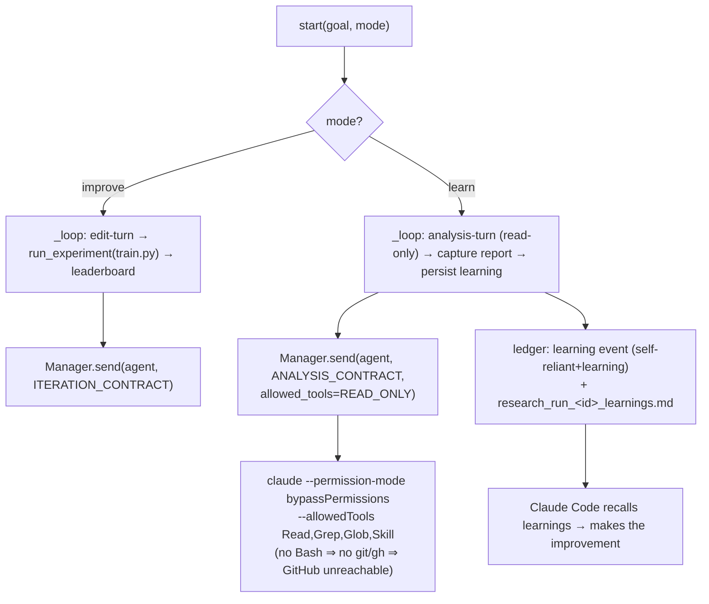

# feat: Self-Reliant analyze-and-learn mode with a hard GitHub boundary

## Summary

Reframe the Self-Reliant researcher so its focus is **analyzing and learning**, not
autonomously mutating `train.py`. Add a **learn** mode whose turn is a read-only
analysis pass: the headless agent reads `train.py` plus the experiment history and
emits a structured **learning report** (observations, what worked/regressed, ranked
hypotheses, concrete recommended edits) that is persisted as durable, recallable
learnings — so a human working with **Claude Code** makes the actual improvements.

Alongside, enforce a **hard GitHub boundary**: the Self-Reliant agent must be
*unable* to touch GitHub. Today the researcher agent runs with
`--permission-mode bypassPermissions` and **no tool restrictions**
(`src/mindhive/workspace.py` `send()`), so nothing hard-blocks `git push`/`gh`. The
boundary is enforced by spawning the analysis agent with a **read-only tool
allowlist** (no Bash → no git/gh), reinforced by a contract clause and a regression
test.

The existing autonomous **improve** loop is preserved as a non-default mode; this
change is additive, not a rewrite.

---

## Problem Frame

Self-Reliant currently runs an autonomous flywheel: each turn a headless `claude`
agent edits `train.py` (contract: `_ITERATION_CONTRACT`, "edit train.py ONLY"),
then MindHive runs a 5-minute capped training experiment and records `val_bpb` to a
leaderboard. Two gaps against the requested direction:

1. **Wrong emphasis.** The feature *makes* improvements autonomously. The user wants
   it to *analyze and learn* and hand actionable insight to Claude Code, which makes
   the improvements. There is no mode where the agent produces durable, structured
   learnings instead of blind edits.
2. **No enforced GitHub boundary.** The agent runs `bypassPermissions` with the full
   toolset. The contract *asks* it not to run commands, but nothing *prevents* a
   `git push`/`gh` call. "Boundary so as not to touch GitHub" must be a guarantee,
   not a request.

The research module itself performs no GitHub operations today (verified: no
`git`/`gh`/`push`/`commit`/`origin` in `src/mindhive/research.py`). The risk surface
is exclusively the **spawned agent**.

---

## Assumptions

Running headless; these scope bets are recorded here rather than confirmed
interactively. The plan file and resulting PR are the review gate.

- **Additive, not destructive.** "Learning feature" is interpreted as a new **learn**
  mode that becomes the default surface, with the existing autonomous-edit
  (**improve**) loop kept intact and selectable. A full removal of autonomous editing
  is *not* assumed — it would discard a working flywheel and the current best result
  (`val_bpb` 1.5858). If the user wants improve mode deleted, that is a follow-up.
- **Learn mode does not run training.** An analysis turn makes no `train.py` edit, so
  re-running the 5-minute trainer would just retrain an unchanged baseline and waste
  the budget. Learn mode therefore skips the trainer and spends its budget on
  analysis rounds that refine learnings. (Gathering fresh experiment data stays the
  job of improve mode.)
- **Learnings are captured from the agent's final message**, not a file the agent
  writes — this keeps the analysis agent read-only (no Write/Bash) and is the tightest
  possible GitHub boundary.
- **Boundary mechanism is a read-only allowlist** (`Read`, `Grep`, `Glob`, `Skill`)
  rather than a git/gh denylist. With no Bash, git/gh are simply unavailable —
  stronger than subcommand-matcher deny rules and independent of `bypassPermissions`
  semantics. A denylist is noted as defense-in-depth for any future Bash-needing mode.

---

## Requirements

- **R1.** Add a `mode` dimension to a Self-Reliant run: `improve` (existing behavior,
  default preserved for back-compat at the function layer) and `learn` (new analysis
  behavior, the emphasized surface).
- **R2.** In learn mode, the agent's turn is read-only: it reads `train.py` and the
  experiment/leaderboard history and returns a structured learning report; it makes
  no file edits and runs no commands.
- **R3.** Learn-mode learnings are persisted durably and recallably: a ledger event
  tagged `self-reliant` + `learning`, and a per-run artifact beside the leaderboard,
  so Claude Code can recall and act on them.
- **R4.** The Self-Reliant agent is *unable* to perform GitHub operations — enforced
  at spawn via tool restriction, not only via prompt text.
- **R5.** The GitHub boundary and the read-only nature of learn mode are covered by
  tests, including a regression guard asserting the boundary holds.
- **R6.** Existing improve-mode behavior and the leaderboard/attribution machinery are
  unchanged when `mode` is unset or `improve`.

---

## Key Technical Decisions

- **KTD1 — Enforce the boundary with a read-only allowlist, at the spawn layer.**
  `send()` gains optional tool-restriction parameters rendered as the CLI's
  `--allowedTools` / `--disallowedTools`. Learn mode passes an allowlist of
  read-only tools. Deny/allow rules are honored regardless of `bypassPermissions`,
  and an allowlist with no Bash removes the git/gh capability entirely. Exact flag
  spelling/patterns are confirmed against the installed CLI at implementation via the
  existing `claude_cli` helper (execution-time detail).
- **KTD2 — Capture learnings from the agent's final result text.** The workspace
  reader already parses the stream `result` event; expose it as `agent.last_result`
  so `ManagerResearcher.turn` can return the full report. No agent-side file write is
  needed, keeping the agent read-only.
- **KTD3 — `mode` threads through `compose_program` → `ResearchController` → start
  API**, mirroring how `preset`/`skills`/`profile` already thread through. `learn` is
  the emphasized default at the API/dashboard layer; the `compose_program` and
  `ResearchController.start` function signatures default to `improve` to keep every
  existing test and caller green (R6).
- **KTD4 — Learn mode's loop skips the trainer.** `_loop` branches on mode: improve
  runs `run_experiment`; learn runs analysis turns and persists learnings, bounded by
  the same cap/time-budget/stop terminators.
- **KTD5 — Contract split.** A new `_ANALYSIS_CONTRACT` (parallel to
  `_ITERATION_CONTRACT`) drives learn mode: read-only, no edits, no commands, an
  explicit "never touch GitHub" clause, and the structured-report shape. Defense in
  depth behind the allowlist (KTD1).

---

## High-Level Technical Design

Two modes over one controller; the boundary is enforced where the agent is spawned.

Boundary defense-in-depth: (1) read-only allowlist at spawn [primary], (2)
`_ANALYSIS_CONTRACT` "never touch GitHub" clause, (3) regression test (U6).

---

## Implementation Units

### U1. Extend workspace `send()` for tool restriction and result capture

**Goal:** Give the spawn layer the two hooks the boundary and learnings need.
**Requirements:** R4, and enables R2/R3.
**Dependencies:** none.
**Files:** `src/mindhive/workspace.py`, `tests/test_workspace.py`
**Approach:**
- `send(self, agent_id, prompt, extra_system=None, add_dirs=None, allowed_tools=None, disallowed_tools=None)`. When provided, append `--allowedTools` / `--disallowedTools` with the given patterns to `argv` (after the `bypassPermissions` flag). Absent → argv unchanged (back-compat).
- In `_reader`, when a `result` event is seen, also store `a.last_result = result_text`; initialize `last_result` on `Agent`. This exposes the full final report to callers without changing existing logging.
- Confirm the exact flag names against the installed CLI via the `claude_cli` helper; keep patterns in a module constant so U2 can reuse them.
**Patterns to follow:** existing `argv` assembly in `send()` (the `--add-dir` / `--append-system-prompt` blocks); `Agent` field initialization near `self.status = "idle"`.
**Test scenarios:**
- `send()` with `allowed_tools=["Read","Grep"]` → argv contains `--allowedTools` followed by the patterns; `disallowed_tools` likewise renders `--disallowedTools`.
- `send()` with neither → argv identical to today (regression; guards existing callers).
- After a run whose stream includes a `result` event, `agent.last_result` equals the result text; agents with no result keep `last_result` empty.
- Covers R4: assert git/gh are absent from an allowlist that omits Bash.

### U2. Spawn the Self-Reliant researcher read-only and GitHub-blocked

**Goal:** The researcher agent physically cannot touch GitHub.
**Requirements:** R4; enables R2.
**Dependencies:** U1.
**Files:** `src/mindhive/research.py`, `tests/test_research.py`
**Approach:**
- Add a module constant `SELF_RELIANT_ALLOWED_TOOLS = ["Read", "Grep", "Glob", "Skill"]` and `GITHUB_DENY = ["Bash(git:*)", "Bash(gh:*)", "mcp__github__*"]` (defense-in-depth).
- `ManagerResearcher.turn` forwards `allowed_tools=` (learn mode) / `disallowed_tools=GITHUB_DENY` to `self._mgr.send(...)`. Thread the restriction from the controller so improve mode can keep the current (unrestricted-but-contract-bound) behavior while learn mode is read-only.
**Patterns to follow:** existing `ManagerResearcher.turn` → `self._mgr.send(..., add_dirs=...)` forwarding.
**Test scenarios:**
- `ManagerResearcher.turn` in learn mode calls `send` with `allowed_tools` == the read-only set (assert via a fake manager capturing kwargs).
- `GITHUB_DENY` contains git, gh, and the GitHub MCP glob (guards the constant against edits).
- Improve mode forwards no `allowed_tools` (back-compat).

### U3. Analysis contract and `mode`-aware `compose_program`

**Goal:** Learn mode instructs the agent to analyze and report, never edit or touch GitHub.
**Requirements:** R1, R2.
**Dependencies:** none (pure function; lands independently).
**Files:** `src/mindhive/research.py`, `tests/test_research.py`
**Approach:**
- Add `_ANALYSIS_CONTRACT`: read-only; do not edit `train.py` or any file; do not run commands; **never touch GitHub — no git, no gh, no remotes, no commits**; produce a structured learning report (observations · what worked/regressed · ranked hypotheses · concrete recommended edits for a human using Claude Code); end the turn.
- `compose_program(..., mode="improve")`. In `learn`, frame the task as analysis, emit `_ANALYSIS_CONTRACT` as both the program tail and the `system` value, and suppress the improve-only "you made NO edit" nudge. `improve`/default renders exactly as today.
**Patterns to follow:** existing `compose_program` part-assembly and its `{"program", "system"}` return.
**Test scenarios:**
- `compose_program(mode="learn")` program+system include the analysis contract and the "never touch GitHub" clause and exclude "edit train.py ONLY".
- `compose_program(mode="improve")` and the no-arg default are byte-identical to current output (regression; protects R6).
- Learn mode omits the "no change" nudge even when `prior["change"] == "no change"`.

### U4. Controller learn mode: analysis loop + learning persistence

**Goal:** A learn run performs analysis rounds and persists durable, recallable learnings without running training.
**Requirements:** R2, R3, R6.
**Dependencies:** U1, U2, U3.
**Files:** `src/mindhive/research.py`, `tests/test_research.py`
**Approach:**
- `ResearchController.start(..., mode="improve")`; store `self._mode`.
- `_loop` branches on `self._mode`. Learn: compose with `mode="learn"`, run the read-only turn, capture the report (`ManagerResearcher.turn` returns `last_result`), and persist it — a ledger event via `self._log("learning", {...})` tagged `self-reliant` + `learning`, and a per-run artifact `research_run_<id>_learnings.md` (append each round) beside the leaderboard. No `run_experiment`, no `before/after` snapshot, no leaderboard `add`. Honor the existing stop / cap / time-budget terminators and `aborted` handling (which already stops the in-flight agent).
- Improve branch is the current `_loop` body, unchanged.
**Patterns to follow:** existing `_loop` terminator checks and `_record`/`_log`/`_save_tally` persistence; artifact path via `self.leaderboard.path.with_name(...)` like `_tally_path`.
**Test scenarios:**
- Learn run with a stub researcher over N rounds: the trainer command is **never invoked** (assert the injected trainer callable count stays 0), a learnings artifact is written, and ≥1 `learning` ledger event tagged `self-reliant`+`learning` is emitted.
- Learn run ends with reason `cap` at the round cap and `time` at the budget; `stop()` mid-run ends `stopped` and stops the agent.
- Improve run is unaffected: trainer runs, leaderboard records, reason `cap` (regression for R6).
- A learn turn that aborts (timeout) records no learning for that round and continues (reuses the abort-stops-agent fix).

### U5. Thread `mode` through the start API and dashboard

**Goal:** A run can be started in learn mode and its learnings viewed.
**Requirements:** R1, R3.
**Dependencies:** U4.
**Files:** `src/mindhive/research.py` (action dispatcher), `src/mindhive/research_page.py`, `tests/test_research.py` (and `tests/test_research_page.py` if page-level assertions fit there)
**Approach:**
- Action dispatcher `start` reads `body.get("mode")` and forwards it to `ctl.start(...)`; unknown/missing → `improve` at the function layer, while the dashboard presents **learn** as the emphasized choice.
- `research_page.py`: a minimal Learn/Improve control on the start form and a light panel that shows the latest run's learnings artifact. Keep the UI change small and mirror existing controls (`failover`, cap inputs).
**Patterns to follow:** existing `if action == "start": return ctl.start(...)` block; the `apiPost('/api/research/start', {...})` payload assembly in `research_page.py`.
**Test scenarios:**
- Dispatch `start` with `mode="learn"` forwards `mode="learn"` to `controller.start` (assert via a fake controller).
- Dispatch `start` with no `mode` forwards `improve`.
- `Test expectation: none — reason` for any pure-markup HTML string with no branching; assert only the small piece of learn/improve payload logic that has behavior.

### U6. GitHub-boundary regression guard

**Goal:** Lock the boundary so a future edit can't silently reopen it.
**Requirements:** R4, R5.
**Dependencies:** U2, U3.
**Files:** `tests/test_research.py`
**Approach:** a focused test asserting: (a) `SELF_RELIANT_ALLOWED_TOOLS` contains no Bash/git/gh; (b) `GITHUB_DENY` blocks git, gh, and GitHub MCP; (c) the learn program/system carries the "never touch GitHub" clause; (d) a static check that `src/mindhive/research.py` source contains no `gh ` / `git push` invocation strings.
**Patterns to follow:** existing constant/text assertions in `tests/test_research.py`.
**Test scenarios:** the four assertions above; the static-source check reads the module file and greps for forbidden call fragments.

---

## Scope Boundaries

**In scope:** the `learn` mode (contract, compose, controller loop, persistence),
the spawn-layer tool-restriction hook, result capture, start-API + minimal dashboard
wiring, and boundary tests.

**Not in scope (true non-goals):**
- Removing or redesigning the existing improve/autonomous-edit loop.
- Any GitHub integration for Self-Reliant (the whole point is that it stays out).
- Changing the training harness, WSL bring-up, or leaderboard schema.

### Deferred to Follow-Up Work
- A denylist-backed mode that still allows Bash for richer analysis (would need the
  `GITHUB_DENY` path exercised, not just defined).
- Auto-handoff of learnings into a Claude Code session (recall wiring exists; a
  one-click "act on these learnings" is a later nicety).
- Summarizing/ranking learnings across runs (cross-run learning digest).

---

## Risks & Dependencies

- **CLI flag drift.** `--allowedTools`/`--disallowedTools` spelling or pattern syntax
  could differ in the installed CLI. Mitigation: confirm via the `claude_cli` helper
  at implementation (U1); the mechanism (read-only allowlist) is robust to the exact
  matcher grammar because it removes Bash entirely.
- **Back-compat.** Many tests assert current `compose_program`/`send`/`start`
  behavior. Mitigation: every new parameter defaults to today's behavior; U3/U4/U1
  each carry an explicit regression scenario.
- **Boundary bypass via allowlisted Skill.** `Skill` could, in principle, invoke a
  skill that shells out. Mitigation: learn mode's power comes from Read/Grep/Glob;
  if Skill proves a hole, drop it from the allowlist — the analysis agent still
  functions. Noted for U6 review.
- **Dependency:** builds on the merged abort-stops-agent fix (`_run_turn` stops the
  in-flight agent) so learn-mode analysis turns recover from timeouts the same way.

---

## Verification

The change lands green when: the full suite passes; U6's boundary guard passes; a
learn run in tests persists learnings and never invokes the trainer; and improve-mode
tests are unchanged. Per project rule, do not report success until the local test run
standing in for CI is actually green.
