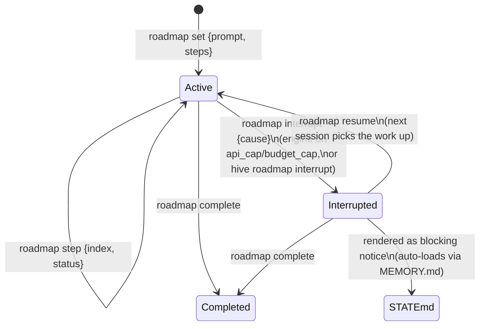
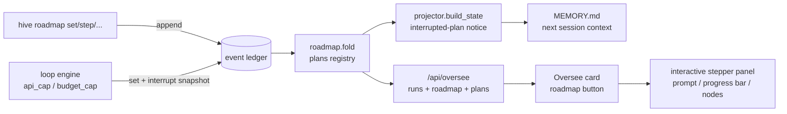

# feat: Interactive Oversee roadmap + out-of-usage interruption marker

**Target repo:** `mindhive` (worktree branch `claude/oversee-roadmap-progress-3ab39c`; all paths repo-relative)

---

## Summary

Add a **roadmap** subsystem to MindHive: an event-sourced plan registry (what
the user asked, the plan steps built from it, per-step progress) projected two
ways — (1) an **interactive roadmap view** in the dashboard's Oversee section,
opened by a button on each work-session card, rendering the original ask, the
plan, and step-by-step progress as a clickable visual stepper; and (2) an
**out-of-usage interruption marker**: when a run is cut off by Claude usage
limits (loop `api_cap` / `budget_cap`), the engine snapshots the plan + progress
into the ledger and STATE.md shows a blocking-style "⚠ Interrupted plan" notice
— so the next session auto-loads the big picture (initial prompt, steps done,
next step) and resumes without losing context.

## Problem Frame

Oversee shows live work (loop runs + interactive sessions) with flat
done/doing/planned lists, but there is no way to see *the plan as a plan* —
what was asked, what the roadmap is, how far along it is — and nothing survives
an out-of-usage interruption: a rate-limited loop run just ends with
`reason=api_cap`, and the next session starts cold with no marker of what the
plan was or where it stopped. The store's design (append-only ledger +
deterministic projections + STATE.md → auto-loaded MEMORY.md) is exactly the
right vehicle; the roadmap registry rides it the same way SOPs do.

## Assumptions

Headless-planning inferences (autonomous session; each is revisable without
invalidating the rest):

- **One data model serves both features.** The interruption marker is a roadmap
  plan whose status is `interrupted` — no parallel "marker" store.
- **"Out of usage" in the detectable path = loop `api_cap` (Claude usage/rate
  limit) and `budget_cap` (local budget stop).** Interactive Claude sessions
  cannot be hooked at the moment the app hits its usage wall; there the marker
  is written by `hive roadmap interrupt` (Claude or the user runs it), and the
  event-sourced step updates mean the ledger is already current up to the last
  recorded step even without an explicit marker.
- **"Based on UI images" = a visual roadmap UI** (stepper/timeline with status
  nodes and a progress bar), interactive on click — matching the dashboard's
  existing dark hive palette; no image assets are embedded (dashboard stays
  zero-dependency stdlib).
- **Roadmap events are registry/audit class** like `sop`/`code_change`: exempt
  from consolidation and display dedupe; corrections are new events.

---

## Requirements

### Roadmap registry (shared data model)

- R1. A new semantic event type `roadmap` with a validated payload contract:
  `set` (declare/replace a plan: `plan_id`, `prompt` — the user's original ask,
  optional `title`, ordered `steps`), `step` (update one step's
  status: done | active | pending | skipped, optional note), `interrupt`
  (mark the plan interrupted with a `cause`), `resume`, `complete`.
- R2. The current registry is a deterministic, total fold over `roadmap` events
  (same idiom as `sop.fold`): plan records carry prompt, title, steps with
  statuses, progress counts, lifecycle status (active/interrupted/completed),
  and interruption cause/ts when present.
- R3. `hive roadmap set|step|interrupt|resume|complete|list|show` manage the
  registry; the raw `hive append roadmap` path enforces the same contract.
- R4. Roadmap events ride the LEDGER (recallable), the hash chain, and the
  Memory view; they are never merged by consolidation or display dedupe.

### Interactive Oversee roadmap (feature 1)

- R5. Every Oversee card has a **roadmap** button; pressing it opens an
  interactive roadmap panel for that run/session.
- R6. The panel shows: the original ask (prompt), a progress bar (done/total),
  and a vertical stepper of plan steps — done (green ✔), active (pulsing ◐),
  pending (○), skipped (dim) — with a connector line, in the existing hive
  palette and card CSS idiom.
- R7. Steps are interactive: clicking a step node expands its detail (note,
  status). Panel state survives the 2.5 s live refresh (same `Set`-keyed
  expansion idiom as `OV_EXPANDED`).
- R8. When an explicit roadmap plan exists for the run id / session id it is
  the panel's source of truth; otherwise the panel synthesizes a roadmap from
  the card's own progress data (title as the ask; done/doing/planned/not_yet
  as steps) — the button always works.
- R9. Interrupted plans surface in Oversee even after their run/session left
  the board: an "interrupted plans" strip renders each with its roadmap and a
  resume hint.

### Out-of-usage interruption marker (feature 2)

- R10. When a loop run ends with reason `api_cap` or `budget_cap`, the engine
  appends a roadmap snapshot for the run (`set` with the task prompt headline
  and fix_plan-derived steps: checked → done, first unchecked-required →
  active, rest → pending, Future/Optional → skipped) followed by an
  `interrupt` event with the cause — before `loop_run_end` leaves the ledger's
  last word.
- R11. STATE.md (and therefore the auto-loaded MEMORY.md) renders a
  "⚠ Interrupted plan" notice for every interrupted plan: the initial prompt,
  per-step progress, the next step, and the resume commands — positioned with
  the other blocking notices at the top.
- R12. The notice clears the append-only way: `hive roadmap resume` (work
  continues) or `complete` (work done) — never by editing the ledger.

- C1 (constraint). Dashboard stays zero-dependency stdlib; folds/projections
  stay deterministic and total; append-only discipline throughout; full pytest
  suite green; mandatory `hive log` entry before done.

---

## Key Technical Decisions

- **KTD1 — `roadmap` is a semantic, registry-class event type.** It joins
  `SEMANTIC_TYPES` (rides LEDGER/chain/Memory/recall for free per
  `projector.LEDGER_TYPES`) and is exempted in `consolidate.CONSOLIDATE_TYPES`
  and `dedupe.collapse` like `sop`/`code_change`. Contract lives in a new
  `src/mindhive/roadmap.py` (mirror of `sop.py`), enforced at the append
  surfaces (`__main__.cmd_append`); the store stays type-agnostic.
- **KTD2 — The registry is a total fold keyed by `plan_id`.** `set` upserts
  (replaces steps wholesale — a re-plan is a new `set`), `step` mutates one
  index (out-of-range/unknown ids skip silently — reads stay total),
  `interrupt`/`resume`/`complete` flip lifecycle status. Marking a step `done`
  or `active` auto-clears any other `active` step (one current step at a
  time); marking `done` on the active step advances `active` to the next
  pending step so the roadmap always shows where work is.
- **KTD3 — The interruption marker is data, not a new mechanism.** Engine-side
  detection reuses the existing run-end reasons (`api_cap` from
  `DriverResult.rate_limited`, `budget_cap` from the budget gate). The
  STATE.md notice is a deterministic render of interrupted plans inside
  `projector.build_state` (pure function of `evs` — no sidecar file needed,
  unlike review/changelog whose gates depend on session boundaries).
- **KTD4 — Oversee stays one endpoint.** `/api/oversee` attaches
  `roadmap` to each run record when a plan with `plan_id == run_id` exists,
  and adds a top-level `plans` list (interrupted + active plans not bound to a
  live card) — no new route; the dismiss/read-only guard semantics are
  untouched.
- **KTD5 — The panel is client-side synthesis when no explicit plan exists**
  (R8): the JS builds the stepper from the card's `done/doing/planned/not_yet`
  arrays so the button is never dead. Explicit plans win because they carry
  the true original prompt and step statuses.

---

## High-Level Technical Design

Plan lifecycle (drives R1/R2/R10–R12):

Component flow:

---

## Implementation Units

### U1. `roadmap.py`: contract, fold, notice

**Goal:** The registry module — payload validation, deterministic fold, STATE
notice, LEDGER body.
**Requirements:** R1, R2, R11 (render half), R12
**Dependencies:** none
**Files:** `src/mindhive/roadmap.py` (new), `tests/test_roadmap.py` (new)
**Approach:** Mirror `sop.py`: `ACTIONS`, `ID_RE` (reuse sop's kebab/hex-safe
regex), size caps (prompt ≤ 2000 chars, ≤ 50 steps, step text ≤ 300 chars,
note ≤ 500), `validate_payload`, `fold(evs) -> dict plan_id -> record`,
`plans(evs)` (stable order), `get(evs, plan_id)`, `record(...)` with
registry-aware guards (step/interrupt/resume/complete on unknown id → error
with the corrective command; raw-append path skips guards but keeps shape),
`notice(evs)` → the "⚠ Interrupted plan" markdown block (empty when none),
`ledger_body(payload)`. Steps normalize to `[{text, status, note}]`; `set`
accepts plain strings (status pending, first one active) or dicts.
**Test scenarios:**
  - `set` then two `step done` → progress 2/N, statuses correct, `active`
    advanced to the next pending step.
  - `step` with out-of-range index or unknown plan_id folds as a no-op (total).
  - `interrupt` flips status + records cause/ts; `resume` returns to active;
    `complete` finalizes; re-`set` after complete revives with new steps.
  - `validate_payload` rejects: missing action, bad plan_id, empty steps on
    set, oversize prompt/steps, bad status, non-dict payload.
  - `notice`: empty string with no interrupted plans; interrupted plan renders
    prompt, ✔/→/○ step lines, next step, and both resume/complete commands;
    two interrupted plans render two blocks.
  - Fold determinism: same events → identical records (no clock/RNG).
**Verification:** `tests/test_roadmap.py` green.

### U2. Store integration: registry, exemptions, projector

**Goal:** `roadmap` events are first-class citizens of the ledger pipeline.
**Requirements:** R4, R11 (placement half)
**Dependencies:** U1
**Files:** `src/mindhive/events.py`, `src/mindhive/consolidate.py`,
`src/mindhive/dedupe.py`, `src/mindhive/projector.py`,
`tests/test_projector.py`, `tests/test_consolidate.py`, `tests/test_dedupe.py`
**Approach:** Register `roadmap` in `SEMANTIC_TYPES` with a why-comment;
exempt in `CONSOLIDATE_TYPES` and dedupe's never-collapse tuple;
`build_state` appends `roadmap.notice(evs)` after the changelog notice;
`build_ledger_entries` gains a `roadmap` branch using `ledger_body`.
**Test scenarios:**
  - STATE.md contains the interrupted-plan notice when a plan is interrupted
    and not after `resume`/`complete`.
  - LEDGER entry for a roadmap event carries action, plan_id, prompt/step text
    (recallable by keyword).
  - Consolidation and collapse leave two similar roadmap events untouched.
**Verification:** projector/consolidate/dedupe suites green; `hive verify`
semantics unchanged (chain covers the new semantic type automatically).

### U3. CLI: `hive roadmap` + raw-append guard

**Goal:** Manage the registry from the shell; block malformed raw appends.
**Requirements:** R3
**Dependencies:** U1
**Files:** `src/mindhive/__main__.py`, `tests/test_cli_new.py` (or
`tests/test_roadmap.py` CLI section)
**Approach:** Subcommands mirroring `hive sop`: `set <plan_id> --prompt …
[--title …] --step … (repeatable) | --file <one-step-per-line> [--session]`,
`step <plan_id> <index> --status done|active|pending|skipped [--note …]`,
`interrupt <plan_id> --cause <text> [--note …]`, `resume <plan_id>`,
`complete <plan_id>`, `list [--json] [--all]` (default hides completed),
`show <plan_id> [--json]` (record + event history). `cmd_append` gains a
`roadmap` validation branch next to `code_change`/`sop`.
**Test scenarios:**
  - Round-trip: set → step → interrupt → list/show reflect each transition;
    exit code 2 + corrective hint on unknown plan_id / bad status.
  - `hive append roadmap` with an invalid payload exits 2 and appends nothing;
    with a valid payload it lands.
  - `--file` step loading works; `list` hides completed unless `--all`.
**Verification:** CLI tests green.

### U4. Loop engine: usage-interruption snapshot

**Goal:** An out-of-usage loop run leaves the marker automatically.
**Requirements:** R10
**Dependencies:** U1, U2
**Files:** `src/mindhive/loop/engine.py`, `tests/test_loop_engine.py`
**Approach:** In `run_loop`, when the final `reason` is `api_cap` or
`budget_cap`, append `roadmap set` (plan_id = run_id, prompt = the task
prompt's headline, title = run title, steps from
`task_mod.plan_items(fix_plan)`: done→done, first planned→active,
rest→pending, not_yet→skipped) then `roadmap interrupt` (cause = reason),
just before `loop_run_end`. Best-effort guarded (a snapshot failure must not
mask the run-end event).
**Test scenarios:**
  - Fake driver returning `rate_limited=True` → ledger gains roadmap set +
    interrupt (cause api_cap) + loop_run_end, in that order; STATE then shows
    the notice.
  - Budget-cap stop (`on_cap="stop"`) → cause budget_cap.
  - `completed` / `breaker_open` / `max_iterations` runs append no roadmap.
**Verification:** `tests/test_loop_engine.py` green.

### U5. Dashboard API: roadmap on `/api/oversee`

**Goal:** Serve roadmap data with the existing Oversee payload.
**Requirements:** R5 (data half), R8, R9 (data half)
**Dependencies:** U1, U2
**Files:** `src/mindhive/dashboard.py`, `tests/test_dashboard.py`
**Approach:** `_get_oversee` folds roadmap plans once per project; attaches
`r["roadmap"] = plan` where `plan_id == r["run_id"]`; adds top-level
`"plans"` = interrupted plans plus active plans with no matching live card
(each stamped with `project`). HIVE MIND (`*`) aggregates like runs do.
**Test scenarios:**
  - A run with a matching plan carries `roadmap`; one without carries none.
  - An interrupted plan whose run is dismissed still arrives in `plans`.
  - HIVE MIND merge keeps project stamps; token guard unchanged (401/403
    paths untouched).
**Verification:** dashboard suite green.

### U6. Oversee UI: the interactive roadmap panel

**Goal:** The user-facing feature — button on every card, visual stepper
panel, interrupted-plans strip.
**Requirements:** R5, R6, R7, R8, R9 (view half)
**Dependencies:** U5
**Files:** `src/mindhive/dashboard_page.py`, `tests/test_dashboard.py` (page
content assertions)
**Approach:** Card head gains a mini **roadmap** button next to delete;
clicking toggles `RM_OPEN` (a `Set` keyed by run_id, refresh-safe like
`OV_EXPANDED`). Panel: "Asked:" prompt box, progress bar
(`<done>/<total>` fill), vertical stepper — nodes ✔/◐/○ with a left connector
line via CSS (`.rmstep`, `.rmline`, `.rmbar`), statuses colored with the
existing `ovdone/ovspin/ovpend` palette; clicking a node toggles its note
detail (`RM_NODE_OPEN` set keyed by `run_id:index`). Cards without an
explicit plan synthesize steps client-side from done/doing/planned/not_yet
(KTD5). Above the list, when `plans` is non-empty, an "interrupted plans"
strip renders each plan as a card with its roadmap open and a resume hint
(`hive roadmap resume <id>`).
**Test scenarios:** page-content assertions: nav/JS hooks present
(`roadmap` button markup, `RM_OPEN`, `renderOversee` still wired), CSS
classes present — consistent with how existing views are tested; interactive
behavior is manual smoke.
**Verification:** dashboard page tests green; manual smoke on a preview port
(never the live 54461 process) confirming button → panel → node expansion,
and the interrupted strip with a seeded interrupted plan.

---

## Scope Boundaries

**In scope:** everything above, on this worktree's branch.

**Out of scope:**
- Detecting the usage wall inside interactive Claude Code sessions (no hook
  fires at that moment); covered operationally by `hive roadmap interrupt`.
- Physical deletion of roadmap events (breaks the hash chain by design).
- Auto-resuming interrupted loop runs (resume stays a human/next-session act).

**Deferred to follow-up work:**
- Prompting/skill guidance that has interactive Claude maintain
  `hive roadmap` step updates as it works (promptgate/SOP integration).
- Rendering roadmap history (who changed which step when) in the panel — the
  ledger already has it; `hive roadmap show` prints it.
- A dashboard POST route to resume/complete plans from the UI.

---

## Risks & Dependencies

- **Ledger bloat from snapshots** — mitigated: one `set` + one `interrupt`
  per interrupted run only (no per-iteration writes); size caps bound each
  event.
- **Notice noise if plans are never resumed/completed** — mitigated: notice
  lists the two clearing commands; `complete` is one command; stale
  interrupted plans stay visible by design (that is the feature).
- **Windows/PS 5.1 quoting for multi-step CLI calls** — mitigated: repeatable
  `--step` plus `--file` (same escape hatch as `hive sop --file/--stdin`).
- **Dashboard page size creep** — the new JS/CSS follows the existing
  string-building idiom; no framework, no assets.

---

## Sources & Research

- Registry/audit event idiom: `src/mindhive/sop.py`, `src/mindhive/changelog.py`
  (contract at append surfaces; fold totality; exemptions in
  `src/mindhive/consolidate.py`, `src/mindhive/dedupe.py`).
- Extension procedure: `docs/DATA_MODEL.md` §6.
- Oversee projections: `src/mindhive/loop/state.py` (`list_runs`),
  `src/mindhive/oversee.py` (interactive sessions), dashboard route/view:
  `src/mindhive/dashboard.py` (`_get_oversee`, `_post_oversee_dismiss`),
  `src/mindhive/dashboard_page.py` (`ovCard`/`paintOversee`, `OV_EXPANDED`).
- Usage-limit signal: `src/mindhive/loop/driver.py` (`rate_limited` from
  `rate_limit_event.status == "rejected"`), `src/mindhive/loop/engine.py`
  (`reason = "api_cap"` / `"budget_cap"`).
- STATE.md notice placement: `src/mindhive/projector.py` (`build_state` —
  review + changelog notices), delivery via `sync` → MEMORY.md.
- Prior Oversee plan: `docs/plans/2026-07-07-001-feat-oversee-learning-gated-orchestration-plan.md`.
