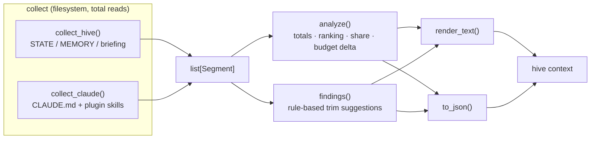

# feat: `hive context` — auto-loaded context budget analyzer

## Summary

Add a read-only `hive context` command that measures what Mind Hive and Claude Code load into
**every** session before any work starts, ranks the contributors by estimated token cost, and reports
concrete trim suggestions. Ships as one new stdlib-only module plus CLI wiring — additive only, no
existing behavior modified.

---

## Problem

Mind Hive's own operating rule (SOP 4, "context management, reliability & escalation") says: *never
ship an unbounded section into auto-loaded context.* The caps that enforce that rule bound **item
counts, not size**:

| Cap | Location | Bounds |
|---|---|---|
| `LESSONS_CAP = 10` | `src/mindhive/sync.py:10` | number of lessons |
| `DECISIONS_CAP = 5` | `src/mindhive/sync.py:11` | number of decisions |
| `_TIMELINE_CAP = 40` | `src/mindhive/briefing.py:17` | number of timeline rows |
| `SUGGEST_CAP = 3` | `src/mindhive/projector.py:8` | number of suggested-skill lines |

Ten lessons can be 500 bytes or 50 KB. The caps cannot tell the difference, so the artifacts grew
unchecked. Measured on this machine at plan time:

```
STATE.md    37,410 bytes  (~9,350 est. tokens)
MEMORY.md   23,124 bytes  (~5,780 est. tokens)
briefing.md  3,573 bytes  (~890 est. tokens)
---------------------------------------------
total       ~64 KB        (~16,000 est. tokens)  paid at every session start
```

A grep across `src/mindhive/*.py` confirms **no byte or token measurement exists anywhere** — every
match for "token" is the dashboard's auth token (`src/mindhive/dashboard.py:54`). The system is blind
in the one dimension that actually costs the user, and the cost recurs every session.

The wider always-on surface is larger still: the user runs ~70 Claude Code plugins whose skill
descriptions were measured at ~27,400 tokens in a prior session — nearly double Mind Hive's own
contribution. Answering "what is eating my context?" requires measuring both.

---

## Requirements

- **R1** — Measure hive-owned auto-loaded artifacts: `STATE.md`, `MEMORY.md`, `briefing.md`, directives.
- **R2** — Measure the wider Claude Code always-on surface: `CLAUDE.md` files and installed plugins'
  skill descriptions.
- **R3** — Report bytes and estimated tokens per contributor, ranked, with share-of-total.
- **R4** — Emit rule-based trim suggestions (what to cut and why), never mutating anything.
- **R5** — Support `--json` for machine consumption, mirroring the plan-as-inspectable-data pattern.
- **R6** — Be strictly read-only. No writes to the store, memories, or user config.
- **R7** — Be additive-only: no existing function's behavior changed (user constraint — avoid
  overwrite conflicts damaging working code).
- **R8** — Stdlib-only (`pyproject.toml` declares `dependencies = []`).
- **R9** — Reads stay total: malformed, unreadable, or missing inputs are skipped, never raised
  (SOP 7 rule 5).

---

## High-Level Technical Design

A four-stage read-only pipeline. Each stage has one job and is independently testable; collectors are
the only stage that touches the filesystem.



`Segment` is the single currency passed between stages, so adding a new context source later means
writing one collector — nothing downstream changes.

---

## Key Technical Decisions

**KTD1 — Token estimation is a documented heuristic isolated in one function.**
`pyproject.toml` declares `dependencies = []` and no `src/mindhive/*.py` imports a third-party
package. Adding `tiktoken` for exact counts would break that invariant for a reporting tool, so
`estimate_tokens(text)` uses a character-ratio heuristic. All output is labelled *est.* Confining it
to a single function makes it the one swap point if an exact backend is ever added behind an optional
extra (the pattern `pyproject.toml` already uses for `vectors`).

**KTD2 — Collector registry, not a flat scanner.**
Each source is its own function returning `list[Segment]`. Rejected: a single procedural walker —
it tangles hive-store logic with `~/.claude` scanning and cannot be tested per-source.

**KTD3 — Rejected: instrumenting the existing sync/briefing pipeline.**
Measuring inside `sync.py` / `briefing.py` as they build would give exact rather than estimated
delivery figures, but requires editing existing write paths. That directly violates R7 and the user's
"don't damage the initial code" constraint. Measuring the artifacts on disk is slightly less precise
and entirely safe.

**KTD4 — Reuse `paths` for all store resolution.**
`src/mindhive/paths.py` already owns `store_home()` and namespace resolution (`MINDHIVE_HOME`,
`MINDHIVE_PROJECT`). The collector must not re-derive paths; with 48 namespaces on this machine,
divergent resolution would report the wrong project's numbers.

**KTD5 — Frontmatter parsing is reused, not reinvented.**
`src/mindhive/plugins.py` already reads `SKILL.md` files. U2 reuses that helper if one exists at a
usable boundary; only if none does will it add a local minimal reader. Confirmed during
implementation, not assumed here.

**KTD6 — Bounded reads when scanning plugins.**
A skill description lives in frontmatter at the head of the file. Scanning ~70 plugins' skills must
read only the leading bytes needed for frontmatter, not whole bodies, so the command stays fast.

---

## Implementation Units

### U1. Core module: `Segment`, token estimation, hive collector

**Goal** — Establish the module and measure the hive-owned artifacts.
**Requirements** — R1, R3, R6, R8, R9
**Dependencies** — none
**Files**
- `src/mindhive/context.py` (new)
- `tests/test_context.py` (new)

**Approach** — Module opens with the `# src/mindhive/context.py` path comment and an explanatory
docstring stating *why* the module exists (the count-vs-size gap above), matching the house style in
`src/mindhive/oversee.py`. Define a frozen `Segment` dataclass (`name`, `origin`, `path`, `nbytes`,
`tokens`, `kind`, `detail`), `estimate_tokens(text)`, and `collect_hive(...)` resolving paths through
`paths.store_home()` / namespace resolution.

**Patterns to follow** — `src/mindhive/oversee.py` (module docstring depth, dataclass-light style);
`src/mindhive/paths.py` (path resolution); `src/mindhive/briefing.py` (artifact reading).

**Test scenarios**
- `estimate_tokens("")` returns 0; a known ASCII string returns a stable, documented value; the
  function is monotonic — appending text never lowers the estimate.
- `collect_hive` on a tmp store containing STATE.md/MEMORY.md/briefing.md returns one `Segment` per
  file with `nbytes` equal to the real file size.
- **Missing file** — a store with no `briefing.md` yields segments for the others and no exception.
- **Unreadable/malformed file** — a file containing invalid UTF-8 bytes is skipped or counted by
  bytes, never raising (R9).
- Empty store directory returns an empty list, not `None`.
- Segments carry `origin == "hive"`.

**Verification** — `pytest tests/test_context.py` passes; importing the module has no side effects.

---

### U2. Claude-surface collector

**Goal** — Measure the wider always-on load: `CLAUDE.md` files and installed plugins' skill descriptions.
**Requirements** — R2, R6, R8, R9
**Dependencies** — U1
**Files**
- `src/mindhive/context.py` (modify — add `collect_claude`)
- `tests/test_context.py` (modify)

**Approach** — Walk a supplied Claude home (injected, never hardcoded, so tests use a tmp dir).
Collect user + project `CLAUDE.md`, then each plugin skill's frontmatter `description`. Read only the
leading bytes needed for frontmatter (KTD6). Reuse `plugins.py`'s frontmatter helper if one exists at
a usable boundary (KTD5).

**Patterns to follow** — `src/mindhive/plugins.py` (SKILL.md discovery and frontmatter handling).

**Test scenarios**
- A tmp Claude home with 2 plugins × 3 skills yields 6 skill segments plus a `CLAUDE.md` segment.
- **Malformed frontmatter** — a `SKILL.md` with an unterminated `---` fence is skipped without
  raising, and the remaining skills still return (R9).
- **Missing description** — a skill whose frontmatter lacks `description:` is skipped or recorded
  with zero-token description, never crashing.
- **Absent directories** — a Claude home with no `plugins/` returns only the `CLAUDE.md` segment; a
  wholly nonexistent home returns an empty list.
- Segments carry `origin == "claude"` so the two surfaces can be filtered apart.
- A skill file with a very large body contributes only its description's tokens, proving the bounded
  read (KTD6).

**Verification** — `pytest tests/test_context.py` passes; a manual run against the real
`~/.claude` completes in reasonable time and reports a non-zero plugin count.

---

### U3. Analysis and trim findings

**Goal** — Rank contributors, compute totals and budget delta, and emit rule-based trim suggestions.
**Requirements** — R3, R4, R6
**Dependencies** — U1, U2
**Files**
- `src/mindhive/context.py` (modify — add `analyze`, `findings`)
- `tests/test_context.py` (modify)

**Approach** — `analyze(segments, budget=None)` returns totals, a descending ranking, per-segment
share-of-total, and (when a budget is supplied) the overage. `findings(segments)` applies independent
rules, each returning zero or more findings so rules can be tested in isolation:
- an artifact exceeding a share-of-total threshold,
- an individual memo far above SOP 8's guidance that a decision states its point in ~500 chars,
- repeated near-identical lines within one artifact (the observed `STATE.md` duplicate-path-list case),
- absolute filesystem paths embedded in an artifact that no longer exist on disk (stale worktree
  references),
- skill descriptions that are extreme outliers against the corpus median.

**Test scenarios**
- Ranking is strictly descending by tokens; ties are ordered deterministically (stable across runs).
- Shares sum to ~100% for a non-empty segment list; an empty list yields zero totals and no
  divide-by-zero.
- `budget=None` produces no overage field/None; a budget below total reports positive overage; a
  budget above total reports zero or negative, not an error.
- **Each finding rule fires** on a crafted fixture that should trigger it.
- **Each finding rule stays silent** on a clean fixture — no false positives on well-formed input.
- The dead-path rule flags a nonexistent absolute path and does **not** flag a path that exists
  (create a real tmp file to prove the negative case).
- `findings` never mutates the input segments (verify list/dataclass identity and values unchanged).

**Verification** — `pytest tests/test_context.py` passes; running `findings` against the real
artifacts surfaces at least the known `STATE.md` duplicate-path condition.

---

### U4. Rendering and CLI wiring

**Goal** — Expose the analyzer as `hive context` with human and JSON output.
**Requirements** — R3, R5, R6, R7
**Dependencies** — U1, U2, U3
**Files**
- `src/mindhive/context.py` (modify — add `render_text`, `to_json`)
- `src/mindhive/__main__.py` (modify — **additive only**: one `cmd_context` handler + one
  `sub.add_parser(...)` registration)
- `tests/test_context.py` (modify)

**Approach** — `render_text` produces a ranked table plus a findings list; `to_json` produces a stable
serializable dict. Register the subcommand exactly like existing ones —
`sub.add_parser("context", help=...).set_defaults(func=cmd_context)` — alongside the registrations at
`src/mindhive/__main__.py:1340-1346`. Flags: `--json`, `--budget N`, `--top N`,
`--origin hive|claude|all`.

**Patterns to follow** — `src/mindhive/__main__.py:1321-1346` (subparser + `set_defaults(func=...)`
dispatch convention).

**Test scenarios**
- `to_json` output round-trips through `json.dumps`/`loads` unchanged (no non-serializable values).
- JSON contains the documented top-level keys; the shape is asserted explicitly so downstream
  consumers have a contract.
- `render_text` on an empty segment list produces a sensible message rather than an empty string or
  traceback.
- `--top N` limits displayed rows without changing the reported totals.
- `--origin hive` excludes all `claude`-origin segments and vice versa; `all` includes both.
- `--budget` is reflected in both text and JSON output.
- CLI smoke: invoking the handler with default args returns exit code 0 on a tmp store.
- **Additive-check** — existing `__main__` commands still dispatch (run the broader suite, not just
  this file).

**Verification** — `hive context` and `hive context --json` both succeed against the real store;
**the full `pytest` suite passes** (not just `tests/test_context.py`), proving no regression in
`__main__.py`; a `hive log` change-log entry is recorded per the repo's mandatory logging rule.

---

## Scope Boundaries

**In scope** — measurement, ranking, and suggestion of trims across hive-owned and Claude-surface
artifacts; human + JSON output.

**Out of scope (non-goals)**
- Any mutation of memories, STATE.md, the ledger, or user config. This command never writes.
- Changing the existing `LESSONS_CAP` / `DECISIONS_CAP` / `_TIMELINE_CAP` / `SUGGEST_CAP` behavior.
  Enforcing a byte budget in the sync/briefing write path is deliberately excluded — the user chose
  "measure + suggest trims" and excluding it keeps R7 (additive-only) intact.
- Exact tokenizer parity with any specific model (KTD1).
- A dashboard panel for the report.

**Deferred to follow-up work**
- Byte-budget enforcement in the sync/briefing path, once the measurements show which caps to set.
- A dashboard section rendering the report, following the existing `render*`/`show*` pattern in
  `src/mindhive/dashboard_page.py`.
- Namespace-wide comparison across all 48 namespaces (overlaps the separate `hive doctor` idea).

---

## Risks and Mitigations

| Risk | Mitigation |
|---|---|
| Scanning ~70 plugins is slow enough to make the command annoying | Bounded frontmatter reads (KTD6); measure during U2 verification and revisit if it is not comfortably fast |
| Token heuristic misleads if read as exact | Label every figure *est.*; document the heuristic in the module docstring and in `--json` output |
| Wrong namespace measured (48 exist) | Resolve exclusively through `src/mindhive/paths.py` (KTD4) |
| A `__main__.py` edit regresses existing commands | Edit is strictly additive; U4 verification runs the **full** suite, not just the new test file |
| Scanning user config meets unexpected file shapes | R9 total reads — every collector skips rather than raises; explicitly tested with malformed fixtures |

---

## Open Questions (deferred to implementation)

- Does `src/mindhive/plugins.py` expose a frontmatter reader at a reusable boundary, or is it bound
  to plugin-catalog logic? Determines whether U2 reuses or adds a minimal local reader (KTD5).
- Exact character-ratio constant and thresholds for the findings rules — these want calibration
  against the real artifacts once measurable, not a guess in the plan.
- Whether `MEMORY.md` should be located via the native per-project memory directory, the hive store,
  or both. Resolve by reading what exists at implementation time rather than assuming one layout.

---

## Sources and Research

- Repo conventions read first-hand this session: `src/mindhive/oversee.py` (module docstring style),
  `src/mindhive/__main__.py:1321-1346` (CLI registration), `src/mindhive/paths.py` (store
  resolution), `tests/` (73 test files, `conftest.py` fixture convention).
- Constraint verified: `pyproject.toml` declares `dependencies = []`; no third-party import appears
  in `src/mindhive/*.py`.
- Gap verified by grep: no byte/token measurement exists in the codebase; all "token" matches are the
  dashboard auth token.
- Measurements taken at plan time on this machine (STATE.md 37,410 B; MEMORY.md 23,124 B;
  briefing.md 3,573 B; 48 namespaces; 156 MB store).
- Project rules applied: `CLAUDE.md` (mandatory `hive log` entry; land green), SOP 4 (context
  delivery caps), SOP 7 rule 5 (reads stay total), SOP 8 (memo size guidance).
- **External research: not run.** Local patterns are strong (47 sibling modules, 73 test files),
  the module is stdlib-only, and the domain is a read-only reporting tool rather than a high-risk
  surface. Recorded here so the plan is not mistaken for externally grounded.
