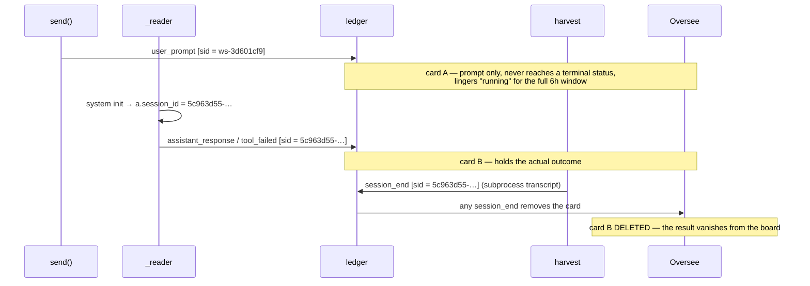

# fix: Give a fleet run one stable ledger identity

## Summary

A MindParallel/MindSwarm run currently writes its prompt under one ledger
session id and its outcome under another, so Oversee renders two cards per run
— and deletes the one holding the result. This plan gives a fleet run a single
stable ledger identity for its whole life, decoupling the ledger's notion of
"which run is this" from the CLI's `--resume` continuity token, which today are
the same overloaded field.

---

## Problem Frame

`Manager._log` (`src/mindhive/workspace.py:711`) resolves the ledger session id as:

```
session_id = a.session_id or f"ws-{a.id}"
```

`a.session_id` is `None` at `send()` time (`:607`). It is only assigned later,
inside `_reader`, when the stream's `system` init event arrives (`:658-659`,
`:680-681`). So one logical run writes under **two different identities**:

| Moment | Writer | Ledger session id |
|---|---|---|
| `send()` → `user_prompt` | `workspace.py:607` | `ws-<agent-id>` (fallback — uuid not yet known) |
| run end → `assistant_response` / `tool_failed` | `workspace.py:673` / `:679` | the real claude uuid |

**Measured against the live ledger** (`~/.mindhive/mindhive/events`, 19,243 events):

- 28 workspace-tagged sessions: **14 under `ws-<id>`, 14 under real uuids**
- All 14 `ws-<id>` sessions contain **only `user_prompt`** — zero terminal events
- The 14 uuid sessions hold **all 22 `assistant_response` + 6 `tool_failed`**
- **13 of 13** terminal-bearing uuid sessions also carry a harvested `session_end`

### Why this produces two cards, and kills the useful one



The ledger accounting is complete (22 done + 7 failed = 29 prompts, verified) —
**the data is durable, the view is not.**

### Why it matters beyond the UI

WS1 of `docs/prds/2026-07-22-003-agent-process-layer-prd.md` rehydrates a
process table by folding agent events from the ledger. **That fold is
impossible while one logical run carries two identities.** This is a
prerequisite, not a cosmetic fix.

It also unblocks already-landed work: WS0.2 (`src/mindhive/oversee.py`) derives
card status from workspace-tagged terminal events, which is correct but can
never fire on a card that structurally cannot receive one.

---

## Requirements

| ID | Requirement |
|---|---|
| R1 | One fleet run produces exactly one Oversee card carrying both its prompt and its terminal outcome |
| R2 | That card reaches a real terminal status (`done`/`failed`) instead of lingering `running` for 6h |
| R3 | A completed fleet run is not silently deleted from the board by a harvested `session_end` |
| R4 | The 28 already-split historical sessions still read without error, handled deliberately |
| R5 | No regression: ordinary interactive sessions unaffected; full suite green (currently 1679) |
| R6 | `--resume` continuity is preserved — the CLI still resumes the correct claude session |

---

## Key Technical Decisions

### KTD1 — Decouple the ledger identity from the resume token (chosen)

`a.session_id` is doing **two unrelated jobs**:

1. the `--resume` continuity token passed to the CLI (`:602-603`)
2. the ledger identity for every event this agent writes (`:711`)

Job 1 legitimately must be the claude uuid and legitimately cannot be known
until the stream opens. Job 2 must be stable from the first write. **Overloading
one field with both is the entire bug.** Split them: `a.session_id` keeps job 1
unchanged; `_log` always uses a stable `ws-<agent-id>` for job 2, and carries
the claude uuid in the event *payload* for correlation.

**Verified as safe:** the only occurrence of `ws-` in `src/` is `workspace.py:711`,
and nothing in the codebase joins workspace events by the claude uuid. The
change is structurally isolated.

**R3 falls out for free.** Harvest writes `session_end` under the transcript's
own uuid. Once fleet events live under `ws-<agent-id>`, that `session_end`
lands on a *different* session id and can no longer delete the fleet card. Defect
0.6 needs no separate fix — it was a symptom of the same overload.

### Alternatives considered

| Option | Verdict |
|---|---|
| **(b) Defer the `user_prompt` append until the uuid is known** | **Rejected.** If the run dies before the `system` init event, the prompt is lost entirely — a data-loss regression in a plan whose whole purpose is durability. |
| **(c) Keep both writes, add a correlation event, merge at read time** | **Rejected.** Adds a new event type and a join to the 2.5s dashboard refresh path — and it does *not* deliver its main advantage: the 14 historical split sessions predate any correlation event, so they cannot be repaired at read time anyway. Same forward benefit as KTD1 at materially higher cost. |
| **(a-plain) Stable id, discard the uuid** | **Rejected as insufficient.** Same identity fix, but throws away the only handle for correlating a run with its harvested transcript. Keeping the uuid in the payload costs one field and preserves that option. |

### KTD2 — Historical sessions are legacy, repaired by nothing (deliberate)

The ledger is append-only; existing events are never edited or migrated
(SOP 7.1). The 14 split historical runs are left **as legacy**: they read
without error, and they are already far outside the 6h active window, so they
render nothing either way. A read-time merge heuristic would add permanent
complexity to a hot path to retro-fix 14 rows nobody can see. **Explicitly not
repaired**, and R4 is satisfied by proving reads stay total over the split shape.

### KTD3 — Skill trail on fleet cards is a known, unchanged limitation

`oversee.skill_trails` keys by session id, and harvested `skill_used` events
land under the claude uuid. So a `ws-<agent-id>` card shows no skill trail —
but it shows none today either (it holds only a `user_prompt`), so this is **not
a regression**. The uuid now preserved in the payload is exactly the handle a
future unit would use to join them. Deferred, not lost.

---

## Implementation Units

### U1. Give each agent a stable ledger identity

**Goal:** One fleet run writes every event under one session id, while
`--resume` keeps using the claude uuid.

**Requirements:** R1, R6

**Dependencies:** none

**Files:**
- `src/mindhive/workspace.py` — `Agent.__init__`, `Manager._log`
- `tests/test_workspace.py`

**Approach:** Introduce a stable per-agent ledger id assigned at construction
(derived from the existing `a.id`, so it is available before the first write).
`_log` uses it unconditionally instead of the `a.session_id or …` fallback.
`a.session_id` remains the resume token and keeps its current assignment points
untouched. Add the claude uuid to the logged payload so the run can still be
correlated with its harvested transcript later (KTD3).

**Patterns to follow:** `_log`'s existing crash-guard (`workspace.py:713-715`) —
the ledger must never crash a pane; keep that contract. Payload field naming
follows the flat-key style already used (`agent`, `role`).

**Test scenarios:**
- A single run's `user_prompt` and its terminal `assistant_response` are logged
  under the **same** session id, and that id is stable across the run.
- A run that **fails** (non-zero exit) logs its `tool_failed` under the same id
  as its `user_prompt`.
- The ledger id does **not** change after the stream's `system` init event
  arrives — i.e. it is unaffected by `a.session_id` being assigned mid-run.
- `a.session_id` is still set from the stream and is still passed as `--resume`
  on a subsequent `send()` to the same agent (R6 guard — must not regress).
- Two runs on the **same** agent share one ledger id; two **different** agents
  get different ids.
- The logged payload carries the claude uuid once known, and the run still logs
  successfully when the uuid never arrives (uuid absent/None, no raise).

**Verification:** A run driven through the existing `Harness` produces exactly
one distinct ledger session id across both of its events.

---

### U2. Prove the fleet card is now whole and survives harvest

**Goal:** Demonstrate end-to-end that one run yields one Oversee card that
reaches a terminal status and is not deleted by a foreign `session_end`.

**Requirements:** R1, R2, R3, R5

**Dependencies:** U1

**Files:**
- `tests/test_oversee.py`

**Approach:** Integration-level coverage over the real
`workspace → ledger → oversee.interactive_sessions` path, rather than asserting
on `_log` internals. This is the unit that actually proves the user-visible
defect is fixed, and it is the regression guard for the WS0.2 status work
landed earlier. No production change is expected here — if a change *is* needed,
that is a finding, not a licence to expand scope.

**Execution note:** Write these as failing tests first; they encode the
user-visible acceptance criteria and should fail against U1-only if anything in
the fold still mis-handles fleet cards.

**Patterns to follow:** `tests/test_oversee.py` `_wsev` / `_only` helpers added
with the WS0.2 work; `_ev` for ordinary-session events.

**Test scenarios:**
- A completed fleet run yields **exactly one** card whose title comes from its
  prompt and whose status is `done`.
- A failed fleet run yields exactly one card with status `failed`.
- A `session_end` written under a **different** session id (the harvested
  transcript uuid) does **not** remove the fleet card. *(R3 — the defect-0.6
  guard; this is the scenario that silently deleted results before.)*
- An ordinary interactive session with its **own** `session_end` is still
  removed as before. *(R5 — proves the R3 fix did not disable legitimate
  lifecycle removal.)*
- A fleet run re-sent after finishing returns to `running`, then reaches its new
  terminal status.
- An ordinary session carrying a non-workspace `tool_failed` is still `running`
  — the five-producer guard from WS0.2 still holds.

**Verification:** One card per run, correct terminal status, and the
harvested-`session_end` scenario passes without the card disappearing.

---

### U3. Prove reads stay total over the legacy split shape

**Goal:** Lock in KTD2 — the 28 already-split historical sessions read without
error and behave deliberately.

**Requirements:** R4, R5

**Dependencies:** U1

**Files:**
- `tests/test_oversee.py`

**Approach:** Construct the legacy shape explicitly — a `ws-<id>` session
holding only a `user_prompt`, plus a separate uuid session holding the terminal
event — and assert the fold handles it without raising. This documents the
legacy behavior as a decision rather than leaving it as an accident, and guards
the append-only invariant that the store still contains history written by
older code (SOP 7.5).

**Test scenarios:**
- The legacy split shape folds without raising, and the prompt-only `ws-` session
  still renders as `running` (it has no terminal event — correct, not a bug).
- The legacy uuid session carrying a terminal event still reports that terminal
  status, so no already-recorded outcome is lost by the new identity scheme.
- The fold is unaffected by a workspace event whose `tags` are missing or a
  non-list — reads stay total (mirrors the existing `_is_workspace` guard).

**Verification:** Legacy-shaped events produce no exception and no card
regression; full suite green.

---

## Scope Boundaries

### In scope
- The ledger-identity split and the tests proving R1–R6.

### Deferred to Follow-Up Work
- **Joining harvested transcript events to the fleet card** (skill trails, cost
  per run) using the newly-preserved uuid — KTD3. Belongs with WS0.3.
- **Teaching `origin_of` the `workspace` tag** so fleet cards are labelled and
  show cost instead of rendering as anonymous zero-cost sessions — that is PRD
  defect 0.3, tracked separately.
- **Backfilling or merging the 14 legacy split runs** — explicitly rejected in
  KTD2.

### Non-goals
- Any change to `loop/`, the single-agent path, or `enrich.py`.
- Any change to the `--resume` mechanism itself.

---

## Risks & Dependencies

| Risk | Severity | Mitigation |
|---|---|---|
| Changing the ledger id orphans fleet events from harvested transcript events under the uuid | Medium | Accepted and documented (KTD3); no regression vs. today, and the uuid is preserved in-payload so the join stays possible |
| `--resume` silently breaks, so agents lose conversational continuity | **High** | Explicit R6 guard test in U1; `a.session_id` and its assignment points are deliberately untouched |
| The R3 fix over-corrects and stops legitimate `session_end` removal for ordinary sessions | Medium | Paired scenarios in U2 assert both directions |
| Dismissal/delete keyed by `run_id` behaves differently once ids change | Low | `loop_run_dismissed` is keyed by whatever `run_id` the card carries; the new id is stable, so dismissal is at least as correct as before |

**Dependency:** builds directly on the WS0.2 status derivation already landed in
`src/mindhive/oversee.py`; U2 is that work's first real end-to-end proof.

---

## Verification Strategy

- Full suite must stay green (**1679 passing** at plan time).
- Worktree runs need `PYTHONPATH=<worktree>/src`; interpreter is at
  `C:/Users/hanif/mindhive/.venv/Scripts/python.exe` (not on `PATH`).
- Beyond unit tests, re-run the live-ledger replay used to discover this defect
  (read-only, against `~/.mindhive/mindhive/events`) to confirm no ordinary
  session changes status and legacy rows still read.
- No `dashboard_page.py` change is anticipated. If one becomes necessary, verify
  by calling `render_page()` directly and grepping the served page for section
  hooks — never by touching the live dashboard on port 54461.
- Record the change-set with `hive log` before calling the work done.

---

## Open Questions

None blocking. One deferred to implementation: whether the stable id should keep
the existing `ws-` prefix or adopt a clearer one. Keeping `ws-` is the default —
it matches the 14 historical rows and avoids inventing a third identity shape —
but this is settled at implementation time, not here.

---

## Sources & Research

- Root cause, evidence, and the two-card mechanism: this session's verification
  pass, recorded in `docs/prds/2026-07-22-003-agent-process-layer-prd.md`
  (defects 0.5 and 0.6) and `docs/plans/2026-07-22-os-architecture-consolidated-state.md`.
- Live-ledger measurements: `~/.mindhive/mindhive/events`, 19,243 events, read-only.
- No upstream requirements document and no `docs/solutions/` learnings exist for
  this area; the plan is grounded in direct source reading and ledger measurement.
