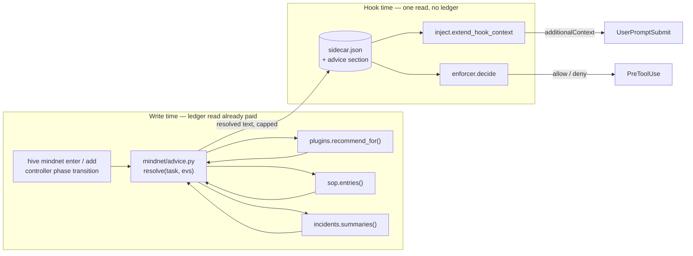
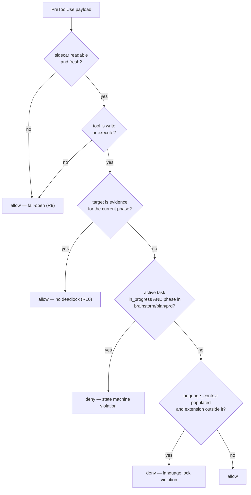

# feat: MindNetwork MN-3/MN-4/MN-5 — mechanical enforcement, language lock, and the cat board

## Summary

Three units of work that turn MindNetwork from a system that *describes* its rules into one that *executes* them:

- **MN-3 / Mechanicalization** — `mindnet/inject.py` currently emits one prose line telling the agent to "consult the skill catalog." Replace it with actually-retrieved skill, SOP, and prior-failure data, resolved by Python queries against the real registries.
- **MN-4 / The Teeth** — a `PreToolUse` enforcer that denies write and execute tools when the active task's phase forbids them, and denies file writes whose extension violates the task's declared `language_context`.
- **MN-5 / The Cat Board** — per-faculty cat icons in the MindSwarm dashboard, with click-through metadata, 180-second dimming, and 6-hour removal.

The plan's central architectural move is a **resolve-at-write / read-at-hook split**. All three data sources the directive wants injected are ledger- or filesystem-backed and cost far more than the stated 5 ms budget. They are resolved where a ledger read is already being paid, persisted into the sidecar, and read back by the hook from the single `sidecar.read()` it already performs.

---

## Baseline Correction (read this first)

The directive states MN-1/MN-2 are merged and the tree carries 2303 passing tests. **Verified against the repo: that is not the current state of this worktree.**

| Claim | Verified state |
|---|---|
| "PR #80 is green" | True — all four CI jobs SUCCESS as of 2026-07-26T23:37Z |
| "PR #80 is merged" | **False** — PR #80 is `OPEN`, `MERGEABLE`, `CLEAN` against master |
| MN-1/MN-2 code is available here | **False** — this worktree is at `ae16d33` (= `origin/master`), which contains **no** `src/mindhive/mindnet/` directory at all |
| `recommend/plugins.py` is the skill registry | **False** — there is no `recommend/` package; the registry is `src/mindhive/plugins.py` + `src/mindhive/recommend.py` |
| `mindnet/state.json` is the sidecar path | Unverified spelling — the real path comes from `sidecar.sidecar_path(project)`; the enforcer must call that API, never a hardcoded filename |
| "backend telemetry data feed exists" | Half true — `telemetry.py` exists and is complete, but its own docstring states it is *"deliberately NOT wired into `controller.py` or `executor.py`"*. **Nothing emits.** MN-5 renders an empty board until emit call sites are added. |

Every file this plan modifies (`inject.py`, `sidecar.py`, `telemetry.py`, `controller.py`) lives only on `origin/claude/mindnetwork-system-init-30cb2a`. **U1 establishes the real baseline by merging that branch into this one.** Without it, every later unit edits files that do not exist.

---

## Problem Frame

MindNetwork's phase spine is real and enforced *within its own commands* — `hive mindnet enter` refuses a forward move without evidence. But the spine has no reach outside those commands:

1. **The injector describes instead of retrieves.** `inject.py:236` ends the phase block with a single line: `"Need context first? Recall the ledger, then read the code, then consult the skill catalog. Ask the user last."` No query runs. The agent is told a catalog exists and left to find it, which means in practice it does not.

2. **Nothing stops a tool call.** The phase machine knows the task is in `brainstorm`. The agent can still write `.py` files, and nothing in the system objects. `__main__.py` accepts a `language_context` and no code reads it back.

3. **The telemetry feed has no consumer and no producer.** `telemetry.py` defines seven faculties, a fold, and an `awake()` projection — and is wired to nothing on either end.

The through-line: every one of these is a place where the system *knows* something and *does nothing with it*.

---

## Requirements

Traced from the directive; R-IDs are plan-local.

**MN-3 — Mechanicalization**
- **R1** — The injected context contains skill/plugin data retrieved by a Python query against the live registry, not a pointer to it.
- **R2** — The injected context contains the actual text of SOPs relevant to the active task.
- **R3** — When the active task matches a prior recorded failure signature, the injected context names the failure and forbids the pattern.
- **R4** — Injection generation stays under 5 ms and never reads the ledger on the hook path.
- **R5** — Existing `inject.py` invariants survive: fail-open, additive-only, size-capped, sanitized, stale-branch intact.

**MN-4 — The Teeth**
- **R6** — A `PreToolUse` payload for a write/execute tool returns `permissionDecision: "deny"` when the active task is in `brainstorm`, `plan`, or `prd`.
- **R7** — A `PreToolUse` payload for a file write returns `deny` when the target extension is outside a populated `language_context`.
- **R8** — The enforcer reads only the sidecar. It never calls `events.read_all`.
- **R9** — An empty, missing, or corrupt sidecar allows (fail-open).
- **R10** — Denial does not deadlock the phase machine: writes that *produce the evidence a phase requires* must remain permitted.

**MN-5 — The Cat Board**
- **R11** — Each active faculty renders a cat icon in the MindSwarm UI, in canonical faculty order.
- **R12** — Clicking a cat shows the skill/plugin in use, the `task_id`, and the phase.
- **R13** — A faculty idle beyond 180 s renders dim; beyond 6 h it is absent from the payload entirely.
- **R14** — Faculty state is derived from real ledger telemetry, which requires emit call sites to exist.

**Cross-cutting**
- **R15** — Python 3.11+, standard library only, no new dependencies, no `shell=True`.
- **R16** — Tests written before implementation, observed failing, then made to pass.
- **R17** — The full suite is green before the work is called done, and a `hive log` entry is recorded.

---

## High-Level Technical Design

### The resolve-at-write / read-at-hook split

The directive asks the injector to query three registries live. Measured against the code, none of them can run on the hook path:

| Source | Real entry point | Cost |
|---|---|---|
| Skills / plugins | `plugins.recommend_for()` | `events.read_all()` (~264 ms) **plus** `live_inventory()` filesystem scan across every cached plugin |
| SOPs | `sop.entries(evs)` → `sop.fold(evs)` | `events.read_all()` (~264 ms) |
| Prior failures | `incidents.summaries()` | ledger read plus per-incident file reads |

Against a 5 ms budget and a pinned property test (`test_the_hook_path_never_calls_read_all`), live querying is not an option. It is also a size problem: `sop.BLOCK_FULL_BUDGET` is 16 000 characters and `inject.MAX_BLOCK_CHARS` is 1 200.

The resolution keeps the mechanical guarantee — Python does the retrieval, actual text is injected — and moves *when* it happens:

Both MN-3 and MN-4 consume the same cached projection through the same single `sidecar.read()`. Staleness is already a solved problem here — `sidecar.read()` returns a `fresh` flag, and `inject.block()` already branches on it.

### The enforcer decision

Directional; the prose above and the unit definitions are authoritative.

---

## Key Technical Decisions

**KTD1 — Resolve at write time; the hook only reads.**
The mandate is *mechanical retrieval*, not *retrieval at a specific instant*. Python still runs the queries and the injected text is still the real retrieved data; it is resolved where the ledger read is already being paid. This is the only design satisfying R1–R3 and R4 simultaneously, and it reuses the exact pattern MN-4 independently requires.

**KTD2 — Advice gets its own budget, separate from the phase block.**
`MAX_BLOCK_CHARS = 1200` stays untouched and continues to bound the phase directive. Advice is capped independently (`MAX_ADVICE_CHARS`, proposed 2 400), with per-item caps beneath it. Two independent walls, each with its own test — matching the existing two-bound idiom in `phase_block`. SOP text is truncated at the *resolver*, so the cap is never reached by a 4 000-character SOP body.

**KTD3 — Advice is a new sidecar section, and the schema version goes to 3.**
`sidecar.SCHEMA_VERSION` is currently 2. Adding a section is additive; `_decode` already tolerates missing keys, so a v2 document read by v3 code yields empty advice, and a v3 document read by v2 code ignores the section. Bump the constant so the staleness stamp reflects the shape change.

**KTD4 — MN-4 fires only on `in_progress`, not `pending`.**
`inject.active()` deliberately includes `pending` because it is the dataclass default for every declared task — correct for advisory steering, catastrophic for denial. A single declared-but-untouched task sitting in `brainstorm` would deny every write in the repository. The enforcer narrows to a task the operator explicitly started. This is the single most important safety decision in the plan.

**KTD5 — The enforcer is a `POLICY_CHECKS` entry, not a bespoke hook path.**
`enforce.POLICY_CHECKS` already gives ordered evaluation, per-signature manifest disable, reason override, and fail-open wrapping in `evaluate_policies`. Registering two entries (`gate:mindnet-phase`, `gate:mindnet-language`) inherits all of it and gives the operator a documented kill switch through the existing manifest. Building a parallel path would duplicate every one of those behaviours.

**KTD6 — Evidence-producing writes are exempt (R10).**
`phases.PHASE_EVIDENCE` declares `kind: "file"` phases with a `required_dir`. Denying writes to those directories while in those phases makes the phase unclearable — the machine would forbid the only action that advances it. The enforcer consults the same descriptor `inject._criterion` reads, so the exemption is derived from the one legend rather than a second hardcoded list of "docs paths."

**KTD7 — MN-5 gets a pure `ui_cats.py`; `swarm_page.py` only renders.**
`telemetry.awake()` is status-based with no time component, and cannot express dim-versus-gone. A new pure module classifies each faculty into `active` / `dim` / `absent` from `(status, ts, now)`, with `now` injected. Pure and total means the 180 s and 6 h boundaries are unit-testable without clock manipulation, and `swarm_page.py` stays a renderer.

**KTD8 — Telemetry emit call sites are in scope.**
R14 is not satisfiable otherwise. `telemetry.busy()` already provides the context manager with the `finally` guarantee. Per the recorded wiring caveat, the order within any command is: **phase event → telemetry emit → sidecar write**. Verify that ordering against the merged code in U1 before relying on it.

---

## Implementation Units

### U1. Establish the real baseline

**Goal:** Make MN-1/MN-2 present in this worktree and confirm the suite is green before changing anything.

**Requirements:** Prerequisite for all.

**Dependencies:** none.

**Files:** none modified — a merge plus a verification run.

**Approach:** Merge `origin/claude/mindnetwork-system-init-30cb2a` into `claude/mindnetwork-system-init-f1ac89`. It is `MERGEABLE`/`CLEAN` against master and this branch is at master, so expect no conflicts. Then run the full suite and record the actual passing count.

**Verification:** `src/mindhive/mindnet/` exists with all eight modules; the full suite passes; the recorded count is the honest baseline for U10's comparison. **If the observed count is not 2303, the plan's baseline is the observed number** — record it, do not retrofit the directive's figure.

**Test scenarios:** *Test expectation: none — no source change; this unit's output is the verified baseline count itself.*

---

### U2. Advice resolver — `mindnet/advice.py`

**Goal:** One module that turns an active task into resolved skill, SOP, and prior-failure text.

**Requirements:** R1, R2, R3, R15.

**Dependencies:** U1.

**Files:**
- `src/mindhive/mindnet/advice.py` (new)
- `tests/test_mindnet_advice.py` (new)

**Approach:** A pure-ish resolver with all I/O behind injectable seams. `resolve(task, evs=None, project=None) -> Advice` where `Advice` is a `NamedTuple` of plain strings and tuples, serializable without a custom encoder (mirroring `telemetry.Activity`).

- **Skills** — `plugins.recommend_for(project, evs=evs, top=3)`, keyed on the task's title and description via the existing `recommend.need_match` scoring. Store each pick's name plus its `recommend.intended_use_clause` — the actual usage text, not a name.
- **SOPs** — `sop.entries(evs, project)`, matched against task text; store the real `text` body, truncated per KTD2.
- **Prior failures** — `incidents.summaries(project)`, matched by signature keywords against task text; render as the directive's explicit constraint sentence naming the reason and forbidding the pattern.

Total by construction: every lookup wrapped so a missing registry, corrupt incident file, or absent plugin cache yields an empty field, never a raise. Reuse `inject.safe_text` for every registry-supplied string — this text reaches a prompt, and a plugin description is untrusted input.

**Patterns to follow:** `telemetry.py` for the NamedTuple-of-strings shape and total-fold discipline; `plugins.recommend_for` for lazy imports avoiding cycles; `inject.safe_text` for sanitization.

**Test scenarios:**
- A task whose title matches a mocked skill's keywords resolves that skill, and the output contains the skill's *intended-use text*, not merely its name.
- Exactly the top 3 skills are kept when the registry returns more.
- A mocked SOP whose text is a unique sentinel string appears **verbatim** in the resolved output — asserting on the literal body, not on the presence of the word "SOP".
- An SOP body longer than the per-item cap is truncated at the resolver, and the truncation does not split mid-line into a fragment.
- A task matching a recorded failure signature resolves a constraint naming the recorded reason.
- A task matching no failure signature resolves an empty failure field — no fabricated warning.
- `plugins.live_inventory` raising resolves to empty skills with the SOP and failure fields still populated (per-source isolation, not all-or-nothing).
- `incidents.summaries` returning a malformed row is skipped, not raised.
- A registry string containing `[mindnet]` has the marker stripped — no forged directive header.
- A registry string containing newlines is collapsed to one line.

---

### U3. Persist advice into the sidecar

**Goal:** Carry resolved advice on the projection so the hook can read it in one call.

**Requirements:** R4 (enabling), R5.

**Dependencies:** U2.

**Files:**
- `src/mindhive/mindnet/sidecar.py`
- `tests/test_mindnet_sidecar.py`

**Approach:** Add an `advice` section to the encoded document and an `advice` field to the `Sidecar` NamedTuple, following the exact shape `tasks` already uses (`_encode` accepts it, `_decode_tasks` mirrors it, `read` surfaces it). Bump `SCHEMA_VERSION` to 3 per KTD3. Decode must be total, consistent with the module's existing posture: an advice section that is a string, a list, or missing decodes to empty rather than raising.

**Patterns to follow:** the existing `tasks=` threading through `_encode` / `_decode_tasks` / `read` / `write` / `rebuild` — advice is the same shape one level over.

**Test scenarios:**
- Round-trip: advice written is advice read back, field for field.
- A v2 document (no `advice` key) decodes to empty advice, and every other field still decodes — backward compatibility.
- A v3 document with `advice` set to a non-dict decodes to empty advice without raising.
- `write` with `advice=None` produces a document that `read` handles.
- `SCHEMA_VERSION` is 3 and appears in the encoded document.
- An advice section containing a non-string leaf value decodes without raising.

---

### U4. Wire resolution into the write path

**Goal:** Refresh advice whenever the ledger is already being read.

**Requirements:** R1–R3 (delivery), R4.

**Dependencies:** U2, U3.

**Files:**
- `src/mindhive/mindnet/sidecar.py` (`rebuild`)
- `src/mindhive/mindnet/controller.py` (transition write path)
- `tests/test_mindnet_sidecar.py`, `tests/test_mindnet_controller.py`

**Approach:** `rebuild()` already holds an `evs` list — pass it to `advice.resolve` for the active task and write the result alongside the state. In the controller, refresh advice on the same transitions that already write the sidecar, reusing their events read. Add no new `read_all` call anywhere; if a call site does not already hold `evs`, it does not resolve advice.

**Execution note:** Honor the recorded wiring-order caveat — phase event, then telemetry emits, then sidecar write. Confirm the ordering against the merged controller before changing it.

**Test scenarios:**
- `rebuild` on a store with an active task produces a sidecar whose advice is populated.
- `rebuild` performs no more `events.read_all` calls than before the change — assert on call count via a counting stub, the same property style as `test_the_hook_path_never_calls_read_all`.
- A phase transition refreshes advice for the newly-current phase.
- `rebuild` on a store with no tasks writes empty advice and does not raise.
- A resolver raising does not fail the rebuild — the sidecar is still written, with empty advice.

---

### U5. Mechanicalize `inject.py`

**Goal:** Replace the "consult the skill catalog" line with the retrieved data.

**Requirements:** R1, R2, R3, R4, R5.

**Dependencies:** U3, U4.

**Files:**
- `src/mindhive/mindnet/inject.py`
- `tests/test_mindnet_inject_mechanical.py` (new)
- `tests/test_mindnet_inject.py` (existing invariants must stay green)

**Approach:** Add `advice_block(advice) -> str` — pure, total, capped at `MAX_ADVICE_CHARS`, every field through `safe_text`. Append it to the phase block in `block()`. Delete the prose line at `inject.py:236`; leave the "Ask the user last" ordering guidance, which is behavioural instruction rather than a fake retrieval pointer.

Constraints that must not move: `extend_hook_context` still calls only `sidecar.read`; the stale branch still returns `AGNOSTIC_BLOCK` **alone** (stale advice is worse than none, by the same argument the module already makes for stale phase data); fail-open unchanged; empty advice renders nothing rather than an empty header.

**Test scenarios:**
- A sidecar carrying a mocked SOP body yields injected context containing that body **verbatim** — the directive's literal-text requirement.
- A sidecar carrying a resolved skill yields context containing its intended-use text.
- A sidecar carrying a failure constraint yields context containing the recorded reason and the forbidding language.
- Empty advice yields a phase block byte-identical to the pre-change output — no stray header, no blank lines.
- A stale sidecar yields `AGNOSTIC_BLOCK` only, with no advice text — extend the existing stale-branch test to assert advice absence.
- The advice block is independently size-capped: an oversized advice payload truncates advice without truncating the phase block.
- Total block size stays within `MAX_BLOCK_CHARS + MAX_ADVICE_CHARS`.
- `extend_hook_context` still performs zero `events.read_all` calls — the existing property test must pass unmodified.
- Latency: `extend_hook_context` against a populated sidecar completes within the budget. Assert against a **generous** ceiling (e.g. 50 ms) rather than 5 ms — a hard 5 ms wall-clock assertion is a CI flake generator on shared runners. The real guarantee is the structural no-ledger property above; the timing test is a smoke check against accidental O(n) work.
- A raise inside `advice_block` returns the context unchanged (fail-open).

---

### U6. The enforcer — `mindnet/enforcer.py`

**Goal:** The decision function, pure and independently testable.

**Requirements:** R6, R7, R8, R9, R10.

**Dependencies:** U1 (needs sidecar and phases).

**Files:**
- `src/mindhive/mindnet/enforcer.py` (new)
- `tests/test_mindnet_enforcer.py` (new)

**Approach:** Two pure predicates plus one thin I/O wrapper.

- `phase_violation(tool_name, tool_input, sc, now=None) -> str | None`
- `language_violation(tool_name, tool_input, sc) -> str | None`

Both take an already-read `Sidecar` so tests never touch disk. Tool classification: a write set (`Write`, `Edit`, `NotebookEdit`, `MultiEdit`) and an execute set (`Bash`, `PowerShell`), named as module constants so the sets have one home.

Denial messages are the directive's, verbatim:
- `ACCESS DENIED: MindNetwork State Machine violation. You cannot write or execute code while in Phase: {current_phase}.`
- `ACCESS DENIED: Language Compatibility Lock violation. This task is strictly restricted to {language_context}.`

Per KTD4, phase denial requires `status == in_progress`. Per KTD6, a write whose path falls under the current phase descriptor's `required_dir` is exempt. Extension mapping (`.py` → `python`, `.md` → `markdown`, …) is a module constant; an unmapped extension does **not** deny — unknown is not a violation.

**Patterns to follow:** `enforce._policy_*` for the `reason-or-None` contract; `inject.active` for active-task selection, narrowed per KTD4.

**Test scenarios:**
- `Write` to `src/x.py` with the active task `in_progress` in `brainstorm` → denies, message contains the exact directive string and the phase name.
- Same, in `plan` → denies. Same, in `prd` → denies.
- Same, in `execution` → allows.
- Same, in `audit-bug` → allows.
- `Bash` running a script while in `brainstorm` → denies.
- `Read` while in `brainstorm` → allows (not a write or execute tool).
- Task in `brainstorm` but status `pending` → **allows** (KTD4 — the anti-brick guard, the single most important test here).
- Task in `brainstorm` but status `done` → allows.
- Write to the current phase's `required_dir` while in `plan` → allows (KTD6 — the anti-deadlock guard).
- `language_context == ["python"]`, write to `app.js` → denies, message names the context.
- `language_context == ["python"]`, write to `mod.py` → allows.
- `language_context == ["python", "markdown"]`, write to `notes.md` → allows.
- `language_context == []` → allows any extension (unpopulated lock is not a lock).
- `language_context` absent from the task → allows.
- Write to an extensionless file with a populated lock → allows (unmapped is not a violation).
- Write to `.JS` with `["python"]` → denies (case-insensitive extension matching).
- Empty sidecar → allows. Stale sidecar → allows. Sidecar whose decode yields no records → allows.
- No `in_progress` task anywhere → allows.
- Two `in_progress` tasks in different phases → the selection is deterministic and matches `inject.active`'s documented ordering.
- A `tool_input` missing `file_path` → allows, does not raise.
- A `tool_input` that is not a dict → allows, does not raise.

---

### U7. Register the enforcer in the `PreToolUse` path

**Goal:** Make the decision reach the actual hook.

**Requirements:** R6, R7, R8, R9.

**Dependencies:** U6.

**Files:**
- `src/mindhive/enforce.py`
- `tests/test_enforce.py` (existing)
- `tests/test_mindnet_enforcer.py`

**Approach:** Add two `POLICY_CHECKS` entries — `("gate:mindnet-phase", "deny", _policy_mindnet_phase)` and `("gate:mindnet-language", "deny", _policy_mindnet_language)`. Each is a thin adapter: lazily import `mindnet.enforcer`, read the sidecar once, delegate. Lazy import matters — `enforce.py` must not gain a hard dependency on `mindnet`, matching how `_policy_destructive` lazily imports `gateguard`.

One sidecar read per `hook_decision` call, shared by both checks — not one per check.

`evaluate_policies` already wraps everything in a try/except returning `None`, so fail-open is inherited. Denials automatically receive the `ENFORCED_MARK` prefix in `hook_decision`, which keeps the failure-capture loop from re-ingesting our own denial text as a new incident.

**Test scenarios:**
- `hook_decision` with a brainstorm-phase Write payload returns `permissionDecision: "deny"` and a reason carrying `ENFORCED_MARK`.
- `hook_decision` with an execution-phase Write payload returns `{}`.
- `hook_decision` with a language-violating payload returns `deny` with the language message.
- A manifest entry disabling `policy:gate:mindnet-phase` restores allow — the documented kill switch.
- A manifest `reason` override replaces the default message.
- No mindnet sidecar present → `{}`, and pre-existing enforce policies still behave identically.
- Malformed JSON payload → `{}` (existing contract preserved).
- The mindnet checks do not shadow `gate:no-verify` — ordering within `POLICY_CHECKS` is asserted.
- `hook_decision` performs zero `events.read_all` calls (R8) — the property test, mirroring the injector's.

---

### U8. Cat state provider — `mindnet/ui_cats.py`

**Goal:** Turn the telemetry fold into a render-ready, time-decayed payload.

**Requirements:** R11, R12, R13.

**Dependencies:** U1.

**Files:**
- `src/mindhive/mindnet/ui_cats.py` (new)
- `tests/test_mindnet_ui_cats.py` (new)

**Approach:** `board(state, now, skills=None) -> tuple[dict, ...]` — pure and total, `now` injected. Each entry carries `faculty`, `display` (`active` | `dim`), `task_id`, `phase`, `skill`, `age_secs`. Constants `DIM_AFTER_SECS = 180` and `HIDE_AFTER_SECS = 21600` live here with one home each.

Classification is by **age of the last event**, per R13 — an `idle`-status faculty within 180 s still renders dim rather than vanishing, since the point of the board is spotting a silent hang. Output preserves `telemetry.FACULTIES` canonical order so the board does not reshuffle as events arrive.

Totality matters more than usual: this parses timestamps written by every past version of the emitter. An unparseable `ts` is treated as maximally old (hidden) rather than raising — a bad row must not take out the board.

**Test scenarios:**
- A faculty last seen 10 s ago → present, `display == "active"`.
- Last seen 179 s ago → `active`. At exactly 180 s → `dim` (boundary stated explicitly).
- Last seen 200 s ago → `dim`.
- At exactly 21600 s → absent. At 21599 s → present and `dim`.
- Last seen 7 h ago → absent from the payload entirely (R13).
- A mix across all three bands returns only the non-hidden ones, in canonical faculty order.
- Entries carry `task_id` and `phase` from the fold (R12).
- An empty state returns an empty tuple.
- A faculty with an unparseable `ts` is treated as hidden, not raised.
- A faculty with an empty `ts` is hidden, not raised.
- A `state` containing a faculty name outside `FACULTIES` is ignored.
- `now` is honored as given — no hidden call to the system clock.

---

### U9. Emit sites and the dashboard board

**Goal:** Make cats reflect real activity and appear in the UI.

**Requirements:** R11, R12, R13, R14.

**Dependencies:** U8.

**Files:**
- `src/mindhive/mindnet/controller.py`, `src/mindhive/mindnet/executor.py` (emit sites)
- `src/mindhive/dashboard.py` (route)
- `src/mindhive/swarm_page.py` (render)
- `tests/test_mindnet_telemetry.py`, `tests/test_dashboard.py` (or the closest existing dashboard test module)

**Approach:** Three seams.

1. **Emit sites** — wrap the faculty-bearing operations in `telemetry.busy(...)`: phase transitions (`task-graph`), validation runs (`pr-green`), advice resolution from U2 (`skill-plugin`, `sop`, `improvements`). Per KTD8, order is phase event → telemetry emit → sidecar write.
2. **Route** — `/api/mindnet/cats` in `_GET_ROUTES`, returning `ui_cats.board(telemetry.fold(evs), now)`. Follow the existing `_get_*` handler shape and `self._json` convention.
3. **Render** — extend `swarm_page.py`'s existing 1200 ms poll loop with a cat strip at the top of the stage. Inline SVG cats, one per active faculty, dim class driven by `display`, click opens a metadata panel showing skill/plugin, `task_id`, and phase. Keep the existing token-escaping discipline in `render_swarm` — every interpolated value stays JSON-encoded with `<` escaped.

**Execution note:** This unit touches the live dashboard's served code. Per project instructions, preview on a separate port from this worktree; never repoint the process on 54461. Before calling it done, grep the served page for `showOversee` and `renderOversee` to confirm no existing section regressed.

**Test scenarios:**
- A phase transition emits a `mindnet_activity` event with `faculty == "task-graph"` and the correct `task_id` and `phase`.
- The emit pairs: `active` on entry, `idle` on exit, including when the wrapped block raises.
- A raising wrapped block still propagates its exception (telemetry must not swallow).
- A telemetry backend failure does not fail the phase transition (`emit` returns `None`, transition succeeds).
- `/api/mindnet/cats` returns the board payload, faculties in canonical order.
- The route filters faculties older than 6 h out of the response (R13, asserted at the HTTP layer, not only in `ui_cats`).
- The route returns an empty list when no telemetry exists, with HTTP 200 — not an error.
- `render_swarm` output contains the cat-strip container hook.
- `render_swarm` still contains the pre-existing swarm hooks — an anti-regression assertion on the page's existing sections.

---

### U10. Integration, documentation, and change log

**Goal:** Close the loop honestly.

**Requirements:** R17.

**Dependencies:** U1–U9.

**Files:**
- `docs/DATA_MODEL.md`
- change-log entry (no file — `hive log`)

**Approach:** Run the full suite and record the real count against U1's baseline. Document in `DATA_MODEL.md`: the `PreToolUse` denial payload shape and its two signatures; the sidecar `advice` section and the `SCHEMA_VERSION` 3 bump; the MN-5 cat board payload schema. Follow the §6 extension procedure the SOP names. Record `hive log major_change "<what and why>"`.

**Verification:** Full suite green; the reported count is the observed one. **If the total does not exceed the directive's 2400, report the real number** — the target is a projection, not a result to be manufactured.

**Test scenarios:** *Test expectation: none — documentation and change-log only; verification is the suite run itself.*

---

## Scope Boundaries

**In scope:** the ten units above.

### Deferred to Follow-Up Work
- **Enforcement of `language_context` on `Bash`/`PowerShell` command content.** The lock is applied to file writes only. Inferring a language from an arbitrary shell command is a parsing problem with a false-positive cost paid on every command.
- **Animated cat sprites.** Static SVG with a dim state satisfies R11–R13. Animation is cosmetic and the directive itself frames the board as a debugging tool.
- **Semantic task-to-SOP matching.** U2 uses keyword matching against existing scoring helpers. Vector matching would pull `vectors.py` onto the resolve path for a gain that is unmeasured.
- **Merging PR #80 itself.** U1 merges its branch into this working branch to establish the baseline. Whether PR #80 lands on master independently, or is superseded by the PR this work produces, is the user's call — flagged in Open Questions.

### Not Goals
- Rewriting `paths.write_text_atomic` for the known Windows `os.replace` flake. Directive-confirmed as pre-existing; rerun the job.
- Altering `test_mindnet_sidecar.py`'s concurrency logic. Directive-confirmed as load-bearing.
- Changing the 8-phase model, cycle detection, or the `can_complete` gate.

---

## Risks

**R-A — The enforcer bricks the agent. (High impact, mitigated.)**
A denial rule on `Write` can make the repository unworkable. Three independent guards: `in_progress`-only (KTD4), the evidence-directory exemption (KTD6), and the manifest kill switch (KTD5). The `pending`-allows test and the `required_dir`-allows test are the two that must never be deleted; if either regresses, the failure mode is a hard stop with no obvious cause.

**R-B — Advice goes stale and misleads. (Medium.)** Mitigated by reusing the existing `fresh` flag: stale sidecars emit `AGNOSTIC_BLOCK` alone and no advice at all.

**R-C — Prompt-injection through registry text. (Medium.)** Plugin descriptions and SOP bodies are third-party text flowing into a prompt. Every field passes through `safe_text`, which strips the `[mindnet]` marker and collapses newlines, so retrieved content cannot forge a directive header or line.

**R-D — The advice block crowds out the phase directive. (Low.)** Independent budgets (KTD2) with a test asserting phase-block integrity under an oversized advice payload.

**R-E — Timing tests flake in CI. (Medium, design-mitigated.)** A literal 5 ms wall-clock assertion on shared runners is a flake generator. The enforced guarantee is structural — zero `read_all` calls, asserted by call counting; the timing test uses a generous ceiling as a smoke check.

**R-F — Dashboard regression. (Medium.)** U9 edits live-served code. Mitigated by the anti-regression assertion on existing page hooks and by previewing on a separate port per project instructions.

---

## Open Questions

1. **PR #80's fate.** U1 merges its branch here, so this branch will contain MN-1/MN-2 + MN-3/4/5. If PR #80 merges to master independently first, this branch rebases cleanly; if not, the resulting PR supersedes it. Flagging rather than deciding — it affects review surface, not implementation. **Assumption for execution: merge PR #80's branch into this one and proceed.**
2. **`language_context` write surface.** The directive cites `__main__.py:791` as where it is written. U6 reads it off the task record via the sidecar; if the CLI stores it somewhere other than the task, U6's reader adjusts. Resolve by reading the merged `__main__.py` at the start of U6 — not a blocker.
3. **Faculty-to-emit-site mapping.** Four of the seven faculties have obvious call sites. `compatibility`, `history`, and `pr-green` may not have a natural one yet; those cats simply never wake. Acceptable — a faculty with no emit site is honestly absent rather than falsely idle.
