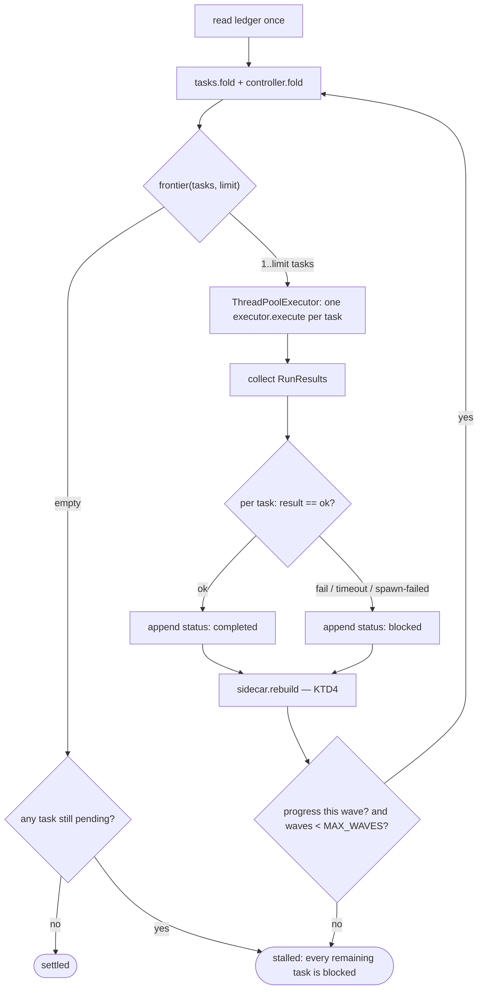
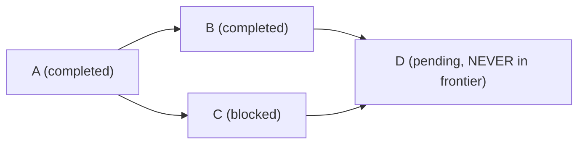

# feat: MN-7 — the parallel orchestrator, plus the one real cat-board gap

## Summary

Build `mindnet/orchestrator.py`: the deterministic Python controller that walks
the MN-2 task graph, spawns concurrent agent runs for every unblocked task, traps
non-zero exits into `blocked`, and re-evaluates until the graph settles. Plus one
small genuine gap in the shipped MN-5 cat board: all seven faculties currently
render the same sprite.

**This plan is much smaller than the originating directive assumed.** Three of
the directive's premises were checked against the code and are false. Correcting
them removes roughly two thirds of the requested work as already-shipped.

---

## Problem Frame

The directive ("MINDNETWORK FULL REALIZATION") names three unfulfilled visions.
Verifying each against the tree at `ab1ddd4` + this session's MN-6 work:

| Directive claim | Verified reality | Verdict |
|---|---|---|
| §4.3 "teeth default ON globally across all worktrees" | Fixed this session. `mindnet/optin.py` + `hive mindnet enforce`; 2657 tests green | **DONE — not in this plan** |
| §4.1 "the frontend UI is nonexistent. There are no cats. There are no clickable panels." | False. `swarm_page.py` ships `#mn-cats`, `.mn-cat.active/.dim`, `#mn-cat-panel` with task/phase/skill/state/last-seen rows, a 900 s hang warning, `/api/mindnet/cats`, and a 1.2 s poll | **Shipped — one real gap remains (U1)** |
| §4.2 "we have NOT built the Orchestrator. Nothing reads the graph and spins up parallel swarms" | True | **The actual work (U2–U6)** |

Two further corrections that change the design rather than the scope:

**The frontier already exists.** `tasks.ready()` (`src/mindhive/mindnet/tasks.py:512`)
returns exactly what the directive's §7.1 specifies — `pending` tasks whose every
dependency is `completed` — and adds a transitive `blocked`-ancestor exclusion the
directive did not ask for. All four of §7.3's required assertions already hold
against it. The orchestrator must **consume** it, not reimplement it (invariant 10:
one legend). What is missing is the *loop*, not the *predicate*.

**The directive's `is_dimmed`/`is_hidden` payload shape conflicts with the shipped
contract.** `ui_cats.board()` emits `display: "active"|"dim"` and expresses hidden
as *absence from the payload*. That is already documented in `docs/DATA_MODEL.md`
§4.5 and pinned by 440 lines of tests across two files. Two booleans would be a
strictly worse encoding (`is_dimmed=false, is_hidden=false` and the row's absence
both mean "fine"; a row can never be both) and re-spelling it would break a
documented contract for no behavioural gain. **Keeping the shipped shape.**

### What is actually broken

`swarm_page.py:456` assigns `el.innerHTML = CAT_SVG` — a single module-level
constant — to every faculty cat. The parameterized `catSVG(idx, size)` and the
six-entry `CAT_PALETTES` exist and are used for swarm *agent* nodes, but the
faculty board never calls them. So the seven faculties are visually identical and
distinguishable only by their text label, against directive §6.1's "map each
faculty to a distinct cat sprite or color palette".

---

## Requirements

| ID | Requirement | Source |
|---|---|---|
| R1 | Each of the 7 `telemetry.FACULTIES` renders a visually distinct cat | directive §6.1 |
| R2 | `frontier()` returns only tasks whose deps are all `completed`, honouring the concurrency limit deterministically | §7.1, §7.3 |
| R3 | A `blocked` task's dependents are never returned by `frontier()`, transitively | §7.3 |
| R4 | Ready tasks in one wave run concurrently, bounded by an explicit limit | §7.1, §7.2 |
| R5 | A non-zero child exit marks its task `blocked` and never spawns its dependents | §7.2 |
| R6 | The loop re-evaluates after each wave and terminates on settle, on no-progress, or at a wave cap | §7.1 |
| R7 | Child runs inherit the parent's MN-6 arming decision | §7.3 |
| R8 | `frontier()` stays under 5 ms at `tasks.MAX_NODES` (2000) | §8.5 |
| R9 | No `shell=True`; stdlib only; Python ≥ 3.11 | §8.1, §8.2 |
| R10 | Every child's output survives its own failure (MN-0 durability) | §7.2 |

---

## Key Technical Decisions

**KTD1 — `frontier()` delegates to `tasks.ready()`; it does not re-derive it.**
The orchestrator's added value is the *limit* and the *deterministic slice*, not
the predicate. Re-implementing readiness would create a second legend that drifts
from `can_complete`'s view of the same graph — the exact failure invariant 10
exists to prevent. `frontier()` therefore wraps: call `tasks.ready(tasks)`, then
slice to `limit`. It earns its own name because the limit is real added behaviour.

**KTD2 — `concurrent.futures.ThreadPoolExecutor`, not `asyncio`.** The work is
subprocess-bound, and `executor.execute()` is already a blocking `subprocess.run`.
Threads let the orchestrator reuse that spawn path verbatim; asyncio would require
a second, parallel implementation of the run path — including its shlex handling,
timeout cap, exception narrowing and RunLog writes — for no throughput gain on
process-bound work. The directive permits either.

**KTD3 — reuse `executor.execute()` as the only spawn path.** It already supplies
every property §7.2 asks for: `shlex.split(posix=False)` → argv with
`shell=False` (R9), a timeout cap, exceptions narrowed to
`(OSError, subprocess.SubprocessError)`, a `RUN_RESULTS` vocabulary that already
includes `spawn-failed`, and a durable `RunLog` artifact written as the child runs
(R10). The non-zero-exit trap the directive asks for is not new code — it is
reading `RunResult.result`.

**KTD4 — status writes go through the ledger, and the sidecar is rebuilt after
each wave.** `blocked`/`completed` are `mindnet_task` `action: "status"` events.
This is load-bearing and was learned the hard way in MN-6: `sidecar._staleness`
counts *every* event, so a status row appended without rewriting the sidecar makes
the projection read STALE — which silently disables MN-1's phase-aware injection
*and* MN-4's teeth for the very next wave. One `sidecar.rebuild()` per wave, after
the status writes, never before.

**KTD5 — `--dry-run` is the default; `--execute` is explicit.** An orchestrator
that spawns real agent processes is the single most dangerous command on this
surface. Bare `hive mindnet orchestrate` prints the wave plan and exits 0 without
spawning anything. This also makes the whole loop testable without ever starting a
process.

**KTD6 — the child env carries `MINDNETWORK_ENFORCE` only.** `executor.execute()`
gains an optional `env=` parameter (U3). Propagating the parent's arming decision
has a real consumer as of MN-6 (`optin._env_decision`), so it does something.
Pinning a `MINDNETWORK_TASK_ID` — which §7.1 step 3 also asks for — is
**deferred**: nothing reads it. `inject.active` and `enforcer.blocking_task` both
select their task from the shared sidecar, so a task-id variable would be dead
code today. See Open Questions.

**KTD7 — no-progress is a terminal state, not a spin.** A wave that completes with
the frontier unchanged and nothing newly settled means the graph cannot advance
(every remaining task is blocked, or transitively depends on one that is). The loop
exits `stalled` rather than re-running an identical wave forever. A hard
`MAX_WAVES` cap backs this up as a runaway backstop, matching how `tasks.MAX_NODES`
and `MAX_DEPS_PER_TASK` bound the graph itself.

---

## High-Level Technical Design

Directional guidance for review. Prose above is authoritative where they disagree.

### The wave loop

### Why a blocked task takes its whole subtree out

The directive's §7.3 diamond, with C failed. `tasks.ready()` already produces
this — D is excluded because C is not `completed`, and no extra guard is needed.

---

## Implementation Units

### U1. Per-faculty cat sprites

**Goal:** the one real gap in the shipped MN-5 board — make the 7 faculties
visually distinct (R1).

**Requirements:** R1

**Dependencies:** none

**Files:**
- `src/mindhive/swarm_page.py` (modify)
- `tests/test_mindnet_cat_board.py` (modify)

**Approach:** `swarm_page.py:456` uses the single `CAT_SVG` constant for every
faculty. Give each faculty a stable palette index and call the existing
`catSVG(idx, size)` instead. Derive the index from the faculty's position in
`telemetry.FACULTIES` so the mapping is stable across polls and reorders with the
legend rather than drifting from it — do **not** add a second hand-written
faculty→colour table (invariant 10). `FACULTIES` has 7 entries and
`CAT_PALETTES` has 6, so the mapping needs a documented answer for the overflow;
prefer extending `CAT_PALETTES` to 7 over a modulo that makes two faculties
collide, since collision is the exact thing this unit fixes.

**Patterns to follow:** `catFor(id)` / `catSVG(idx, size)` already in
`swarm_page.py`; the served-page assertion style in `tests/test_mindnet_cat_board.py`.

**Test scenarios:**
- The served swarm page contains a distinct palette fill for each of the 7 faculties — assert 7 distinct colour tokens reachable from the faculty rendering path, not 1.
- **Canary:** assert the pre-fix shape (one shared sprite for all faculties) is *absent*, so the test cannot pass against the old code.
- The faculty→index mapping is derived from `telemetry.FACULTIES`: adding a fake 8th faculty to the legend does not raise and does not collide with an existing index.
- `CAT_PALETTES` has at least `len(FACULTIES)` entries — the guard that stops a future faculty silently colliding.

**Verification:** the rendered page shows seven visually different cats; the
existing cat-board tests still pass unchanged.

---

### U2. `frontier()` — the DAG read

**Goal:** the deterministic, bounded frontier the loop consumes (R2, R3, R8).

**Requirements:** R2, R3, R8

**Dependencies:** none

**Files:**
- `src/mindhive/mindnet/orchestrator.py` (create)
- `tests/test_mindnet_orchestrator.py` (create)

**Approach:** `frontier(tasks, limit=None)` calls `tasks.ready(tasks)` and slices
to `limit`. `ready()` already returns sorted ids, so the slice is deterministic
without a second sort. Pure — no I/O, no clock, no ledger read — which is what
makes the whole loop testable from golden task maps. Module docstring must state
that the readiness *predicate* is MN-2's and this function owns only the bound,
so a future reader does not "helpfully" inline a second copy of the rule.

**Execution note:** write the four directive-specified frontier assertions first;
they should pass immediately against `tasks.ready()`. A test that goes red here
means the shared predicate does not mean what the loop needs, and that is a
finding about MN-2, not a licence to fork the rule.

**Patterns to follow:** the pure-fold style of `ui_cats.board()` (`now` injected,
total over malformed rows); golden inline task maps as in `tests/test_mindnet_tasks.py`.

**Test scenarios:**
- Linear A→B→C: frontier is `[A]` only.
- Diamond A→{B,C}→D with A `completed`: frontier is `[B, C]` — both, simultaneously.
- Same diamond with C `blocked`: D is never returned, and neither is C.
- Disconnected graph (two independent roots): both roots returned in sorted order.
- A task depending on an id that is not in the graph is never ready (dangling dep).
- `limit=1` on a 3-task frontier returns exactly 1, and the *same* one across repeated calls.
- `limit=0` returns empty; `limit=None` returns everything ready.
- An empty task map returns `[]` rather than raising (totality).
- A task map containing a malformed/None entry does not raise.
- **Performance (R8):** a generated `tasks.MAX_NODES`-node graph completes `frontier()` under 5 ms. Build the fixture with real dependency edges, not 2000 isolated nodes, or the benchmark measures nothing.

**Verification:** all four of the directive's §7.3 frontier assertions pass
against the real shared predicate.

---

### U3. `executor.execute(env=...)` — the child environment seam

**Goal:** let a spawned child inherit the parent's MN-6 arming decision (R7).

**Requirements:** R7

**Dependencies:** none

**Files:**
- `src/mindhive/mindnet/executor.py` (modify)
- `tests/test_mindnet_executor.py` (modify)

**Approach:** add an optional `env=None` parameter threaded into the existing
`subprocess.run` call. `None` must keep today's exact behaviour (inherit the
parent environment) so no existing caller changes semantics. When supplied, merge
over `os.environ` rather than replacing it — a bare replacement would strip
`PATH`, `SYSTEMROOT` and `PYTHONPATH`, and on Windows a child with no
`SYSTEMROOT` fails to start at all.

**Test scenarios:**
- `env=None` leaves the child's inherited environment unchanged (the regression guard for every existing caller).
- `env={"MINDNETWORK_ENFORCE": "1"}` reaches the child, verified by a child that prints the variable.
- The merge preserves `PATH` — assert the child can still resolve its own interpreter.
- An `env` value that is not a mapping is ignored rather than raising (totality).

**Verification:** the existing executor suite passes unchanged; a child can read
the injected variable.

---

### U4. The execution loop

**Goal:** run one wave concurrently, trap failures, settle or stall (R4, R5, R6, R9, R10).

**Requirements:** R4, R5, R6, R9, R10

**Dependencies:** U2, U3

**Files:**
- `src/mindhive/mindnet/orchestrator.py` (modify)
- `tests/test_mindnet_orchestrator.py` (modify)

**Approach:** `run_wave(tasks, ...)` maps the frontier through a
`ThreadPoolExecutor` bounded by the same limit, one `executor.execute` per task.
`orchestrate(...)` loops `run_wave` until settled, stalled, or `MAX_WAVES`.

The **runner is injected** (`runner=executor.execute` by default). That single
seam is what lets the entire loop — concurrency, failure cascade, wave
re-evaluation, stall detection — be tested without spawning one real process,
and it is why U2 was kept pure. Do not reach for `subprocess` mocks; pass a fake
runner that returns canned `RunResult`s.

Map `RunResult.result` → status: `ok` → `completed`, and `fail`/`timeout`/
`spawn-failed`/`refused` → `blocked`. Enumerate the mapping against
`executor.RUN_RESULTS` explicitly rather than treating "not ok" as failure, so a
future result value fails loudly instead of being silently classified.

Return a frozen result dataclass (`waves`, `completed`, `blocked`, `outcome`) in
the module's existing style — the CLI renders it and never re-derives it.

**Execution note:** write the failure-cascade test before the happy path. The
directive's §7.2 trap is the property most likely to be quietly wrong, and a
green happy path first tends to shape the code so the cascade becomes awkward.

**Patterns to follow:** frozen dataclass results and `RUN_RESULTS`-style closed
vocabularies in `executor.py`; injected-seam testing as in
`controller.can_complete`'s injected `satisfied` predicate.

**Test scenarios:**
- Diamond, all children succeed: A runs in wave 1; B and C in wave 2; D in wave 3. Assert wave *membership*, not just count.
- B and C are submitted to the pool concurrently, not sequentially — assert via a runner that records overlapping entry/exit, so a serial implementation fails.
- A fails → outcome is not `settled`, A is `blocked`, and **B and C are never submitted at all** (assert the runner was never called for them, not merely that they are unfinished).
- C fails in a diamond → D is never submitted, B still completes (a partial failure does not abort the healthy branch).
- `limit=1` against a 3-task frontier: the pool never holds more than 1 concurrently.
- Every `executor.RUN_RESULTS` value maps to exactly one status; a value outside the tuple raises rather than defaulting to `completed`.
- A runner that raises (not returns a failure) marks the task `blocked` and does not take the loop down.
- Fully-completed graph: zero waves, outcome `settled`.
- All-blocked graph: outcome `stalled`, zero runner calls.
- No-progress guard (KTD7): a wave that changes nothing terminates instead of looping.
- `MAX_WAVES` is enforced on a pathological graph.
- `--dry-run` equivalent (`execute=False`): the runner is never called and the planned waves are still reported.
- The child env carries the parent's `MINDNETWORK_ENFORCE` (R7), asserted through the injected runner's received kwargs.
- Each child's RunLog artifact exists after a *failed* run (R10) — the MN-0 property, asserted against the real `executor.execute` in one integration test rather than the fake.

**Verification:** the diamond executes in three waves with the documented
membership; a failed node's dependents are provably never spawned.

---

### U5. Ledger writes and the sidecar rebuild

**Goal:** persist wave outcomes without staling the projection (KTD4).

**Requirements:** R5, R6

**Dependencies:** U4

**Files:**
- `src/mindhive/mindnet/orchestrator.py` (modify)
- `tests/test_mindnet_orchestrator.py` (modify)

**Approach:** append one `mindnet_task` `action: "status"` event per settled task,
then call `sidecar.rebuild(project)` **once per wave, after** the appends. Every
payload must pass `tasks.validate_payload` before it is written — the writer's
half of the honesty contract, exactly as `test_cli_mindnet.py` asserts for the
phase axis.

**Test scenarios:**
- After a wave, `sidecar.read().fresh is True` — the MN-6 lesson, asserted directly. **Canary:** appending the same status rows *without* the rebuild leaves it stale, proving the assertion can fail.
- Every emitted payload satisfies `tasks.validate_payload`.
- The status events fold back to the statuses the wave reported (round-trip through `tasks.fold`).
- A failed ledger append does not corrupt the loop's in-memory result; the outcome still reports honestly.
- Exactly one rebuild per wave, not one per task (assert the call count).

**Verification:** after orchestration the sidecar is fresh and the ledger replays
to the reported statuses.

---

### U6. `hive mindnet orchestrate` + docs

**Goal:** the operator surface, dry-run by default (KTD5).

**Requirements:** R4, R6, R9

**Dependencies:** U4, U5

**Files:**
- `src/mindhive/__main__.py` (modify)
- `tests/test_cli_mindnet.py` (modify)
- `docs/DATA_MODEL.md` (modify)

**Approach:** `hive mindnet orchestrate [--execute] [--limit N] [--max-waves N]
[--json] [--project] [--session]`. Bare = dry run: print the planned waves, exit 0,
spawn nothing. Handler follows the `cmd_mindnet_*` shape — lazy imports, `_mn_error`
for refusals, exact exit codes. Extend the frozen subcommand-set assertion in
`test_cli_mindnet.py::test_no_verified_by_flag_exists_on_satisfy` (it is the
deliberate review gate for a new subcommand — MN-6 already needed this edit).

Document in `docs/DATA_MODEL.md`: a new `### 4.6` covering the wave loop, the
result→status mapping, the KTD4 rebuild rule, and the stall/settle outcomes.

**Test scenarios:**
- Bare `orchestrate` exits 0 and spawns nothing (assert via an injected runner).
- `--execute` on a diamond drives it to `settled`.
- `--json` output parses and carries `waves`, `outcome`, `completed`, `blocked`.
- `--limit 1` is honoured end-to-end through the CLI.
- Exit code is non-zero on a `stalled` outcome — a stall is an operator-actionable state, not a success.
- The frozen mindnet subcommand set includes `orchestrate`.
- `orchestrate` is reachable while MN-4's teeth are armed and biting — the same locked-room regression MN-6 added, since orchestration is a `hive` command an operator may need while the phase block is live.
- The command leaves the sidecar fresh (the `test_every_mutating_command_leaves_the_sidecar_fresh` property).

**Verification:** real `hive mindnet orchestrate` on a fixture graph reaches
`settled`; the full suite is green.

---

## Scope Boundaries

**In scope:** the frontier bound, the wave loop, the failure cascade, ledger +
sidecar persistence, the CLI, per-faculty cat sprites, DATA_MODEL.

**Not in scope:**
- Rewriting `ui_cats.board()` to `is_dimmed`/`is_hidden` booleans — see Problem Frame.
- Rebuilding any part of the cat board that already works (panel, dim, purge, poll, hang warning).
- Re-implementing readiness (KTD1).
- Token/quota-aware resource allocation. §7.1 mentions "token limits (if available via configuration)"; no such configuration exists in this repo. `--limit` is the honest bound. A budget-aware limiter would need a token accounting surface that does not exist yet.

**Deferred to follow-up work:**
- `MINDNETWORK_TASK_ID` pinning, and teaching `inject.active` / `enforcer.blocking_task` to prefer it (KTD6). Real value once several tasks run concurrently — a shared sidecar means every child sees the same "active task", so per-child phase steering is currently approximate. Deferred because it is a change to MN-1 and MN-4 semantics, not orchestrator wiring, and it deserves its own plan.
- Idle-cat disappearance. The user's original words were "when not running the cat disappears"; the shipped board deliberately keeps `idle` cats for up to 6 h because "finished a minute ago" and "hung a minute ago" are both worth seeing (`ui_cats.py` docstring). That tradeoff is documented and defensible, so changing it is a product decision, not a bug fix. See Open Questions.

---

## Open Questions

1. **Should an `idle` faculty vanish immediately?** The original Indonesian ask says yes; the shipped design says keep it 6 h as a hang detector. Needs the user, not an implementer. Not blocking — U1 is orthogonal.
2. **What command does a child actually run?** U4 injects the runner, so the loop is testable and correct regardless. But `--execute` needs a real argv. `Task.validation_script` is the only per-task command the graph stores today, and it is a *validator*, not an implementer. Resolve before U6's `--execute` path is trusted in anger; U2–U5 and the dry run do not depend on it.
3. **`CAT_PALETTES` is 6 entries for 7 faculties.** U1 prefers extending to 7. If the user has a specific colour intent per faculty, that overrides the derived mapping.

---

## Risks & Dependencies

| Risk | Mitigation |
|---|---|
| The loop spawns real processes in CI or by accident | `--dry-run` default (KTD5); injected runner in every test but one |
| A status append stales the sidecar and silently disables MN-1 injection + MN-4 teeth | KTD4; U5's freshness test *with a canary* proving it can fail |
| Threads plus per-wave ledger appends interleave into a torn write | Appends happen on the main thread after the pool joins, never inside a worker |
| `frontier()` forks from `tasks.ready()` during a later edit | KTD1 stated in the module docstring; U2's tests assert against the shared predicate |
| A new `RUN_RESULTS` value defaults to `completed` | U4 enumerates the mapping and raises on an unknown value |
| Open Question 2 is unresolved and `--execute` looks more finished than it is | U6 ships the dry run as the default and the docs state the limitation |

**Dependencies:** `tasks.ready`, `tasks.fold`, `controller.fold`,
`executor.execute` + `RUN_RESULTS`, `sidecar.rebuild`, `runlog`, `telemetry.FACULTIES`.
Stdlib only (`concurrent.futures`, `dataclasses`) — no new `pyproject.toml` entry (R9).

---

## Sources & Research

Local reads only; no external research (this is repo-internal orchestration over
committed contracts, and the local patterns are strong — `executor.py` already
solves subprocess spawning, `tasks.py` already solves graph readiness).

- `src/mindhive/mindnet/tasks.py:512` — `ready()`, the existing frontier
- `src/mindhive/mindnet/tasks.py:111` — `MAX_NODES = 2000`, matching R8's budget
- `src/mindhive/mindnet/executor.py:338` — `execute()`, the spawn path and `RUN_RESULTS`
- `src/mindhive/mindnet/ui_cats.py:111` — `board()`, the shipped payload
- `src/mindhive/swarm_page.py:388,456` — `CAT_SVG` used for every faculty (the U1 gap)
- `src/mindhive/dashboard.py:1109` — `/api/mindnet/cats`, already wired
- `docs/DATA_MODEL.md` §4.5 — the documented cat payload contract
- MN-6 (this session) — the sidecar-staleness lesson behind KTD4
