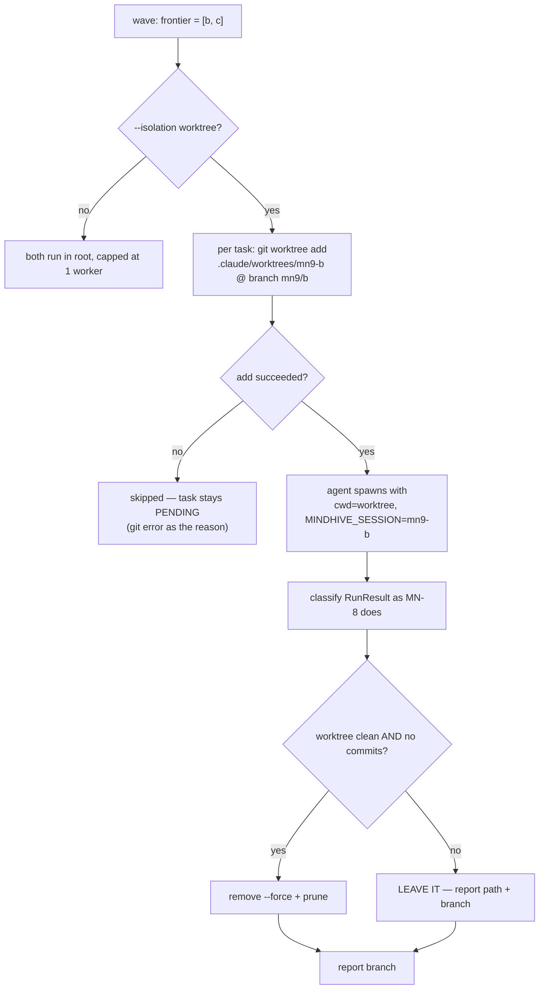

# feat: MN-9 — per-task worktree isolation

## Summary

Give each orchestrated agent its own git worktree and its own ledger segment, so
`hive mindnet orchestrate --execute` can finally run agents **in parallel** instead
of one at a time. This is the last thing standing between MN-8 and the user's
original ask ("dapat berjalan secara pararell").

---

## Problem Frame

MN-8 shipped agent execution capped at **one agent at a time**
(`agent.MAX_SAFE_WORKERS = 1`) for a stated reason: every agent runs with
`cwd=root`, the same checkout, and two agents editing one working tree
concurrently corrupt each other's edits and the git index. The cap was honest but
it means the orchestrator is sequential — the parallel machinery (frontier,
ThreadPoolExecutor, wave loop, `DEFAULT_MAX_WORKERS`) is all built and all unused.

Two preconditions were discovered during recon and both are load-bearing:

**The worktree directory is not portably ignored.** `.claude/worktrees/` is
excluded via `.git/info/exclude` — a *local, uncommitted* file. On any other clone
or CI checkout, agent worktrees created there would show up as untracked changes
in the parent repo, and `git status`-based tooling (including this project's own
change-log detection) would see them.

**Concurrent agents would corrupt the ledger.** `events.append_event` writes to
`<events>/<session_id>.jsonl` with a plain unlocked `open(..., "a")`, and
`session_id` comes from `MINDHIVE_SESSION`. `claude_cli.run_headless` inherits the
parent environment, so every concurrent agent would append to the **same segment
file with no locking** — interleaved mid-line writes produce corrupt JSONL, and the
ledger is the source of truth for the entire system. The per-session segment design
already solves this; nothing was passing a distinct session down.

### Non-goal, stated up front

**Merging is not automated.** Each agent's work lands on its own branch and the
orchestrator reports the branch names. Deciding what to integrate, in what order,
and how to resolve conflicts is the operator's call — an orchestrator that
auto-merged N agents' branches would be making that call silently, and a bad merge
is far more expensive than a manual one.

---

## Requirements

| ID | Requirement | Source |
|---|---|---|
| R1 | Each agent runs in its own git worktree on its own branch | user: "berjalan secara pararell" |
| R2 | Concurrent agents never share a ledger segment | recon finding 2 |
| R3 | With isolation active, concurrency is bounded by `DEFAULT_MAX_WORKERS`, not 1 | MN-8's cap exists only for the shared tree |
| R4 | Worktree creation failure blocks only its own task, never the wave | MN-7 P0 lesson |
| R5 | An agent's work is never silently discarded on cleanup | — |
| R6 | Worktree paths are ignored portably, not via a local exclude | recon finding 1 |
| R7 | Isolation is opt-in per run and the default is stated, not implied | MN-7 KTD5 |
| R8 | `--via-script` and dry-run behaviour are unchanged | regression safety |

---

## Key Technical Decisions

**KTD1 — Worktrees live under `.claude/worktrees/mn9-<task_id>` and that path is
added to the committed `.gitignore`.** The directory is this repo's established
convention (this very session runs from one), so a sibling temp dir would be a
second convention. Committing the ignore rule closes the portability hole rather
than depending on a local exclude that only exists on this machine.

**KTD2 — Each agent gets `MINDHIVE_SESSION=mn9-<task_id>`.** Not a lock, not a
mutex: the ledger's per-session segmentation is *already* the concurrency design,
and `events.read_all` sorts by `(ts, segment_name, line)` so ordering stays
deterministic across segments. This is using the existing mechanism correctly
rather than adding a new one.

**KTD3 — `claude_cli.run_headless` gains a real `env` overlay, applied BEFORE the
headless guard.** MN-8's `agent.run` accepts `env=` and documents that it ignores
it, which is the shape of a future bug. The overlay must be applied first and
`MINDHIVE_HEADLESS="1"` forced last, so no caller can clobber the recursion guard
by passing it — a spawn loop is the worst failure available here.

**KTD4 — Cleanup never discards work.** After a run, the worktree is removed
**only** when it has no uncommitted changes and no commits ahead of its base.
Otherwise it is left in place and its path is reported. `git worktree remove` is
always called with `--force` (this repo's own recorded Windows lesson: removal
fails with "Permission denied" whenever any process still holds a handle), and
`git worktree prune` follows. The branch always survives worktree removal, so
committed work is never lost either way.

**KTD5 — Isolation is opt-in via `--isolation worktree`; the default stays
`none`.** Creating N worktrees of a repo is real disk and real git state. The safe
form remains the one an operator gets by accident, matching `--execute`'s own
default. `--isolation worktree` raises the concurrency cap; `none` keeps MN-8's
cap of 1.

**KTD6 — Isolation failure is a per-task `skipped`, not a wave abort.** If
`git worktree add` fails for one task, that task reports skipped with the git error
as its reason and stays PENDING. The MN-7 P0 lesson applies directly: an
environmental failure must never write a status row that removes the task's subtree
from the graph.

---

## High-Level Technical Design

Directional. Prose above is authoritative where they disagree.

---

## Implementation Units

### U1. Commit the worktree ignore rule

**Goal:** R6 — agent worktrees never dirty a parent checkout on any machine.

**Dependencies:** none

**Files:** `.gitignore` (modify), `tests/test_repo_hygiene.py` (create or extend)

**Approach:** Add `.claude/worktrees/` to the committed `.gitignore`. Recon showed
it is currently only in `.git/info/exclude`, which does not travel. Check whether a
hygiene test file already exists before creating one.

**Test scenarios:**
- `git check-ignore` reports a path under `.claude/worktrees/` as ignored **by
  `.gitignore`**, not by `info/exclude` — assert the source file, or the test passes
  on this machine and fails on a fresh clone.
- The rule does not accidentally ignore `.claude/skills/` or `.claude/settings*`.

**Verification:** `git check-ignore -v` names `.gitignore` as the matching source.

---

### U2. A real env overlay on the spawn

**Goal:** R2's mechanism — let a caller set the child's session without touching
the recursion guard.

**Dependencies:** none

**Files:** `src/mindhive/claude_cli.py` (modify), `tests/test_claude_cli.py`
(modify — check whether it exists)

**Approach:** `run_headless(..., env=None)`. Merge over `os.environ`, then force
`MINDHIVE_HEADLESS="1"` **last**. Mirror `executor._child_env`'s rules, which
already solved this: merge rather than replace (a bare replacement drops `PATH` and
`SYSTEMROOT`, and a child with no `SYSTEMROOT` does not start on Windows), and
ignore a non-mapping argument rather than raising.

**Patterns to follow:** `mindnet/executor.py::_child_env`.

**Test scenarios:**
- `env=None` leaves today's behaviour byte-identical (the regression guard for `invoker.py` and `reflect.py`).
- An injected variable reaches the child.
- **`env={"MINDHIVE_HEADLESS": "0"}` cannot disable the guard** — the forced-last ordering, asserted directly. This is the security-shaped test of the unit.
- `PATH` survives the merge.
- A non-mapping `env` is ignored, not raised.
- `agent.run`'s `env=` is now actually threaded through (it is currently documented as ignored).

**Verification:** existing `claude_cli` callers unchanged; the guard cannot be overridden.

---

### U3. `mindnet/worktree.py`

**Goal:** create and safely retire one isolated checkout (R1, R4, R5).

**Dependencies:** U1

**Files:** `src/mindhive/mindnet/worktree.py` (create),
`tests/test_mindnet_worktree.py` (create)

**Approach:** Three functions over `subprocess.run(..., shell=False)`, using
`paths.NO_WINDOW` like every other subprocess call in this repo:

- `add(root, task_id)` → a frozen result carrying `path`, `branch`, `ok`, `reason`.
  Branch `mn9/<task_id>`, path `.claude/worktrees/mn9-<task_id>`. Total: any git
  failure answers `ok=False` with git's own stderr as the reason, never raises.
  Handle the already-exists case idempotently (reuse or refuse with a clear
  reason — do not silently `add` over an existing worktree).
- `state(path)` → `(dirty: bool, ahead: int)` via `git status --porcelain` and
  `git rev-list --count <base>..HEAD`.
- `retire(root, path, branch)` → removes **only** when clean and not ahead;
  otherwise returns `kept=True` with the reason. `remove --force` always, then
  `prune`.

**Execution note:** build a real git repo in `tmp_path` (`git init`, one commit)
rather than patching `subprocess.run` — this repo's own testing doctrine, and a
patched run would encode a guess about argv for the exact commands whose behaviour
is in question.

**Test scenarios:**
- `add` in a real repo creates a directory and a branch; the branch points at the base commit.
- Two `add` calls for different task ids produce two independent worktrees.
- `add` for a task id that already has a worktree does not clobber it.
- `add` on a non-repo path answers `ok=False` with git's message, and does not raise.
- `state` reports clean for a fresh worktree, dirty after touching a file, `ahead=1` after a commit.
- `retire` removes a clean worktree and the directory is gone.
- **`retire` KEEPS a worktree with uncommitted changes** and says so — the R5 assertion, and the one whose failure loses an agent's work.
- **`retire` KEEPS a worktree that is ahead** of its base (committed work).
- The branch still exists after a successful `retire` (committed work survives removal).
- `retire` on an already-removed path does not raise.
- Structural: `shell=True` appears nowhere; `--force` is present on every `remove`.

**Verification:** a real `git worktree list` in the sandbox reflects each operation.

---

### U4. Wire isolation into the wave

**Goal:** R1, R2, R3, R6 in the loop (the unit that makes it real).

**Dependencies:** U2, U3

**Files:** `src/mindhive/mindnet/orchestrator.py` (modify),
`src/mindhive/mindnet/agent.py` (modify),
`tests/test_mindnet_orchestrator.py` (modify), `tests/test_mindnet_agent.py` (modify)

**Approach:** `_run_wave` gains `isolate=False`. When set, each task's `one()`
calls `worktree.add` before the runner, passes `root=<worktree path>` and
`env={"MINDHIVE_SESSION": "mn9-<task_id>"}`, and calls `worktree.retire` in a
`finally`. A failed `add` returns a synthetic `RunResult(result="refused",
executed=False)` so MN-8's existing classification maps it to `skipped` with no
status row — reusing the mapping rather than adding a branch to it.

The worktree/branch/kept-path per task is carried on the `Wave` and
`Orchestration` alongside `reasons`, so the CLI can report what to look at.

**Test scenarios:**
- With `isolate=True`, each task's runner receives a **distinct** `root`.
- Each task's runner receives a **distinct** `MINDHIVE_SESSION` (R2 — the corruption guard).
- **Canary:** with `isolate=False`, every task receives the *same* root, so the test above is not passing for an unrelated reason.
- A failed `worktree.add` yields `skipped` for that task, no status row, and **the other task in the wave still runs** (R4).
- `retire` is called for every task, including one whose agent failed (the `finally`).
- A kept worktree's path appears in the wave's report.
- Concurrency: with isolation, peak concurrency exceeds 1 (R3) — the whole point.
- Dry run creates no worktree at all.
- `--via-script` path is unaffected.

**Verification:** two tasks in one wave run concurrently in different directories.

---

### U5. `--isolation` on the CLI

**Goal:** R7, R3 at the operator surface.

**Dependencies:** U4

**Files:** `src/mindhive/__main__.py` (modify), `tests/test_cli_mindnet.py` (modify)

**Approach:** `--isolation {none,worktree}`, default `none`. With `worktree`, drop
MN-8's `MAX_SAFE_WORKERS` clamp and let `DEFAULT_MAX_WORKERS`/`--max-workers`
apply. Report each task's branch and any kept worktree path in both text and
`--json`. Extend the frozen-subcommand/option assertions deliberately.

**Test scenarios:**
- Default is `none` — asserted on the parser, so a future edit cannot flip it silently.
- `--isolation worktree` lifts the worker clamp; `none` keeps it at 1.
- The printed report names each branch, and a kept worktree path when there is one.
- `--json` carries the branch/worktree fields.
- An invalid `--isolation` value exits 2.
- `--isolation worktree --via-script` is refused or documented — script runs have no reason to isolate, and silently ignoring the flag would mislead.

**Verification:** real CLI on a real graph shows two branches created.

---

### U6. Documentation

**Goal:** the contract is written down where the rest of it lives.

**Dependencies:** U4, U5

**Files:** `docs/DATA_MODEL.md` (modify),
`docs/residual-review-findings/claude-mindnetwork-system-init-756283.md` (modify)

**Approach:** Extend §4.7 with the isolation table, the per-session-segment rule and
why it exists, the cleanup policy, and the explicit **merging is not automated**
non-goal. Strike the "per-task git worktrees are the real fix and are not built"
line from the residual notes, since it will be.

---

## Scope Boundaries

**In scope:** worktree lifecycle, per-agent ledger segments, the env overlay, the
CLI flag, docs.

**Not in scope:**
- **Automatic merging** of agent branches — see Problem Frame.
- **Automatic parallelisation** ("secara paksa") — still the next item after this.
- Cats in other dashboard sections — the item after that.
- Cross-agent coordination (two agents editing the same file in different
  worktrees will conflict at merge time; that is inherent to the model and the
  operator resolves it).

**Deferred to follow-up work:**
- Disk pressure: N worktrees of a large repo. No quota is planned; `--max-workers`
  bounds it indirectly.
- A `hive mindnet worktrees` listing/cleanup command for retired-but-kept trees.

---

## Open Questions

1. **Should a kept worktree block the task's status row?** Current plan: no — the
   agent's outcome decides the status, and the kept tree is reported separately.
   An operator with a dirty worktree and a `completed` task has something to
   reconcile, which is the honest state.
2. **Base commit for each worktree:** HEAD of the current branch at wave time. Two
   waves therefore start from different bases if the operator commits in between.
   Acceptable and worth documenting rather than pinning.

---

## Risks & Dependencies

| Risk | Mitigation |
|---|---|
| Concurrent agents corrupt the ledger | KTD2, and U4 asserts distinct sessions with a canary |
| Windows worktree removal fails and leaks directories | `--force` always + `prune`; U3 tests removal for real |
| An agent's work is silently deleted on cleanup | KTD4; two U3 tests assert the keep path |
| A `git worktree add` failure aborts a whole wave | KTD6 — per-task `skipped`, asserted in U4 |
| Agent worktrees dirty the parent on another clone | U1, asserted against `.gitignore` as the source |
| The recursion guard gets overridden through the new env overlay | U2's forced-last ordering, asserted directly |

**Dependencies:** `claude_cli`, `paths.NO_WINDOW`, `events` per-session segments,
`worktree.add/retire`, `agent.run`, `executor.RunResult`. Stdlib + git only.
