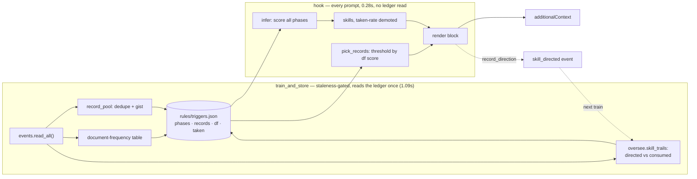

# fix: playbook defect repair and the direction feedback loop (MN-16)

## Summary

MN-14 and MN-15 made every code-work prompt carry an injected block: the technique
(a phase from `tasks.PHASES`), the reliable skills for it, and the ledger records
worth reading. This plan repairs what an audit of the *live* output proved wrong and
closes the one thing the founding ask implies but nothing yet does — the system does
not know whether anything it suggests is ever used.

Two of the five defects carried into this plan were **my own claims, and measurement
falsified both**. Two worse defects surfaced that were not on the list. That
correction is recorded here rather than quietly dropped, because the plan's
credibility rests on which claims were verified.

---

## Problem Frame

The injected block is the system's only chance to steer a turn, and it rides *every*
code prompt. Three things make it worse than it looks:

1. **It quotes the ledger badly.** 77% of record gists are cut at the character
   limit, most mid-word, and at least one reaches the prompt with an unbalanced
   quote. A pointer that trails off mid-token is a pointer the reader skips.
2. **It names the wrong technique for a quarter of prompts.** Phase inference is
   first-match-wins over a priority-ordered cue table, and 23% of real code prompts
   match cues from more than one phase — so *priority order decides, not strength of
   evidence*. The measured distribution is implausible: `audit-system` 60 and
   `pr-green` 53 against `execution` 10, driven almost entirely by incidental
   mentions of "architecture", "PR", "merge" and "green" inside ordinary build
   requests. The technique line is wrong *and* it selects the wrong skill list.
3. **It never learns.** `skill_directed` events already exist and `oversee` already
   joins them to a later same-session `skill_used` to decide whether a direction was
   consumed. Nothing feeds that back into ranking, and MN-15's own directions are
   not even recorded — `record_direction` returns early on a clear prompt, which is
   exactly the case MN-14 opened up.

### Corrections to the incoming defect list

| Claimed | Measured | Verdict |
|---|---|---|
| "`RECORD_POOL=200` truncates the pool silently" | Cap never reached: 130 kept of 284 curated. The 154 dropped rows are dropped by **dedupe** | **False as stated.** The honest gap is undisclosed dedupe, not a cap |
| "`render_always` is dead code the playbook replaced" | Phase inference returns None for **69 of 274 (25%)** real code prompts, so the fallback fires for a quarter of them | **False.** It is a live path and must keep working |
| "relevance needs IDF re-ranking" | IDF-weighted scoring leaves the top-3 **ordering unchanged** on every prompt tried | **Rejected.** Not planned |

Full measurements, including the commands that produced them, are in the evidence
appendix at the end of this plan.

---

## Requirements

- **R1** Record gists end at a word boundary and never carry an unbalanced quote or
  bracket into the injected text.
- **R2** Phase inference is decided by weight of evidence, not by the order of a
  table. A prompt that literally asks for a plan infers the plan phase.
- **R3** Weak record matches are suppressed rather than padded to a fixed count.
- **R4** The manifest discloses how many curated memos were collapsed, so a reader
  can tell the pool is a selection.
- **R5** Every injected direction is recorded, including on a clear prompt, so the
  causal trail covers the MN-14/MN-15 path and not only the vague-prompt gate.
- **R6** A skill the system has directed repeatedly and that is never used is
  demoted in future rankings, using the same consume-once join `oversee` already
  performs.
- **R7** No regression against the constraints MN-14/MN-15 established: additive
  only (never a deny/block), fail-open on a missing or corrupt sidecar, deterministic
  render path, no ledger read on the hook path, no second copy of a legend, and the
  MN-14 single-skill fallback still fires when no technique can be inferred.

---

## Key Technical Decisions

**KTD1 — Score all phases; keep priority only as a tie-break.** The cue table stays,
but `infer` counts how many distinct cues each phase matches and takes the strongest.
Ties resolve by the existing table order, so today's behaviour is preserved exactly
where evidence is genuinely balanced. This is the smallest change that makes 23% of
prompts stop being decided by table position. *Rejected:* per-cue hand-tuned weights
— unfalsifiable without labelled data, and the distribution skew is explained by cue
*count* already.

**KTD2 — Demote incidental cues rather than delete them.** "architecture", "PR",
"merge", "green" are real signals when they are what the prompt is *about* and noise
when mentioned in passing. Deleting them loses the true positives. Under KTD1 a
prompt genuinely about the merge gate hits several of its cues and still wins;
a build request that merely mentions a PR hits one. No cue is removed.

**KTD3 — Suppress by relative score, do not re-rank.** Records scoring far below the
best match are dropped instead of filling the quota. Measured: 28% of record lines
removed, decisive exactly where one record is genuinely strong (3 lines → 1), and
correctly keeping all three when scores genuinely tie. The score needs corpus term
rarity, so a document-frequency table is precomputed at train time — but it is used
as a *threshold*, not a sort key, because re-ranking demonstrably changed nothing.

**KTD4 — Reuse `oversee.skill_trails` for the taken signal; do not reimplement the
join.** Oversee already implements consume-once semantics ("one direction, one
invocation") with a documented rationale about over-attribution. A second
implementation would be a second thing to keep honest, and the first divergence would
have the two surfaces disagreeing about whether a suggestion was taken.

**KTD5 — The feedback signal demotes; it does not promote.** A skill directed many
times and never used is evidence the suggestion is not landing. The converse is
confounded — the agent may follow directions regardless of their value — so a high
taken-rate must not manufacture authority a skill has not earned. Provenance wording
(`MUST USE` vs `TRY & MEASURE`) stays governed by `recommend`'s measured-completion
chain, untouched.

**KTD6 — No new event type.** `skill_directed` already exists in
`DETERMINISTIC_TYPES` with payload `{skills: [{name, plugin?, measured?}]}`, is
already read by `oversee`, and already has test coverage. Registering a new type
would mean touching `VALID_TYPES`, the payload-contract dispatch, a projector body
renderer, and the dashboard Memory view — all to carry a signal an existing type
already carries.

---

## High-Level Technical Design

Where the cost lands, and why nothing moves onto the hook path:

The dashed edge is the loop this plan closes: what the block directed becomes an
event, which the next training run joins against what was actually used.

---

## Implementation Units

### U1. Gist quality: word-boundary truncation and balanced quotes

**Goal** A record pointer reads as a complete phrase, not a severed token.

**Requirements** R1

**Dependencies** none

**Files**
- `src/mindhive/playbook.py`
- `tests/test_playbook.py`

**Approach** Truncate at the last word boundary at or before the limit rather than
mid-token, and drop a trailing unmatched quote or bracket. Append an ellipsis when
text was removed so the reader can tell the gist is partial — a silently shortened
quote misrepresents the record. Keep `_gist` pure and total: a gist shorter than the
limit must come through byte-identical, which is what stops this from becoming a
reformatter.

**Patterns to follow** `_GIST_LEAD` stripping already in `_gist`; the collapse-and-cap
discipline in `_clean`.

**Test scenarios**
- A gist under the limit is returned unchanged, character for character.
- A gist over the limit ends at a word boundary, with no partial token.
- A gist whose cut point falls inside a quoted span does not emit an unbalanced
  quote; same for `(`/`)` and backticks.
- Truncated output carries the ellipsis marker; untruncated output does not.
- A gist that is one very long token with no boundary before the limit still returns
  something non-empty and bounded (no infinite backtrack to empty string).
- Leading markdown stripping still applies after the change.
- Determinism: same input, same bytes, twice.

**Verification** Re-running the live pool shows zero mid-word tails among the 100
previously-truncated gists, and every gist still non-empty.

---

### U2. Phase inference by weight of evidence

**Goal** The technique named is the one the prompt is actually about.

**Requirements** R2, R7

**Dependencies** none

**Files**
- `src/mindhive/playbook.py`
- `tests/test_playbook.py`

**Approach** Replace first-match-wins with a count of distinct matching cues per
phase; the highest count wins, ties broken by the existing table order so balanced
evidence behaves exactly as today. Add the missing `plan`-word cue — a prompt asking
for a plan must infer the plan phase. Return None when no phase matches at all, which
preserves the MN-14 fallback that measurement showed is live for a quarter of code
prompts.

**Execution note** Test-first. The distribution shift is the point of the change, so
the test that pins it should exist before the implementation that produces it.

**Patterns to follow** `_CUES` / `_COMPILED` as they stand; do not introduce a second
phase table (invariant 10). The invariant-10 guard forbids phase-name synonyms as
string literals in `src/` — a cue for the plan phase must be written so no forbidden
spelling appears in quotes.

**Test scenarios**
- `plan dulu sebelum mulai` and `write the plan first` both infer the plan phase
  (both currently return None).
- A prompt matching one merge-gate cue plus three build cues infers the build-side
  phase, not the merge gate — the direct regression for the 23% collision.
- A prompt genuinely about the merge gate (several of its cues) still infers it.
- Exactly-tied cue counts resolve to the earlier phase in table order, pinning the
  documented tie-break.
- Every phase in `tasks.PHASES` remains reachable by some prompt.
- Conversation still infers None; machine-injected text still infers None.
- The existing single-cue expectations from MN-15 still hold (no silent reversal).
- Canary: a prompt matching cues from no phase returns None, so the "it inferred
  correctly" tests above are not vacuous.

**Verification** Re-run inference over the ~274 real code prompts from the ledger.
`execution` and `plan` rise, `audit-system` and `pr-green` fall toward plausibility,
and the None rate does not increase.

---

### U3. Suppress weak record matches

**Goal** Three mediocre pointers become one good pointer.

**Requirements** R3

**Dependencies** U1 (gists are the scored text)

**Files**
- `src/mindhive/playbook.py`
- `src/mindhive/promptgate.py`
- `tests/test_playbook.py`

**Approach** Precompute a document-frequency table over the pool's gists at train
time and store it beside the pool. At hook time score each candidate by the summed
rarity of its terms shared with the prompt, then keep only those at or above a
fraction of the best score. Ordering stays as it is — measurement showed re-ranking
changes nothing, and pretending otherwise would be unfounded churn.

**Patterns to follow** `recommend._keywords` for tokenisation, so this cannot
disagree with the ranker about what a word is. The existing precompute-at-train /
consume-at-hook split.

**Test scenarios**
- Given one strongly-matching and two weakly-matching records, only the strong one
  survives.
- Given three equally-scoring records, all three survive — the threshold is relative,
  not an absolute cutoff that silently empties the list.
- A prompt matching nothing yields no records (canary against a threshold that always
  keeps something).
- A manifest with no document-frequency table degrades to the current behaviour
  rather than raising — same fail-open promise as a missing playbook.
- Malformed rows in the table (non-numeric counts, missing keys) are skipped, not
  raised on.
- Determinism: identical inputs produce an identical kept set.
- The cap still bounds the result when many records tie.

**Verification** On the live store, the sample prompts drop from 14 record lines to
**12** with the strong matches retained — not the 10 this plan first predicted. The
prediction came from a prototype that ranked the whole pool; the integrated version
thresholds only the `need_match` survivors, so the ceiling is lower. Measured limit,
recorded rather than smoothed over: suppression is **inert** when every candidate
shares exactly one common term with the prompt, which is what happens when the
prompt's distinguishing words are Indonesian and the ledger is English (`CI merah di
windows py3.12` → all eight candidates score 2.57 on `windows` alone). It still fires
where discrimination exists (worktree prompt: 3 records → 1).

---

### U4. Disclose what the pool collapsed

**Goal** A reader can tell the pool is a selection, and by how much.

**Requirements** R4

**Dependencies** U1

**Files**
- `src/mindhive/playbook.py`
- `src/mindhive/promptgate.py`
- `tests/test_playbook.py`
- `tests/test_promptgate.py`

**Approach** Report the number of curated memos seen, the number kept, and the number
collapsed as near-duplicates, in the manifest's coverage block beside the existing
counters. This corrects the incoming defect: the cap is not what truncates — dedupe
is, and it dropped 154 of 284 rows without saying so.

**Patterns to follow** the existing `coverage` dict in `promptgate.train`.

**Test scenarios**
- Seen, kept, and collapsed are reported and internally consistent (kept + collapsed
  never exceeds seen).
- A pool of all-distinct memos reports zero collapsed.
- A pool of identical memos reports the collapse count, not a silent 1.
- Hitting the cap is reported distinctly from collapsing — the two mechanisms are not
  conflated, which is the exact confusion this unit corrects.

**Verification** The live manifest reports seen 284 / kept 130 / collapsed 154.

---

### U5. Record every direction, including on a clear prompt

**Goal** The causal trail covers the MN-14/MN-15 path, not only the vague-prompt gate.

**Requirements** R5, R7

**Dependencies** U2 (the block's skill list is what gets recorded)

**Files**
- `src/mindhive/promptgate.py`
- `src/mindhive/playbook.py`
- `tests/test_promptgate.py`
- `tests/test_playbook.py`

**Approach** `record_direction` currently returns early when the verdict is clear, so
a well-phrased code prompt directs skills and records nothing. Extend it to record the
skills the playbook block actually named, on the same `skill_directed` event type
Oversee already reads. Best-effort and silent on failure — this is a trace, and a
write failure must never disturb the hook.

**Patterns to follow** `record_direction`'s existing best-effort shape and its
`session_id` handling; the payload contract already documented in `events.py`.

**Test scenarios**
- A clear code prompt that receives the playbook block records a `skill_directed`
  event naming exactly the skills the block rendered.
- The recorded names match the rendered block — no direction is claimed for a skill
  that was suppressed by the exclude rule.
- A vague prompt still records the gate's directions, unchanged from today.
- A prompt with no block records nothing.
- A write failure (append raises) leaves the hook output untouched and does not
  propagate.
- No duplicate event when both the gate and the playbook fire on one prompt.
- The event's payload shape still satisfies what `oversee.skill_trails` consumes
  (asserted by feeding it through that fold, not by re-describing the shape).

**Verification** After one clear code prompt through the real hook, `hive skills
trail` attributes a subsequent skill use to the prompt gate.

---

### U6. Demote directions that are never taken

**Goal** A suggestion the system keeps making and nobody uses stops being made first.

**Requirements** R6, R7

**Dependencies** U5 (there must be directions to measure), U2

**Files**
- `src/mindhive/playbook.py`
- `src/mindhive/promptgate.py`
- `tests/test_playbook.py`

**Approach** At train time, fold the events through `oversee.skill_trails` to obtain
consumed directions, count directed-versus-consumed per skill, and store the pair.
Ranking applies it as a demotion only: a skill with enough directions and no
consumption sinks below its peers; everything else keeps the order `recommend`
produces. Provenance wording is untouched, so this can never present an unproven
skill as proven.

**Execution note** Test-first, and pin the *thresholds* explicitly — a demotion that
fires on one unused direction would thrash on noise.

**Patterns to follow** `promptgate.observed_counts` as the precedent for deriving a
counter from the ledger at train time; `recommend`'s provenance chain, which stays
authoritative for wording.

**Test scenarios**
- A skill directed many times and never used ranks below an otherwise-equal skill.
- A skill directed once and not used is *not* demoted (below the minimum-evidence
  threshold) — the anti-thrash guarantee.
- A skill directed and used keeps its position; a high taken-rate does not promote it
  above a better-measured peer (KTD5).
- Demotion never changes `MUST USE` / `TRY & MEASURE` wording.
- Absent taken-rate data (a manifest trained before this unit) leaves ranking
  identical to U2's output — fail-open, and the migration path.
- The counts are derived through `oversee.skill_trails`, asserted by feeding a
  hand-built direction/use event pair through training and checking the recorded
  counts match what that fold reports — so a reimplementation would fail this test.
- Determinism across two identical training runs.
- Canary: with no `skill_directed` events at all, no skill is demoted.

**Verification** Training on the live store produces per-skill directed/consumed
counts consistent with `hive skills trail`, and no ranking change for skills with
insufficient evidence.

---

## Scope Boundaries

**In scope** the six units above, their tests, and the `DATA_MODEL.md` section
covering them.

**Not in scope**
- Semantic/vector relevance for records. The optional embedding layer is
  dependency-gated and the hook must work offline and deterministically.
- Any deny/block behaviour. Additive only, permanently.
- Changing `recommend`'s provenance chain or the `MUST USE` threshold.

### Deferred to Follow-Up Work
- **Surfacing the playbook in the dashboard** so the operator can see and correct
  which technique, skills and records the system would inject. Aligned with the
  existing observability work, but it is a UI unit with its own review surface.
- **Per-session anti-repetition** (not showing the same record on consecutive
  prompts). Needs per-session hook state, which means a write on the hook path — a
  cost that has to be measured before it is accepted.

---

## Risks

| Risk | Mitigation |
|---|---|
| U2 changes the technique for many prompts at once; a bad cue weight could misroute *more* than today | The distribution over the ~274 real prompts is the acceptance check, not a synthetic fixture. Ties preserve current behaviour, so the change is bounded to genuine collisions |
| The threshold in U3 hides a record that would have helped | Relative, not absolute: it only drops records much weaker than the best available, and keeps everything on a genuine tie |
| The feedback loop in U6 learns from a confounded signal — the agent may follow directions mechanically | Demotion only (KTD5), with a minimum-evidence threshold, and no effect on provenance wording |
| Growing the manifest (df table + taken counts) slows the hook's single read | The manifest is 36 KB today against a 0.28 s hook. Re-measure after U3 and U6; the existing test that forbids a ledger read on the hook path stays the hard guard |
| A stale sidecar from before this plan | Every unit degrades to current behaviour on a missing key, asserted per unit rather than assumed |

---

## Evidence Appendix

Every number below was produced by running against the live store in this worktree.

**Budget (carried from MN-15).** Ledger 373 segments / 12.54 MB / 22 835 events;
`events.read_all()` 1.09 s; hook 0.27-0.29 s including interpreter start; injected
block 1 160 B; manifest 36.2 KB.

**U1.** 284 curated pointer-type events, all producing a gist; 130 in the pool after
dedupe; **100 of 130 (77%)** sit at the 110-character limit, most cut mid-word
(observed tails `...ses, and (b) file writes`, `... You cannot write or exe`,
`...rror 5 on the DESTINATIO`); at least one carried an odd double-quote count.

**U2.** Over **1 179** real human prompts: 274 detected as code work (23%), 205
inferred a phase, **69 (25%) inferred None**. Distribution: `audit-system` 60,
`pr-green` 53, `plan` 33, `audit-bug` 24, `audit-code` 17, `execution` 10,
`brainstorm` 6, `prd` 2. **64 of 274 (23%)** matched cues from more than one phase.
Winning cues: `\barchitectur` 60; `\bpr\b` 25, `\bmerge\b` 25, `\bgreen\b` 19,
`\bci\b` 9, `\bpipeline\b` 7, `\bpull request\b` 4. `infer("plan dulu sebelum
mulai")` and `infer("write the plan first")` both return None.

**U3.** IDF-weighted re-ranking left the top-3 ordering unchanged on every prompt
tried, so it was rejected. The same score used as a relative threshold at 45% of the
best match: `[11.9, 3.5, 3.5] → keep 1/3`, `[6.8, 2.6, 2.6] → keep 1/3`,
`[2.0, 2.0, 2.0] → keep 3/3`, `[3.8, 3.8] → keep 2/2` — **28%** of record lines
removed, none of them the strong match.

**U4.** Cap `RECORD_POOL = 200` never reached (130 kept of 284). The 154 dropped rows
are dropped by dedupe.

**U5/U6.** `skill_directed` is already registered in `DETERMINISTIC_TYPES`
(`events.py`) with payload `{skills: [{name, plugin?, measured?}]}`;
`oversee.skill_trails` already folds it against a later same-session `skill_used`
with consume-once semantics (`oversee.py`, `_skill_why`). `record_direction` returns
early on a clear verdict, so no MN-15 direction on a well-phrased prompt is recorded
today.
