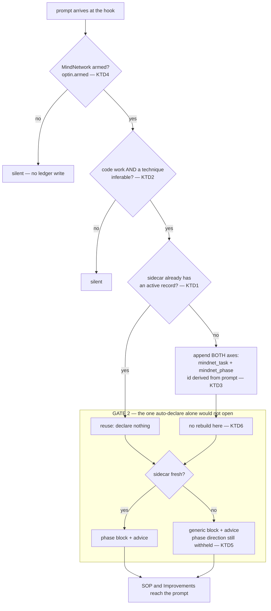

# feat: wake the MindNetwork spine — auto-declare and the staleness gate (MN-18)

## Summary

The phase spine, the SOP section and the Improvements section are **built, tested, and
never reached**. `advice.resolve_sops` and `advice.resolve_constraints` work; nothing
injects them, because `inject.block` returns `""` when the sidecar holds no phase
records — and the live store holds none.

Auto-declaring a task is the obvious fix and it is **not sufficient**. Planning-time
measurement found a second, independent gate: one appended event of *any* type marks the
sidecar stale, the hook itself appends events on every prompt, and advice rides only the
fresh branch. So a declared task would still get the generic block forever. Both gates
have to open or this unit ships a feature that stays dark — the exact failure MN-17 just
finished repairing elsewhere.

---

## Problem Frame

The founding prompt asks for a system that is "otomatis terpanggil" across all eight
phases, forces the input to obey the SOP section, and is governed by the Improvements
section — the record of past failures. Three of those are implemented and unreachable.

Measured, not assumed:

| Fact | Evidence |
|---|---|
| `inject.block` opens with `if not records: return ""` | `src/mindhive/mindnet/inject.py` |
| `records` are the controller's **phase** records, not the task graph | a task declare alone folds no record — found while writing MN-17's tests |
| live store: 0 tasks, 0 phase records | spine block length 0 |
| a task can only be created by hand (`hive mindnet declare`) or by `decompose --execute`, which needs a parent | `cmd_mindnet_declare`, `cmd_mindnet_decompose` |
| **one appended event of any type makes the sidecar stale** | rebuild → `fresh: True`; append one activity row → `fresh: False` |
| a stale-but-populated sidecar yields the generic block, and advice is reached only on the fresh branch | `inject.block` |
| `sidecar.rebuild()` costs **0.32 s** on the live store | timed |
| the hook writes events on every prompt (`skill_directed`, activity rows) | MN-16 U5, MN-17 |

The last three compose into the second gate: the hook's own writes guarantee staleness,
so even with a task declared the spine would never speak per-task and SOP/Improvements
would never inject.

---

## Requirements

- **R1** A MindNetwork task comes into existence without the user running a command.
- **R2** Auto-declaration cannot flood the append-only ledger. Nothing can be deleted
  later, so the bound is a design requirement, not a nicety.
- **R3** With a task present, the SOP and Improvements sections actually reach the prompt.
- **R4** The user can turn auto-declaration off, and it is off until they arm it.
- **R5** The hook's latency budget survives: no `events.read_all` on the prompt path, and
  no per-prompt rebuild.
- **R6** Entry phase stays derived, never caller-named. MN-2 removed caller-named entry
  phases deliberately and the plan must not reintroduce them.
- **R7** No regression against the standing contracts: additive-only, fail-open,
  deterministic projections, invariant 10.

---

## Key Technical Decisions

**KTD1 — At most one auto-declared root task is live at a time.** When the sidecar already
holds an active record, auto-declare does nothing. That is what bounds R2: writes are
one-per-work-session, not one-per-prompt. *Rejected:* auto-subtasking every prompt under
the active task — MN-11's `decompose` exists for growth and needs judgment; doing it
per prompt would flood the graph instead of the ledger and call it progress.

**KTD2 — The entry phase is NOT inferred.** `cmd_mindnet_declare` documents why: "a
caller-named entry phase is the teleport MN-2 stopped accepting". The phase-axis declare
names no phase and `tasks.fold` derives the entry point. `playbook.infer` therefore
decides only **whether** the prompt is recognizable code work worth declaring for, never
where the task starts. A prompt with no inferable technique does not declare — silence
beats a task parked at a gate nobody chose.

**KTD3 — The id is derived deterministically from the prompt, so a repeated prompt cannot
create a second task.** Same prompt in, same id out; the graph fold upserts a re-declare
rather than duplicating. This is a second, independent flood guard that holds even if
KTD1's active-task check is somehow bypassed. Collision detection reads existing ids from
the **sidecar**, not the ledger — R5.

**KTD4 — Off until armed, through MN-6's existing opt-in.** This writes permanently to the
user's ledger on their behalf. `optin.py` already exists for exactly this blast-radius
question and already has the CLI surface. Reusing it means no second switch to reason
about. Stated plainly: the founding prompt asks for force, and forcing *permanent writes*
without a switch is the one place to trade a little force for a lot of recoverability.

**KTD5 — Advice rides the stale branch; per-task phase direction does not.** This is the
central decision and it is a deliberate narrowing of an existing rule.

`inject.block` currently withholds *everything* on a stale projection, with a documented
reason: advice resolved against a task that has since fallen back to the planning gate is
"a confident, wrong instruction — strictly worse than silence". That argument is about the
task's **phase**, which a stale projection genuinely may have wrong.

It does not transfer to SOP and constraints. Those are resolved against the task's *text*,
which a later event cannot change. Withholding them on staleness buys no safety and costs
the entire feature — and since the hook appends on every prompt, "stale" is the normal
state, not the exception. So the stale branch keeps withholding phase direction and starts
carrying advice.

*Rejected:* **rebuild on the hook path** — 0.32 s on every prompt against a 0.38-0.46 s
budget, to recompute a projection that the next prompt's own write will invalidate again.
*Rejected:* **narrowing the staleness rule to the event types the projection folds** —
correct in principle and the better long-term answer, but segment size and mtime cannot
tell you an event's type without reading it, which is the read R5 forbids. Recorded as
deferred follow-up.

**KTD6 — The declare appends and does not rebuild.** The two events land on the prompt
that triggers them; the projection catches up at the next rebuild trigger. Under KTD5 the
task's advice is available from the following prompt onward without any extra cost on the
hook path.

---

## High-Level Technical Design

Both gates, and where each unit opens one:

The `subgraph` is the part worth staring at: without KTD5, every path through it lands on
"generic block, no advice", because the hook's own writes make `fresh` false on every
prompt after the first.

---

## Implementation Units

### U1. The auto-declare decision, as a pure function

**Goal** Decide whether this prompt should declare a task, and with what id and title —
with no I/O, so it is testable and cannot slow the hook.

**Requirements** R1, R2, R6

**Dependencies** none

**Files**
- `src/mindhive/mindnet/autodeclare.py` (new)
- `tests/test_mindnet_autodeclare.py` (new)

**Approach** One function taking the prompt text and the *already-read* sidecar, returning
either a decision to declare (id, title) or a reason not to. Every input is passed in;
nothing is read. The id derives from the prompt deterministically and must satisfy
`tasks.ID_RE`; the title is the prompt's headline, capped. Existing ids come from the
sidecar's records for collision handling — never from a ledger fold.

**Execution note** Test-first. The refusal cases are the substance of this unit, and
writing them first is what stops the happy path from being the only shape considered.

**Patterns to follow** `decompose.slugify` for id derivation from free text;
`playbook.infer` and `promptgate.is_code_work` as the gates; `tasks.ID_RE` and
`tasks.validate_payload` for the shape contract.

**Test scenarios**
- A code-work prompt with an inferable technique and an empty sidecar decides to declare.
- The same prompt twice yields the *same* id — the flood guard of KTD3.
- A prompt whose technique cannot be inferred refuses, naming that reason.
- A non-code-work prompt refuses.
- An empty, whitespace-only, or machine-injected prompt refuses.
- A sidecar with an active record refuses, naming reuse (KTD1).
- The derived id always satisfies `tasks.ID_RE`, including for a prompt that is pure
  punctuation, pure Indonesian, extremely long, or a single character.
- A derived id that collides with an existing id in the sidecar is disambiguated, and the
  disambiguation is itself deterministic.
- The decision carries no phase (KTD2) — asserted structurally, so a later edit that adds
  one fails here rather than in a teleported task.
- Same inputs produce the same decision twice (no clock, no RNG).
- A malformed sidecar (records not a dict, records holding non-dicts) refuses rather than
  raising.

**Verification** The function is importable and total; no test needs a ledger or a file.

---

### U2. Wire it into the hook, behind the opt-in

**Goal** A task comes into existence on its own, for an armed project only.

**Requirements** R1, R4, R5, R6

**Dependencies** U1

**Files**
- `src/mindhive/__main__.py`
- `src/mindhive/mindnet/autodeclare.py`
- `tests/test_mindnet_autodeclare.py`

**Approach** In the hook's side-effect layer — beside `record_direction` and the MN-17
announcement, after the context is printed — consult the opt-in, then the U1 decision, then
append both axis events. Reuse the sidecar the hook already reads for MN-17 rather than
reading it again. Never rebuild here (KTD6). Best-effort throughout: a failure to declare
must leave the printed context untouched.

Both events, or neither: a task on one axis is the half-declared state `_mn_no_record`
exists to complain about.

**Patterns to follow** `cmd_mindnet_declare` for the two payload shapes and their tags —
including that the phase payload names no phase; `promptgate.record_direction` for the
best-effort/fail-open shape; `optin.armed` for the gate.

**Test scenarios**
- An unarmed project declares nothing, and writes no event of any kind.
- An armed project on a code-work prompt appends exactly one `mindnet_task` declare and
  one `mindnet_phase` declare, with production's tags.
- The two events name the same task id.
- After the appends, folding the ledger yields a task whose entry phase is the derived
  gate — not one taken from the prompt (KTD6/R6).
- A second armed prompt with an active record present appends nothing.
- The same prompt twice appends one task, not two (end-to-end form of KTD3).
- An append failure leaves the printed context unchanged and does not propagate.
- A missing or corrupt sidecar declares nothing rather than raising.
- The hook path performs no `events.read_all` — asserted by monkeypatching it to raise,
  mirroring the existing guard on the playbook path.
- Latency: the declaring prompt stays under a stated bound, and non-declaring prompts are
  unchanged from today.

**Verification** On a scratch project: arm it, send one code-work prompt through the real
hook, and the graph holds one task on both axes with a derived entry phase.

---

### U3. Let advice ride the stale branch

**Goal** SOP and Improvements reach the prompt in the state the system is normally in.

**Requirements** R3, R7

**Dependencies** none (independent of U1/U2 — this gate is separate)

**Files**
- `src/mindhive/mindnet/inject.py`
- `tests/test_mindnet_inject.py`

**Approach** On a stale projection, keep withholding per-task phase direction and start
carrying the advice block. The existing rationale for withholding is about phase
correctness; SOP and constraints are resolved against task text, which a later event
cannot invalidate. Record that narrowing in the code, not only here — the next reader will
otherwise re-apply the broader rule.

**Execution note** Test-first, and start from the stale case. Writing the fresh case first
tends to produce a change that only works when the problem is absent.

**Patterns to follow** `inject.block`'s existing three-outcome structure and its comment
explaining the fresh-only placement — that comment is what this unit revises rather than
deletes.

**Test scenarios**
- Stale sidecar with records and resolved advice: the block carries the advice sections and
  does NOT carry per-task phase direction.
- Stale sidecar with records and no advice: the generic block only, unchanged from today.
- Fresh sidecar: phase direction plus advice, exactly as today (no regression).
- No records at all: still silent, on both fresh and stale.
- A stale sidecar whose advice is a wrong shape (not a dict, sections not lists) yields the
  generic block rather than raising.
- The sanitiser still runs on the stale path — a forged marker in a stored advice line
  cannot reach the prompt.
- MN-17's `engaged_faculties` agrees with what the stale block actually carried, so a lit
  SOP cat still means the SOP text was injected.

**Verification** With a declared task and a stale sidecar — the ordinary state — a prompt
receives the SOP and constraint lines.

---

### U4. Refresh the projection somewhere that is not the hook

**Goal** The spine reaches its fresh state without paying 0.32 s per prompt.

**Requirements** R3, R5

**Dependencies** U2

**Files**
- `src/mindhive/__main__.py`
- `tests/test_mindnet_autodeclare.py`

**Approach** Rebuild at a point that already tolerates a fold and does not run per prompt.
The session-start hook is the candidate — it already does stale-gated work, and a
once-per-session 0.32 s is invisible where a per-prompt 0.32 s is not. Stale-gate it so a
session that starts against an already-fresh projection pays nothing.

**Open question deferred to implementation:** whether session start is the right host or
whether the declaring prompt should schedule the rebuild for the *next* invocation. Decide
by measuring the session-start path's existing budget rather than by argument.

**Test scenarios**
- A stale projection is rebuilt at the trigger point; a fresh one is left alone.
- A rebuild failure is silent and leaves the previous projection in place.
- The trigger does not fire on the prompt path — asserted, since that is the whole point.
- After the trigger, a declared task's phase direction appears (the fresh branch is
  reachable in practice, not just in principle).

**Verification** Timed: the trigger costs ~0.32 s once, and prompt latency is unchanged.

---

### U5. The canary that would have caught this dormancy

**Goal** A test that fails when the spine is silent end to end, so "built but unreachable"
cannot recur quietly.

**Requirements** R3, R7

**Dependencies** U2, U3

**Files**
- `tests/test_mindnet_autodeclare.py`
- `docs/DATA_MODEL.md`

**Approach** One test that walks the whole path in a scratch project — arm, prompt,
declare, prompt again — and asserts the injected context actually contains an SOP line and
a constraint line. Every unit above can pass while the user still sees nothing; this is the
test that ties them together, and its absence is why three finished features sat dark.

Mirror MN-17's guard shape: that one fails when a declared faculty has no emitter, this one
fails when a resolved section has no path to the prompt.

**Test scenarios**
- End to end with a seeded SOP and a seeded incident: the injected text contains both.
- With MindNetwork unarmed: no task, and the spine stays silent — the opt-in is real.
- With no SOP and no incident seeded: the block appears without inventing sections.
- Deliberate break: with `inject.block`'s advice call removed the test fails — asserted by
  construction of the test, so it cannot pass by finding nothing.

**Verification** The suite fails if any single unit above regresses.

---

## Scope Boundaries

**In scope** the five units, their tests, and the `DATA_MODEL.md` section.

**Not in scope**
- Automatic subtask growth. `decompose` exists; wiring it per prompt is a different
  decision with its own flood risk.
- Changing what `advice.resolve` retrieves, or its ranking.
- Any deny/block behaviour. Additive only, permanently.
- Auto-completing or auto-advancing a task's phase. Declaring is not driving.

### Deferred to Follow-Up Work
- **Narrow the staleness rule to the event types the projection actually folds.** The
  better long-term answer than KTD5: activity rows and `skill_directed` cannot change the
  projection and should not invalidate it. Needs a cheap way to know an event's type
  without reading the segment, which today's size/mtime stamp cannot provide.
- **Auto-declared task hygiene.** Titles derived from prompts will sometimes be poor. A
  review or rename surface belongs with the dashboard work, not here.

---

## Risks

| Risk | Mitigation |
|---|---|
| Auto-declare writes junk tasks permanently into an append-only ledger | Three independent bounds: off until armed (KTD4), at most one live root (KTD1), deterministic id so repeats upsert (KTD3). Refusal is the default on every uncertain branch |
| KTD5 weakens a rule that was written for a reason | The narrowing is argued from what the data can and cannot go stale — phase can, task text cannot — and the fresh-path behaviour is pinned unchanged by test |
| The declaring prompt is slower | The rebuild is deliberately not on that path (KTD6); the declare itself is two appends |
| A derived id collides or is malformed | `tasks.ID_RE` and `validate_payload` are the contract, and the id generator is tested against punctuation-only, Indonesian, single-character and overlong prompts |
| U4's host turns out to be wrong | Left as an explicit open question to settle by measurement rather than guessed at here |

---

## Evidence Appendix

All measured against the live store in this worktree during planning.

- `sidecar.rebuild()`: **0.32 s**. Hook today: **0.38-0.46 s**. `events.read_all()`:
  **1.09 s** over 22 835 events.
- Live spine state before this plan: **0 tasks, 0 phase records**, `inject.block` returns a
  zero-length string.
- Staleness: after `rebuild()`, `fresh` is `True`; after **one** appended
  `mindnet_activity` row, `fresh` is `False`. The hook appends on every prompt, so stale is
  the normal state.
- A stale-but-populated sidecar returns the generic block, and `advice_block` is reached
  only on the fresh branch — so SOP and constraints inject on neither path today.
- `cmd_mindnet_declare` writes two events and the phase payload names no phase: "the entry
  point is derived by `tasks.fold` … a caller-named entry phase is the teleport MN-2
  stopped accepting."
