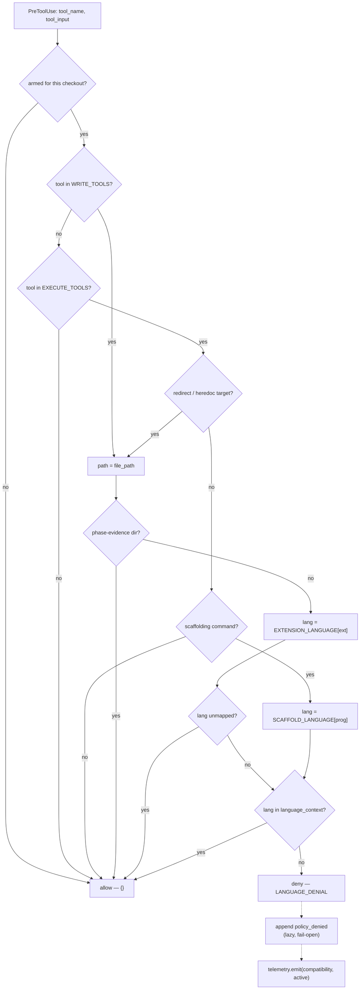

# feat: MN-4 continuation — close the language compatibility gate's three open holes

**Branch:** `claude/gate-kompatibilitas-bahasa-18c4e8` (currently identical to `master`)

---

## Summary

MN-4 shipped the Language Compatibility Lock (`gate:mindnet-language`) as a
`PreToolUse` deny on file writes whose extension falls outside a task's
populated `language_context`. It works, and it is well guarded. But it landed
with three holes that its own plan and the architecture doc named out loud and
then left open:

1. **The lock only inspects write tools.** `Bash`/`PowerShell` were deliberately
   deferred — so a heredoc or a redirect puts a forbidden file on disk without
   the gate ever seeing it.
2. **A denial leaves no ledger evidence.** The architecture doc lists
   "PreToolUse auditability" as something MN-4 fixes; `hook_decision` still
   appends nothing on deny, so enforcement is unauditable, contrary to SOP 1.4.
3. **The `compatibility` cat never wakes.** MN-4 Open Question 3 flagged that
   `compatibility` has no emit site. The language lock *is* that faculty, and
   nothing emits for it.

This plan closes all three, and only those three. It does not change when the
lock fires relative to a task, does not widen it beyond a declared
`language_context`, and does not touch the phase block's rules.

---

## Problem Frame

The gate's stated purpose (R13) is that a task declaring
`language_context: ["python", "markdown"]` cannot produce artifacts in another
language. Today that promise holds only for the `Write`/`Edit`/`MultiEdit`/
`NotebookEdit` tools. The same agent, same task, same session:

```
Bash("cat > src/app.ts <<'EOF' … EOF")
```

writes TypeScript into a Python-only task and the gate is silent. The tool-name
filter in `language_violation` (`src/mindhive/mindnet/enforcer.py:388`) returns
`None` for every execute tool. That is a real bypass of a rule the operator
explicitly asked for, not a theoretical one — it is the single most obvious way
an agent puts bytes on disk without a `Write` call.

The second problem is quieter and worse for the learning loop. When the gate
denies, the operator sees a refusal in their terminal and the ledger records
nothing. There is no way to answer "how often does this rule fire", "which task
froze me", or "is this rule earning its keep" — the questions the whole
nudge→enforce ladder exists to answer for every *other* rule.

The third is cosmetic but it is a stated acceptance criterion: MN-5's board
shows seven faculties, and `compatibility` is permanently absent because no code
path emits `mindnet_activity` for it.

### What "continue" means here, precisely

The origin plan's own Scope Boundaries says:

> **Deferred to Follow-Up Work** — Enforcement of `language_context` on
> `Bash`/`PowerShell` command content. The lock is applied to file writes only.
> Inferring a language from an arbitrary shell command is a parsing problem with
> a false-positive cost paid on every command.

That deferral reason is correct and this plan does **not** overturn it. It
solves the narrower problem the reason does not cover: a shell command that
*creates a source file* is not a parsing problem — the path is right there in
the redirect target. Merely *running* an interpreter stays allowed.

---

## Requirements

| ID | Requirement | Traces to |
|---|---|---|
| R1 | A shell command whose redirect/heredoc target has a mapped extension outside a populated `language_context` is denied, with the existing `LANGUAGE_DENIAL` message. | origin R7, R13; origin Deferred item 1 |
| R2 | A shell command that merely *runs* an interpreter or tool (`node app.js`, `pytest`) is **not** denied. The deferral's false-positive concern is honored. | origin Deferred item 1 |
| R3 | A scaffolding command that generates a foreign-language source tree (`npx create-react-app`, `cargo new`) is denied when that language is outside the context. | R13 |
| R4 | Every `PreToolUse` denial — both mindnet gates and the three pre-existing policies — appends one ledger event naming the signature, tool, and reason. Allows append nothing. | architecture doc §MN-4 "PreToolUse auditability"; SOP 1.4 |
| R5 | The `compatibility` faculty emits `mindnet_activity` when the language lock fires, so its cat appears on MN-5's board. | origin Open Question 3; MN-5 R11–R13 |
| R6 | Every existing guard survives: fail-open on fault, `EXEMPT_PROGRAMS` never denied, unmapped never denies, evidence directories exempt, manifest kill switch works, `enforcer.py` still imports no `events`, hook path still never calls `read_all`. | origin R9, R12; `tests/test_mindnet_enforcer.py:478` |

---

## Key Technical Decisions

**KTD1 — The shell rule keys on *artifact creation*, not on the program.**
A general "which language does this command imply" classifier is the parsing
problem the origin plan refused, and it would deny `node --version`. Instead
there are exactly two recognized shapes: (a) a redirect or heredoc whose target
path parses to a mapped extension, and (b) a small closed table of scaffolding
commands that are *defined* by generating a source tree. Everything else
allows. This keeps the failure direction on "misses a bypass" rather than
"denies a legitimate command", which is the same direction every other guard in
this module errs.

**KTD2 — Reuse `EXTENSION_LANGUAGE` and `LANGUAGE_DENIAL` unchanged.**
The redirect target is a path; once extracted it goes through the exact
extension→language resolution the write path already uses, including the
Windows trailing-dot / `::$DATA` normalization. Two spellings of "what language
is this file" would drift (invariant 10). The denial message is likewise
identical — an operator should not be able to tell from the text whether they
were caught by a `Write` or by a redirect.

**KTD3 — The audit event is a new type (`policy_denied`), not `rule_enforced`.**
`rule_enforced` already means "this signature was auto-escalated from nudge to
enforce" and `incidents.py:698` folds it alongside `rule_revised`/`rule_expired`
as a lifecycle transition. Overloading it with per-denial rows would corrupt
that projection and inflate every rule's lifecycle history. A distinct type
costs one registry entry and keeps both readings honest.

**KTD4 — Audit and telemetry live in `enforce.py`, never in `enforcer.py`.**
`tests/test_mindnet_enforcer.py:478` asserts over the module's own source that
`enforcer.py` imports no `events` — the structural guarantee behind the latency
requirement, deliberately stronger than a timing bound. `telemetry.emit` and
`events.append_event` both write to the ledger. So the predicates stay pure and
the single write happens at the `hook_decision` seam, where the decision is
already made. The imports there are lazy, matching how `enforce.py` already
reaches `events`, `incidents`, and `gateguard`.

**KTD5 — Append on deny only, never on allow.** `PreToolUse` fires on every
tool call. A ledger append on the allow path would put a file write on the
hottest path in the system. A denial is rare by construction and the tool call
is being blocked anyway, so the write is free in practice.

**KTD6 — The audit append is fail-open and cannot change the decision.**
The append is wrapped and its result discarded. A ledger that is full, locked,
or missing must not turn a deny into an allow, nor an allow into an error. Same
contract `telemetry.emit` already documents for itself.

---

## High-Level Technical Design

The decision path after this change. Everything left of the dashed line is pure
and untouched by the ledger; everything right of it happens once, on deny.



The dotted edges are the new seam (U2/U3). The solid path is the existing
predicate with one new entry branch (U1).

---

## Implementation Units

### U1. Widen the language lock to shell commands that create files

**Goal:** Close the deferred bypass — a redirect, heredoc, or scaffolding
command can no longer put a forbidden-language file on disk.

**Requirements:** R1, R2, R3, R6.

**Dependencies:** none.

**Files:**
- `src/mindhive/mindnet/enforcer.py` (modify)
- `src/mindhive/enforce.py` (modify — `_policy_mindnet_language` tool-name prefilter)
- `tests/test_mindnet_enforcer.py` (modify)
- `tests/test_mindnet_enforcer_hook.py` (modify)

**Approach:**

Add two module-level constants beside `EXTENSION_LANGUAGE`:

- `SCAFFOLD_LANGUAGE` — a small closed dict of `(program, first-arg)` or bare
  program → language, covering only commands whose *purpose* is generating a
  source tree. Start deliberately tiny: `npx create-react-app`, `npm init`,
  `yarn create`, `pnpm create`, `cargo new`, `cargo init`, `go mod init`,
  `rails new`. Anything absent is unmapped and never denies.
- A redirect/heredoc extraction helper returning the candidate target paths from
  a command string: `>`/`>>` targets, `tee` arguments, and heredoc-preceding
  redirect targets. Crude and conservative by design — it feeds a deny, so when
  in doubt it must return nothing.

Then in `language_violation`, replace the `tool_name not in WRITE_TOOLS: return
None` early exit with a branch: write tools resolve one path from `_file_path`;
execute tools resolve zero-or-more candidate paths from the command string plus
an optional scaffolding language. `EXEMPT_PROGRAMS` (`hive`, `git`, `gh`) short
-circuits to allow *before* any of this — the escape hatch must survive both
rules, and `git` in particular writes files constantly.

Every resolved path then runs the *existing* pipeline unchanged: phase-evidence
exemption, `_ADS_RE`/trailing-dot normalization, `EXTENSION_LANGUAGE` lookup,
unmapped-allows, membership test. A scaffolding language skips straight to the
membership test since there is no path.

`enforce.py`'s `_policy_mindnet_language` prefilter currently reads
`if tool_name not in mn.WRITE_TOOLS: return None`; widen it to include
`mn.EXECUTE_TOOLS`. Leave the `_mindnet_armed` check ahead of the sidecar read
untouched — a project that never opted in must still pay zero file I/O.

**Patterns to follow:** `phase_violation`'s structure for handling both tool
classes in one predicate (`enforcer.py:347`); `_program` for crude-but-safe
command parsing (`enforcer.py:322`); the `try/except → None` total contract on
both existing predicates.

**Execution note:** Test-first. This unit changes what can be *denied*, and the
module's own docstring says re-scoping what can be denied must be a deliberate
edit with a test behind it. `test_an_execute_tool_is_not_language_locked` is an
encoded *deferral*, not a safety guard — rewrite it to assert the narrower new
contract (interpreter invocation still allowed) rather than deleting it.

**Test scenarios:**
- `language_context == ["python"]`, `Bash("cat > src/app.ts <<'EOF'\nx\nEOF")` → denies; message names `python` and the task id.
- `language_context == ["python"]`, `Bash("echo x > src/app.ts")` → denies.
- `language_context == ["python"]`, `Bash("echo x >> src/app.ts")` → denies.
- `language_context == ["python"]`, `Bash("echo x | tee src/app.ts")` → denies.
- `language_context == ["python"]`, `Bash("node app.js")` → **allows** (R2 — the rewritten deferral test).
- `language_context == ["python"]`, `Bash("pytest -q")` → allows.
- `language_context == ["python"]`, `Bash("echo x > notes.txt")` → allows (unmapped extension).
- `language_context == ["python"]`, `Bash("echo x > out")` → allows (no extension).
- `language_context == ["python", "markdown"]`, `Bash("echo x > README.md")` → allows.
- `language_context == ["python"]`, `Bash("npx create-react-app web")` → denies (R3).
- `language_context == ["javascript"]`, `Bash("npx create-react-app web")` → allows.
- `language_context == ["python"]`, `Bash("npm run test")` → allows (not scaffolding).
- `language_context == ["python"]`, `Bash("hive mindnet satisfy t1")` → allows even if the command text mentions a `.ts` path — `EXEMPT_PROGRAMS` wins.
- `language_context == ["python"]`, `Bash("git commit -m 'add app.ts'")` → allows.
- `language_context == ["python"]`, `PowerShell("Set-Content src/app.ts 'x'")` → allows in this iteration; assert it explicitly so the known gap is recorded rather than assumed covered.
- Redirect into the current phase's evidence directory during `brainstorm` with `language_context == ["python"]` → allows (the compose-without-deadlock property, now over the shell path).
- Junk matrix over the shell path: `tool_input` is `None`, `{}`, `{"command": None}`, `{"command": ""}`, a non-dict → all allow, no raise.
- Stale sidecar + a denying redirect → allows.
- Hook layer: `hook_decision` with a redirect-violating `Bash` payload returns `deny` carrying `ENFORCED_MARK`.
- Hook layer: the manifest kill switch on `policy:gate:mindnet-language` restores allow for the shell path too.
- Structural: `enforcer.py` still imports no `events`; the hook path still calls no `read_all` (existing tests must stay green unmodified).

**Verification:** `tests/test_mindnet_enforcer.py` and
`tests/test_mindnet_enforcer_hook.py` green, including every pre-existing test
unmodified except the one rewritten deferral test.

---

### U2. Give every PreToolUse denial ledger evidence

**Goal:** A denial becomes an auditable fact. Applies to all five policy
signatures, not just the two mindnet gates — the auditability gap is in
`hook_decision`, which is shared.

**Requirements:** R4, R6.

**Dependencies:** none (independent of U1; sequenced after it only because U1
gives it a second denial shape to test against).

**Files:**
- `src/mindhive/events.py` (modify — register `policy_denied`)
- `src/mindhive/enforce.py` (modify — append at the `hook_decision` seam)
- `tests/test_mindnet_enforcer_hook.py` (modify)
- `tests/test_enforce.py` (modify)

**Approach:**

Register `policy_denied` in the `events.py` event-type registry with the payload
contract `{signature, tool_name, decision, reason}` — `reason` truncated to a
bounded length so an oversized denial message cannot bloat the ledger, and
carrying the text *without* `ENFORCED_MARK` so the stored reason is the rule's
own words.

In `hook_decision`, after a policy or matcher produces a `reason` and
immediately before returning the hook payload, append one event. The append is
inside its own `try/except` that discards the result (KTD6) and the `events`
import is lazy at that call site (KTD4). Nothing is appended on the allow path
(KTD5).

The signature is already in hand for the policy tier (`evaluate_policies`
iterates `(pid, decision, fn)`); today it returns only `(decision, reason)`, so
widen its return to carry `pid`. For the learned-matcher tier, `evaluate`
returns a reason without a signature — record `signature: ""` there rather than
guessing, and note it in the docstring. Widening the matcher tier's return is
out of scope.

**Patterns to follow:** the existing lazy `from . import events, incidents`
inside `suggest` (`enforce.py:400`); `telemetry.emit`'s never-raises contract as
the model for the fail-open wrapper.

**Execution note:** Add a canary asserting the ledger is untouched on the allow
path *before* wiring the append — a test that only checks "deny writes an event"
would pass just as well if every call wrote one.

**Test scenarios:**
- A `gate:mindnet-language` denial appends exactly one `policy_denied` event whose payload names `gate:mindnet-language`, the tool name, `deny`, and a reason containing "Language Compatibility Lock".
- A `gate:mindnet-phase` denial appends one event naming that signature.
- A `gate:destructive-command` firing appends one event with `decision == "ask"`.
- An allowed tool call appends **nothing** — asserted by event count before/after, over both a `Read` (no policy applies) and a permitted `Write` (policies ran and declined).
- A denial whose reason is 10 KB stores a truncated reason; the returned hook payload still carries the full text.
- `events.append_event` raising → the hook still returns `deny` with the correct reason (fail-open, KTD6).
- A learned-matcher denial appends an event with `signature == ""`.
- Two denials in one session append two events.
- The stored reason does not contain `ENFORCED_MARK`.
- Regression: `failures.py` incident ingestion does not treat a `policy_denied`
  row as a new incident — the learning loop must not eat its own refusals.
- Existing `test_the_hook_path_never_calls_read_all` stays green (an append is
  not a replay).

**Verification:** `tests/test_enforce.py` and
`tests/test_mindnet_enforcer_hook.py` green; the allow-path canary fails when
the append is moved outside the `if not reason` guard.

---

### U3. Wake the `compatibility` cat

**Goal:** The language lock emits `mindnet_activity` for the `compatibility`
faculty, so MN-5's board stops showing a permanently absent cat.

**Requirements:** R5, R6.

**Dependencies:** U2 (shares the `hook_decision` denial seam and its fail-open
wrapper).

**Files:**
- `src/mindhive/enforce.py` (modify)
- `tests/test_mindnet_enforcer_hook.py` (modify)
- `tests/test_mindnet_cat_board.py` (modify)

**Approach:**

At the same seam as U2, when the fired signature is `gate:mindnet-language`,
emit `telemetry.emit("compatibility", STATUS_ACTIVE, task_id=…, phase=…)`. Use
the bare `emit` rather than the `busy` context manager: there is no block to
wrap — the faculty's "work" is the single decision that just completed, and
MN-5's 180 s dim / 6 h removal already expresses the wind-down. `emit` is
already documented as never-raising, so no extra wrapper is needed beyond the
one U2 establishes.

The `task_id` and `phase` are decoration: `telemetry._payload` drops them when
malformed, so passing what the sidecar had is safe even when it had nothing.
Getting them requires the sidecar the policy adapter already read — thread the
firing task id out of the predicate rather than re-reading. Simplest shape that
does not break the pure-predicate contract: have `language_violation` keep
returning a string, and read the task id from the shared per-call `cache` that
`_policy_mindnet_language` already receives.

Emit only on a *language* denial. Wiring `compatibility` to fire on the phase
gate too would make the board lie about which faculty acted.

**Test scenarios:**
- A language denial appends one `mindnet_activity` with `faculty == "compatibility"` and `status == "active"`.
- The emitted payload carries the denying task's `task_id` when it is well-formed.
- A malformed/absent task id emits an event with the `task_id` key simply absent — not a dropped event.
- A **phase** denial emits nothing for `compatibility`.
- An allowed write emits nothing.
- `telemetry.emit` raising → the hook still returns `deny` (fail-open).
- Board integration: after one language denial, `ui_cats` renders `compatibility` awake, and it dims past 180 s.
- Canonical order preserved — the board does not reshuffle when `compatibility` first appears.

**Verification:** cat-board tests green; a manual `hive mindnet` denial followed
by reading the board shows the compatibility cat awake.

---

### U4. Documentation and change-log

**Goal:** The three changes are recorded where the project's own rules require.

**Requirements:** R4, R5 (documentation obligations).

**Dependencies:** U1, U2, U3.

**Files:**
- `docs/DATA_MODEL.md` (modify)
- change-log entry (no file — `hive log`)

**Approach:**

In `DATA_MODEL.md`: add `policy_denied` to the event-type documentation with its
payload contract and the append-on-deny-only rule; extend §4.4's
`gate:mindnet-language` row to state that the lock now covers redirect/heredoc
targets and scaffolding commands on execute tools, and that interpreter
invocation stays allowed; note `compatibility` now has an emit site, amending
the "those cats simply never wake" claim carried from MN-4's Open Question 3.

Record the change-log entry per CLAUDE.md's mandatory rule:
`hive log major_change "<what and why>"`.

**Test scenarios:** *Test expectation: none — documentation and change-log only;
verification is the full-suite run.*

**Verification:** Full test suite green. `hive log` entry present and the
STATE.md "Unlogged code changes" notice cleared.

---

## Scope Boundaries

**In scope:** the four units above.

### Deferred to Follow-Up Work

- **A repo-baseline language policy.** The architecture doc states R13 as a
  *repository* rule — "Python 3.11+ stdlib-only under `src/`, PowerShell 5.1
  under `hooks/`, Markdown for docs. No TypeScript, React, or Node." The
  implementation made it *per-task and dormant*: with no task carrying a
  populated `language_context`, the gate never fires, so R13 is unenforced in
  normal operation. Making it always-on is a real change in blast radius and a
  product decision, not a plan-time one. Flagged in Open Questions.
- **`PowerShell` cmdlet file-creation coverage.** `Set-Content`,
  `Out-File`, `New-Item` and `>` under PowerShell 5.1 have different quoting and
  parameter shapes than POSIX redirection. U1 covers the POSIX shapes and
  asserts the PowerShell gap explicitly rather than leaving it assumed-covered.
- **Widening the learned-matcher tier to carry a signature.** U2 records
  `signature: ""` for that tier. Threading a real signature through `evaluate`
  is a separate change to a path this plan does not otherwise touch.
- **A `hive` surface for reading denial history.** `policy_denied` events land in
  the ledger and are queryable by existing means; a dedicated report is a
  follow-up once there is data to shape it.

### Not Goals

- Changing when the phase block fires, its blocked-phase set, or its guards.
- Changing `locked_task`'s eligibility (`WORKABLE_STATUSES`) or the ordering
  shared with `inject.active`.
- Growing `EXTENSION_LANGUAGE`. Unmapped-never-denies is a guard, not a gap.
- Any dashboard restart or `PYTHONPATH` redirection of the live process on
  port 54461 (CLAUDE.md).

---

## Risks

**R-A — The shell rule denies a legitimate command. (High impact, mitigated.)**
This is exactly why MN-4 deferred it. Mitigations: only two recognized shapes,
both requiring an explicit artifact-creating construct; `EXEMPT_PROGRAMS`
short-circuits before any analysis; unmapped never denies; the extraction helper
returns nothing when uncertain; the manifest kill switch and
`MINDNETWORK_ENFORCE=0` both still work. The rule is also dormant unless a task
carries a populated `language_context`, which is an explicit operator act.

**R-B — Composing the widened lock with the phase block re-creates a deadlock.
(High impact, mitigated.)** MN-4 already shipped one such composition bug: the
phase gate waved an evidence document through and the language lock denied it
one check later, making all three planning gates unclearable. The same hazard
now exists over the shell path — e.g. `echo … > docs/superpowers/specs/x.md`
during `brainstorm`. Mitigation: the phase-evidence exemption runs on every
resolved path from either tool class, with a dedicated test.

**R-C — The audit append lands on the hot path. (Medium, mitigated.)**
`PreToolUse` fires on every tool call. Mitigation: append strictly inside the
`if not reason` guard's else-branch, with a canary test asserting zero ledger
growth on the allow path — a test that would pass vacuously if it only checked
the deny path.

**R-D — The learning loop ingests its own denials. (Medium.)** `failures.py`
already had this class of bug once (`enforce.py:186-190`, the reason
`ENFORCED_MARK` exists). A new event type that looks like a failure record could
re-enter incident ingestion. Mitigation: an explicit regression test, and the
stored reason omits `ENFORCED_MARK`.

**R-E — `evaluate_policies`' widened return breaks a caller. (Low.)** It is
internal to `enforce.py` and called from `hook_decision`; a grep for callers is
part of U2, and the existing `tests/test_enforce.py` covers the tier.

---

## Open Questions

1. **Should the language gate have a repo baseline?** R13 reads as a repository
   invariant; the implementation is per-task and dormant. Turning it on
   repo-wide would enforce the stated rule but changes blast radius from
   "tasks the operator explicitly scoped" to "every write, always". Not decided
   here; deferred above. **Assumption for execution: keep it per-task.**
2. **Is `npm init` too broad for `SCAFFOLD_LANGUAGE`?** It creates
   `package.json` (unmapped) rather than source. Including it denies a command
   that produces no forbidden-language file; excluding it lets the first step of
   a Node project through. **Assumption for execution: include it** — the intent
   is unambiguous and the operator declared the context. Revisit if it produces
   a false positive in practice.

---

## Sources & Research

- `docs/superpowers/specs/2026-07-25-mindnetwork-architecture-decomposition.md`
  §MN-4 — R13's concrete language rule, the PreToolUse auditability gap.
- `docs/plans/2026-07-27-001-feat-mindnet-mn3-mn4-mn5-mechanical-enforcement-plan.md`
  — U6/U7, Scope Boundaries (the shell deferral), Open Question 3 (the
  compatibility cat).
- `docs/DATA_MODEL.md` §4.4 — the denial payload shape and the five anti-brick
  guards.
- `src/mindhive/mindnet/enforcer.py` — the two predicates and every guard this
  plan must preserve.
- `src/mindhive/enforce.py:296` — `hook_decision`, the seam for U2/U3;
  `:400` — the lazy-import pattern to follow.
- `src/mindhive/mindnet/telemetry.py:134` — `emit`'s never-raises contract and
  the `FACULTIES` set containing `compatibility`.
- `tests/test_mindnet_enforcer.py:478` — the structural no-`events`-import
  assertion that forces KTD4.
