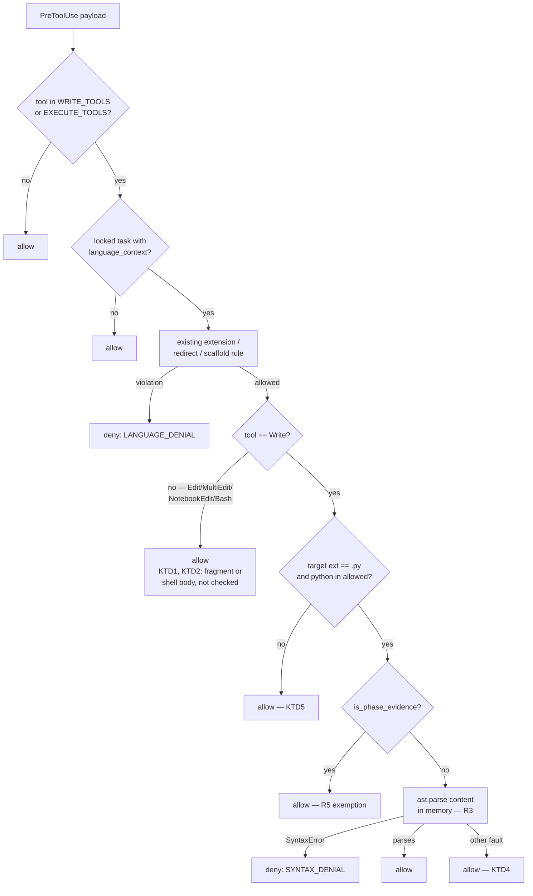

# feat: MN-8 hardening — AST language lock and mechanical pr-green authority

**Target repo:** this checkout. All paths repo-relative.

---

## Summary

Two independent hardening changes to MindNetwork's enforcement surface:

- **MN-8a** — the Language Compatibility Lock currently decides "what language is
  this" from the file *extension* alone. A `Write` of `script.py` whose body is
  JavaScript passes the gate untouched. This adds an in-memory `ast.parse()`
  check on full-file Python writes, so non-compilable content is refused before
  it reaches disk.
- **MN-8b** — `pr-green`, the terminal completion gate, is declared
  `verified_by: "agent"`, which means the agent can attest its own PR is green.
  This flips it to `"python"`, so only a real subprocess exit code recorded by
  `executor.validate` can clear the task's final gate.

The two share no code. They are planned together because both were commissioned
as one MN-8 slice and both land in the same enforcement package.

---

## Problem Frame

### MN-8a: the lock reads filenames, not code

`enforcer.language_violation` ([src/mindhive/mindnet/enforcer.py](src/mindhive/mindnet/enforcer.py))
resolves a language three ways — file extension via `EXTENSION_LANGUAGE`, shell
redirect targets via `_redirect_targets`, and scaffold generators via
`_scaffold_language` — and checks each against the active task's
`language_context`. Every one of those is a check on the *destination*, never on
the *payload*. `import ast` appears nowhere in the package.

The consequence is narrow but real: under `language_context: ["python"]`, writing
`src/thing.py` containing `function add(a, b) { return a + b; }` is allowed,
because `.py` maps to `python` and `python` is permitted. The gate's stated
purpose — "syntax diluar bahasa pemgrograman tersebut tidak keluar sama sekali"
— is not met for file content.

### MN-8b: the terminal gate accepts self-attestation

`phases.PHASE_EVIDENCE["pr-green"]` declares `verified_by: "agent"`
([src/mindhive/mindnet/phases.py:114](src/mindhive/mindnet/phases.py)).
`controller._apply_satisfy` refuses a claim *weaker* than the descriptor
([src/mindhive/mindnet/controller.py:578](src/mindhive/mindnet/controller.py)),
so `agent` clears an `agent` descriptor. The task that must not finish "hingga PR
berwarna hijau" can therefore be finished by an agent saying it is green.

`executor.py` already has the honest alternative: it stamps
`VERIFIED_BY = "python"` only after a real subprocess ran and a real exit code was
read ([src/mindhive/mindnet/executor.py:133](src/mindhive/mindnet/executor.py)).
Nothing forces the terminal gate to use it.

### The documented objection, and why it is being overridden

This reverses a decision the code currently states in three places
([executor.py:65-67](src/mindhive/mindnet/executor.py),
[phases.py:86-91](src/mindhive/mindnet/phases.py),
[docs/DATA_MODEL.md:232](docs/DATA_MODEL.md)): `pr-green` stays agent-reported
*because* `executor.DENIED_PROGRAMS` blocks `gh`, so Python cannot observe GitHub
CI state, and a `python` stamp would be the KTD2 lie.

That objection is sound about *GitHub CI* and does not bind here. The evidence
this plan requires is the **local suite's own exit code**, which the executor can
genuinely produce and which `CLAUDE.md` already sanctions ("the local test run
standing in for CI"). The GitHub boundary is untouched — `gh` stays denied. What
changes is that `pr-green` now names the strongest authority that can *honestly*
verify it, rather than the weakest one that could claim it.

Because those three comments currently document the opposite of what the code
will do, updating them is in scope, not optional cleanup.

---

## Requirements

| ID | Requirement |
|----|-------------|
| R1 | A full-file `Write` of a `.py` path whose content is not parseable Python is denied when the active task's `language_context` includes `python`. |
| R2 | The R1 denial message is exactly the mandated string (see KTD3), distinct from the existing extension-rule denial. |
| R3 | Content is parsed in memory only. No candidate content is written to disk before or during verification. |
| R4 | Valid Python content is allowed. Any non-`SyntaxError` fault in the AST path allows rather than denies. |
| R5 | The existing `is_phase_evidence` exemption and the total (`except Exception: return None`) contract of `language_violation` survive unchanged. |
| R6 | Fragment-bearing tool payloads (`Edit`, `MultiEdit`, `NotebookEdit`) are explicitly excluded from AST checking, with the exclusion recorded in the source. |
| R7 | `PHASE_EVIDENCE["pr-green"]["verified_by"]` is `"python"`. |
| R8 | An `agent`-stamped satisfy at `pr-green` folds to a violation and does not advance the task to completed. |
| R9 | A `python`-stamped satisfy at `pr-green`, produced by a real executor run, clears the gate and permits completion. |
| R10 | `executor.agent_satisfy` reports `clears=False` at `pr-green` rather than printing success over a no-op. |
| R11 | Every comment, docstring, and doc paragraph that asserts "`pr-green` stays agent-reported" is corrected. The `gh`/`git push` denylist claims they sit beside remain true and stay. |
| R12 | Suite is green at or above the 3401-test baseline. |

---

## Key Technical Decisions

### KTD1 — AST checking applies to `Write` only

`Write` carries `content`: a complete file, which is exactly what `ast.parse`
expects. `Edit`/`MultiEdit` carry `new_string`, and `NotebookEdit` carries a cell
source — all **fragments**. An indented method body, a dangling `else:` branch, or
a half-expression is legitimate as a fragment and a `SyntaxError` standalone.
AST-checking those would deny correct edits, and this repo has already been burned
once by two individually-sound guards composing into a deadlock (see the
`is_phase_evidence` comment at [enforcer.py:602](src/mindhive/mindnet/enforcer.py),
where the phase rule waved a document through and the language rule denied it one
check later, making all three planning gates unclearable).

The asymmetry is deliberate and must be stated in the source so a later tidy-up
does not "complete" the feature by extending it to `Edit`.

**Rejected:** parsing `Edit` fragments with a dedent-and-wrap heuristic. It
converts a precise check into a guessing game whose false positives are paid on
every edit, in the one place a false positive wedges a live session.

### KTD2 — Shell heredoc bodies stay out of scope

`language_violation` already denies `cat > src/app.ts <<EOF` by *target path*.
Extracting and parsing the heredoc *body* is a shell-parsing problem with the same
false-positive economics MN-4 already declined for command language inference
([enforcer.py:627-634](src/mindhive/mindnet/enforcer.py)). The redirect-target
rule is unchanged; only the `Write` payload gains content verification.

### KTD3 — A new denial constant, not a reworded existing one

The mandated message differs from `LANGUAGE_DENIAL` in wording and in what it
tells the operator to do — "widen the task's `language_context`" is useless advice
when the problem is that the code does not compile. Add a sibling constant
(`SYNTAX_DENIAL`) carrying the mandated string verbatim:

```
ACCESS DENIED: Language Compatibility Lock Violation. The provided code contains
alien syntax or spaghetti code that is not valid Python. You are strictly
forbidden from writing non-compilable syntax.
```

`LANGUAGE_DENIAL` keeps its current text and its current job. Both live in the
same constants block so the tests can pin them independently.

### KTD4 — Only `SyntaxError` denies; every other fault allows

`ast.parse` can raise beyond `SyntaxError`: `ValueError` on null bytes,
`RecursionError` on deeply nested literals, `MemoryError` on a pathological
payload. Those are faults in the *checker*, not evidence about the *code*, and the
brief is explicit that an AST crash must become neither an accidental allow of
alien syntax nor an accidental deny of unrelated work. `SyntaxError` is the single
deny signal; everything else returns "no opinion" and the caller allows.

This requires catching `SyntaxError` *inside* the AST helper. `SyntaxError`
subclasses `Exception`, so letting it propagate into `language_violation`'s
existing `except Exception: return None` would silently convert every intended
denial into an allow — the gate would look implemented and enforce nothing.

### KTD5 — The AST check runs only where the extension rule already allowed

If `python` is not in `language_context`, the extension rule denies a `.py` write
already and the AST check is redundant. The new check fires only for a `.py`
target that the extension rule permitted. This keeps the gate cheap and means a
task with `language_context: ["typescript"]` is never handed Python-parse
semantics.

### KTD6 — `executor.validate` is the mechanical path that prevents the wedge

Flipping `pr-green` to `python` makes `agent_satisfy` return `clears=False` there,
because `clears` is computed as `VERIFIERS.index("agent") <= VERIFIERS.index(need)`
([executor.py:642](src/mindhive/mindnet/executor.py)) — `1 <= 0` is False. That is
the intended effect, and it is only safe because a mechanical path exists:
`executor.validate` runs the task's script as a real subprocess and stamps
`python`. Running `pytest` is not on `DENIED_PROGRAMS` (`gh`) or
`DENIED_GIT_SUBCOMMANDS` (`push`, force spellings), so the local suite is
runnable through the executor unchanged.

A task therefore has two live exits at `pr-green` after this change: satisfy it
mechanically, or `fall_back`. It is never permanently stuck. U6 proves this rather
than asserting it.

---

## High-Level Technical Design

The MN-8a decision path. Every terminal marked *allow* is `return None` from
`language_violation`; the new behavior is the single `SYNTAX_DENIAL` leaf.



The MN-8b authority change, stated as the fold's accept/refuse table. `_authority`
ranks `python`=0, `agent`=1, `human`=2; `_apply_satisfy` refuses when
`rank > need`.

| satisfy stamped | `pr-green` need = `agent` (today) | `pr-green` need = `python` (after) |
|---|---|---|
| `python` (executor ran a subprocess) | accepted | **accepted** |
| `agent` (self-attested) | accepted | **refused → violation** |
| `human` | refused | refused |

---

## Implementation Units

### U1. AST verification helper and denial constant

**Goal:** A pure, total function that answers "is this text parseable Python"
with no I/O and no exception leakage.

**Requirements:** R2, R3, R4

**Dependencies:** none

**Files:**
- `src/mindhive/mindnet/enforcer.py` (add `SYNTAX_DENIAL` beside `LANGUAGE_DENIAL`; add the helper; add `import ast`)
- `tests/test_mindnet_enforcer.py`

**Approach:** Add `import ast` to the stdlib imports. Place `SYNTAX_DENIAL` in the
constants block next to `LANGUAGE_DENIAL` (KTD3). The helper takes the candidate
text and returns a bool (or `None` for "no opinion"), catching `SyntaxError` as
the deny signal and every other exception as allow (KTD4). It never touches the
filesystem.

**Patterns to follow:** the existing constants block at
[enforcer.py:226](src/mindhive/mindnet/enforcer.py) for message shape; the
module's prevailing "a gate answers, it does not raise" discipline (see
`resolve_ref`'s comment in [phases.py:175](src/mindhive/mindnet/phases.py)).

**Execution note:** Test-first.

**Test scenarios:**
- Valid Python `def add(a, b): return a + b` → parses, no denial.
- JavaScript `function add(a, b) { return a + b; }` → `SyntaxError` → denial signal.
- Bash `for f in *.py; do echo $f; done` → denial signal.
- JSON object literal `{"a": 1, "b": 2}` → **parses as a Python dict expression, no denial.** Pins the honest limit of the check: `ast.parse` answers "is this valid Python", not "was this intended as Python". Do not assert a denial here.
- Empty string and whitespace-only → parse cleanly, no denial (must not deny an intentional empty file).
- Content with a null byte → `ValueError`, not `SyntaxError` → allow (KTD4).
- Valid Python using 3.11+ syntax (e.g. `match`/`case`) → parses, no denial.
- Non-string input (`None`, `int`, `dict`) → allow, no raise.
- `SYNTAX_DENIAL` equals the mandated string byte-for-byte, and `LANGUAGE_DENIAL` is unchanged and still distinct from it.

**Verification:** Helper is total across the table above; no scenario raises.

---

### U2. Wire the AST check into `language_violation`

**Goal:** The `Write`-only content gate fires in the real decision path without
disturbing any existing branch.

**Requirements:** R1, R5, R6, KTD1, KTD5

**Dependencies:** U1

**Files:**
- `src/mindhive/mindnet/enforcer.py`
- `tests/test_mindnet_enforcer.py`

**Approach:** Inside `language_violation`, after the existing extension/redirect/
scaffold rule has *allowed*, add the `Write`-only branch: resolve the target
extension, proceed only when it maps to `python` and `python` is in `allowed`
(KTD5), honor `is_phase_evidence` (R5), then run U1's helper on `tool_input`'s
`content`. Return `SYNTAX_DENIAL` on the deny signal.

The exclusion of `Edit`/`MultiEdit`/`NotebookEdit` must be a written comment
naming the fragment reason and the deadlock precedent (KTD1) — not an accident of
control flow.

Keep the function's outer `try/except Exception: return None` intact and make sure
U1's helper is what swallows `SyntaxError`, per KTD4.

**Patterns to follow:** `_path_language_violation`'s extension resolution
([enforcer.py:597](src/mindhive/mindnet/enforcer.py)) for `_norm`/`_ADS_RE`
handling of trailing dots and `::$DATA`; `_file_path`
([enforcer.py:552](src/mindhive/mindnet/enforcer.py)) for payload key lookup.

**Execution note:** Test-first.

**Test scenarios:**
- `Write` to `src/x.py` with JavaScript body, task `language_context: ["python"]` → returns `SYNTAX_DENIAL` exactly.
- Same write with valid Python body → returns `None`.
- `Edit` on `src/x.py` with `new_string` = an indented fragment (`    return a + b`) that is not standalone-parseable → returns `None`. **This is the wedge-prevention test** (KTD1).
- `MultiEdit` and `NotebookEdit` with unparseable fragments → `None`.
- `Bash` with `cat > src/x.py <<EOF` and a JavaScript body → `None` from the AST rule; the existing redirect-target behavior is unchanged (KTD2).
- `Write` to `src/x.ts` under `language_context: ["typescript"]` with invalid TypeScript → `None`. The AST rule is Python-only and must not deny other languages.
- `Write` to `src/x.py` under `language_context: ["typescript"]` → still the **extension** denial (`LANGUAGE_DENIAL`), not `SYNTAX_DENIAL`. Ordering pinned.
- `Write` to a `docs/superpowers/specs/` path that would be phase evidence → `None` (R5 exemption survives).
- No locked task / empty `language_context` → `None`, regardless of content.
- `Write` payload missing `content` entirely, or `content` non-string → `None`, no raise.
- Path with trailing dot (`src/x.py.`) resolving to `.py` on Windows → still AST-checked (mirrors `_path_language_violation`'s `_ADS_RE`/rstrip handling).

**Verification:** Full enforcer suite green; the extension rule's existing tests
pass untouched.

---

### U3. Enforcer hook end-to-end proof

**Goal:** Prove the denial reaches the actual `PreToolUse` decision surface, not
just the predicate.

**Requirements:** R1, R2

**Dependencies:** U2

**Files:**
- `tests/test_mindnet_enforcer_hook.py`

**Approach:** Exercise the hook entry point with a real `Write` payload carrying
alien syntax and assert the emitted decision is a deny carrying `SYNTAX_DENIAL`.
Follow the existing hook tests' fixture shape for sidecar/task setup rather than
inventing one.

**Execution note:** Test-first. This is the "real output, not a proxy" check the
repo's verification rule requires — a passing predicate test does not prove the
hook wires it.

**Test scenarios:**
- Hook receives `Write`/`src/x.py`/JavaScript under a python-locked task → decision is `deny`, reason contains `SYNTAX_DENIAL`.
- Hook receives the same write with valid Python → not denied.
- Canary: with the AST branch mentally removed the deny assertion must fail — assert on the specific `SYNTAX_DENIAL` text, not merely on "some denial occurred", so an unrelated extension denial cannot make this pass for the wrong reason.

**Verification:** Hook-level deny observed with the exact mandated message.

---

### U4. Flip `pr-green` to python authority

**Goal:** The descriptor names the strongest authority that can honestly verify
the terminal gate.

**Requirements:** R7, R8

**Dependencies:** none (independent of U1-U3)

**Files:**
- `src/mindhive/mindnet/phases.py`
- `tests/test_mindnet_phases.py`

**Approach:** Change `PHASE_EVIDENCE["pr-green"]["verified_by"]` to `"python"`.
Rewrite the comment block at [phases.py:86-91](src/mindhive/mindnet/phases.py) so
it no longer groups `pr-green` with the two genuinely agent-reported audits: the
`audit-code`/`audit-system` rationale (no review event type exists, so `python`
would be a lie) is still correct and stays; `pr-green` moves out of it with its own
sentence explaining that the local suite's exit code *is* readable by Python and
that the `gh` denial bounds the claim to the local run, not GitHub CI state.

**Patterns to follow:** the existing per-phase rationale comments in the same
block — they explain *why* an authority is what it is, which is the standard this
change has to meet.

**Execution note:** Test-first.

**Test scenarios:**
- `PHASE_EVIDENCE["pr-green"]["verified_by"] == "python"`.
- `test_the_two_reviewed_audits_are_honestly_agent_reported` still passes unchanged — `audit-code` and `audit-system` remain `agent`. Their rationale is untouched by this change.
- Existing invariants hold: every descriptor's `verified_by` is in `VERIFIERS`; non-file phases still carry `required_dir == ()`.
- `pr-green` still has `kind == "command"` — this change is about authority only.

**Verification:** Phases suite green.

---

### U5. Fold behavior — agent attestation at `pr-green` becomes a violation

**Goal:** Prove the mechanism, not just the constant.

**Requirements:** R8, R9

**Dependencies:** U4

**Files:**
- `tests/test_mindnet_controller.py`

**Approach:** Drive a task to `pr-green` using the file's existing `_walk_to`
helper (see [test_mindnet_controller.py:945](tests/test_mindnet_controller.py)),
then fold an `agent`-stamped satisfy and assert refusal; then fold a
`python`-stamped one and assert it clears and permits completion.

**Execution note:** Test-first.

**Test scenarios:**
- Task at `pr-green`; fold satisfy `verified_by: "agent"`, `result: "ok"` → recorded as a violation containing "weaker claim"; `satisfied(records, task, "pr-green")` is False; task does not reach `STATUS_COMPLETED`.
- Same task; fold satisfy `verified_by: "python"`, `result: "ok"` → satisfied; `can_complete` permits completion.
- Satisfy stamped `python` but `result: "fail"` → does **not** satisfy. A mechanical run that failed is not a green PR.
- Satisfy stamped `human` at `pr-green` → still refused (was refused before, must stay refused).
- Epoch discipline unchanged: a `python` satisfy carrying a stale epoch is refused.

**Verification:** Controller suite green; the agent-path assertion fails if U4 is
reverted.

---

### U6. Executor — `clears` reporting and the mechanical exit

**Goal:** Prove the escape-hatch narrowing is reported honestly and that the task
is not wedged.

**Requirements:** R9, R10, KTD6

**Dependencies:** U4

**Files:**
- `src/mindhive/mindnet/executor.py` (docstrings only — no logic change expected)
- `tests/test_mindnet_executor.py`

**Approach:** `agent_satisfy` derives `clears` from the descriptor and needs no
code change; what changes is that `pr-green` now joins `audit-bug` in the
`clears=False` set. Update the module docstring
([executor.py:75-81](src/mindhive/mindnet/executor.py)) and `agent_satisfy`'s
docstring ([executor.py:612-616](src/mindhive/mindnet/executor.py)), which
currently name `audit-bug` as the *only* such phase.

Then prove the mechanical exit: a real `executor.validate` run at `pr-green`
stamps `python` and clears the gate.

**Execution note:** Test-first. If `agent_satisfy` turns out to need a logic
change, that is a finding to surface — the plan's expectation is docstrings only.

**Test scenarios:**
- `agent_satisfy` at `pr-green` → `clears is False`, `note` is non-empty, event still lands on the ledger stamped `agent` with the reason verbatim.
- `executor.validate` at `pr-green` with a script that exits 0 → satisfy stamped `python`, `pr-green` satisfied, task completable. **This is the anti-wedge proof** (KTD6).
- `executor.validate` at `pr-green` with a script that exits non-zero → `result: "fail"`, gate not satisfied.
- A task at `pr-green` whose agent satisfy was refused can still `fall_back` — the second live exit.
- `DENIED_PROGRAMS` still contains `gh` and `DENIED_GIT_SUBCOMMANDS` still contains `push`. The existing assertion at [test_mindnet_executor.py:266](tests/test_mindnet_executor.py) stays; only its docstring's "pr-green stays agent-reported" clause is corrected (R11).

**Verification:** Executor suite green; the mechanical-clear test proves a real
subprocess path to completion exists.

---

### U7. Correct the stale rationale in docs and source

**Goal:** No comment, docstring, or doc paragraph documents the opposite of what
the code does.

**Requirements:** R11

**Dependencies:** U4, U6

**Files:**
- `docs/DATA_MODEL.md`
- `src/mindhive/mindnet/executor.py` (module docstring, lines ~65-67)
- `docs/plans/2026-08-02-003-feat-mindnet-mn8-hardening-plan.md` (this plan, referenced as the change's rationale)

**Approach:** Three edits.

1. [executor.py:65-67](src/mindhive/mindnet/executor.py) — "turns the plan's CLAIM
   that `pr-green` stays agent-reported ... into something enforced" becomes a
   statement about what the denylist *actually* still guarantees: the GitHub
   boundary. The `gh`/`git push` denial is unchanged and still enforced; it simply
   no longer implies anything about `pr-green`'s authority.
2. [docs/DATA_MODEL.md:232](docs/DATA_MODEL.md) — same correction to the bullet
   asserting the paired claim.
3. `docs/DATA_MODEL.md` §4.9 "The pr-green completion gate (MN-10)" — document
   that the gate now requires `verified_by: python`, that the evidence is the
   local suite's exit code, that `agent_satisfy` reports `clears=False` there, and
   that `fall_back` plus a mechanical re-run are the two live exits.

Also add the MN-8a AST rule to `DATA_MODEL.md`'s language-lock section: what is
checked (`Write` content on `.py` under a python context), what is deliberately
not (fragments, heredoc bodies), and why.

**Execution note:** Documentation only — no behavior change. Do this after U4-U6
so the docs describe verified behavior rather than intended behavior.

**Test scenarios:** `Test expectation: none — documentation only.` Note that
`tests/test_architecture_drift.py` parses these docs for the *phase-name legend*
only; it does not read authority claims, so these edits carry no drift-test risk.
Re-run it anyway as a guard.

**Verification:** Grep the repo for "agent-reported" and "stays agent-reported"
near `pr-green` and confirm every remaining hit is either corrected or is
genuinely about `audit-code`/`audit-system`.

---

### U8. Full suite, change-log, and green landing

**Goal:** The repo's own completion bar.

**Requirements:** R12

**Dependencies:** U1-U7

**Files:** none (verification + ledger entry)

**Approach:** Run the full suite with the venv interpreter. Record the change-log
entry `CLAUDE.md` mandates:

- `hive log major_change` for the `pr-green` authority flip (it reverses a
  documented decision).
- `hive log update` for the AST language-lock addition.

**Test scenarios:** `Test expectation: none — verification unit.`

**Verification:** `.venv/Scripts/python.exe -m pytest -q` reports **≥ 3401 passed,
0 failed**. Any drop below the baseline is a regression to investigate, not a
number to accept.

---

## Scope Boundaries

**In scope:** the eight units above.

### Non-goals

- **`src/mindhive/history.py` and its stopword filter.** The file does not exist
  on any branch; the role is already served by
  [src/mindhive/mindnet/advice.py](src/mindhive/mindnet/advice.py), which has a
  hardcoded `_STOP` tuple covering English and programming words, `_STOP_STEMS`
  inflection folding, and `MIN_OVERLAP = 2` ("One shared word is noise; two is a
  signal"). Verified already-defended; no work.
- **GitHub CI integration.** `gh` stays on `DENIED_PROGRAMS`. `pr-green`'s evidence
  is the local suite, not the external CI matrix.
- **AST checking for non-Python languages.** No parser for TypeScript, Go, etc. is
  in the stdlib; adding one would need a dependency, which the repo forbids.

### Deferred to Follow-Up Work

- **Fragment-aware `Edit` verification.** Would need a dedent-and-wrap heuristic
  (KTD1). Worth revisiting only with a design that cannot false-positive.
- **Heredoc body extraction for `Bash` writes** (KTD2).
- **A fallback authority for python-verified phases** — the gap
  [executor.py:79-81](src/mindhive/mindnet/executor.py) already names for
  `audit-bug`. This plan widens the set to include `pr-green` but does not close
  the underlying gap; `fall_back` remains the release valve.

---

## Assumptions

Recorded because this plan was produced without a synchronous confirmation step.

- **A1** — "PR green" is satisfied by the repository's own test suite exiting 0.
  The plan does not attempt to read GitHub Actions state.
- **A2** — `executor.agent_satisfy` needs no logic change; `clears` is already
  derived from the descriptor. U6 treats a required logic change as a finding to
  surface rather than a silent expansion.
- **A3** — No consumer outside this repo reads `PHASE_EVIDENCE["pr-green"]`. The
  descriptor is internal; the risk register carries the residual.

---

## Risks & Dependencies

| Risk | Severity | Mitigation |
|---|---|---|
| AST check false-positives on `Edit` fragments, wedging live sessions | High | KTD1 restricts to `Write`; U2 carries an explicit fragment test per excluded tool. |
| `SyntaxError` swallowed by `language_violation`'s outer `except Exception` — gate looks implemented, enforces nothing | High | KTD4 catches inside the helper; U1 asserts the deny signal at the helper boundary and U3 re-proves it at the hook. |
| Tasks already parked at `pr-green` can no longer be cleared by agent attestation | Medium | Two live exits proven in U6: mechanical `validate`, or `fall_back`. `clears=False` surfaces it instead of printing success over a no-op. |
| Docs keep asserting the reversed rationale | Medium | U7 is a required unit with a grep-based verification, not optional cleanup. |
| Suite regression from the authority flip | Medium | U8 gates on the 3401 baseline; U4/U5 are test-first so breakage surfaces at the unit, not at the end. |
| An external consumer reads the `pr-green` descriptor (A3) | Low | Grep for `PHASE_EVIDENCE` importers during U4; escalate if one exists outside `src/mindhive/`. |

---

## Open Questions

Deferred to implementation — none blocks starting.

- **Q1** — Does `pr-green`'s command-kind evidence require a `ref`? U6 will show
  whether `executor.validate`'s artifact path satisfies it or whether the
  command-kind path bypasses ref resolution entirely. Answerable only by running
  the fold.
- **Q2** — Is there a CLI surface (`hive mindnet validate`/`gate`) that already
  passes a default test command for `pr-green`, or must the operator supply the
  script? Affects U7's documentation wording, not any unit's behavior.

---

## Sources & Research

All findings below are from direct reading of this checkout at
`357162f`; no external research was run (the work is entirely internal to this
codebase's own conventions).

- Baseline: `.venv/Scripts/python.exe -m pytest -q` → **3401 passed, 1 warning, 227.81s**. Note `python` is not on PATH in Git Bash; the venv interpreter is required.
- [src/mindhive/mindnet/enforcer.py](src/mindhive/mindnet/enforcer.py) — `EXTENSION_LANGUAGE`, `WRITE_TOOLS`/`EXECUTE_TOOLS`, `_path_language_violation`, `language_violation`, `is_phase_evidence`, `LANGUAGE_DENIAL`.
- [src/mindhive/mindnet/phases.py](src/mindhive/mindnet/phases.py) — `VERIFIERS`, `PHASE_EVIDENCE`, the KTD2 "derived, never accepted" contract.
- [src/mindhive/mindnet/controller.py](src/mindhive/mindnet/controller.py) — `_apply_satisfy`'s six gates and the `rank > need` authority refusal.
- [src/mindhive/mindnet/executor.py](src/mindhive/mindnet/executor.py) — `VERIFIED_BY`, `DENIED_PROGRAMS`, `validate`, `agent_satisfy`, the `clears` derivation.
- [src/mindhive/mindnet/advice.py](src/mindhive/mindnet/advice.py) — the already-shipped stopword/threshold defense that closes the directive's Phase 1.
- [docs/DATA_MODEL.md](docs/DATA_MODEL.md) §4.9 and the executor denylist bullet — the two doc locations asserting the reversed rationale.
- [tests/test_mindnet_phases.py](tests/test_mindnet_phases.py), [tests/test_mindnet_executor.py](tests/test_mindnet_executor.py), [tests/test_mindnet_controller.py](tests/test_mindnet_controller.py) — confirmed **no test pins `pr-green`'s verifier**; only `audit-code`/`audit-system` are pinned, and they are unaffected.
