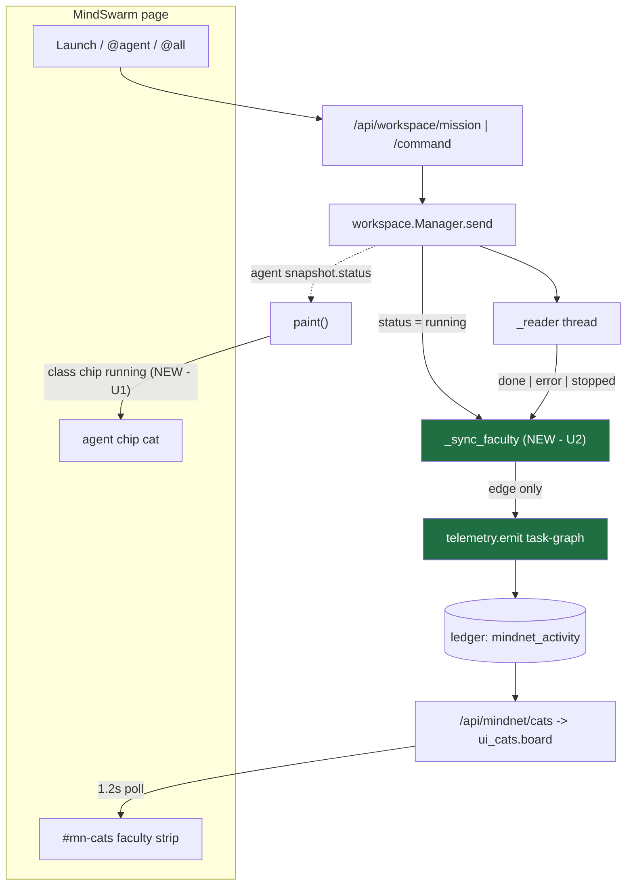
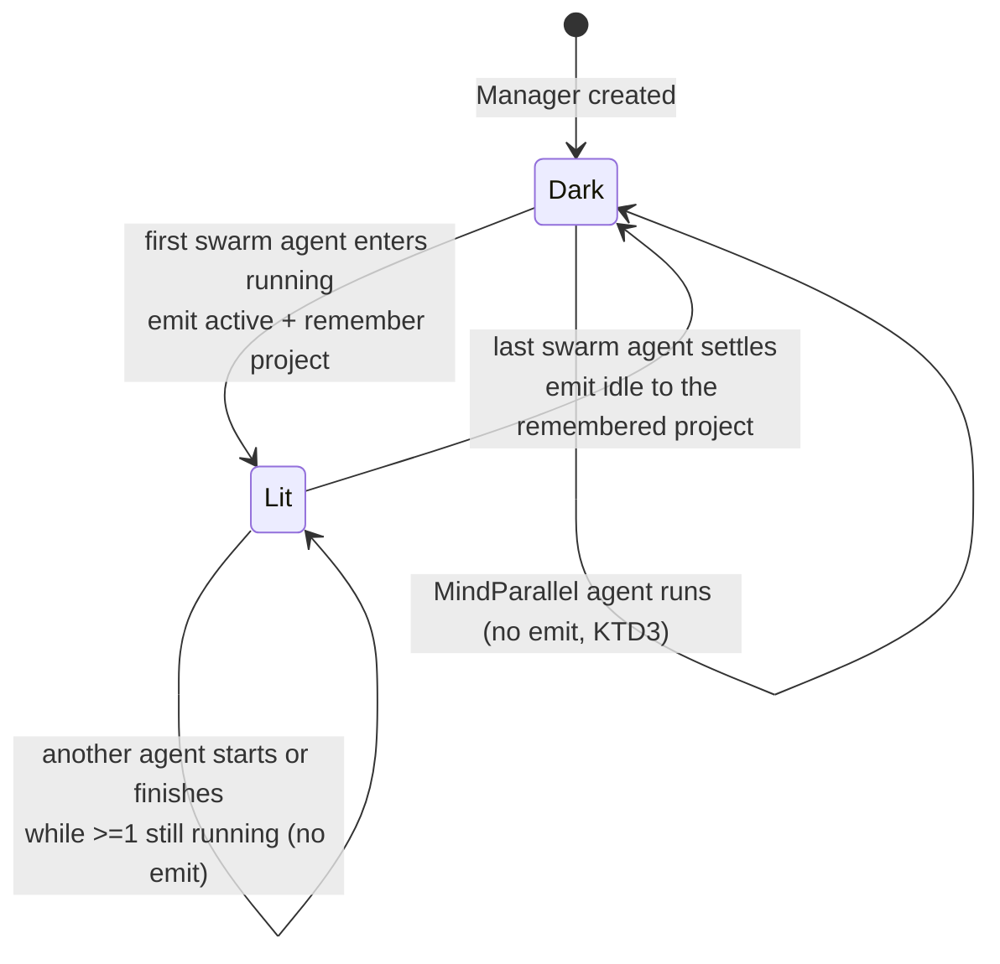

# fix: make the MindSwarm cats move — chip animation and a workspace producer for the faculty strip

**Target branch:** `claude/mindswarm-cat-animation-bug-dc77c8`, worktree
`.claude/worktrees/nervous-taussig-c8ebac`. All paths below are repo-relative.

## Summary

The operator reported that the MindSwarm cats never come alive when work is
commanded. They are right, and the cause is two independent gaps — neither of
which is a bug in the cat board itself.

**Gap 1 (presentation).** Every swarm agent chip draws a cat via
`catSVG(catFor(a.id), 30)` ([swarm_page.py:269](src/mindhive/swarm_page.py:269)),
but the `mn-bob` animation is scoped to `.mn-cat.active svg`
([cat_board.py:89](src/mindhive/cat_board.py:89)). A chip's cat carries no
`.mn-cat` class, so it has never animated and never could — regardless of whether
its agent is running. The only motion on a chip today is the 7px `.dot.running`.

**Gap 2 (no producer).** The faculty strip is fed by `/api/mindnet/cats` ←
`telemetry.fold`, and `workspace.py` — the module behind Launch, `@agent`, and
`@all` — never imports `mindnet.telemetry` at all. Commanding the swarm writes
`user_prompt` and `assistant_response` events but zero `mindnet_activity`, so the
strip reads "no MindNetwork activity" forever.

Ledger evidence for gap 2: across **every** project namespace in
`~/.mindhive/*/events/`, `mindnet_activity` totals **13 rows**, all written by the
probe sessions `mn17-live`, `mn18-live`, and `stale-probe` on 2026-07-31 and
2026-08-01. Not one row came from a real session, and not one came from MindSwarm.

This plan closes both, and closes the doc drift the second one creates.

---

## Problem Frame

The faculty board exists to make one claim falsifiable: **a missing cat means a
real bug** (R16, per [telemetry.py:6-8](src/mindhive/mindnet/telemetry.py:6)). That
claim collapses when a surface has no emitter, because "not running" and "never
wired" render identically. MindSwarm is the surface where the operator actually
commands work, and it is precisely the surface with no emitter — so the board is
at its least trustworthy exactly where it is most looked at.

The chip gap compounds it: the operator sees seven-plus cats on screen (one per
agent), none of which ever move, which reads as "the animation is broken" rather
than "these two cat systems are unrelated."

---

## Requirements

- **R1** — On the MindSwarm canvas, an agent's cat visibly animates while that
  agent's `status` is `running`, and is static in every other state.
- **R2** — Motion respects `prefers-reduced-motion: reduce`, for chip cats and
  faculty-strip cats alike, from one shared rule.
- **R3** — Commanding work through the workspace (mission Launch, `@agent`,
  `@all`) lights the `task-graph` faculty cat on the strip; it goes out once the
  last swarm agent settles.
- **R4** — The emit is **edge-triggered on the aggregate**: exactly one `active`
  on the 0→≥1-running transition and one `idle` on the ≥1→0 transition, so a
  finishing agent cannot extinguish the cat while its siblings still run.
- **R5** — Telemetry never disturbs the observed. It never raises out of a send or
  a reader thread, never blocks a run, and never holds the fleet lock across a
  ledger append.
- **R6** — No new faculty name. `telemetry.FACULTIES`, `events.py`'s registration
  comment, and the architecture decomposition spec are untouched.
- **R7** — The `active` and `idle` rows of one swarm episode land in the **same**
  project namespace, so a mission cannot strand a lit cat in a namespace nothing
  will ever extinguish.

---

## Key Technical Decisions

### KTD1 — The faculty is `task-graph`, reusing the wave precedent

`FACULTIES` is pinned three ways by
[test_mindnet_telemetry.py:108-124](tests/test_mindnet_telemetry.py:108): an
independent literal in the test, `events.py`'s registration comment, and
`docs/superpowers/specs/2026-07-25-mindnetwork-architecture-decomposition.md`.
Growing the tuple would mean editing a founding spec to accommodate a UI fix —
backwards.

[orchestrator.py:135-138](src/mindhive/mindnet/orchestrator.py:135) already settled
this question for the identical shape: an orchestrated wave of parallel execution
lights `task-graph`, *"rather than a new name: `telemetry.FACULTIES` is the one
legend and walking the graph is exactly what that faculty means."* A MindSwarm
mission — a coordinator decomposing work across builders, scouts and reviewers —
is that shape. Reusing the name is the honest reading, not a convenience.

### KTD2 — Edge-triggered on the aggregate, not `telemetry.busy` per agent

`busy` is a context manager around a synchronous block; swarm runs live in
background reader threads, so it does not fit. More importantly, `fold` is
last-write-wins *per faculty* — a per-agent `idle` emitted when Builder 1 finishes
would extinguish the cat while Builder 2 and 3 are still working, producing the
exact false "nothing is running" the board exists to prevent.

So `Manager` tracks one boolean and emits only on its transitions. The predicate is
`any(a.swarm and a.status == "running")`, recomputed from the fleet rather than
counted incrementally — a counter would drift permanently the first time a status
changed on a path nobody remembered to decrement.

### KTD3 — Swarm agents only; MindParallel panes are out of scope

`task-graph` means orchestrated graph-walking. A MindParallel pane is one ad-hoc
agent with no coordinator and no decomposition, so lighting the same cat for it
would make the signal mean less. This is a deliberate narrowing, recorded in Scope
Boundaries.

### KTD4 — The `idle` edge is emitted to the project the `active` edge used

Agents carry their own `a.project`, and the board is read per-namespace. If the
`active` edge fired for project A and the `idle` edge were emitted with a later
agent's project B, project A's cat would stay lit until the 6-hour `HIDE_AFTER_SECS`
rule finally removed it — a stuck cat, which
[ui_cats.py:44-50](src/mindhive/mindnet/ui_cats.py:44) is explicit is worse than a
missing one. So `Manager` remembers the project it lit with and extinguishes into
the same namespace (R7).

### KTD5 — The emitter is injectable, mirroring `spawn` and `append_event`

`Manager.__init__` already takes `spawn=None, append_event=None`
([workspace.py:485](src/mindhive/workspace.py:485)) so tests can observe without a
subprocess or a ledger. The faculty emitter follows that established seam rather
than reaching for `telemetry.emit` directly, which would make every assertion a
ledger round-trip. Resolution stays lazy (inside the method, not at import) so a
dashboard in a project that never used the phase spine still pays nothing for the
import — the same rule `dashboard.py:609` keeps.

### KTD6 — Chip animation is a status class plus the existing keyframes

`paint()` already stamps `a.status` onto the inner `.dot`. Adding the same status
to the `.chip` element itself lets one page-local rule drive the cat, and that rule
reuses the `mn-bob` keyframes already injected from `cat_board.CSS` — no second
copy of the animation, which is what invariant 10 forbids and what
[test_cat_board_shared.py](tests/test_cat_board_shared.py) exists to catch.

The `#mn-cats`-box precedent applies: `cat_board.CSS` owns page-independent cat
rules, each page owns its own container. A chip is the swarm page's own furniture,
so its rule lives in `swarm_page.py`. The reduced-motion guard is the opposite — it
is page-independent and must cover both cat systems, so it belongs in
`cat_board.CSS`.

---

## High-Level Technical Design

Two independent paths reach two independent cat systems. Today the left path has no
producer and the right path has no animation.



The edge-trigger is the whole of U2's logic. It has three states and only two of
them emit:



The `Lit --> Lit` self-loop is the requirement that makes this design necessary
(R4): it is the case a naive per-agent emit gets wrong.

---

## Implementation Units

### U1. Make the swarm chip cat reflect its agent's status

**Goal** — An agent's cat bobs while that agent runs and holds still otherwise, and
neither cat system animates under `prefers-reduced-motion: reduce`.

**Requirements** — R1, R2.

**Dependencies** — none.

**Files**
- `src/mindhive/swarm_page.py` — chip class stamping and the page-local chip-cat rule
- `src/mindhive/cat_board.py` — the shared reduced-motion guard
- `tests/test_workspace_pages.py` — chip rendering assertions
- `tests/test_cat_board_shared.py` — reduced-motion and no-duplicate-keyframes assertions

**Approach**

In `paint()` ([swarm_page.py:265-272](src/mindhive/swarm_page.py:265)), add the
agent's status to the chip's own class list alongside the existing `sel` handling.
The status vocabulary is already fixed at
[workspace.py:442](src/mindhive/workspace.py:442) — `idle | running | done | error
| stopped` — and is server-controlled, so it is safe to interpolate as a class; it
never reaches the DOM as text. Keep the `catSVG(catFor(a.id), 30)` call byte-identical:
[test_cat_board_shared.py:132](tests/test_cat_board_shared.py:132) asserts that exact
substring, and it is the assertion that proves the swarm page renders from the shared
implementation rather than a local copy.

Add one rule to the swarm page's own stylesheet block (near the existing `.chip`
rules, ~[swarm_page.py:49-57](src/mindhive/swarm_page.py:49)) driving the chip's
direct `svg` child from `.chip.running`, referencing the `mn-bob` keyframes that
`cat_board.CSS` already injects into this page. Do **not** redeclare `@keyframes
mn-bob` — one definition, per invariant 10.

Add the reduced-motion guard to `cat_board.CSS`. It must disable motion for both
`.mn-cat.active svg` and the chip cats, which means the selector cannot name
`.chip` (that class does not exist on the dashboard). Write it as a rule that
neutralises `animation` for any cat sprite under the media query, so a third page
adopting the fragment inherits the guard for free. This is the one cat rule that is
genuinely page-independent, which is why it belongs here and not in `swarm_page.py`
— matching the split documented at [cat_board.py:16-25](src/mindhive/cat_board.py:16).

**Patterns to follow** — the `#mn-cats` box split (page-independent rules in
`cat_board.CSS`, per-page containers in each page); the existing `.chip .dot.running`
status-class idiom; `pulse` and `mn-bob` keyframe reuse.

**Test scenarios**
- A rendered swarm page contains a chip-cat animation rule bound to the running
  state, and that rule references `mn-bob` rather than declaring new keyframes.
- `paint()`'s chip markup interpolates the agent status into the chip's class list
  (assert the class-building expression is present, alongside the preserved `sel`
  behaviour).
- The literal `catSVG(catFor(a.id), 30)` still appears in the rendered swarm page —
  a regression guard on the shared-implementation assertion this unit edits around.
- `cat_board.CSS` contains exactly one `@keyframes mn-bob` declaration, and the
  rendered swarm page contains exactly one — proving U1 added no second copy.
- `cat_board.CSS` contains a `prefers-reduced-motion: reduce` block, and it appears
  in **both** the rendered swarm page and the rendered dashboard page (the shared-
  fragment claim, tested the way `test_cat_board_shared.py` already tests CSS reach).
- The reduced-motion block's selector does not mention `.chip` — pinning that the
  guard is page-independent and will cover a future third page.

**Verification** — Rendering the swarm page yields markup where a `running` chip is
distinguishable by class from a `done` one, the animation rule is present exactly
once, and the reduced-motion guard reaches both pages.

---

### U2. Emit `task-graph` faculty telemetry from the workspace, edge-triggered

**Goal** — Commanding the swarm lights the faculty cat; the last agent to settle
puts it out.

**Requirements** — R3, R4, R5, R6, R7.

**Dependencies** — none (independent of U1; they touch disjoint files).

**Files**
- `src/mindhive/workspace.py` — the emitter seam, the edge state, and its call sites
- `tests/test_workspace_faculty_telemetry.py` — new

**Approach**

Add an injectable emitter to `Manager.__init__`
([workspace.py:485](src/mindhive/workspace.py:485)) alongside `spawn` and
`append_event`, defaulting to `None` and resolving lazily to `telemetry.emit` at
first use (KTD5). Add two pieces of edge state: whether the cat is currently lit,
and the project it was lit for (KTD4).

Add one private method — call it `_sync_faculty` — that:
1. recomputes `any(a.swarm and a.status == "running")` over the fleet under
   `self._lock`, capturing the triggering project while holding it;
2. **releases the lock**, then compares against the remembered flag;
3. emits `active` (remembering the project) or `idle` (into the remembered
   project) only on a change, and updates the flag;
4. swallows every exception, exactly as `_log`
   ([workspace.py:796-804](src/mindhive/workspace.py:796)) does — *"the ledger must
   never crash a pane."*

The lock must not be held across the append (R5). `telemetry.emit` already never
raises, but the fleet scan and the flag update are this module's own code and get
their own guard.

Wire `_sync_faculty` at every place a swarm agent's status can change, and nowhere
else:
- `send()` after `a.status = "running"` ([workspace.py:637](src/mindhive/workspace.py:637))
- `_reader()` after the `done` / `error` / `stopped` branches settle
  ([workspace.py:753-790](src/mindhive/workspace.py:753))
- `stop()` after `a.status = "stopped"` ([workspace.py:534](src/mindhive/workspace.py:534))
- `_settle_orphan()` after `a.status = "stopped"` ([workspace.py:693](src/mindhive/workspace.py:693))

`stop_mission()` and `remove()` route through `stop()` and need no call of their
own. `spawn(prompt=...)` routes through `send()`. The `OSError` branch at
[workspace.py:632](src/mindhive/workspace.py:632) sets `error` without ever having
been `running`, so it needs no call — but the fleet-recompute design means an extra
call there would be harmless, which is the point of recomputing rather than counting.

**Critical:** `spawn()` holds `self._lock` and calls `self.send()` *outside* it
([workspace.py:504-513](src/mindhive/workspace.py:504)). Verify no call site invokes
`_sync_faculty` while already holding `self._lock`, or the re-entrant acquire
deadlocks the fleet. This is the single highest-risk detail in the unit.

Pass no `task_id`: `telemetry._task_id` requires a `sop.ID_RE` match and a mission
string is not one, so it would be silently dropped anyway. Passing the agent's
`session_id` is worthwhile — it puts the row in the same segment as the
`user_prompt` it accompanies, matching how `_log` stamps its events.

**Execution note** — Implement test-first. The edge behaviour is defined by
transitions rather than by any single call's return value, and a test written after
the fact tends to assert the implementation's shape instead of the requirement.

**Patterns to follow** — `Manager._log`'s never-raise contract; `telemetry.emit`'s
best-effort contract ([telemetry.py:147-169](src/mindhive/mindnet/telemetry.py:147));
`orchestrator._WAVE_FACULTY`'s faculty naming; the lazy-import convention used by
`Manager` for `plugins`, `incidents` and `recall`.

**Test scenarios**
- Launching a mission with a coordinator plus builders emits exactly **one**
  `active` row for `task-graph`, not one per spawned agent.
- With three swarm agents running, settling one emits **nothing**; settling the
  second emits nothing; settling the last emits exactly one `idle`. *(This is R4 —
  the failure the naive design produces.)*
- A second mission after a full settle emits a fresh `active` — the flag resets
  rather than latching.
- The `idle` row carries the same `project` as the `active` row that preceded it,
  even when a later agent carries a different project (R7).
- A MindParallel agent (`swarm=False`) running to completion emits nothing at all
  (KTD3).
- An emitter that raises on every call leaves `send()` returning `ok: True` and the
  agent's status still `running` — telemetry cannot disturb the observed (R5).
- `stop()` on the only running swarm agent emits `idle`; `stop()` on an agent that
  was never running emits nothing.
- `_settle_orphan` releasing a stranded `running` agent emits `idle` when it was
  the last one.
- The emitted faculty string is a member of `telemetry.FACULTIES` — asserted by
  membership, not by comparing to a hardcoded `"task-graph"`, so a legend rename
  fails loudly here instead of silently emitting a refused row. *(Mirrors
  `test_the_cross_module_faculty_constant_is_a_real_member` at
  [test_mindnet_telemetry.py:470](tests/test_mindnet_telemetry.py:470).)*
- Concurrency guard: driving `send` and reader-settles from multiple threads leaves
  the flag consistent with the fleet's actual running state and never deadlocks.

**Verification** — With a fake spawn and a recording emitter, a full
launch → command → settle cycle produces the row sequence `active … idle`, one of
each, in the right namespace, and the suite stays green with no deadlock or hang.

---

### U3. Close the doc drift this producer creates, and log the change

**Goal** — The prose that told a future reader "this feed has no producer on the
workspace path" stops being true the moment U2 lands. Fix it in the same change.

**Requirements** — supports R6 (the legend and its rationale stay coherent).

**Dependencies** — U2.

**Files**
- `src/mindhive/mindnet/telemetry.py` — module docstring
- `src/mindhive/workspace.py` — module docstring (a one-line note that it now feeds
  the faculty board)

**Approach**

[telemetry.py:63-65](src/mindhive/mindnet/telemetry.py:63) states the module is
*"deliberately NOT wired into `controller.py` or `executor.py` — where the emit
calls belong is a seam to decide explicitly, not a side effect of adding the
producer."* That sentence is the reason MindSwarm had no emitter, and U2 decides
that seam. Record the decision there: the workspace path emits `task-graph`,
edge-triggered, for swarm agents only — so the next reader learns why rather than
rediscovering it.

This repo has an explicit history of doc-vs-code drift shipping and needing a
follow-up plan ([2026-08-02-002](docs/plans/2026-08-02-002-fix-style-docstring-test-drift-plan.md)).
Doing it inside the same change is the cheap moment.

Then record the mandatory change-log entry — `CLAUDE.md` makes this blocking:

```
hive log update "<what changed and why>"
```

**Test expectation: none** — documentation and a ledger entry; the behavioural
claims are pinned by U1 and U2.

**Verification** — `telemetry.py`'s docstring describes the wiring that now exists;
`hive state` shows no "⚠ Unlogged code changes" notice.

---

## Scope Boundaries

**In scope** — the swarm chip cat's animation; a `task-graph` producer on the
workspace path; the reduced-motion guard; the doc truth-up.

**Non-goals**
- **Adding an eighth faculty.** The legend is pinned to a founding spec (KTD1).
- **MindParallel panes lighting a cat.** Deliberate (KTD3).
- **Changing `IDLE_VANISH_SECS`, `DIM_AFTER_SECS`, or `HIDE_AFTER_SECS`.** These
  are pinned at their boundaries by `tests/test_mindnet_ui_cats.py` and are not
  what is broken.
- **Fixing the hook-path afterglow.** `promptgate.announce_faculties` writes
  `active` and `idle` in the same second, so a hook-lit cat is visible for at most
  15 seconds. That is a real narrowness, but it is a different producer on a
  different path — see Deferred.

### Deferred to Follow-Up Work
- **The `announce_faculties` same-instant pair.** Whether a hook-path faculty
  should light *during* the block rather than after it is a design question about
  the prompt hook's budget, not about MindSwarm.
- **Per-agent cat metadata on click.** Chips open the inspector; the faculty strip
  opens `#mn-cat-panel`. Unifying them is a UX question nobody has asked.
- **A dim/grayscale treatment for `error` and `stopped` chips.** The status class
  U1 adds makes it a one-rule change later; leaving it out keeps this change's
  visual claim to exactly what was asked for.

---

## Risks

| Risk | Likelihood | Mitigation |
|---|---|---|
| Re-entrant `self._lock` acquire in `_sync_faculty` deadlocks the fleet | Medium | Call sites audited explicitly in U2; lock released before any emit; a threaded test in the scenario list |
| A status transition path is missed, stranding a lit cat for 6 h | Medium | Recompute from the fleet rather than counting, so any *extra* call self-corrects; the four transition sites enumerated in U2 |
| `active`/`idle` split across project namespaces | Low | KTD4 remembers the lighting project (R7), with a dedicated test |
| U1's edit breaks the shared-implementation assertion at `test_cat_board_shared.py:132` | Low | The `catSVG(catFor(a.id), 30)` call is kept byte-identical; a scenario re-pins it |
| Reusing `task-graph` overloads a faculty that also means orchestrator waves | Low | Accepted: the wave precedent is the same semantic, and the detail panel's `task`/`phase` fields distinguish sources |

---

## Verification

The work is done when all of the following hold:

1. `python -m pytest tests/` is green — the full suite, not just the touched files
   (`CLAUDE.md`: *"Any change here must land green."*).
2. A live check of the real flow, not a proxy: launch a mission on a **non-54461**
   port per `CLAUDE.md`'s dashboard rule, confirm the strip shows a `task-graph`
   cat while agents run and loses it after they settle, and confirm a running
   chip's cat visibly moves while a settled one does not.
3. `grep '"type":"mindnet_activity"'` over the exercised namespace shows one
   `active` and one `idle` per mission episode — not one pair per agent.
4. The change-log entry from U3 is recorded and `hive state` shows no unlogged-code
   warning.

---

## Sources & Research

- Live ledger scan across `~/.mindhive/*/events/` — 13 `mindnet_activity` rows
  total, all probe-session-authored; zero from MindSwarm. This is the evidence that
  gap 2 is absence-of-producer, not a rendering fault.
- [telemetry.py:63-65](src/mindhive/mindnet/telemetry.py:63) — the explicit
  "decide the seam" note that U2 answers.
- [orchestrator.py:135-143](src/mindhive/mindnet/orchestrator.py:135) — the
  `task-graph` / `pr-green` naming precedent (KTD1).
- [test_mindnet_telemetry.py:53-124](tests/test_mindnet_telemetry.py:53) — the
  three-way pinning that puts a new faculty out of reach.
- [cat_board.py:16-25](src/mindhive/cat_board.py:16) — the page-independent /
  page-owned CSS split that decides where each of U1's two rules lives.

No external research was run: both gaps are internal wiring questions with strong
local precedent, and nothing here depends on an unsettled external option set.
