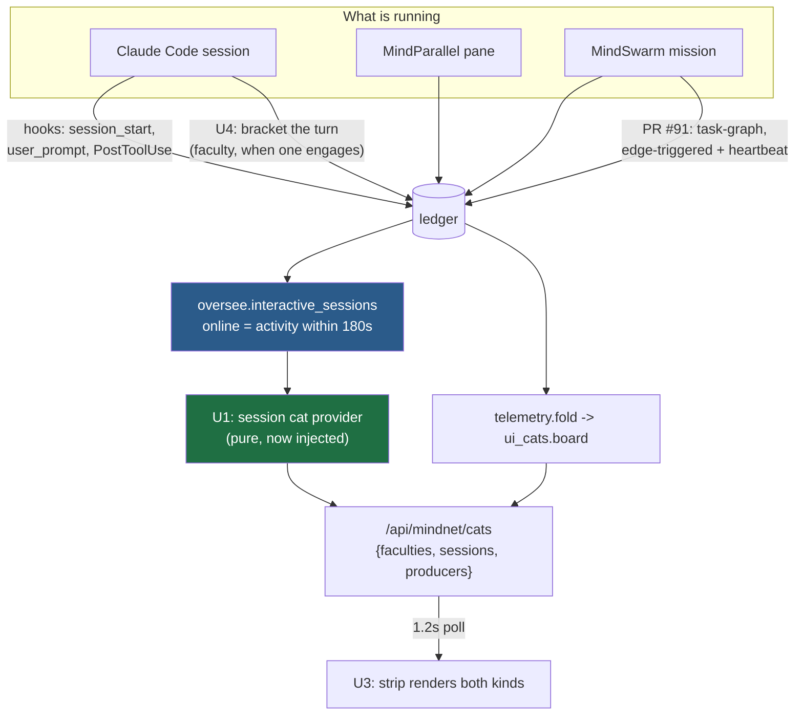
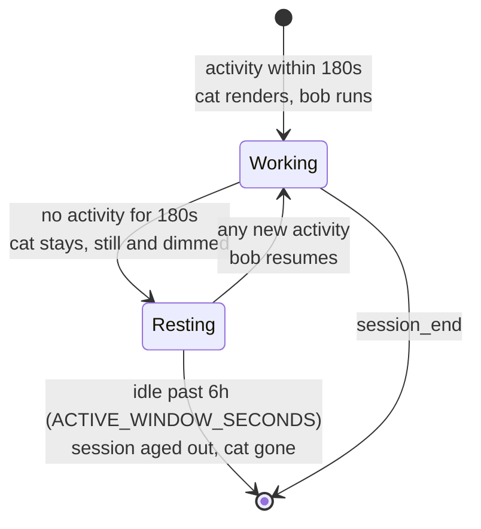

# feat: a cat for every live Claude — session liveness on the MN-5 board

**Target branch:** continues from `claude/mindswarm-cat-animation-bug-dc77c8` (PR #91).
All paths are repo-relative.

## Summary

The operator asked for the obvious thing: whenever a Claude is working — a MindSwarm
mission, a MindParallel pane, or an ordinary Claude Code session — a cat should be on
screen and moving. Today none of that happens for ordinary sessions, and the
investigation found the reason is not the one anybody would guess.

Three facts, each verified directly rather than inferred:

1. **The hook fires and reaches the emit.** For a code-work prompt, `is_code_work`
   returns `True` and `promptgate.record_direction` runs.
2. **Both faculty computations return an empty set.** `playbook` is absent from the
   manifest and the sidecar's `advice` is `{}`, so `playbook.engaged(...)` and
   `inject.engaged_faculties(...)` each answer `set()`. `announce_faculties(set())`
   writes nothing. The wiring is fine; its inputs are empty.
3. **The branch the operator runs does not contain the feature at all.**
   `C:\Users\hanif\mindhive` is on `claude/verify-checkpoint-consistency`, which has no
   `src/mindhive/playbook.py`. The manifest was retrained *today* and still lacks the
   `playbook_*` coverage keys the current trainer emits — it was written by older code.

So "the cat never lights for a normal session" is a **deployment** fact wearing a
bug's clothes, and no amount of new emitting fixes it.

The good news is larger. **No new telemetry producer is needed.**
`oversee.interactive_sessions()` already computes exactly the wanted signal —
`online` means *"tool events within `ONLINE_WINDOW_SECONDS`"*, i.e. Claude is working
right now — from events the existing hooks already write, and it is already served at
`/api/oversee`. Its 180-second window is the same number as `ui_cats.DIM_AFTER_SECS`.
The cat board simply does not consume it.

This plan therefore renders a signal that already exists, rather than manufacturing a
second one, and separately repairs the faculty cats' 15-second afterglow so that when
a faculty *does* engage, its cat lasts as long as the work does.

---

## Problem Frame

MN-5's board rests on one claim: **a missing cat means a real bug** (R16). That claim
needs the board to distinguish three states it currently collapses into one blank
strip:

- nothing is running,
- something is running but this build has no producer for it,
- something is running and its producer is silent (the real bug).

The operator spent this session unable to tell the second from the first, and so did
the previous session's evidence sweep. A board that cannot say "I have no way to know"
is not trustworthy in the direction it was built to be trustworthy.

Separately, the operator's mental model — *"Claude is working, so the cat moves"* — is
a **session** claim, not a faculty claim. The seven faculties answer "which part of
MindNetwork engaged"; that is a different, narrower question, and overloading them
with session liveness would destroy the only thing they are good at.

---

## Requirements

- **R1** — Every live Claude lights a cat: a Claude Code session, a MindParallel pane,
  and a MindSwarm mission all qualify.
- **R2** — That cat visibly moves while the session is working, and stops when it is
  not. Motion is the "working now" signal.
- **R3** — Session liveness is a **separate** signal from the seven faculties. The
  faculty cats keep meaning "this faculty really ran" (see origin: PR #91's KTD1).
- **R4** — No new telemetry producer and **no ledger write on the prompt hot path**.
  The prompt hook has a ~0.4 s budget; this feature must add nothing to it.
- **R5** — When a faculty *does* engage, its cat lasts as long as the turn, not 15
  seconds. (Today `announce_faculties` writes `active` and `idle` in the same second.)
- **R6** — Motion honours `prefers-reduced-motion`, and state stays legible without
  motion — colour and text carry it too.
- **R7** — Many concurrent sessions must not become a wall of cats pulsing in
  lockstep.
- **R8** — The board distinguishes "nothing running" from "this build cannot tell",
  so a deployment gap can never again read as absence of activity.

---

## Key Technical Decisions

### KTD1 — Read `oversee.interactive_sessions()`; do not emit anything new

`oversee` already folds `_ACTIVITY_TYPES` (`session_start`, `user_prompt`,
`command_run`, `file_touched`, `skill_used`, `assistant_response`, …) per session and
derives `online` from `ONLINE_WINDOW_SECONDS = 180`. Those events are written by the
hooks that already run on every prompt and every tool call.

Emitting a *new* `session_active` event would duplicate that fold, add a ledger write
to the prompt hot path (R4), and create a second source of truth for "is Claude
working" that can disagree with the Oversee section already on screen. Reading the
existing one costs nothing and cannot drift.

The threshold alignment is the tell that this is the right seam: `oversee`'s 180 s
"working now" window is the same number as `ui_cats.DIM_AFTER_SECS`. Both already mean
*"activity this fresh counts as alive"*.

### KTD2 — Session cats are a distinct kind, in the payload and in the DOM

They answer a different question, they have a different lifecycle, and their count is
unbounded where the faculties are fixed at seven. Merging them into the faculty list
would make `paintCats` unable to tell a "Skills" cat from a "some session" cat, and
would let a busy afternoon push the faculty cats off screen.

Separate array in the payload, separate container in the markup, shared sprite and
motion vocabulary so they still read as one system.

### KTD3 — Repair the faculty afterglow by bracketing the turn, not by widening a threshold

`announce_faculties` is called *after* the block is rendered, and writes `active` and
`idle` back to back — so `ui_cats` hides the cat 15 s later. Raising
`IDLE_VANISH_SECS` would paper over it and simultaneously slow down every honest
"work finished" transition, including the swarm's.

Instead, mirror the producer shape PR #91 established: emit `active` when the turn
starts, and let the **absence** of further activity dim the cat on schedule. The
`PostToolUse` hook is the natural heartbeat — it fires while Claude works and stops
when Claude stops, which keeps the dim band meaning "went silent" rather than "has
been working a while".

### KTD4 — Cap the cats and desync their motion

`ui-design:interaction-design` is explicit that over-animation causes fatigue, and N
sprites bobbing in lockstep is the worst version of it — it reads as a strobing bar
rather than N independent workers. Cap the rendered session cats and derive each
cat's `animation-delay` from its session id, so the phase is stable across repaints
(the same determinism `catFor` already uses for palette) and visually staggered.

The cap is a UI decision, not a data one: the payload reports the true count so the
strip can say "+N more" rather than silently lying about how much is running.

### KTD5 — Animate `transform` and `opacity` only, and never encode state in motion alone

Two rules carried from the interaction-design reference and from PR #91's own review:
animating layout properties (`width`, `top`, …) janks, and a state expressed purely
as movement disappears entirely under `prefers-reduced-motion`. The existing
`mn-bob` already uses `translateY`; the new entrance transition must stay on
`transform`/`opacity`, and "online" must also differ in colour and caption.

### KTD6 — The board reports its own blind spots (R8)

The payload gains an explicit statement of whether a producer exists for each signal
on this build. That is what turns "no MindNetwork activity" — which cost this session
hours — into "nothing running" versus "this build has no producer wired".

---

## High-Level Technical Design

Two independent paths reach the board. The faculty path emits into the ledger and
folds back out; the session path never emits at all — it reads a projection of events
that other subsystems already write.

A session cat's life is shorter and simpler than a faculty's — it has no `idle` row to
wait for, because absence of activity *is* the signal:

The two cat kinds compared — this is what U3 must make visually obvious:

| | Faculty cat | Session cat |
|---|---|---|
| Answers | which part of MindNetwork engaged | which Claude is working |
| Count | fixed at seven | unbounded, capped in the UI |
| Source | `mindnet_activity` rows | `oversee` projection, no rows of its own |
| Goes out because | an `idle` row was written | activity simply stopped |
| Caption | faculty name (Skills, SOPs, …) | session identity |

---

## Implementation Units

### U1. A pure session-cat provider

**Goal** — Turn `oversee.interactive_sessions()` into render-ready session cats.

**Requirements** — R1, R3, R4.

**Dependencies** — none.

**Files**
- `src/mindhive/mindnet/ui_sessions.py` — new
- `tests/test_mindnet_ui_sessions.py` — new

**Approach**

Mirror `ui_cats.board`'s contract exactly, because the board's testability rests on
it: pure, `now` injected rather than read, total (a malformed row is skipped, never
raised), and deterministic ordering so the strip does not reshuffle between polls.

Each row carries the session's identity, whether it is `online`, its age in whole
seconds, what it is doing, and its kind (`chat` / `parallel` / `swarm`) so the UI can
label it. Sort newest-active first and report the true total alongside the capped
list, so the UI can say what it dropped (KTD4).

Take the `online` decision from `oversee` rather than recomputing it from
`last_event_ts` — a second implementation of that window is a second thing that can
disagree with the Oversee section already on screen.

**Execution note** — Implement test-first. The behaviour is defined by boundaries
(online window, age-out) that are far easier to pin before the code exists.

**Patterns to follow** — `src/mindhive/mindnet/ui_cats.py` for purity, injected `now`,
totality, and threshold-export; `oversee.interactive_sessions` for the record shape.

**Test scenarios**
- A session with activity inside the online window renders `online`; one just outside
  renders resting.
- Boundary: exactly at `ONLINE_WINDOW_SECONDS` — pin which side it falls on, so a
  later refactor cannot silently flip it.
- A session idle past `ACTIVE_WINDOW_SECONDS` does not render at all.
- A malformed or missing timestamp skips that row and still returns the others — one
  bad row must not blank the board.
- Ordering is deterministic across two calls with identical input.
- The reported total counts every live session, including those beyond the cap.
- An empty session list returns an empty result, not an error.
- The provider never reads the clock itself (calling it twice with the same injected
  `now` yields identical output).

**Verification** — Given a fixed `now` and a fixed session list, the provider returns
a stable, ordered, correctly-banded set of rows.

---

### U2. Serve session cats alongside faculty cats

**Goal** — One poll returns both kinds plus an honest statement of what this build can
observe.

**Requirements** — R1, R8.

**Dependencies** — U1.

**Files**
- `src/mindhive/dashboard.py` — extend the existing cats handler
- `tests/test_dashboard.py`

**Approach**

Extend the existing `/api/mindnet/cats` handler rather than adding a second endpoint:
the strip polls once every 1.2 s and a second request would double that traffic for
data the same fold already has in hand. Resolve `now` in the handler and pass it in,
matching how the faculty side already keeps its provider pure.

Add a `producers` block naming which signals this build can actually emit (KTD6, R8).
Derive it by inspection of what is importable and wired — not a hand-maintained
literal, which would itself go stale and re-create the problem it exists to solve.

Ship the session thresholds in the payload the way the faculty thresholds already
ride along, so the page never restates a number the server owns.

**Patterns to follow** — the existing cats handler's lazy `mindnet` import and
threshold-export; `all_event_pairs()` handling for the HIVE MIND (`*`) namespace.

**Test scenarios**
- The response carries faculty cats, session cats, and the producers block.
- Existing faculty consumers still see their current shape — the addition is additive.
- A project with sessions but no faculty rows returns session cats and an empty
  faculty list (this is the operator's actual situation today).
- The HIVE MIND namespace aggregates sessions across projects rather than reading `*`
  as a literal project name.
- Session thresholds appear in the payload and match the provider's constants.
- The producers block reports the faculty producer as absent on a build where the
  playbook module cannot be imported.
- A handler fault returns a 500 rather than a half-populated body.

**Verification** — Polling the endpoint on a store with a live session returns that
session as an online cat, with thresholds and producer status.

---

### U3. Render and animate the session cats

**Goal** — The operator sees a moving cat whenever a Claude is working, on both pages,
without mistaking it for a faculty.

**Requirements** — R1, R2, R6, R7.

**Dependencies** — U2.

**Files**
- `src/mindhive/cat_board.py` — shared fragment: markup, styles, paint
- `src/mindhive/swarm_page.py` — page-owned container box
- `src/mindhive/dashboard_page.py` — page-owned container box
- `tests/test_cat_board_shared.py`
- `tests/test_workspace_pages.py`

**Approach**

The fragment owns everything page-independent and each page owns only its container —
the split `cat_board.py` already documents and `test_cat_board_shared.py` already
enforces. Session cats reuse `catSVG` and therefore inherit the `mn-cat-sprite` hook
and the reduced-motion guard for free.

Motion design, per KTD5 and the interaction-design reference:

- **Working** — the existing `mn-bob`, plus a colour and caption that say so
  independently of movement, so the state survives `prefers-reduced-motion` (R6).
- **Resting** — still and dimmed, reusing the faculty `dim` treatment so one visual
  vocabulary covers both kinds.
- **Entering** — a short fade-and-rise on `transform`/`opacity` only, in the 200–300 ms
  band the reference gives for small transitions, so a cat appearing mid-poll reads as
  arriving rather than popping.
- **Desynced** — each cat's `animation-delay` derives from its session id, so N cats
  drift out of phase instead of strobing together (R7, KTD4).

Reuse the repaint guard PR #91 introduced: compare rendered markup against a
remembered string before touching the DOM, or every 1.2 s poll restarts every bob.
This is the same defect, and it will recur here unless the guard is applied to the new
container too.

**Execution note** — Verify the motion in a real browser before calling this done.
String assertions cannot see an animation restart; PR #91 established that the hard
way.

**Patterns to follow** — `cat_board.CSS`'s page-independent/page-owned split;
`catFor`'s deterministic derivation from an id; the `CHIPS_HTML` repaint guard in
`swarm_page.py`.

**Test scenarios**
- A working session's cat carries the running class and an animation whose name
  resolves to declared keyframes (not merely a substring match).
- A resting session's cat has no animation.
- State is distinguishable without motion — the working and resting markup differ in
  more than the animation property.
- `animation-delay` differs between two cats with different session ids and is stable
  for the same id across two renders.
- Beyond the cap, the strip reports the remainder rather than dropping it silently.
- Zero sessions renders the empty state, not a stray container.
- Both pages carry the session strip and exactly one copy of the shared script.
- The reduced-motion guard covers the new sprites (they carry `mn-cat-sprite`).
- The entrance transition animates only `transform`/`opacity`.
- Repainting with unchanged data leaves the cat DOM nodes identical (the animation
  cannot restart).

**Verification** — In a browser on a preview port, a live session shows a moving cat;
it stops when the session goes quiet; nodes survive repaints; reduced-motion stills
it.

---

### U4. Make a faculty cat last as long as the turn

**Goal** — When a faculty genuinely engages, its cat is visible for the duration of the
work rather than for 15 seconds afterwards.

**Requirements** — R5.

**Dependencies** — none (independent of U1–U3).

**Files**
- `src/mindhive/promptgate.py` — the announce path
- `src/mindhive/__main__.py` — the hook entry points
- `tests/test_promptgate.py`
- `tests/test_mindnet_telemetry.py`

**Approach**

`announce_faculties` currently emits `active` and `idle` in the same second because it
runs after the block is already printed. Split the two: emit `active` when the turn
begins, and let the heartbeat's absence dim the cat, exactly as the swarm producer does
(see origin: PR #91's `FACULTY_BEAT_SECS`).

`PostToolUse` is the heartbeat seam — it fires while Claude works and stops when Claude
stops. Throttle it the way the swarm's beat is throttled, so a tool-heavy turn does not
append a row per call.

Keep the hot-path contract absolutely: never raise, never block, and stay within the
prompt hook's budget. A faculty cat is not worth one millisecond of the operator's
prompt latency.

**Execution note** — Implement test-first; the behaviour is a sequence of emissions
over time, which is exactly what a post-hoc test tends to assert loosely.

**Patterns to follow** — `workspace.Manager._sync_faculty` for the edge + heartbeat
shape and the never-raise contract; `promptgate.record_direction` for the existing
fail-open posture.

**Test scenarios**
- A turn that engages a faculty emits `active` at the start and no `idle` alongside it.
- A tool call during the turn re-asserts the cat at most once per throttle interval.
- A turn that engages nothing emits nothing at all (the honesty property is preserved).
- The beat interval sits below `ui_cats.DIM_AFTER_SECS`, pinned as a relationship
  rather than a restated number.
- An emitter that fails leaves the hook's printed context byte-identical.
- A raising emitter does not propagate out of the hook.
- Session end settles any faculty this turn lit.

**Verification** — A simulated turn produces one `active`, throttled beats while tools
run, and no premature `idle`; the hook's stdout is unchanged throughout.

---

### U5. Tell the operator when the board cannot see

**Goal** — "No MindNetwork activity" stops being ambiguous.

**Requirements** — R8.

**Dependencies** — U2.

**Files**
- `src/mindhive/cat_board.py`
- `tests/test_cat_board_shared.py`

**Approach**

Render the `producers` block from U2 as a distinct empty state: *nothing is running*
reads differently from *this build has no producer for that signal*. Keep it quiet —
a short line in the strip, not a banner — because it is diagnostic, not an alarm.

This unit is the direct product of what this investigation cost. The board said "no
MindNetwork activity" while the truth was "the running branch has no playbook module",
and nothing on screen could distinguish those.

**Test scenarios**
- With a producer present and nothing running, the strip shows the ordinary empty
  state.
- With the producer absent, the strip says so and does not claim inactivity.
- The distinction reaches both rendered pages.
- The message names which signal is unobservable, not just that something is.

**Verification** — Rendering with each producer state yields visibly different strips.

---

## Scope Boundaries

**In scope** — session-liveness cats end to end; the faculty afterglow repair; the
producer-visibility empty state.

**Non-goals**
- **Changing what the seven faculties mean.** They keep answering "this faculty ran"
  (R3, and origin PR #91's KTD1).
- **Retraining the operator's manifest or merging their branches.** The playbook is
  absent because of what is checked out; that is an operational step, not a code change,
  and doing it unasked would touch state outside this work.
- **Growing `telemetry.FACULTIES`.** Still pinned three ways.

### Deferred to Follow-Up Work
- **Per-session detail on click.** The faculty cats open a metadata panel; sessions
  could too, but the Oversee section already shows that detail and duplicating it is a
  UX question nobody has asked.
- **Cross-machine sessions.** Only this machine's ledger is read.
- **Retiring the `announce_faculties` post-hoc call** once U4's bracket is proven in
  the field.

---

## Risks

| Risk | Likelihood | Mitigation |
|---|---|---|
| Reading `oversee` per poll is a full ledger replay every 1.2 s | **High** | Measure before shipping; the faculty side already reads the same events in that handler, so fold once and share. If it is material, cache on the segment-mtime signal `sidecar` already uses |
| `PostToolUse` heartbeat adds latency to every tool call | Medium | Throttle with a lock-free clock check first, as the swarm beat does; never write on the prompt path itself (R4) |
| Session cats crowd the faculty cats off screen | Medium | Cap plus a separate container (KTD2, KTD4) |
| Motion fatigue from many cats | Medium | Desynced phase, capped count, reduced-motion guard |
| The operator still sees nothing because their branch lacks all of this | **High** | U5 makes it legible; the verification below states the deployment step plainly rather than assuming it |

---

## Verification

1. Full suite green — `CLAUDE.md`'s "any change here must land green".
2. Live check on a **non-54461** preview port: with a Claude Code session working,
   a session cat is present and moving; it stills when the session goes quiet.
3. Browser-verified node identity across repaints, as PR #91 established, plus
   reduced-motion suppression.
4. Prompt-hook latency measured before and after U4 — no regression on the hot path.
5. Change-log entries recorded (`hive log`).
6. **Deployment truth stated to the operator:** none of this is visible until the
   branch carrying it is what `C:\Users\hanif\mindhive` has checked out. That is the
   operator's call, not this plan's.

---

## Sources & Research

- Direct execution against the live store: `is_code_work` true, `playbook` `None`,
  sidecar `advice` `{}`, `engaged` → `set()` — the proof that the emitter is wired but
  starved.
- `src/mindhive/oversee.py` — `ONLINE_WINDOW_SECONDS = 180`, `_ACTIVITY_TYPES`, and
  `interactive_sessions`, verified returning a real record shape from the live store.
- Branch inspection: the operator's checkout has no `src/mindhive/playbook.py`.
- `ui-design:interaction-design` — timing bands for entrance transitions,
  `transform`/`opacity`-only animation, the over-animation fatigue warning that drives
  the cap and phase desync (KTD4, KTD5), and the reduced-motion requirement.
- PR #91 (`docs/plans/2026-08-02-003-...`) — the edge+heartbeat producer shape reused
  by U4, and the repaint guard reused by U3.

The interaction-design reference is React/framer-motion oriented while this surface is
vanilla inline CSS; its timing, easing, and accessibility principles transfer, its
component code does not, and no part of it was adopted verbatim.
