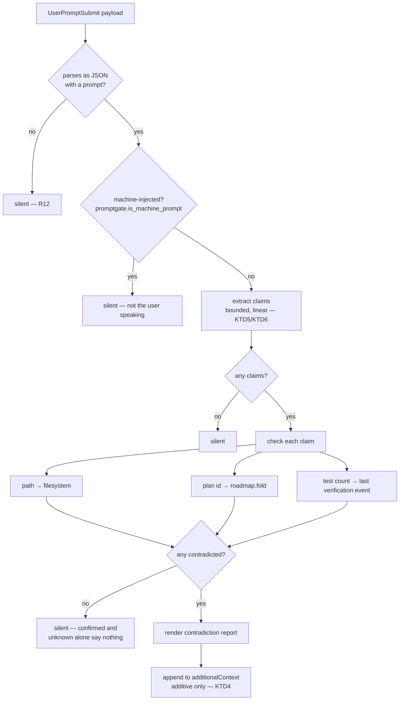

# feat: absolute honesty as a core hive rule

**Target repo:** this checkout. All paths repo-relative.

---

## Summary

The user asked for two things in one sentence: more ambition and creativity,
**and** absolute honesty made a core hive rule. This plan treats that pairing as
the design constraint rather than two independent asks — optimism governs what
the assistant *attempts*; it never softens what the assistant *claims*.

Three halves, because a prose rule alone is exactly the ghost implementation
this repo keeps flagging:

- **The standing rule** — a new §0 at the top of `OPERATING_SPEC`
  (`src/mindhive/directives.py`), the text injected into every session by the
  session_start hook. Honesty is currently real but scattered across §2, §5,
  and §7, and none of those cover the two failures that actually happen here:
  claiming work is complete that is not, and absorbing an unverified premise.
- **The premise gate** — a new `src/mindhive/premise.py` `UserPromptSubmit`
  pass that mechanically checks the *checkable* factual claims an incoming
  prompt makes (asserted file paths, asserted roadmap/plan ids, asserted test
  counts) and injects a contradiction report when they are false.
- **The evidence source** — `hive verify test`, which runs the suite as a real
  subprocess and records the counts as a `python`-stamped ledger event. Without
  it, "the suite is green at N" is not checkable by anything. With it, it is.

---

## Problem Frame

### The failure that triggered this plan

The prompt that commissioned this work arrived wrapped in a ~20KB
"SMART-ZONE HANDOFF" directive asserting, specifically and confidently:

| Claim in the directive | Verified reality |
|---|---|
| An interrupted roadmap exists; run `hive roadmap resume <id>` | `hive roadmap list` → `(no roadmaps ...)`. Nothing was interrupted. |
| `src/mindhive/history.py` holds an over-match footgun to patch | The file does not exist on any branch. `src/mindhive/mindnet/advice.py` already serves the role, already defended. |
| The AST language lock (MN-8a) is unbuilt | Built and merged. `import ast` at `src/mindhive/mindnet/enforcer.py:69`; `SYNTAX_DENIAL` at `:255`; fires at `:807`. |
| `pr-green` accepts agent self-attestation (MN-8b unbuilt) | Built and merged. `PHASE_EVIDENCE["pr-green"]["verified_by"] == "python"` at `src/mindhive/mindnet/phases.py:135`. |
| Baseline is 3518 tests | The recorded baseline is 3401 (`docs/plans/2026-08-02-003-feat-mindnet-mn8-hardening-plan.md`). Nothing in the repo has ever recorded 3518. |

Every checkable claim was false. This is not the first time: the MN-8 plan's own
frontmatter reads `origin: none (solo invocation; supersedes a directive whose
premises were verified false)`. The repo has a documented, repeating pattern of
being handed a confident false frame and building against it.

### Why the existing gate did not catch it

`src/mindhive/promptgate.py` is the `UserPromptSubmit` quality gate. It has a
hard scan cap:

```
PROMPT_SCAN_CAP = 2000
```

Past that size, `assess()` returns `{"skip": False, "clear": True,
"findings": []}` ([promptgate.py:233](src/mindhive/promptgate.py)) and
`is_code_work()` returns `False` ([:217](src/mindhive/promptgate.py)). So a 20KB
directive gets **no quality assessment and no catalog injection at all**.

The cap's rationale is sound and must survive: the target regexes backtrack
badly, and a pasted 100KB unbroken run of dots measured ~100s unscanned versus
~ms capped. That is a real measurement, recorded in the source, and this plan
does not touch it.

But the consequence is a precisely inverted incentive: **the longer and more
assertion-dense a prompt is, the less scrutiny it receives.** Handoff
directives, pasted specs, and generated continuation prompts — the three
categories most likely to carry stale or fabricated premises — are all past
2000 characters by construction. The gate is blind exactly where premises
concentrate.

### Why prose alone would not be an answer

This repo's stated position is that agent attestation is not evidence. MN-8b
moved `pr-green` from `verified_by: "agent"` to `"python"` for precisely that
reason: an agent saying its PR is green is worth nothing. A core honesty rule
that consists only of an instruction to be honest is the same category of
artifact the codebase already rejects — it would look implemented and enforce
nothing.

The rule therefore ships with a mechanism, and the mechanism is scoped to what
can be *honestly* verified. Where a claim class is not mechanically checkable,
the plan says so rather than shipping a decorative check.

---

## Requirements

| ID | Requirement |
|----|-------------|
| R1 | `OPERATING_SPEC` gains a §0 honesty section, positioned first, that covers: no claiming completion without verification, no reporting an unobserved result, no accepting an unverified premise, and the explicit ambition/honesty split. |
| R2 | §0 states that a granted licence to be ambitious, optimistic, or creative governs what is *attempted*, never what is *claimed*. |
| R3 | `docs/superpowers/specs/2026-06-23-mindhive-assistant-operating-spec.md`, the human-facing rationale copy, is updated to match. `directives.py`'s module docstring already mandates this sync. |
| R4 | A new `src/mindhive/premise.py` extracts checkable factual claims from prompt text with pure, bounded, linear-time predicates. No I/O in the extractor. |
| R5 | Extraction covers three claim classes: asserted repo-relative file paths, asserted roadmap/plan ids, asserted test-suite counts. |
| R6 | A checker resolves each extracted claim against real evidence and returns one of `confirmed` / `contradicted` / `unknown`. `unknown` is a first-class outcome, never silently rendered as either of the other two. |
| R7 | Path claims resolve against the filesystem, rooted at the repo, with traversal and absolute paths refused rather than followed. |
| R8 | Roadmap/plan-id claims resolve against `roadmap.fold(evs)`. |
| R9 | Test-count claims resolve against the most recent `verification` event; with no such event on the ledger the verdict is `unknown`, not `contradicted`. |
| R10 | The gate injects a contradiction report as additive `additionalContext` only. It never denies, blocks, or edits a prompt. |
| R11 | The pass is wired into the `user_prompt_submit` hook stage **unconditionally**, following the `style` / `mindnet.inject` pattern, so it fires on prompts `promptgate` skips. |
| R12 | The pass is total: any error, unreadable ledger, or malformed payload yields no injection. It can never break a prompt. |
| R13 | The pass has its own scan budget, independent of `PROMPT_SCAN_CAP`, and every regex used is linear with a bounded match length. `PROMPT_SCAN_CAP` itself is unchanged. |
| R14 | `hive verify test` runs a test command as a real subprocess (no `shell=True`), parses the summary line, and appends a `verification` event carrying `verified_by: "python"`, the counts, and the exit code. |
| R15 | `verification` is registered in `events.VALID_TYPES` with a payload contract, or `append_event` will raise. |
| R16 | `hive premise check` reports the verdicts for a prompt supplied by file or stdin — the same engine the hook uses, callable directly. |
| R17 | Claim classes that are *not* mechanically checkable are enumerated in the source and in `docs/DATA_MODEL.md`. The gate does not imply coverage it lacks. |
| R18 | Full suite green at or above the measured baseline of **3580 passed, 0 failed** (run before planning; see Sources). No regression. |
| R19 | `hive log` change-log entries recorded for every source change, per `CLAUDE.md`. |

---

## Key Technical Decisions

### KTD1 — A new module and a sibling hook pass, not an edit to `promptgate.assess`

`premise.py` is a separate module wired as `premise.extend_hook_context(context,
raw)` in the `user_prompt_submit` stage, mirroring `style.extend_hook_context`
and `mindnet.inject.extend_hook_context` ([__main__.py:99-122](src/mindhive/__main__.py)).

Three reasons, in order of weight:

1. **The cap must survive, and the pass must run past it.** Widening
   `PROMPT_SCAN_CAP` would re-expose the measured ~100s backtracking pathology.
   A separate module carries its own budget and its own regexes, chosen for
   linear behavior, so the two decisions stay independent.
2. **The chain already has the shape.** `style` and `mn_inject` both run
   unconditionally and both can create context from nothing — `enrich` is the
   only conditional one. A new unconditional pass is the established pattern,
   not an invention.
3. **`assess` is byte-pinned by tests.** `hook_context`'s output is asserted
   verbatim in the existing suite. Threading a new finding class through it
   would churn tests that have nothing to do with this feature.

**Rejected:** raising `PROMPT_SCAN_CAP` and adding a `false-premise` dimension
to `DIMENSIONS`. It couples the fix to the pathology the cap exists to prevent,
and `DIMENSIONS` entries are *quality* findings routed to a trained skill —
a false premise is a *factual* finding routed to evidence, not a skill.

### KTD2 — Three claim classes, chosen because each has a real evidence source

The gate checks only what something in this repo can actually answer:

| Class | Evidence source | Exists today? |
|---|---|---|
| Path claim | filesystem, rooted at repo | yes |
| Roadmap/plan-id claim | `roadmap.fold(evs)` ([roadmap.py:166](src/mindhive/roadmap.py)) | yes |
| Test-count claim | most recent `verification` event | **no — U5 builds it** |

Test-count claims are the one class whose evidence source does not exist. A
grep of `src/mindhive/` finds no event type recording pytest counts and no
`passed`/`failed` parsing anywhere. The choice is therefore explicit: either
build the evidence source or drop the class. This plan builds it (U5), because
the false test count was one of the five failures and because a `python`-stamped
run record is independently useful.

**Rejected:** git-ref claims (asserted commit SHAs and branch names). Cheap in
principle (`git rev-parse --verify`), but it puts a subprocess on the
`UserPromptSubmit` critical path, which currently touches no process spawn.
Deferred rather than dropped.

### KTD3 — `unknown` is a first-class verdict and renders differently from `contradicted`

A checker that cannot find evidence must say so. Collapsing `unknown` into
`confirmed` re-creates the exact failure being fixed — silence reading as
assent. Collapsing it into `contradicted` is worse: it would manufacture false
accusations against true statements, and the first such false positive teaches
the operator to ignore the block permanently.

Concretely: a prompt asserting "3401 tests pass" on a store with no
`verification` event renders as `unknown — no recorded run to check against`,
never as a contradiction.

### KTD4 — Additive context only, never a deny

The gate injects `additionalContext` and nothing else. `promptgate`'s MN-14
comment already settles the precedent for this surface, in the source: forcing
CONTEXT is what was asked for, and "denying the user's own prompt would be a
different and hostile thing, and is not built here"
([promptgate.py:141-144](src/mindhive/promptgate.py)).

That reasoning binds harder here. A premise checker will have false positives —
a path claim about a file the user is *about to create* is the obvious one — and
a false positive that blocks a prompt wedges the session. A false positive that
adds one advisory line costs a line.

### KTD5 — Extraction is pure; checking does I/O; rendering is pure

Three-stage split, each independently testable:

```
extract(text)  ->  [Claim]          pure, bounded, no I/O
check(claims)  ->  [Verdict]        filesystem + ledger
render(verdicts) -> str             pure
```

This mirrors `promptgate`'s own `assess` / `train` / `render_context` split and
means the expensive-to-test middle stage is the only one needing fixtures. It
also means `hive premise check` (U7) and the hook (U6) share one engine — a
second decision path would let the CLI and the hook disagree about the same
prompt, and nothing would surface the disagreement.

### KTD6 — Bounded regexes with explicit length caps, no nested quantifiers

`PROMPT_SCAN_CAP` exists because of catastrophic backtracking. This module runs
on *larger* inputs, so its regexes carry the constraint structurally rather than
by input size: bounded repetition (`{1,N}`) instead of `+`/`*` on any character
class that could overlap an adjacent one, no nested quantifiers, and a
per-class match ceiling so a pathological input yields a truncated finding list
rather than a hang.

The module's own budget (`PREMISE_SCAN_CAP`) is a separate, larger constant with
its own rationale comment. It is a cap on *work*, not a statement that larger
prompts do not matter.

### KTD7 — `verification` is a deterministic event type, not semantic

`events.SEMANTIC_TYPES` entries get a LEDGER markdown file, a Memory view row,
a keyword-recall corpus entry, and a consolidation pass
([events.py:74-82](src/mindhive/events.py)). A test-run record is
machine-generated, potentially frequent, and carries no human intent — the same
profile as the existing deterministic telemetry types. It goes in
`DETERMINISTIC_TYPES`, which still puts it on the hash chain.

### KTD8 — The suite is not run from inside the hook, ever

`hive verify test` is an explicit operator/agent command. Nothing in the
`UserPromptSubmit` path may trigger a test run: the gate reads the *last
recorded* run and never produces one. A gate that could spawn a multi-minute
subprocess on a keystroke is a denial-of-service on the user's own session.

---

## High-Level Technical Design

The pass's decision path. Every terminal marked *silent* returns the context
unchanged.



The evidence ladder for a test-count claim, showing why `unknown` cannot
collapse:

| Store state | Claim "3401 passed" | Verdict |
|---|---|---|
| no `verification` event | — | `unknown` |
| last run recorded 3401 passed | matches | `confirmed` |
| last run recorded 3455 passed | differs | `contradicted` |
| last run recorded a non-zero exit | any count | `contradicted` (a failing run is not a green suite) |

---

## Implementation Units

### U1. The §0 honesty directive

**Goal:** The standing rule exists in the text injected into every session.

**Requirements:** R1, R2

**Dependencies:** none

**Files:**
- `src/mindhive/directives.py`
- `tests/test_directives.py` (create if absent — check for an existing directives test module first)

**Approach:** Add a `## 0. Absolute honesty` section at the top of
`OPERATING_SPEC`, before `## 1. Role`. Position is load-bearing: the user asked
for a *core* rule, and §7 "Omitted by design" already establishes that this
document states what the system will not promise. §0 states what it will not
do.

Content must cover four distinct failures, because they fail differently:

1. **Claimed completion.** Work is not done because a file was touched or a
   function declared. Do not report done without having exercised the real
   flow.
2. **Unobserved results.** Never report a test result, exit code, or output not
   actually read. Reporting the command you *would* run as though you ran it is
   the specific shape.
3. **Unverified premises.** A confident, specific claim in an incoming prompt —
   including one from a prior session or an automated handoff — is not
   evidence. §2b already establishes "being told something is not evidence that
   it is so" for human claims about code; §0 generalizes it to the prompt frame
   itself and points at the mechanical check.
4. **Ambition never softens a claim.** State the split explicitly: a licence to
   be creative, optimistic, or ambitious governs what is attempted; it never
   governs what is claimed. Scope may be ambitious. Status reports may not.

Cross-reference §2 (grounding), §5 (failure reporting), and §2b (search the
record first) rather than duplicating them — §0 is the rule they are instances
of, and restating them would create three places to drift.

**Patterns to follow:** the existing section voice — short imperative bullets,
a stated reason per rule. §2b's "MindNetwork's founding requirement, verbatim"
shape is the model for grounding a rule in why it exists.

**Execution note:** Test-first. Pin §0's presence, its position (before §1), and
the ambition/claim split by substring, so a later reflow cannot silently drop
the section.

**Test scenarios:**
- `directives()` output contains a `## 0.` heading and it precedes `## 1. Role`.
- The ambition/honesty split is present as a distinct assertion.
- All existing sections (§1 through §9) survive unchanged — assert each heading
  still present, so the insertion cannot have clobbered a neighbor.
- `directives()` remains a pure string return with no I/O.

**Verification:** `directives()` output read directly and inspected — the
session_start hook prints this text, so the string *is* the artifact.

---

### U2. Spec-doc sync

**Goal:** The human-facing rationale copy does not contradict the runtime
source of truth.

**Requirements:** R3

**Dependencies:** U1

**Files:**
- `docs/superpowers/specs/2026-06-23-mindhive-assistant-operating-spec.md`

**Approach:** `directives.py`'s module docstring names this file as the
rationale copy and says "Keep the two in sync." Read it first to match its
existing structure — it is a rationale document, so §0 there carries the *why*
(the repeating false-premise pattern, with the MN-8 precedent) at more length
than the injected directive does.

**Execution note:** Documentation only. Do this after U1 so the doc describes
shipped text.

**Test scenarios:** `Test expectation: none — documentation only.` Confirm
`tests/test_architecture_drift.py` does not parse this file for structure
before editing; re-run it afterward as a guard regardless.

**Verification:** Both documents read side by side; §0's substance matches.

---

### U3. Claim extraction

**Goal:** A pure, total, bounded function turning prompt text into structured
claims.

**Requirements:** R4, R5, R13, KTD6

**Dependencies:** none

**Files:**
- `src/mindhive/premise.py` (new)
- `tests/test_premise.py` (new)

**Approach:** Module docstring states the problem (the `PROMPT_SCAN_CAP` blind
spot, with the measurement) and the contract (additive, total, never denies).

`extract(text) -> list[Claim]` where a claim carries at minimum its class, the
raw asserted value, and the surrounding span for rendering. Three extractors:

- **Path claims.** Repo-relative-looking paths with a known source extension.
  Reuse the shape of `promptgate._TARGET_RES`'s file-path regex — it already
  carries the `e.g.`/`i.e.`/`etc.`/`vs.` lookahead that keeps prose
  abbreviations from reading as paths, which is a bug this extractor would
  otherwise reproduce.
- **Roadmap/plan-id claims.** Ids appearing near roadmap vocabulary
  (`roadmap`, `resume`, `interrupt`, `plan id`). Read `roadmap.py`'s id shape
  and `sop.ID_RE` before writing the pattern rather than inventing a format.
- **Test-count claims.** Numeric assertions adjacent to test vocabulary —
  `3518-test baseline`, `3401 passed`, `N tests passing`. Bounded distance
  between number and keyword; do not scan the whole prompt for any number.

Per-class match ceiling so a pathological input truncates rather than hangs.
`PREMISE_SCAN_CAP` with its own rationale comment, explicitly *not* an alias of
`PROMPT_SCAN_CAP`.

**Patterns to follow:** `promptgate`'s pure-predicate style — module constants
with rationale comments, regexes compiled at module level, no I/O below the
hook entry point.

**Execution note:** Test-first.

**Test scenarios:**
- The actual triggering directive's text (or a faithful excerpt fixture) yields
  a path claim for `src/mindhive/history.py`, a roadmap-resume claim, and a
  test-count claim of 3518. **This is the regression test for the real
  incident** — it must extract all three from one input.
- Prose abbreviations (`e.g.`, `i.e.`, `etc.`, `vs.`) yield no path claim.
- A number far from any test vocabulary yields no test-count claim.
- Empty string, whitespace-only, and non-string input (`None`, `int`, `dict`)
  return `[]` and do not raise.
- Input at exactly `PREMISE_SCAN_CAP` and one byte over — behavior at the
  boundary is asserted, not assumed.
- A pathological input (long unbroken run of dots, deeply repeated separators)
  completes well inside a wall-clock assertion. **Canary:** this test must fail
  if the bounded quantifiers are replaced with greedy ones.
- Per-class ceiling: an input asserting 500 paths yields a truncated list, not
  500 claims, and the truncation is recorded on the result rather than silent.
- Absolute paths and traversal sequences (`../../etc/passwd`) are extracted as
  claims but flagged for refusal by the checker, not silently dropped here —
  the extractor reports what the text said.

**Verification:** The extractor is total across the table; no scenario raises;
the pathological case is timed, not assumed.

---

### U4. Claim checking against real evidence

**Goal:** Each claim gets a `confirmed` / `contradicted` / `unknown` verdict
from a real source.

**Requirements:** R6, R7, R8, R9, R17, KTD3

**Dependencies:** U3, U5 (for the test-count source)

**Files:**
- `src/mindhive/premise.py`
- `tests/test_premise.py`

**Approach:** `check(claims, project=None, evs=None) -> list[Verdict]`. Each
verdict carries the claim, the outcome, and a short human-readable ground
(`"no such file"`, `"roadmap list is empty"`, `"last recorded run: 3401
passed"`).

- **Path:** resolve against the repo root. Refuse absolute paths and any path
  escaping the root after normalization — verdict `unknown` with an explicit
  `"refused: outside repo"` ground, never a filesystem touch. Follow
  `runlog._safe`'s posture: the boundary enforces the charset rather than
  trusting callers.
- **Roadmap id:** `roadmap.fold(evs)`, then membership. An empty roadmap store
  contradicts a specific id claim (the store is authoritative about its own
  contents) — this is the one place an empty source is a contradiction rather
  than an unknown, and the asymmetry needs a comment saying why.
- **Test count:** most recent `verification` event. No such event →
  `unknown`. Recorded non-zero exit → `contradicted` regardless of count.

`evs` injectable so tests never read the live store — check the repo's autouse
isolated-store fixture convention before writing fixtures.

**Execution note:** Test-first.

**Test scenarios:**
- Path claim for a file that exists → `confirmed`.
- Path claim for `src/mindhive/history.py` (verified absent) → `contradicted`.
  **The real incident, pinned.**
- Absolute path and `../` traversal → `unknown`, ground names the refusal, and
  **no filesystem call is made** (assert via a patched resolver, not by
  inspection).
- Roadmap id claim with an empty store → `contradicted`.
- Roadmap id claim matching a folded plan → `confirmed`.
- Test-count claim with no `verification` event → `unknown`. **Canary: this
  must not be `contradicted`** — assert the exact outcome, so a collapse of the
  three-way verdict into a boolean fails here.
- Test-count claim matching the last recorded run → `confirmed`.
- Test-count claim differing from the last recorded run → `contradicted`, and
  the ground names both numbers.
- Test-count claim where the last run exited non-zero → `contradicted` even
  when the count matches.
- Unreadable ledger / raising `roadmap.fold` → every affected verdict is
  `unknown`; the call does not raise.

**Verification:** Full `premise` suite green; the three-way verdict is pinned
per class.

---

### U5. `hive verify test` — the evidence source

**Goal:** A `python`-stamped record of a real test run exists on the ledger, so
test-count claims become checkable at all.

**Requirements:** R14, R15, KTD7, KTD8

**Dependencies:** none (U4 consumes it)

**Files:**
- `src/mindhive/verify.py` (new)
- `src/mindhive/events.py` (register `verification` in `DETERMINISTIC_TYPES` and add its payload contract)
- `src/mindhive/__main__.py` (CLI subcommand)
- `tests/test_verify.py` (new)
- `tests/test_events.py` (payload contract)

**Approach:** `run(cmd_argv, project=None)` executes the given argv with
`subprocess.run`, **argv list only, never `shell=True`** — the repo's standing
mandate. Capture stdout/stderr, read the real exit code, parse pytest's summary
line for `passed` / `failed` / `errors` / `skipped`.

Append one `verification` event: the counts, the exit code, the argv, a bounded
output excerpt, and `verified_by: "python"`. The stamp means what it means
everywhere else in this codebase — `src/mindhive/mindnet/executor.py` sets
`VERIFIED_BY = "python"` only after a real subprocess ran and a real exit code
was read. Read that module before writing this one and mirror its posture; do
not invent a second, weaker notion of mechanical verification.

Parsing is best-effort and says so: an unparseable summary records the exit
code with counts absent, never guessed counts. `verified_by: "python"` attaches
to the **exit code**, which was genuinely observed; counts are a parse and are
marked as such.

Full output goes to `runlog` rather than the event — `runlog.py`'s docstring is
explicit that multi-kilobyte transcripts on the ledger violate memo hygiene and
blow the context budgets `context.py` polices. Event keeps a bounded excerpt
plus the artifact path.

**Execution note:** Test-first. The subprocess is the point, so at least one
test runs a real trivial process rather than mocking the boundary away.

**Test scenarios:**
- A script exiting 0 with a parseable pytest summary → event has the counts,
  `exit_code: 0`, `verified_by: "python"`.
- A script exiting non-zero → recorded faithfully; **no success is reported
  over a failing run.**
- Unparseable output with exit 0 → event records exit 0, counts absent (not
  zero, not guessed). Assert absent-vs-zero explicitly.
- `shell=True` appears nowhere in the module — assert by source inspection, the
  same way the repo pins `DENIED_PROGRAMS`.
- A command that does not exist → recorded as a failure, no raise to the caller.
- Output exceeding the excerpt bound → excerpt truncated, artifact path present,
  and the artifact holds the full text.
- `append_event("verification", ...)` succeeds — proving R15 registration
  landed. **Canary:** without the `VALID_TYPES` addition, `append_event` raises
  `unknown event type`, so this test fails for the right reason.
- The payload contract in `events.py` accepts the emitted shape and rejects a
  malformed one.

**Verification:** A real run recorded, then read back and asserted — the event
on the ledger is the artifact, not the function's return value.

---

### U6. Render and wire the hook pass

**Goal:** The contradiction report reaches the real `UserPromptSubmit` surface.

**Requirements:** R10, R11, R12

**Dependencies:** U3, U4

**Files:**
- `src/mindhive/premise.py`
- `src/mindhive/__main__.py`
- `tests/test_premise.py`
- `tests/test_premise_hook.py` (new)

**Approach:** `render(verdicts) -> str` — pure. Emits only when at least one
verdict is `contradicted`; confirmations and unknowns alone say nothing, because
a gate that speaks on every prompt gets tuned out. When it does fire, the block
lists each contradiction with its ground, and states plainly that the rest of
the prompt is unchecked (R17) so the report cannot read as a clean bill of
health.

`extend_hook_context(context, raw)` — mirror `style.extend_hook_context`'s
signature and return shape exactly. Read that function before writing this one.
Wire it into the `user_prompt_submit` stage in `__main__.py` **unconditionally**,
beside `mn_inject` and `style`, not inside the `if context:` branch that guards
`enrich`.

Wrap in the total contract: any exception returns `context` unchanged.

Carry a marker constant (`premise.PREMISE_MARK`, mirroring
`promptgate.TRIGGER_MARK`) so injected text is attributable and so
`is_machine_prompt` semantics stay coherent for downstream passes.

**Execution note:** Test-first. A passing `check` unit does not prove the hook
wires it — this is the repo's "real output, not a proxy" rule.

**Test scenarios:**
- Hook receives the real triggering directive text → output contains the marker
  and names `src/mindhive/history.py`. **The end-to-end regression for the
  incident.**
- Hook receives a prompt whose claims are all true → context unchanged.
- Hook receives a prompt with only `unknown` verdicts → context unchanged.
  Pinned separately from the all-true case; they must not be conflated.
- A prompt over `PROMPT_SCAN_CAP` still gets checked. **This is the blind-spot
  test** — it must fail if the pass is ever gated behind `promptgate.assess`.
- Existing context from an earlier pass is preserved and appended to, not
  replaced. Assert the earlier pass's text survives verbatim.
- Malformed JSON, missing `prompt` key, non-dict payload → context unchanged,
  no raise.
- A raising `check` (patched) → context unchanged, no raise.
- Machine-injected prompts (`<`-leading, `/`-leading, skill bodies) → silent,
  matching `promptgate.is_machine_prompt`.
- **Canary:** assert on the specific contradiction text, not merely that "some
  context was added" — another pass's injection must not be able to satisfy
  this test.

**Verification:** Hook-level injection observed with the exact expected
contradiction, on an input past `PROMPT_SCAN_CAP`.

---

### U7. `hive premise check` — the agent-facing self-check

**Goal:** The same engine is callable directly, so an agent can check a
handoff document, a plan, or its own draft claims before acting on them.

**Requirements:** R16

**Dependencies:** U3, U4

**Files:**
- `src/mindhive/__main__.py`
- `tests/test_cli_premise.py` (new — check the repo's existing CLI test module naming first and match it)

**Approach:** `hive premise check [--file PATH]`, reading stdin when no file is
given. Prints one line per verdict, grouped contradicted-first. Exit code
non-zero when any claim is contradicted, so it composes into a script — this is
the CLI-exit-code convention the repo's test suite already exercises elsewhere.

This is the surface that makes §0's "verify the premise" instruction actionable
rather than aspirational: the directive can name a command that exists.

**Execution note:** Test-first.

**Test scenarios:**
- File with a contradicted claim → non-zero exit, the contradiction printed.
- File with only confirmed claims → zero exit.
- File with only unknowns → zero exit, unknowns still printed (the operator
  should see what could not be checked).
- Empty input → zero exit, a clear "no checkable claims found" line rather than
  silence.
- Missing `--file` path → non-zero exit with a real error message, no traceback.
- stdin path exercised, not just `--file`.

**Verification:** CLI invoked and its real stdout and exit code asserted.

---

### U8. Document the honest limits

**Goal:** No reader can mistake the gate for a general-purpose lie detector.

**Requirements:** R17

**Dependencies:** U3–U7

**Files:**
- `docs/DATA_MODEL.md`
- `src/mindhive/premise.py` (module docstring)

**Approach:** Document what the gate checks and — with equal prominence — what
it does not:

**Checked:** asserted repo paths, asserted roadmap/plan ids, asserted test
counts (against a recorded run).

**Not checked, and why:**
- *Claims about what a previous session did.* No session-transcript evidence
  source is queryable for arbitrary assertions.
- *Intent, urgency, authority, and framing.* Not factual claims; nothing to
  check them against.
- *Claims about code behavior* ("the matcher over-matches on stopwords"). Would
  require executing the claim, which the hook must never do (KTD8).
- *Git refs.* Deferred — would put a subprocess on the prompt path (KTD2).
- *Counts of anything other than tests.* One evidence source, one claim class.

Also document the `verification` event type and its payload contract alongside
the existing event-type documentation.

**Execution note:** Documentation only. After U3–U7, so it describes verified
behavior rather than intended behavior.

**Test scenarios:** `Test expectation: none — documentation only.` Re-run
`tests/test_architecture_drift.py` as a guard, since it parses `docs/DATA_MODEL.md`.

**Verification:** The limits section exists and matches the implemented claim
classes exactly — grep the module's claim-class constants against the doc list.

---

### U9. Full suite, change-log, green landing

**Goal:** The repo's own completion bar, met rather than asserted.

**Requirements:** R18, R19

**Dependencies:** U1–U8

**Files:** none (verification + ledger entries)

**Approach:** Run the full suite with the venv interpreter and `PYTHONPATH`
pointed at **this worktree's** `src` — the editable install resolves to
`C:\Users\hanif\mindhive` otherwise, and the suite would silently test the wrong
branch.

Record the change-log entries `CLAUDE.md` mandates:

- `hive log major_change` for the §0 core directive (it changes the standing
  contract every session inherits).
- `hive log update` for `premise.py` and the hook wiring.
- `hive log update` for `hive verify test` and the `verification` event type.

Then dogfood: run `hive premise check` against the original triggering
directive and confirm it reports the real contradictions. If the tool cannot
catch the incident that motivated it, the feature is not done.

**Test scenarios:** `Test expectation: none — verification unit.`

**Verification:** Full-suite pass count read from actual pytest output, at or
above the measured baseline of **3580 passed, 0 failed** (exit 0, 262.28s). A
drop is a regression to investigate, not a number to accept. **Do not report a
count that was not read from a completed run** — that failure is the subject of
this plan.

---

## Scope Boundaries

**In scope:** the nine units above.

### Non-goals

- **Changing `PROMPT_SCAN_CAP`.** Its rationale is a real measurement recorded
  in the source. The new pass carries its own budget (KTD1).
- **Blocking or editing prompts.** Additive context only (KTD4).
- **A general-purpose falsehood detector.** Three claim classes with three real
  evidence sources. U8 documents the boundary.
- **Running tests from the hook.** Ever (KTD8).
- **`src/mindhive/history.py`.** Does not exist; role already served by
  `src/mindhive/mindnet/advice.py`, already defended with `_STOP`, `_STOP_STEMS`,
  and `MIN_OVERLAP`. Verified, not assumed.

### Deferred to Follow-Up Work

- **Git-ref claim checking** (asserted SHAs and branch names) — needs a
  subprocess on the prompt path (KTD2).
- **Session-transcript claim checking** — "the previous session built X" has no
  queryable evidence source today.
- **Auto-running `hive verify test` at session end** so the recorded run is
  never stale. Attractive, but a multi-minute subprocess on a lifecycle hook
  needs its own design.
- **Staleness weighting on `verification` records.** A run recorded a week and
  forty commits ago is weak evidence for today's count. The verdict currently
  ignores age; it should probably say "last recorded run is N commits old."

---

## Assumptions

Recorded because this plan was produced without a synchronous confirmation step.

- **A1** — "Core hive rule" means the injected `OPERATING_SPEC`, since that is
  the text every session actually receives. If the user meant a
  `hive rules`-managed enforcement rule
  (`src/mindhive/enforce.py` / `incidents.py`) instead, U1 is still correct but
  a tenth unit would be needed to register a policy signature there.
- **A2** — Recording the local suite's exit code is acceptable evidence for a
  "green" claim. Consistent with `CLAUDE.md` ("the local test run standing in
  for CI") and with MN-8b's `pr-green` reasoning. GitHub CI state remains
  unreadable — `gh` stays on `executor.DENIED_PROGRAMS`.
- **A3** — Adding one more unconditional pass to `user_prompt_submit` is within
  the hook's latency budget. The chain already runs `mn_inject` and `style`
  unconditionally; the new pass is regex-plus-`stat` with no subprocess. **If
  measurement during execution shows otherwise, that is a finding to surface,
  not a number to quietly accept.**

---

## Risks & Dependencies

| Risk | Severity | Mitigation |
|---|---|---|
| False-positive path contradictions on files the prompt intends to *create* | High | Additive-only (KTD4) bounds the cost to one advisory line. Render wording must distinguish "asserted to exist" from "named as a target" — a U6 test scenario. |
| The new pass adds latency to every prompt | Medium | No subprocess (KTD8); bounded regexes (KTD6); `stat` and one ledger read. A3 requires measuring rather than assuming, and surfacing the real number. |
| Catastrophic backtracking in the new regexes on large input | High | KTD6 structural constraints plus a timed pathological-input test in U3 that fails if greedy quantifiers return. |
| `unknown` collapses into a boolean during implementation, re-creating silence-as-assent | High | KTD3 plus explicit canary scenarios in U4 asserting the exact three-way outcome. |
| `verification` event type not registered → `append_event` raises at runtime | Medium | R15 plus a U5 canary that fails for exactly this reason. |
| Test-count parsing is brittle across pytest output shapes | Medium | Parse is best-effort by design; absent counts are recorded absent, never guessed (U5). `verified_by: "python"` attaches to the exit code, which is genuinely observed. |
| The suite regresses from the events.py or `__main__.py` edits | Medium | U9 gates on the measured baseline; every unit is test-first so breakage surfaces at the unit. |
| §0 duplicates §2/§5 and the three drift apart | Low | U1 cross-references rather than restating; U1 tests assert existing sections survive. |

---

## Open Questions

Deferred to implementation — none blocks starting.

- **Q1** — Does a `tests/test_directives.py` already exist, or does the
  `OPERATING_SPEC` text have assertions living in another module? U1 must
  extend the existing home rather than open a second one.
- **Q2** — What exact id shape does `roadmap.py` use for plan ids? U3's pattern
  must come from reading `roadmap.py` and `sop.ID_RE`, not from inventing a
  format.
- **Q3** — Does the repo have an established CLI-test module naming convention
  U7 should match? Answerable by listing `tests/`.
- **Q4** — Is there an existing bounded-excerpt helper U5 should reuse
  (`runlog.EXCERPT_CHARS` suggests yes) rather than defining a second cap?

---

## Sources & Research

All findings from direct reading of this checkout at `9522f4d`, plus live
command output captured before planning. No external research — the work is
entirely internal to this codebase's conventions.

- Live: `git status --short` → clean; branch `claude/session-continuation-context-3dfb35` at `9522f4d`.
- Live: `hive roadmap list` → `(no roadmaps — declare one: ...)`.
- Live: `hive log pending` → `null`.
- Live: full-suite baseline, run before planning with `PYTHONPATH` set to this
  worktree's `src` → **`3580 passed, 1 warning in 262.28s`, exit 0**. This is
  the number U9 gates on. The directive's asserted 3518 is false; the MN-8
  plan's 3401 is a real but stale earlier measurement.
- [src/mindhive/promptgate.py](src/mindhive/promptgate.py) — `PROMPT_SCAN_CAP` and its measured rationale (`:35-39`), `assess`'s over-cap early return (`:233`), `is_code_work`'s (`:217`), `is_machine_prompt` (`:194`), the MN-14 additive-not-denying precedent (`:141-144`), the `assess`/`train`/`render_context` split.
- [src/mindhive/__main__.py](src/mindhive/__main__.py) — the `user_prompt_submit` chain (`:97-128`): `promptgate.hook_context` → conditional `enrich` → unconditional `mn_inject` → unconditional `style`.
- [src/mindhive/directives.py](src/mindhive/directives.py) — `OPERATING_SPEC`, the sync mandate in the module docstring, §2/§2b/§5/§7.
- [src/mindhive/events.py](src/mindhive/events.py) — `SEMANTIC_TYPES`/`DETERMINISTIC_TYPES`/`VALID_TYPES` (`:9-117`), `append_event`'s unknown-type raise (`:227`), the deterministic-vs-semantic tradeoff comment (`:74-82`).
- [src/mindhive/roadmap.py](src/mindhive/roadmap.py) — `fold` (`:166`), `plans` (`:247`), `get` (`:255`), `interrupted` (`:260`).
- [src/mindhive/runlog.py](src/mindhive/runlog.py) — `EXCERPT_CHARS`, the "not the ledger, deliberately" rationale, `_safe`'s charset boundary.
- [src/mindhive/changelog.py](src/mindhive/changelog.py) — `CATEGORIES`, `code_change` coverage, the pending-marker mechanism.
- [src/mindhive/mindnet/executor.py](src/mindhive/mindnet/executor.py) — `VERIFIED_BY = "python"` set only after a real subprocess and exit code.
- [src/mindhive/mindnet/phases.py](src/mindhive/mindnet/phases.py) — `PHASE_EVIDENCE["pr-green"]["verified_by"] == "python"` (`:133-135`), confirming MN-8b shipped.
- [src/mindhive/mindnet/enforcer.py](src/mindhive/mindnet/enforcer.py) — `import ast` (`:69`), `SYNTAX_DENIAL` (`:255`), its use (`:807`), confirming MN-8a shipped.
- [docs/plans/2026-08-02-003-feat-mindnet-mn8-hardening-plan.md](docs/plans/2026-08-02-003-feat-mindnet-mn8-hardening-plan.md) — the 3401 baseline, the `advice.py` non-goal, and the `origin:` line recording a prior false-premise directive.
- Grep: no event type or parser recording pytest counts anywhere in `src/mindhive/` — the gap U5 fills.
