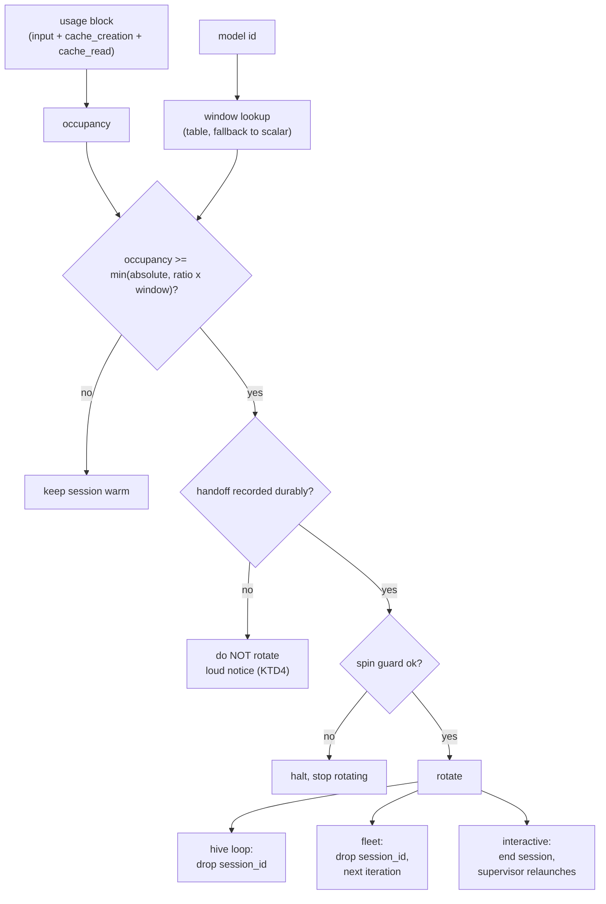

# feat: keep every Claude in the smart zone — automatic session rotation at 500k

**Target repo:** `mindhive`. All paths are repo-relative.

## Summary

The operator runs many Claude sessions in parallel across git worktrees. When one
passes roughly 500k tokens of context occupancy, its execution quality degrades —
it rushes, and instructions that were given go unexecuted. The operator's remedy is
to rotate to a fresh session before that point. Today the rotation either does not
exist, is aimed at the wrong number, or requires the operator to be on standby to
approve it.

This plan makes rotation automatic on three surfaces, in two stages. Stage 1 is
entirely mechanical and headless. Stage 2 supervises interactive sessions and is
gated on an assumption that has not yet been tested.

Four facts established by reading the source, not inferred:

1. **The rotation already exists for `hive loop` and is mis-aimed.**
   `src/mindhive/loop/engine.py` drops `session_id` when occupancy crosses the smart
   zone, so the next iteration starts fresh. But `src/mindhive/loop/config.py` defaults
   `context_window = 200000` with `smart_zone_ratio = 0.5`, so it fires at 100k. On a
   1M-window model that is 10x too early, and the operator's 500k is never expressed
   anywhere.
2. **The occupancy formula undercounts.** `src/mindhive/loop/driver.py` computes
   `context_occupancy` as `input_tokens + cache_read_input_tokens`. True prompt size is
   `input_tokens + cache_creation_input_tokens + cache_read_input_tokens`. On the first
   turns of a session everything lands in `cache_creation` and `cache_read` is zero, so
   the measured value is far below the real one exactly when a session is growing fastest.
3. **The parallel fleet is context-blind.** `src/mindhive/mindnet/agent.py` runs one task
   as a single `claude -p` call capped at 1800s, with no `--resume`. Its spawn primitive,
   `src/mindhive/claude_cli.py`, returns only `{"exit", "stdout"}` — it discards the
   `usage` block entirely and has no `session_id` parameter. The fleet cannot see its own
   context fill, and has no boundary to rotate at.
4. **Model windows differ across the loop's own routing tiers.** `loop/config.py` routes
   `tier_light = claude-haiku-4-5` (200K window) alongside `tier_mid`/`tier_heavy` at 1M,
   while `context_window` is a single scalar shared by all three. A threshold sized for one
   tier is wrong for another.

Stage 1 fixes 1–4 and gives the fleet a rotation boundary. Stage 2 adds the interactive
detector and the supervisor that relaunches.

---

## Problem Frame

**Who is affected.** The operator, running up to ~20 interactive Claude Code sessions
across worktrees plus headless `hive loop` and `hive mindnet orchestrate` runs.

**What goes wrong today.** A session drifts past the operator's quality threshold and
silently produces worse work. Where a rotation suggestion exists at all, it is a prompt
the operator must approve, which means being on standby.

**What "fixed" means.** No session runs past the configured smart-zone ceiling, rotation
happens without an operator keystroke, and the work in flight survives the boundary.

### The honest limit

There is no Claude Code hook, flag, or API that makes an interactive session hand itself
to a successor session. A `Stop` hook can block and inject text; it cannot rotate, clear,
or relaunch. Therefore anything "fully automatic" on the interactive surface requires a
process outside Claude Code to start the next session. That is what Stage 2's supervisor
is, and why Stage 2 is separated from Stage 1.

### An unverified premise, carried explicitly

No Anthropic documentation describes a quality cliff at 500k tokens. 500k is the
operator's own empirical observation from their runs. This plan therefore implements it
as a **tunable parameter with a documented default**, never as an asserted physical
boundary. Nothing in the design depends on 500k being the true number — only on there
being *a* number.

---

## Requirements

| ID | Requirement | Source |
|---|---|---|
| R1 | No session shall exceed a configured occupancy ceiling without rotating | Operator's stated goal |
| R2 | Rotation shall require zero operator interaction on headless surfaces | "operator must always be on standby… is it possible automatically?" |
| R3 | Rotation shall require zero operator interaction on interactive surfaces, accepting a changed launch command | Interview Q5 |
| R4 | The ceiling shall be `min(absolute, ratio × that model's real window)` | Interview Q2 |
| R5 | Work in flight shall survive the rotation boundary via mechanically-derived state | Interview Q4 |
| R6 | Agent-authored handoff prose shall never be treated as verified state | `src/mindhive/mindnet/agent.py` `RESULT_RAN_UNVERIFIED` precedent |
| R7 | A failed handoff shall block rotation; a failed relaunch shall not spin | Interview Q6 |
| R8 | Repeated rotation shall be bounded so it cannot become a spin loop | Carried as non-negotiable, not asked |
| R9 | Occupancy shall be measured as the true prompt size | Verified defect in `loop/driver.py` |
| R10 | An unknown model shall degrade to the configured scalar, never fail open | Interview Q2 |

---

## Key Technical Decisions

**KTD1 — Threshold is `min(absolute_ceiling, ratio × model_window)`.**
The operator thinks in absolute tokens ("500k"); the code thinks in ratios. They agree
today only because 1M × 0.5 = 500k. Taking the minimum honors both and survives a lane
running Haiku 4.5, whose real window is 200K. Cost accepted: a model→window table that
needs updating when new models ship. An unrecognized model id falls back to the
configured `context_window` scalar and logs — so a stale table degrades to today's
behavior rather than disabling the gate (R10).

**KTD2 — Fleet agent runs become resumable iterations rather than one-shots.**
Rejected alternatives: post-hoc measurement (learns only after the degraded turn already
ran — telemetry, not prevention) and a streaming kill-switch (deliberately manufactures
the half-written-tree condition that `mindnet/agent.py` already documents as a hazard,
and does it while the agent may be mid-edit). Making the run resumable mirrors the
pattern already proven in `loop/engine.py` and gives rotation a safe boundary that
falls between iterations, never inside an edit.

**KTD3 — The handoff is mechanically derived; agent prose is stored as unverified.**
Three self-contained reseeds already exist — `briefing.build_briefing`,
`autoresume.resume_prompt`, and `mindnet/agent.prompt_for` — and this repo's stated
invariant is that a second copy of an existing answer is how the two copies begin to
disagree. So no new handoff format is introduced. The progress delta that rides alongside
is computed from the ledger and git, never from the agent's account of itself, because
`mindnet/agent.py` already establishes that an agent's exit-0 reply is `ran-unverified`
and cannot mark work done (R6).

**KTD4 — Fail-closed on handoff, fail-safe on relaunch.**
`mindnet/orchestrator.py` states the house rule that a gate must fail closed. Applied
literally here, closed means "stay in the dumb zone", which is the condition being
prevented — a real tension. Resolved by splitting: if the handoff cannot be recorded
durably, do not rotate (degraded work you still have beats good work you lost), and
surface a blocking notice. If the *relaunch* fails, leave the durable marker and exit
cleanly rather than retrying — no spin.

**KTD5 — Two stages, headless first.**
The supervisor rests on an assumption not yet tested: that the Claude Code TUI behaves
correctly as a child process with inherited stdio. Six deterministic fixes should not be
held hostage to that. Both stages ship; this is ordering, not scope reduction.

---

## High-Level Technical Design

The detector is one shared computation with three call sites. Only the *boundary* and the
*relauncher* differ per surface.

Per-surface rotation boundary:

| Surface | Boundary | Relauncher | Stage |
|---|---|---|---|
| `hive loop` | between iterations (already exists) | the engine's own loop | 1 |
| `hive mindnet orchestrate` | between new agent iterations | the executor's own loop | 1 |
| Interactive Claude Code | `Stop` hook, i.e. turn boundary | `hive session run` supervisor | 2 |

---

## Implementation Units

### U1. Shared smart-zone threshold with per-model windows

**Goal.** One module that answers "is this occupancy outside the smart zone for this
model", used by every surface. Replaces the ratio-only computation.

**Requirements.** R1, R4, R10.

**Dependencies.** None.

**Files.**
- `src/mindhive/loop/context.py` (extend: absolute ceiling, model→window resolution)
- `src/mindhive/loop/config.py` (add `absolute_ceiling`, default `500000`)
- `src/mindhive/loop/scaffold.py` (fix the emitted `loop.toml` template)
- `tests/test_loop_context.py` (extend)
- `tests/test_loop_config.py` (extend)

**Approach.** `ContextConfig` gains an absolute ceiling. A resolver maps a model id to its
real window; unknown ids return `None` and the caller falls back to the configured scalar
and records that it did so. `needs_reset` compares against `min()` of the two bounds.
The `context_window` default moves from `200000` to `1000000` so the fallback path is
also correct for the models actually in use.

**Patterns to follow.** Keep `context.py` pure — it has no I/O today and must not gain any.
The existing `fill_ratio` / `needs_reset` shape stays; the change is what they compare against.

**Test scenarios.**
- Occupancy just under and just at the absolute ceiling (boundary; kills `>` vs `>=` drift)
- 1M-window model: absolute 500k binds before ratio 0.5 (equal here — assert both bounds evaluated, not just one)
- 200K-window model at 120k occupancy: ratio binds, absolute does not — rotates
- 200K-window model at 120k with absolute-only logic: canary proving the ratio bound is armed and would not fire without it
- Unknown model id: falls back to configured scalar, does not raise, records the fallback
- `context_window = 0` or negative: total behavior, no ZeroDivisionError
- `loop.toml` absent: config defaults give a 500k effective ceiling on a 1M model
- Config round-trip: an explicit `absolute_ceiling` in `loop.toml` is honored

**Verification.** `needs_reset` returns True at the operator's stated 500k on a 1M model
and at 100k on Haiku 4.5, from the same call.

---

### U2. Correct the occupancy formula

**Goal.** Measure true prompt size instead of a subset.

**Requirements.** R9.

**Dependencies.** None (independent of U1, but U1's thresholds are meaningless without it).

**Files.**
- `src/mindhive/loop/driver.py` (`Usage.context_occupancy`)
- `src/mindhive/loop/context.py` (`occupancy_from` signature)
- `tests/test_loop_driver.py` (extend)
- `tests/test_loop_context.py` (extend)

**Approach.** Add `cache_creation_input_tokens` to the sum in both places. `occupancy_from`
currently takes two arguments and must take three; every caller is updated in the same unit.

**Execution note.** Write the failing assertion first — the existing
`tests/test_loop_driver.py` asserts `context_occupancy == 50000` against a fixture, and that
assertion encodes the defect. Change the expectation before changing the code, so the red
is honest.

**Test scenarios.**
- A usage block where `cache_creation` is the dominant term (first-turn shape: `cache_read=0`) — the discriminating case that kills the current formula
- A usage block where `cache_read` dominates (steady-state shape) — both formulas agree here, so this case alone proves nothing; included to pin the steady state
- All-zero usage: occupancy 0, no raise
- Missing keys in the parsed envelope: defaults to 0 rather than raising

**Verification.** Feed the real transcript shape observed in this session
(`input=1, cache_creation=1670, cache_read=207389`) and confirm occupancy reads ~209,060
rather than ~207,390.

---

### U3. Capture usage and accept a session id in the headless spawn primitive

**Goal.** Make `claude_cli.run_headless` able to report context fill and to resume — it can
do neither today.

**Requirements.** R1 (fleet), prerequisite for U4.

**Dependencies.** U2 (uses the corrected occupancy).

**Files.**
- `src/mindhive/claude_cli.py`
- `tests/test_claude_cli.py` (extend)

**Approach.** `run_headless` gains an optional `session_id` that appends `--resume <id>`
(explicit id only — never `--continue`, which can hijack the most-recent session in the
directory, a hazard `loop/driver.py` already documents). Its return value gains the parsed
`usage` and the envelope's `session_id`. The existing `{"exit", "stdout"}` keys are
preserved so no current caller breaks.

**Patterns to follow.** `loop/driver.py:parse_result` already parses this envelope shape —
reuse that parsing rather than writing a second copy, per the repo's invariant against
second spellings.

**Test scenarios.**
- `session_id=None` produces argv with no `--resume` (regression guard on existing callers)
- `session_id="abc"` produces `--resume abc` in argv, and never `--continue`
- A well-formed envelope yields populated usage and session id
- An `is_error` envelope yields no usage rather than zeros presented as fact
- Unparseable stdout: returns the existing shape, usage absent, does not raise
- Existing keys `exit` and `stdout` still present and unchanged for every case above
- `MINDHIVE_HEADLESS` is still forced on after any caller env overlay (regression guard on the recursion guard)

**Verification.** An existing caller (`autoresume._run_claude`) continues to work unchanged
against the new signature.

---

### U4. Resumable fleet agent runs with a smart-zone boundary

**Goal.** A fleet task becomes N bounded iterations with a rotation point between them,
instead of one 1800s one-shot with no boundary.

**Requirements.** R1, R2, R5.

**Dependencies.** U1, U2, U3.

**Files.**
- `src/mindhive/mindnet/agent.py`
- `tests/test_mindnet_agent.py` (extend)
- `tests/test_mindnet_orchestrator.py` (extend — the result vocabulary is shared)

**Approach.** `agent.run` becomes a loop: spawn with the current session id, read usage,
check the smart zone, drop the session id when it trips, and reseed the next iteration from
`prompt_for(task, phase)` plus the mechanical progress delta from U5. The existing outcome
vocabulary is preserved exactly — a rotated run still reports `ran-unverified` on a clean
exit, because rotation changes nothing about whether the work was verified. The per-run
wall-clock cap continues to bound the whole loop, not each iteration.

**Execution note.** Characterization first: pin the current one-shot behavior (argv shape,
outcome mapping for each envelope class) before restructuring, so the restructure is
provably behavior-preserving on everything except the new boundary.

**Test scenarios.**
- Single iteration under threshold: identical outcome and result string to today's one-shot
- Occupancy crosses threshold after iteration 1: iteration 2 spawns with no `--resume`
- Occupancy stays under: iteration 2 spawns with the previous `--resume` id
- A usage-limit envelope mid-loop: still classified `refused`/`executed=False`, still carries `USAGE_MARK`, loop stops (a rotated run must not launder a quota failure into a task failure)
- A timeout mid-loop: still `timeout`/`executed=True`, still reports possible partial work
- Clean completion: still `ran-unverified`, never `ok`
- The overall wall-clock cap bounds the sum of iterations, not each one
- Spin guard (U6) trips: loop halts rather than rotating indefinitely

**Verification.** A fake driver that reports rising occupancy causes exactly one rotation at
the configured boundary and zero rotations below it.

---

### U5. Ledger-derived progress delta for the handoff

**Goal.** Give a fresh session a mechanically-true account of what the previous slice
accomplished, with no reliance on the agent's self-report.

**Requirements.** R5, R6.

**Dependencies.** None (consumed by U4; Stage 2 reuses it).

**Files.**
- `src/mindhive/loop/prompt.py` (extend the reseed composition)
- `tests/test_loop_prompt.py` (extend)

**Approach.** Compose the delta from sources that cannot lie: closed roadmap steps, appended
change-log entries, satisfied phases, and changed files. Cap it the way the briefing is
already capped. If the agent supplied a note, render it under an explicit unverified label
so a reader — human or model — cannot mistake it for recorded state.

**Test scenarios.**
- Golden event list with two closed steps and one open: the delta names all three with correct status
- Agent note present: rendered, and the unverified label is present in the output
- Agent note absent: no empty section, no placeholder prose
- Malformed rows in the event list: skipped silently, no raise (totality)
- Cap boundary at N and N+1 entries: the off-by-one case
- An agent note that claims a step is done while the ledger says it is open: the ledger's status wins in the rendered delta

**Verification.** The last scenario above is the load-bearing one — it is the direct
encoding of R6.

---

### U6. Rotation spin guard

**Goal.** Rotation can never become a runaway loop.

**Requirements.** R8.

**Dependencies.** U1.

**Files.**
- `src/mindhive/loop/safeguards.py` (extend)
- `tests/test_loop_safeguards.py` (extend)

**Approach.** Bound rotations per unit time, and halt when consecutive fresh sessions cross
the threshold within a few turns — the signature of a handoff so large it immediately
refills the window. Mirrors the existing `CircuitBreaker` shape in the same module rather
than introducing a second safeguard vocabulary.

**Test scenarios.**
- Rotations under the cap: allowed
- Rotation at the cap: refused, with a reason naming the cap
- Two consecutive fresh sessions crossing threshold within the turn window: halts
- Two crossings separated by a healthy run: does not halt (canary — proves the guard is not simply always-on)
- Clock supplied by injection so the test never sleeps

**Verification.** The healthy-run scenario is the canary; without it the halt assertion
would pass vacuously.

---

### U7. Interactive detector — `Stop` hook *(Stage 2)*

**Goal.** Detect the crossing at a turn boundary in an interactive session and record the
handoff durably.

**Requirements.** R1, R3, R5, R7.

**Dependencies.** U1, U2, U5. **Gated on U8's TTY verification.**

**Files.**
- `hooks/session_stop.ps1` (new)
- `src/mindhive/hookcapture.py` (extend: transcript occupancy read)
- `tests/test_hookcapture.py` (extend)

**Approach.** The hook payload carries `transcript_path`. The transcript is JSONL with a
`usage` block per assistant turn — verified directly this session against a real file. Read
the last assistant turn, compute occupancy via U2's formula, compare via U1. On a crossing:
record the handoff, then signal rotation. Follow the shape every existing hook in `hooks/`
already uses — `MINDHIVE_HEADLESS` early exit, `$ErrorActionPreference = "SilentlyContinue"`,
never block the session on a fault.

**Test scenarios.**
- Transcript with a final assistant turn over threshold: rotation signalled
- Transcript under threshold: no signal, no marker written
- Transcript with no assistant turns: no signal, no raise
- `transcript_path` missing or unreadable: no signal, no raise, session unblocked
- Trailing non-assistant lines after the last assistant turn: the correct turn is read
- Handoff write fails: rotation is NOT signalled and a blocking notice is produced (direct encoding of KTD4)
- `MINDHIVE_HEADLESS=1`: exits immediately, reads nothing

**Deferred to implementation.** Whether the rotation signal is best carried as a ledger
event or a filesystem marker depends on what the supervisor in U8 can watch reliably on
Windows; both are viable and the choice is not knowable before U8 runs.

---

### U8. `hive session run` supervisor *(Stage 2)*

**Goal.** Start the next interactive session without an operator keystroke.

**Requirements.** R2, R3, R7.

**Dependencies.** U5, U7.

**Files.**
- `src/mindhive/session_run.py` (new)
- `src/mindhive/__main__.py` (subcommand registration)
- `tests/test_session_run.py` (new)

**Approach.** Run `claude` as a child with inherited stdio. On exit, read the rotation
marker; if present, relaunch seeded with the U5 handoff; otherwise exit with the child's
code. Apply U6's guard. On relaunch failure, leave the marker and exit cleanly — never
retry-spin (KTD4).

**Execution note.** The first task in this unit is the empirical check, before any design is
committed: does the Claude Code TUI behave correctly as a child process with inherited
stdio on Windows? This has **not** been tested. If it does not, this unit stops and the
alternatives from the interview (hook-spawned window; durable-handoff-only with a manual
start) are re-presented to the operator rather than worked around silently.

**Test scenarios.**
- Child exits with no marker: supervisor exits with the child's code, no relaunch
- Child exits with a marker: exactly one relaunch, seeded with the handoff
- Relaunch spawn fails: marker preserved, clean exit, no retry loop
- Spin guard trips: no relaunch, reason reported
- Child killed by signal: marker state is not corrupted
- The supervisor never targets the dashboard process on port 54461 (explicit guard — `CLAUDE.md` names this as a past regression with a data-loss-shaped failure)

**Verification.** Real subprocess, real marker file, per the repo's preference for building
a tiny real world over patching `subprocess.run`.

---

## Scope Boundaries

**In scope.** Stage 1 units U1–U6. Stage 2 units U7–U8, gated as described.

### Deferred to Follow-Up Work

- Surfacing per-session context fill on the MindSwarm / Oversee boards. The data becomes
  available for the first time in U3–U4, but rendering it is a separate change.
- A fleet-wide aggregate context budget (as opposed to per-session). The operator's ask was
  explicitly per-session.
- Auto-tuning the ceiling from observed quality. Requires a quality signal that does not exist.

### Outside this change

- Any modification to how the port-54461 dashboard resolves its code. `CLAUDE.md` forbids
  redirecting it, and this plan touches it in no way.
- Changing the model routing tiers themselves. U1 reads the tier's model id; it does not
  choose it.

---

## Risks

| Risk | Mitigation |
|---|---|
| TUI does not survive as a child process, invalidating U8 | Staged: U8 begins with the empirical check and stops on failure rather than working around it. Stage 1 ships regardless. |
| Model→window table goes stale | Unknown ids fall back to the configured scalar and log; a stale table degrades to today's behavior, never fails open (R10). |
| U4's restructure changes fleet outcome classification | Characterization tests pin every existing outcome mapping before the restructure; the outcome vocabulary is explicitly unchanged. |
| A global `Stop` hook fires in every project on the machine | Stage 2 only. Same early-exit shape as the six existing global hooks. The operator will be asked again before `settings.json` is edited. |
| The 500k premise is simply wrong | It is a tunable with a default, not a hardcoded constant. A wrong default costs a config edit. |

---

## Verification Strategy

- Establish the real suite baseline by running it before any edit, and report the actual
  number — the "3518 tests" figure in circulation comes from session notes, not from a run
  in this session.
- Every unit is red-first, per `tests/conftest.py`'s autouse isolation and the repo's
  test-first practice.
- Every negative assertion gets a canary proving the gate can fire on that input.
- Subprocess-touching units build a real tiny world rather than patching `subprocess.run`.
- Run the full suite from the worktree with `PYTHONPATH="$PWD/src"` so subprocesses import
  this checkout rather than the editable main install.
- Every change to `src/mindhive/` or `tests/` gets a `hive log` entry, per `CLAUDE.md`.

---

## Open Questions

- **Rotation signal transport for U7** — ledger event vs filesystem marker. Deliberately
  deferred to implementation because the answer depends on what U8's supervisor can watch
  reliably, which is not knowable until U8's TTY check runs.
- **Whether interactive rotation should also fire on a wall-clock bound**, not only
  occupancy. Not asked, not assumed; raise with the operator if Stage 2 surfaces a need.

---

## Sources

- Direct source reads this session: `src/mindhive/loop/{engine,driver,context,config,scaffold}.py`,
  `src/mindhive/{claude_cli,autoresume}.py`, `src/mindhive/mindnet/{agent,orchestrator,executor}.py`,
  `hooks/*.ps1`, `C:\Users\hanif\.claude\settings.json`
- Live transcript inspection confirming per-turn `usage` shape and a real session at ~209,060
  occupancy
- `claude-api` skill: context windows — Opus 5 and Sonnet 5 at 1M, Haiku 4.5 at 200K; and the
  documented identity `total prompt = input + cache_creation + cache_read`
- Installed `plugin-dev` hook documentation and `ralph-loop/hooks/stop-hook.sh` confirming
  `transcript_path` in the hook payload and the `Stop` hook's `decision: block` contract
- Operator interview, this session: seven decisions recorded in Key Technical Decisions
