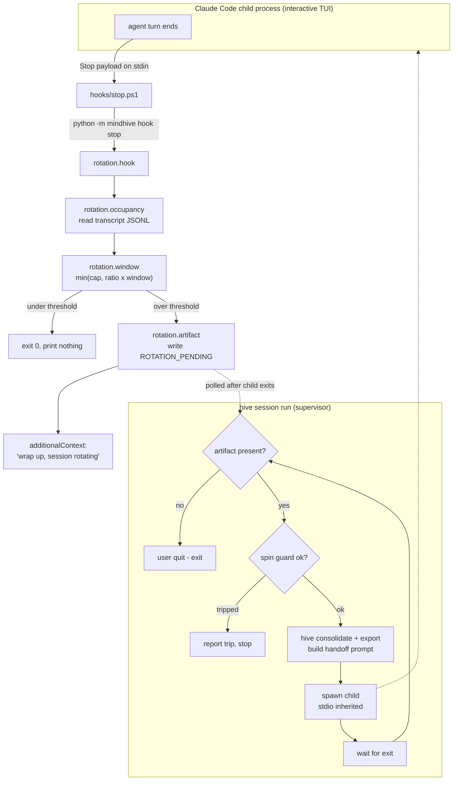

# feat: Smart-Zone Session Rotation — interactive layer

## Summary

An interactive Claude Code session cannot clear its own context or spawn a successor. This plan builds the external machinery that does it: a **Stop hook** that measures true context occupancy from the session transcript and writes a rotation artifact when the smart-zone threshold is crossed, and a **`hive session run` supervisor** that wraps the interactive CLI as a child process, sees the artifact after the child exits, consolidates memory, and relaunches a fresh session reseeded from the ledger.

Two corrections to the originating request are load-bearing and are built into the design rather than noted and ignored:

1. **The proposed Stop-hook mechanism is inverted.** For a Stop hook, `{"decision": "block"}` means *do not stop — keep working*. Emitting it on threshold breach would prevent rotation, not cause it. A Stop hook cannot terminate a session at all. Rotation is therefore signalled by a **filesystem artifact** the supervisor polls after the child exits.
2. **There is no prior "Stage 1".** The model-window table and the `min(cap, ratio × window)` threshold do not exist in this checkout and are new work here, not integration work.

## Problem frame

`hive loop` (headless) already ends an iteration when context fills and reseeds the next one from the compact briefing. Interactive sessions have no equivalent: the user watches the context bar climb and manually decides when to `/clear` and re-explain. The goal is to make that boundary mechanical.

Three gaps stand between here and that:

- **Occupancy is undercounted.** [`context.py:11-13`](src/mindhive/loop/context.py:11) computes `input_tokens + cache_read_input_tokens`, omitting `cache_creation_input_tokens`. With prompt caching on, `input_tokens` is 1–2 and nearly all context lives in the two cache fields. Measured on a real transcript from this repo's own session: `input=2, cache_creation=4826, cache_read=198992` — current formula reports 198,994 against a true 203,820. The gap is the newly-cached span, every turn. [`Usage.total_tokens`](src/mindhive/loop/driver.py:17) directly above already sums all four, so the two disagree with each other.
- **The window is a single hardcoded number.** `context_window: int = 200000` ([`config.py:10`](src/mindhive/loop/config.py:10), mirrored in [`scaffold.py:10`](src/mindhive/loop/scaffold.py:10)). Every current Opus and Sonnet model has a **1M** window; Haiku 4.5 has 200K. On Opus 5 the loop rotates at 100K — a fifth of the way in.
- **Nothing bridges hook → supervisor.** There is no `Stop` hook registered and no `session` subcommand.

## Requirements

- **R1** — Occupancy is `input_tokens + cache_creation_input_tokens + cache_read_input_tokens`, computed identically in the hook and in `hive loop`.
- **R2** — The smart-zone threshold is `min(absolute_cap, ratio × window_for(model))`, default cap 500,000, default ratio from `LoopConfig.smart_zone_ratio` (0.5).
- **R3** — Unknown model ids degrade to a conservative default window rather than raising or disabling rotation.
- **R4** — The transcript reader is total: missing file, unreadable file, corrupt JSON lines, no usage present → a typed *unknown* result, never an exception.
- **R5** — The Stop hook honours `stop_hook_active` and never blocks, so it cannot wedge a session or loop.
- **R6** — The hook is inert unless explicitly enabled, because it fires on **every** Claude Code session on this machine.
- **R7** — `hive session run` renders the interactive TUI natively (inherited stdio, no pipes).
- **R8** — On a rotation exit the supervisor runs consolidation, builds a handoff prompt from the ledger, and relaunches.
- **R9** — A spin guard breaks the loop when rotations cluster abnormally, and reports the trip rather than exiting silently.
- **R10** — `settings.json` registration is idempotent, backs up first, and refuses to write on malformed JSON.
- **R11** — Suite stays green. Baseline: **3657 passed, 0 failed** (verified run, 278.58s).

## High-level technical design

The hook and the supervisor communicate only through the artifact file. The hook never tries to kill anything; the supervisor never parses child output.

**Why an artifact and not a decision.** The Stop-hook contract offers exactly two outcomes: allow the stop, or block it (`{"decision":"block"}` / exit 2), which *continues* the conversation. Neither terminates a session. The artifact is the only channel that survives the child's exit, whatever caused it.

## Key technical decisions

**KTD1 — Occupancy formula includes `cache_creation_input_tokens`.** Cache-write tokens are part of the prompt the model just read; excluding them undercounts by the newly-cached span every turn. This changes `hive loop` behaviour (it will rotate slightly earlier and more correctly), so both the new formula and the loop's continued behaviour get pinned by tests.

**KTD2 — Model-window table is static, with a documented refresh path.** The hook runs on every turn and must not make network calls. Windows are pinned in code from the model catalog; the Models API (`GET /v1/models/{id}` → `max_input_tokens`) is documented in a comment as the way to refresh, not called at runtime. Matching is by longest-prefix on the model id so dated snapshots resolve.

| Model id prefix | Window |
|---|---|
| `claude-opus-5`, `claude-opus-4-8`, `claude-opus-4-7`, `claude-opus-4-6` | 1,000,000 |
| `claude-sonnet-5`, `claude-sonnet-4-6` | 1,000,000 |
| `claude-fable-5`, `claude-mythos-5` | 1,000,000 |
| `claude-haiku-4-5` | 200,000 |
| unknown | 200,000 (conservative — rotates early rather than never) |

**KTD3 — The hook never blocks.** It emits either nothing (exit 0) or `hookSpecificOutput.additionalContext` telling the model to wrap up. `{"decision":"block"}` is never emitted, so `stop_hook_active` re-entrancy cannot arise from our own behaviour — but the field is still honoured (a `true` value short-circuits to silence) because another hook may have blocked.

**KTD4 — Sidechain and subagent turns are excluded.** Real transcripts mark subagent turns with `isSidechain: true`, and subagent Stop payloads carry `agent_id`/`agent_type`. A subagent's usage is its own context, not the main session's; counting it would rotate the parent for a child's fill. Both are filtered.

**KTD5 — Enablement is opt-in via `MINDHIVE_ROTATION` env var, and the hook is registered disabled-by-default.** A global Stop hook fires on every Claude Code session on this machine. A registered-but-inert hook is recoverable; a registered-and-buggy one wedges everything. Registration and activation are separate steps.

**KTD6 — Stdio is inherited, never piped.** `subprocess.Popen(argv)` with no `stdin`/`stdout`/`stderr` arguments hands the child the parent's console handles directly. The TUI then owns a real console — full-screen redraw, key handling, and ANSI all work because nothing is in the middle. There is no `pty` on Windows and none is needed for this shape; piping is what breaks TUIs, and we simply don't.

**KTD7 — Ctrl+C is handled by not handling it.** With inherited stdio the child is in the parent's console process group and receives `CTRL_C_EVENT` directly. The supervisor wraps `proc.wait()` in `try/except KeyboardInterrupt`, treats it as a user quit (not a rotation), and returns a clean exit code.

**KTD8 — The artifact lives under the project's mindhive dir, resolved via `paths`.** Never a hand-built `~/.mindhive` path — that is exactly what escapes the test suite's autouse isolation.

## Implementation units

### U1. Corrected occupancy formula

- **Goal:** One correct occupancy definition, shared by the loop and the hook.
- **Requirements:** R1
- **Dependencies:** none
- **Files:** `src/mindhive/loop/context.py`, `src/mindhive/loop/driver.py`, `tests/test_loop_context.py`, `tests/test_loop_driver.py`
- **Approach:** Widen `occupancy_from` to accept `cache_creation_input_tokens` and sum all three. Update `Usage.context_occupancy` to match `total_tokens`' treatment of the cache fields (minus `output_tokens`, which is not prompt). Keep the parameter order backward-compatible where callers exist; update [`engine.py:87`](src/mindhive/loop/engine.py:87) call site.
- **Execution note:** Test-first. Write the failing formula tests before touching either module.
- **Test scenarios:**
  - `occupancy_from(2, 4826, 198992) == 203820` — the real measured turn; discriminates against the old two-field formula, which returns 198994.
  - `Usage(input_tokens=2, cache_creation_input_tokens=4826, cache_read_input_tokens=198992, output_tokens=661).context_occupancy == 203820` — and is strictly less than `total_tokens` (output excluded).
  - All-zero usage → 0 (no crash, no division).
  - `needs_reset` at exactly `ratio × window` returns `True` (boundary; kills an off-by-one on `>` vs `>=`).
  - Existing engine reset behaviour still holds with the wider formula — pins that the loop did not silently change shape.

### U2. Model-window table and smart-zone threshold

- **Goal:** Resolve a model id to a context window, and a window to a rotation threshold.
- **Requirements:** R2, R3
- **Dependencies:** none
- **Files:** `src/mindhive/rotation/__init__.py`, `src/mindhive/rotation/window.py`, `tests/test_rotation_window.py`
- **Approach:** Immutable ordered tuple of `(prefix, window)` pairs; longest-prefix match; `DEFAULT_WINDOW = 200_000` fallback. `threshold(model, ratio, cap=500_000) -> int` returns `min(cap, int(ratio * window_for(model)))`.
- **Test scenarios:**
  - `window_for("claude-opus-5") == 1_000_000`; `window_for("claude-haiku-4-5") == 200_000`.
  - `window_for("claude-haiku-4-5-20251001")` resolves via prefix — dated snapshot does not fall through to default.
  - `window_for("some-future-model")` returns the default and does not raise; `window_for(None)` and `window_for("")` likewise.
  - `threshold("claude-opus-5", 0.5)` → 500,000 — the cap binds, not the ratio (0.5 × 1M = 500K, equal; use ratio 0.9 to make the cap strictly bind and prove `min` is real).
  - `threshold("claude-haiku-4-5", 0.5)` → 100,000 — the ratio binds, not the cap. This pair discriminates against an implementation that only ever applies one side of the `min`.
  - `threshold(..., ratio=0.0)` → 0, and `ratio=1.0` → capped. No negative or unbounded output.

### U3. Occupancy from transcript

- **Goal:** Given a transcript path, return the main-session occupancy and model, or a typed unknown.
- **Requirements:** R1, R4, KTD4
- **Dependencies:** U1, U2
- **Files:** `src/mindhive/rotation/occupancy.py`, `tests/test_rotation_occupancy.py`
- **Approach:** Read the JSONL, walk lines newest-first, skip non-`assistant` rows, skip `isSidechain: true`, take the first row carrying `message.usage`. Return a frozen dataclass `Occupancy(tokens: int | None, model: str | None, reason: str)` where `tokens is None` means unknown and `reason` is a stable rule id (`ok`, `missing_file`, `unreadable`, `no_usage`). Mirror [`harvest.iter_transcript_events`](src/mindhive/harvest.py:235) for the read (`errors="ignore"`, per-line `try`).
- **Execution note:** Test-first; totality is the contract, so every failure shape gets its own test.
- **Test scenarios:**
  - Golden transcript with the real four-field usage → `tokens == 203820`, `model == "claude-opus-5"`, `reason == "ok"`.
  - Two assistant rows; the newer one wins (not the first, not the max).
  - A newer `isSidechain: true` row with huge usage is skipped in favour of an older main-session row — **discriminating**: an implementation that ignores `isSidechain` returns the subagent's number.
  - Missing path → `tokens is None`, `reason == "missing_file"`, no raise.
  - File with corrupt JSON lines interleaved with one valid row → the valid row is still found (corrupt lines skipped, not fatal).
  - File of only corrupt lines → `reason == "no_usage"`, no raise.
  - A directory passed where a file is expected → unknown, no raise.
  - Assert on `reason` (stable rule id), never on message prose.

### U4. Rotation artifact

- **Goal:** A durable, machine-readable rotation signal that survives the child's exit.
- **Requirements:** R8, R9
- **Dependencies:** U2
- **Files:** `src/mindhive/rotation/artifact.py`, `tests/test_rotation_artifact.py`
- **Approach:** JSON file at `paths.project_dir(project) / "ROTATION_PENDING"` holding `{session_id, occupancy, threshold, model, ts}`. `write()`, `read()`, `clear()`. `read()` on a missing or corrupt file returns `None` (totality again — a corrupt artifact must not crash the supervisor).
- **Test scenarios:**
  - Round-trip write → read returns the same fields.
  - `read()` with no file → `None`.
  - `read()` on a corrupt/truncated file → `None`, no raise.
  - `clear()` on a missing file is a no-op, not an error.
  - Path resolves inside `tmp_path` under the autouse isolated store — **canary**: assert the written path is under `MINDHIVE_HOME`, proving the module cannot touch the live `~/.mindhive`.

### U5. Stop hook

- **Goal:** Decide, per turn, whether to signal rotation — and never wedge the session.
- **Requirements:** R1, R4, R5, R6
- **Dependencies:** U2, U3, U4
- **Files:** `src/mindhive/rotation/hook.py`, `hooks/stop.ps1`, `src/mindhive/__main__.py`, `tests/test_rotation_hook.py`, `tests/test_cli.py`
- **Approach:** `hook_decision(raw: str) -> dict | None`. Parse the Stop payload (`session_id`, `transcript_path`, `stop_hook_active`, optional `agent_id`/`agent_type`). Return `None` (print nothing) when: rotation disabled, `stop_hook_active` is true, a subagent stop (`agent_id` present), occupancy unknown, or under threshold. Over threshold: write the artifact and return `{"hookSpecificOutput": {"hookEventName": "Stop", "additionalContext": "..."}}`. Wrap the whole body so any unexpected exception returns `None` — fail-open is the contract. Add a `stop` branch to `cmd_hook` following the existing `pre_tool_use` shape (print only on a decision). The `.ps1` shim mirrors `session_start.ps1`: `MINDHIVE_HEADLESS` guard, `SilentlyContinue`, try/catch, `exit 0`.
- **Execution note:** Test-first, and include the fail-open canary before the happy path.
- **Test scenarios:**
  - Over threshold with rotation enabled → returns a dict, artifact written, `decision` key **absent** — discriminating against the inverted design from the original request.
  - Under threshold → returns `None`, no artifact written.
  - `stop_hook_active: true` and over threshold → `None`, no artifact. Re-entrancy honoured.
  - Payload carrying `agent_id` → `None` even when over threshold (subagent stop).
  - Rotation not enabled (`MINDHIVE_ROTATION` unset) → `None` even when over threshold. **Canary sibling:** the identical payload with rotation enabled *does* fire — proving the negative test is armed and not passing vacuously.
  - Malformed stdin (not JSON, empty string, JSON that is a list) → `None`, no raise.
  - Occupancy module raising unexpectedly (monkeypatched at the module seam) → `None`, no raise. Fail-open proven, not assumed.
  - `cli_mod.main(["hook", "stop"])` returns 0 on a payload that fires and on one that does not.

### U6. `hive session run` supervisor

- **Goal:** Wrap the interactive CLI, detect rotation, reseed, relaunch.
- **Requirements:** R7, R8, R9, KTD6, KTD7
- **Dependencies:** U4
- **Files:** `src/mindhive/rotation/supervisor.py`, `src/mindhive/__main__.py`, `tests/test_rotation_supervisor.py`, `tests/test_cli.py`
- **Approach:** `run(spawn=..., now=..., max_rotations=..., window_s=...)` — the child spawner and clock are **injected**, so the loop is testable without launching a real CLI. Default spawner uses `claude_cli.resolve_exe()` and `subprocess.Popen(argv)` with stdio untouched, plus `claude_cli._child_env` semantics for the environment. Per iteration: clear any stale artifact, spawn, `wait()` (catching `KeyboardInterrupt` → user quit), read artifact; absent → return; present → spin guard → `consolidate` + `export` → build handoff prompt → next iteration passes it via `--append-system-prompt`, matching how [`driver.build_argv`](src/mindhive/loop/driver.py:42) already seeds context. Never put the prompt in argv beyond that bounded string — the same Windows 8k `.CMD` limit that shaped `build_argv` applies here.
- **Execution note:** Test-first with a fake spawner. The real-CLI path is exercised once, manually, and reported as such.
- **Test scenarios:**
  - Fake spawner exits with no artifact → loop returns after exactly one spawn (`spawn_count == 1`).
  - Fake spawner writes an artifact on the first run and not the second → exactly two spawns, and `consolidate` was invoked once between them.
  - Stale artifact present *before* the first spawn is cleared, not treated as a rotation — otherwise every run would double-spawn.
  - Spin guard: spawner writes an artifact every time, injected clock advances 10s per iteration → loop breaks at `max_rotations`, returns a non-zero exit code, and the trip is reported. **Discriminating:** with the clock advancing 3600s per iteration the same spawner does *not* trip, proving the guard is time-windowed and not a plain counter.
  - `KeyboardInterrupt` from `wait()` → returns a user-quit code, does not rotate, does not spin.
  - Handoff prompt for iteration N>1 is non-empty and contains ledger-derived text; iteration 1 has none.
  - `cli_mod.main(["session", "run", ...])` exit codes: 0 clean, non-zero on guard trip.

### U7. Idempotent `settings.json` registration

- **Goal:** Register the Stop hook in the global config without ever corrupting it.
- **Requirements:** R6, R10
- **Dependencies:** U5
- **Files:** `src/mindhive/rotation/install.py`, `src/mindhive/__main__.py`, `tests/test_rotation_install.py`
- **Approach:** `install(settings_path, command, *, dry_run=False) -> dict` — path injected, so tests never touch the real file. Read → parse → on `JSONDecodeError` return `{"ok": False, "reason": "malformed"}` and **write nothing**. Otherwise: copy to `settings.json.bak-<n>` (never overwriting an existing backup), ensure `hooks` is a dict, ensure `hooks["Stop"]` is a list, scan for an entry whose command already matches → if found return `{"ok": True, "reason": "already_registered"}` unchanged. Else append `{"hooks": [{"type": "command", "command": ...}]}` — the nested matcher-group shape every one of the six existing stages uses in this file — and write UTF-8 via the standard writer. Stop takes no `matcher`, so none is emitted. Expose as `hive session install-hook`.
- **Test scenarios:**
  - Fresh settings with no `hooks` key → `Stop` created, file still parses, the other top-level keys survive byte-identical.
  - Settings with the existing six stages → `Stop` appended, the six are untouched (assert each still present with its original command).
  - Running install twice → second call reports `already_registered` and the `Stop` array length stays 1. **Idempotency, discriminating:** an implementation that appends unconditionally fails this.
  - Malformed JSON input → `ok: False`, `reason == "malformed"`, and the original file bytes are unchanged (assert on file content, not just the return value).
  - A backup file is created; a second install does not clobber the first backup.
  - `hooks` present but not a dict (e.g. a list) → refuses rather than coercing.
  - Emitted entry has no `matcher` key — Stop does not support one.

### U8. Documentation and change-log

- **Goal:** The rules live where the next session will find them.
- **Requirements:** R11
- **Dependencies:** U1–U7
- **Files:** `docs/DATA_MODEL.md`, `CLAUDE.md`
- **Approach:** Document the occupancy formula and why `cache_creation` is included, the window table and its Models-API refresh path, the artifact schema, the opt-in env var, and the fail-open rule. Record `hive log` entries per unit as they land — this is mandatory in this repo, not optional.
- **Test expectation:** none — documentation only. The change-log entries are the verification.

## Scope boundaries

**In scope:** everything in U1–U8.

### Deferred to follow-up work

- Cross-platform hook shim (`hooks/stop.sh`) — this machine is Windows-primary; the `.ps1` matches the existing six.
- Live Models-API window refresh — static table plus documented refresh path is correct for a per-turn hook.
- Dashboard surface for rotation history.

### Not in scope

- **Laravel or any PHP.** The request asked for it; this is a Python ≥3.11 stdlib-only CLI package. Introducing a PHP web framework here would be wrong, not efficient. Flagged, not followed.
- Modifying the live dashboard on port 54461, or any `PYTHONPATH`/`sys.path` redirection of it.

## Risks

| Risk | Mitigation |
|---|---|
| A buggy global Stop hook wedges every Claude Code session on this machine | Fail-open by construction (any exception → `None`); never emits `decision`; opt-in env var so registration ≠ activation; explicit fail-open canary test |
| `settings.json` corruption | Read-parse-backup-write; refuse on malformed JSON; idempotency test; backups never clobbered |
| Occupancy fix changes `hive loop` behaviour | Tests pin both the new formula and the loop's continued reset behaviour |
| Transcript lag — the file may not yet hold the current turn's usage | Accepted. Occupancy is near-monotonic; a one-turn-late reading rotates one turn late, which is harmless. Documented, not worked around |
| TUI-as-child fails on Windows despite inherited stdio | This is the empirical gate. If it fails, report it as a failure with the observed output — do not claim the supervisor works because its unit tests pass |
| Spin guard mis-tuned, breaking legitimate fast rotations | Bounds are config, not constants; the trip is reported with its numbers so it can be re-tuned from evidence |

## Open questions (deferred to implementation)

- Exact handoff prompt composition — depends on what `hive export` / `hive briefing` actually emit at the time; decide against real output, not against a guess.
- Whether the supervisor should pass `--resume <session_id>` instead of a fresh session with a seeded prompt. A fresh session is the point of rotation, so the plan assumes fresh; revisit only if reseeding proves lossy in the empirical test.

## Verification

The work is done when, and only when:

- `PYTHONPATH="<worktree>/src" py -m pytest -q` is green and at or above **3657 passed** (the verified baseline).
- The empirical TUI-as-child gate has been *run*, with its real output read and reported — a successful automated rotation, or an honest account of where it broke. Unit tests passing is not this gate.
- Every unit has a `hive log` entry.

## Sources

- Stop-hook contract (payload fields, `decision: "block"` semantics, exit codes, `stop_hook_active`, no `matcher`): official Claude Code hooks reference, fetched 2026-08-03.
- Transcript JSONL shape and the four usage fields: read directly from a live transcript in `~/.claude/projects/`, this session.
- Model context windows: model catalog — Opus 5 / Opus 4.8 / 4.7 / 4.6 / Sonnet 5 / Sonnet 4.6 / Fable 5 at 1M, Haiku 4.5 at 200K.
- Baseline test count: `3657 passed, 1 warning in 278.58s`, exit 0, run in this worktree.
- Premise contradictions: `hive premise check`, exit 1.
