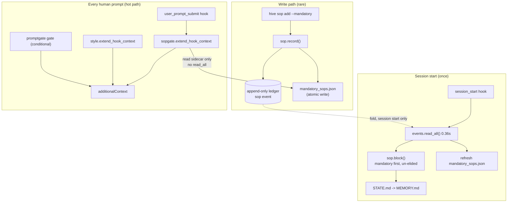

# feat: Mandatory SOP tier with per-prompt injection

## Summary

The user's standing work-method prompt — study the prompt relentlessly, use the
whole MindHive surface, loop until every part of the ask is implemented, prepare
every tool before executing, never declare done with gaps, confirm new-vs-
continuation from the ledger — becomes a **mandatory SOP**: a first-class tier in
the existing event-sourced SOP registry whose body is re-asserted on **every
human-typed prompt**, not merely loaded once at session start.

The mechanism is a new `mandatory` flag on `sop` events plus a new per-prompt
injector module (`sopgate.py`) wired into the `user_prompt_submit` hook beside
`style.py`, reading a materialized sidecar rather than the ledger. A new
`hive sop preflight` command turns the aspirational preparation clauses
("confirm this is new or a continuation", "prepare all skills, tools, ledgers")
into a command with checkable output.

---

## Problem Frame

MindHive already has two injection surfaces, and neither does what the user asked
for:

1. **`directives.py` → session_start.** Canonical operating directives, injected
   once per session. Hardcoded in Python — the user cannot add to it without a
   code change, and a code change is not "an SOP".
2. **`sop.py` → STATE.md → MEMORY.md.** An event-sourced, user-manageable
   registry (`hive sop add|update|delete`), 10 SOPs active today. Delivered
   **once**, at session start, inside a 12,497-character block, budgeted by
   `BLOCK_FULL_BUDGET = 16000` with bodies silently degrading to pointers once
   the budget is spent.

Both decay. `style.py`'s module docstring already names the failure precisely:
*"an instruction read once, at session start, about a behaviour that has to hold
at turn 80 … later context crowds out earlier context."* The caveman style solved
this with a per-prompt hook. The SOP registry has no equivalent — every SOP is a
session-start instruction, and a session-start instruction is exactly the kind
the user is asking to be made non-decaying.

There is also no tier: all 10 SOPs are equal, so a procedure that must hold on
*every* task shares a budget with one that applies to a single subsystem, and can
be the one that gets elided.

### Measured constraints (verified in this repo, not assumed)

| Fact | Value | Where it binds |
|---|---|---|
| Ledger size | 26,486 events | — |
| `events.read_all()` | 0.36 s | Per-prompt hook must **not** call it |
| Current UserPromptSubmit hook cost | ~0.36 s (per `promptgate.catalog_block` docstring) | A `read_all` would double it |
| Current SOP STATE.md block | 12,497 chars | Injecting all SOPs per prompt (~3,100 tok) is untenable |
| `sop.MAX_TEXT_CHARS` | 4,000 | Caps any single SOP body |

These three numbers force the two central decisions below (KTD2, KTD3).

---

## Requirements

Traced verbatim to the user's prompt. R1–R9 are the SOP's *content*; R10–R13 are
the *mechanism* that makes it mandatory.

| ID | Requirement | Source |
|---|---|---|
| R1 | Be flexible; learn from past sessions' mistakes; use all MindHive functions as execution/understanding methods; combine, parallelize, or sequence multiple implied skills by best technical + usage tradeoff | user ¶1 |
| R2 | After finishing any build, re-check the prompt for anything unimplemented; loop until every part is satisfied | user ¶2, ¶4 (stated twice) |
| R3 | Understand every aspect relentlessly — source data, ledger, code architecture, user intent, operation; explore each decision-tree branch, resolve dependencies one by one, pick the best branch | user ¶3 |
| R4 | Discover facts from the environment yourself rather than asking | user ¶3 |
| R5 | Mission complete only when everything in the prompt is implemented; be brave about adding/replacing/deleting/continuing tasks and sub-tasks; never declare complete with gaps; be critical, grounded in absolute truth, never lie | user ¶4 |
| R6 | Before execution prepare and understand **all** skills, tools, frameworks, legends, ledgers, plugins; never proceed blindly; install a missing skill/plugin from GitHub first | user ¶4, ¶5 |
| R7 | Study past execution-phase mistakes via the ledger and the improvements section, to avoid tool/syntax/method/ambiguity/hallucination failures and save usage | user ¶5 |
| R8 | Use the project's established framework and static/deterministic tooling rather than improvising (see **Assumption A1** — the user wrote "Laravel") | user ¶6 |
| R9 | Map the legend so every address in the architecture is findable; read the ledger for infrastructure context; confirm from the ledger whether the session is NEW or a CONTINUATION and absorb prior context if continuing | user ¶7, ¶8 |
| R10 | The SOP is **mandatory** — a distinct, declared tier, not one more equal entry | user: "made a mandatory SOP" |
| R11 | It is **injected on every session** by a mechanism **integrated with the SOP section**, not a separate parallel system | user: "injection method that is integrated with the SOP section" |
| R12 | The injection must not decay across a long session | derived from the stated failure mode; `style.py` precedent |
| R13 | R9's continuation check must be **checkable**, not aspirational prose | plan-local: an instruction with no verifier is a wish |

---

## Assumptions

**A1 — "Laravel" does not apply and is generalized, not dropped.** The user wrote
*"you must use the Laravel framework and other static frameworks in accordance
with IT knowledge."* Laravel is a PHP web framework; MindHive is a Python 3
package (`pyproject.toml`, `src/mindhive/`) with no PHP, no Composer, and no HTTP
framework beyond `http.server` in `dashboard.py`. Installing Laravel here would
be inert at best. The **intent** — do not improvise infrastructure when an
established framework or deterministic tool already covers it — is real and is
preserved as R8, expressed as: use this project's own established framework
(`pytest`, `argparse`, the event-sourced fold, the sidecar/manifest pattern,
`paths.write_text_atomic`) rather than hand-rolling. **This substitution must be
reported to the user in the final response, not silently absorbed.**

**A2 — Per-prompt injection is the right cost.** ~2,600 chars ≈ 650 tokens per
human-typed prompt. Accepted as the price of R12; bounded by KTD3's budget and by
skipping machine-injected prompts entirely.

---

## Key Technical Decisions

### KTD1 — Extend the existing SOP registry with a `mandatory` flag; do not build a parallel registry

**Decision.** Add an optional boolean `mandatory` to the `sop` event payload,
validated in `sop.validate_payload`, carried through `sop.fold`, surfaced by a
new `sop.mandatory(evs)` selector and a `--mandatory` flag on `hive sop add`
/ `hive sop update`.

**Why.** R11 says the injection must be *integrated with the SOP section*. A
second registry would be a second thing to keep honest, and would lose the
registry's four inherited properties for free: hash-chained audit, `hive sop
show` history, keyword recall via `ledger_body`, and the Memory view.

**Backward compatibility.** All 10 existing SOPs have no `mandatory` key.
`fold` reads `bool(p.get("mandatory"))` only when the key is present in an
add/update, and `record()` writes the key only when explicitly passed — so a
non-mandatory `update` never silently demotes a mandatory SOP, and the 10
existing records fold to `mandatory: False` unchanged.

**Alternatives rejected.**
- *Put the text in `directives.py`.* Hardcoded; the user could never edit it
  without a code change, and it would not be an SOP (violates R11).
- *A `mandatory` tag in the existing free-form `tags` list.* Tags are unvalidated
  and not folded into the record; a typo would silently produce a non-mandatory
  SOP with no error. A validated first-class field fails loudly.

### KTD2 — The per-prompt injector reads a materialized sidecar, never the ledger

**Decision.** `sop.record()` and session start write `mandatory_sops.json` into
`paths.project_dir(project)` via `paths.write_text_atomic`. The hook reads only
that file.

**Why.** Measured: `events.read_all()` is 0.36 s on this store, and the whole
UserPromptSubmit hook currently costs ~0.36 s. A ledger read in the injector
would **double the latency of every prompt the user types** — the exact reason
`promptgate.train_and_store` already materializes `rules/triggers.json` instead
of folding live, and `playbook.build` is computed at train time "because a hook
that rebuilt this per prompt would several-fold the latency of every prompt."
This follows the house pattern rather than inventing one (R8).

**Staleness contract.** The sidecar is derived, regenerable data — it is written
on every `hive sop add|update|delete` and refreshed at session start. A missing
or corrupt sidecar yields **no injection** (fail-open), never a ledger fallback:
a fallback would reintroduce the 0.36 s cost on precisely the path the cache
exists to protect.

### KTD3 — Verbatim body, hard character budget, degrade to a pointer — never paraphrase

**Decision.** The injected text is the SOP body **verbatim**. A module constant
`PROMPT_BUDGET` (2,600 chars) caps the total across all mandatory SOPs in
`created, sop_id` order; a SOP that would exceed it renders as
`— <title> (read it: hive sop show <id>)` instead.

**Why verbatim.** A generated summary of a procedure is a paraphrase, and a
paraphrase re-derived per prompt is non-deterministic and drifts from the record.
The registry is the source of truth; the injector transports it.

**Why budgeted.** Without a cap, adding a second mandatory SOP silently doubles
the per-prompt cost of every session on this machine. The cap makes the cost a
declared constant instead of an emergent property.

**Contrast with `sop.block()`.** `block()`'s `BLOCK_FULL_BUDGET = 16000` governs
the session-start block. Mandatory SOPs are **exempt** from that budget — a
mandatory procedure that renders as a pointer because ten optional ones were
created first is a silent failure of R10.

### KTD4 — A new `sopgate.py` module, mirroring `style.py`; not a change to `promptgate.hook_context`

**Decision.** New module exposing `block_for(text, project=None) -> str` and
`extend_hook_context(context, raw, project=None) -> dict`, wired into
`__main__.cmd_hook`'s `user_prompt_submit` branch immediately **before**
`style.extend_hook_context`.

**Why a separate module.** `promptgate.hook_context` is a **conditional gate**
whose silence is a correct answer. A mandatory SOP is **unconditional**. `style.py`
states the rule directly: *"Fusing the two would make 'the gate found nothing'
indistinguishable from 'the hook said nothing'."* The same reasoning applies
here, and `mn_inject`, `premise`, and `style` already establish
`extend_hook_context(context, raw)` as the seam for unconditional passes.

**Why ordered before `style`.** `style` prepends and is documented as running
last so it survives truncation of a long block. Inserting `sopgate` before it
leaves the style block first and the SOP block immediately after — both ahead of
the conditional gate output.

**Skip rules.** Machine-injected text (harness tags, injected skill bodies) gets
no injection. Slash commands **do** get it — reusing `style._is_injected`'s
distinction, not `promptgate.is_machine_prompt`, because `/lfg` is the user
speaking and the standing procedure still applies. `tests/test_style.py` already
pins this distinction; the new tests must pin it independently for `sopgate`.

### KTD5 — Fail-open everywhere, and never a `decision`

**Decision.** Every `sopgate` entry point returns `context` unchanged on any
exception, missing sidecar, or malformed payload. It writes only
`hookSpecificOutput.additionalContext`. No Stop hook is touched.

**Why.** Project CLAUDE.md: the Stop hook must stay fail-open and opt-in, and
must never emit `{"decision": "block"}` — for a Stop hook, `block` means *keep
working*, which would pin a session open. R2/R5's "loop until complete" is
therefore enforced as **injected instruction**, not as a blocking gate. The
honest framing: this makes the discipline *unavoidably present*, not
*mechanically impossible to violate*. Claiming otherwise would violate the very
honesty clause being encoded.

### KTD6 — `hive sop preflight` makes R6/R7/R9 checkable

**Decision.** A new read-only subcommand printing, from the ledger in one pass:

1. **Continuity verdict** — `NEW` or `CONTINUATION`, with the evidence: the most
   recent prior session id and timestamp, open roadmap plans (`roadmap` fold),
   the pending-review marker, and the pending unlogged-changes marker.
2. **Mandatory SOPs** — ids and titles now in force.
3. **Improvements** — active prevention rules (`rules`) and open incidents, i.e.
   R7's "past execution-phase mistakes" surface.
4. **Catalog** — counts of installed skills and plugins (`plugins.live_inventory`).

**Why.** R13. "Confirm whether the session is a continuation" with no command
behind it is a sentence the assistant can claim to have done without doing. A
command produces output that can be quoted, and the SOP body names it, so the
instruction and its verifier ship together.

**Why one command, not four.** The SOP body is budgeted (KTD3); naming one
command costs one line, naming four costs four and invites partial compliance.

---

## High-Level Technical Design



The single load-bearing shape: the **write path** and the **session-start path**
touch the ledger; the **per-prompt path** touches only the sidecar. That
separation is KTD2, and it is what keeps R12 (no decay) from costing 0.36 s per
prompt.

### Delivery order within one prompt's `additionalContext`

```
◆ Reply style — …            (style.py, prepended last, so first)
▣ MANDATORY SOP — …          (sopgate.py)
[mindhive-promptgate] …      (conditional gate / catalog, when it fires)
```

---

## Implementation Units

### U1. `mandatory` flag on the SOP registry

**Goal.** Make "mandatory" a validated, folded, first-class property of an SOP.

**Requirements.** R10, R11.

**Dependencies.** None.

**Files.**
- `src/mindhive/sop.py` (modify)
- `tests/test_sop.py` (modify)

**Approach.** In `validate_payload`, accept an optional `mandatory` key and
reject a non-boolean value with a corrective message. In `fold`, set
`rec["mandatory"] = bool(p["mandatory"])` **only when the key is present** in the
add/update payload, defaulting to `False` on first add — so a title-only update
never demotes a mandatory SOP. Add `sop.mandatory(evs) -> list` returning active
mandatory records in the same `(created, sop_id)` order `current()` uses. Extend
`ledger_body` to mark mandatory entries so keyword recall can find them.

**Patterns to follow.** `changelog.py`'s validate/fold split, cited by `sop.py`'s
own docstring as its mirror; `fold`'s existing "total, never raises on historical
data" contract.

**Test scenarios.**
- `validate_payload` accepts `mandatory: True` and `mandatory: False` on add.
- `validate_payload` rejects `mandatory: "yes"` and `mandatory: 1` (non-boolean).
- An add without `mandatory` folds to `mandatory: False` — pinning backward
  compatibility for the 10 existing SOPs.
- An `update` carrying only `title` leaves an existing `mandatory: True` intact
  (the demotion regression).
- An `update` carrying `mandatory: False` demotes; a later `update` with
  `mandatory: True` re-promotes, and `version` increments each time.
- `delete` then re-`add` revives with the flag from the new add, keeping the
  original `created` per the existing revival contract.
- `sop.mandatory(evs)` returns only active mandatory records, ordered by
  `(created, sop_id)`, and `[]` when none exist.

**Verification.** `tests/test_sop.py` passes, including the pre-existing
lifecycle tests unchanged.

### U2. Mandatory SOPs render first and un-elided in the STATE.md block

**Goal.** A mandatory SOP can never be the one degraded to a pointer at session
start.

**Requirements.** R10, R11.

**Dependencies.** U1.

**Files.**
- `src/mindhive/sop.py` (modify — `block`)
- `tests/test_sop.py` (modify)

**Approach.** In `block()`, partition `current(evs)` into mandatory and ordinary,
emit mandatory first under a distinguishing sub-heading that states the
obligation ("follow on every task, without being asked"), and exempt mandatory
bodies from the `BLOCK_FULL_BUDGET` accumulator entirely — the running total
starts accruing only on ordinary SOPs. Keep the block deterministic: same
registry in, same bytes out.

**Test scenarios.**
- With one mandatory and one ordinary SOP, the mandatory heading precedes the
  ordinary one in the emitted block.
- A mandatory SOP whose body alone exceeds `BLOCK_FULL_BUDGET` still renders in
  full (the exemption), while an ordinary SOP after it renders as a pointer.
- With zero mandatory SOPs the block is byte-identical to today's output — a
  regression guard on the 10 live SOPs.
- Numbering/pointer text for ordinary SOPs is unchanged.

**Verification.** Existing `test_sop.py` STATE-delivery assertions pass
unmodified; new ordering and exemption assertions pass.

### U3. The materialized sidecar

**Goal.** Give the hot path a cheap, atomic, fail-open source for mandatory SOP
bodies.

**Requirements.** R12; enables U4.

**Dependencies.** U1.

**Files.**
- `src/mindhive/sop.py` (modify — add `write_sidecar` / `read_sidecar`)
- `tests/test_sop.py` (modify)

**Approach.** `write_sidecar(project=None, evs=None)` folds `mandatory(evs)` into
`{"sops": [{"sop_id", "title", "text", "version"}], "written_at": …}` and writes
`paths.project_dir(project) / "mandatory_sops.json"` with
`paths.write_text_atomic`. Called at the end of `sop.record()` (best-effort:
wrapped so a sidecar failure never fails the ledger append, mirroring
`promptgate.train_and_store`'s best-effort audit append) and from session start.
`read_sidecar(project=None)` returns `{}` for missing, unreadable, or corrupt —
the `promptgate.load_manifest` contract.

**Patterns to follow.** `promptgate._write_manifest` (atomic rename),
`style._read_modes` (total, never raises), `plugins._catalog_path` (derived data
stays out of the append-only chain).

**Test scenarios.**
- `record()` with `mandatory=True` writes the sidecar containing that SOP's
  verbatim body.
- `record()` of an ordinary SOP writes a sidecar that omits it.
- `delete` of a mandatory SOP removes it from the sidecar.
- `read_sidecar` returns `{}` for a missing file, for invalid JSON, and for a
  JSON scalar/array (wrong shape) — no exception in any case.
- A sidecar write failure (patched to raise) does not prevent the `sop` event
  from being appended — the ledger stays the source of truth.
- The sidecar is not written into the ledger directory as an event.

**Verification.** Sidecar file exists with expected content after CLI add;
`hive verify` still reports an intact chain.

### U4. `sopgate.py` — the per-prompt injector

**Goal.** Re-assert every mandatory SOP verbatim on every human-typed prompt.

**Requirements.** R11, R12.

**Dependencies.** U3.

**Files.**
- `src/mindhive/sopgate.py` (create)
- `src/mindhive/__main__.py` (modify — `cmd_hook`, `user_prompt_submit` branch)
- `tests/test_sopgate.py` (create)

**Approach.** Mirror `style.py` structurally: a module-level `SOP_MARK` so the
block is greppable in a transcript and distinguishable from `◆` and
`[mindhive-promptgate]`; `_is_injected` semantics borrowed from `style` (slash
commands are the user speaking and DO get the block); `block_for` composing the
header plus verbatim bodies under `PROMPT_BUDGET`, degrading over-budget SOPs to
`hive sop show <id>` pointers; `extend_hook_context` prepending to any existing
`additionalContext` and creating it when empty. Wire the call into `cmd_hook`
directly before `style.extend_hook_context`.

**Execution note.** Test-first. This runs on every prompt in every Claude Code
session on this machine; the failure modes (raising, hanging, emitting a
`decision`) are all outages, so the guards should exist before the behavior does.

**Patterns to follow.** `style.extend_hook_context` verbatim in shape — the
`try` / `json.loads` / `isinstance` / merge / blanket-`except` skeleton and the
`hookSpecificOutput` merge that preserves other keys.

**Test scenarios.**
- Empty sidecar → `extend_hook_context` returns the input context **identically**
  (same object semantics for the no-op path), and `{}` stays `{}`.
- One mandatory SOP → block contains the body **verbatim**, character-for-
  character, with no paraphrase.
- Two mandatory SOPs both within budget → both bodies present, in
  `(created, sop_id)` order.
- Total over `PROMPT_BUDGET` → the first renders in full, the second as a
  `hive sop show <id>` pointer; the emitted block never exceeds the budget by
  more than the header and pointer overhead.
- A single SOP body alone over budget → renders as a pointer, not truncated
  mid-sentence (truncation would corrupt the procedure it transports).
- Machine-injected prompt (leading `<`, and a `base directory for this skill:`
  body) → no block.
- A slash-command prompt (`/lfg do the thing`) → **block present**. This is the
  `style` vs `promptgate` divergence and must be pinned independently here, so a
  future refactor that unifies the predicates fails loudly.
- Existing `additionalContext` → the SOP block is prepended and the prior text is
  preserved intact.
- Corrupt sidecar, unreadable sidecar, `raw` that is not JSON, `raw` that is a
  JSON array, and a `read_sidecar` patched to raise → context returned unchanged
  in every case (fail-open at the module seam, following
  `tests/test_rotation_hook.py`'s injection-at-the-seam approach rather than
  trusting that the `try` looks right).
- The returned dict never contains a `decision` key.
- `cmd_hook` integration: a `user_prompt_submit` payload with a mandatory SOP
  present emits JSON on stdout whose `additionalContext` carries both the style
  block and the SOP block, in that order.

**Verification.** `tests/test_sopgate.py` green; a real `hive hook
user_prompt_submit` invocation with a JSON payload on stdin prints the SOP block.

### U5. CLI surface: `--mandatory` and `hive sop preflight`

**Goal.** Let the user create/promote a mandatory SOP, and make R6/R7/R9
checkable.

**Requirements.** R6, R7, R9, R10, R13.

**Dependencies.** U1, U3.

**Files.**
- `src/mindhive/__main__.py` (modify — `sop` parser, `_cmd_sop_write`,
  `cmd_sop_list`, new `cmd_sop_preflight`)
- `tests/test_sop.py` (modify — CLI assertions)

**Approach.** Add `--mandatory` / `--no-mandatory` to `sop add` and `sop update`
as a three-state flag (unset = leave unchanged, satisfying U1's no-silent-
demotion rule); mark mandatory rows in `sop list` output and include the field in
`--json`. Add `sop preflight` computing, from a single `events.read_all()`: the
continuity verdict with its evidence, the active mandatory SOPs, the active
prevention rules plus open incidents, and the skill/plugin catalog counts.
Continuity is `CONTINUATION` when any of — a prior session id appears in the
ledger for this project, an open roadmap plan exists, the pending-review marker
is set, or the pending unlogged-changes marker is set — and `NEW` otherwise, with
each contributing signal printed so the verdict is auditable rather than opaque.

**Patterns to follow.** `cmd_sop_list` / `cmd_sop_show` argparse and `--json`
shape; `review` and `log pending` for reading the existing markers.

**Test scenarios.**
- `hive sop add x --title T --text <body> --mandatory` produces a record with
  `mandatory: True` and exit code 0.
- `hive sop update x --title T2` (no flag) leaves `mandatory` True.
- `hive sop update x --no-mandatory` demotes.
- `hive sop list` marks the mandatory row distinctly; `--json` carries the field.
- `hive sop preflight` on a store with no prior sessions and no markers prints
  `NEW`.
- `hive sop preflight` with an open roadmap plan prints `CONTINUATION` and names
  the plan id as the evidence.
- `hive sop preflight` with a pending unlogged-changes marker prints
  `CONTINUATION` and names that marker.
- `hive sop preflight --json` emits a parseable object with a boolean/enum
  verdict field plus the evidence list.
- `preflight` exits 0 in all of the above (it is a report, not a gate).

**Verification.** CLI tests pass; `hive sop preflight` run against the live store
prints a verdict with evidence.

### U6. Author and register the mandatory SOP

**Goal.** The user's prompt becomes the actual SOP text in force.

**Requirements.** R1–R9.

**Dependencies.** U1–U5.

**Files.**
- `docs/sops/execution-discipline.md` (create — the authored body, kept in the
  repo so it is reviewable in the PR diff; the ledger event is the runtime
  source of truth)

**Approach.** Author the body as a compact numbered checklist under
`PROMPT_BUDGET`, each line traceable to R1–R9, then register it with
`hive sop add execution-discipline --title "…" --file docs/sops/execution-discipline.md --mandatory`.
R8 is written per **A1** — the project's established framework, with a parenthetical
noting the Laravel substitution so the record shows the judgment rather than
hiding it. R9 names `hive sop preflight` explicitly, so the instruction ships
with its verifier (KTD6).

**Test expectation: none** — this unit produces prose and one ledger event, not
behavior. Its correctness is checked by U1–U5's tests plus the manual
verification below.

**Verification.** `hive sop list` shows it marked mandatory; `hive sop show
execution-discipline` prints the body; the composed STATE.md block carries it
first and un-elided; a live `hive hook user_prompt_submit` invocation emits it;
`len(body) <= sopgate.PROMPT_BUDGET`.

### U7. Session-start sidecar refresh

**Goal.** A worktree, a fresh clone, or a hand-edited sidecar self-heals at the
next session start rather than silently injecting nothing forever.

**Requirements.** R12.

**Dependencies.** U3.

**Files.**
- `src/mindhive/__main__.py` (modify — `session_start` hook branch)
- `tests/test_sop.py` or `tests/test_sopgate.py` (modify)

**Approach.** Call `sop.write_sidecar()` in the `session_start` branch, wrapped
best-effort, reusing the `events.read_all()` that branch already performs so no
extra ledger read is introduced. This is the only self-healing path — KTD2
forbids a ledger fallback in the hot path, which makes the session-start refresh
load-bearing rather than a nicety.

**Test scenarios.**
- Session start with a deleted sidecar recreates it with the current mandatory
  set.
- Session start with a corrupt sidecar overwrites it with valid JSON.
- A `write_sidecar` failure at session start does not fail the hook or alter its
  stdout.

**Verification.** Delete the sidecar, run the session_start hook, confirm the
file returns with the expected content.

---

## Scope Boundaries

**In scope.** The `mandatory` flag, the sidecar, `sopgate.py`, the hook wiring,
the CLI (`--mandatory`, `preflight`), the authored SOP, tests, and the mandatory
change-log entry.

**Non-goals.**
- **No Stop-hook enforcement.** Forbidden by project CLAUDE.md, and a `block`
  decision from a Stop hook means *keep working* — the opposite of the intent.
- **No changes to `directives.py`.** The hardcoded operating spec stays as is;
  this adds a user-manageable tier beside it, it does not replace it.
- **No dashboard UI for mandatory SOPs.** The registry is visible today through
  the existing Memory/Log views; a dedicated widget is separate work.
- **No Laravel or PHP.** See A1.

### Deferred to Follow-Up Work
- A dashboard badge marking mandatory SOPs in the Memory view.
- Making `preflight` runnable as a session_start *auto-report* rather than a
  command the SOP tells the assistant to run.
- Per-project (rather than global) mandatory SOP scoping.

---

## Risks & Mitigations

| Risk | Severity | Mitigation |
|---|---|---|
| A bug in `sopgate` breaks the UserPromptSubmit hook, and therefore **every prompt in every project on this machine** | High | Blanket `except` returning `context` unchanged (KTD5); failure-injection tests at the module seam per `tests/test_rotation_hook.py`; never emits a `decision`; the PowerShell shim already swallows non-zero exits |
| Per-prompt context cost grows unbounded as SOPs are promoted | Medium | `PROMPT_BUDGET` is a hard constant with pointer degradation (KTD3); `hive context` already measures the auto-loaded budget |
| Sidecar goes stale and injects a superseded procedure | Medium | Written on every `sop.record()` and refreshed at every session start (U7); the SOP body itself is short-lived data, and `hive sop show` is always authoritative |
| Hook latency doubles | Medium | KTD2 — sidecar only, no `read_all` on the hot path; measured baseline 0.36 s |
| The 10 existing SOPs are silently demoted or reordered | Medium | U1's absent-key default and no-silent-demotion tests; U2's byte-identical-with-zero-mandatory regression test |
| The user reads "mandatory" as "mechanically enforced" | Medium | Stated plainly in KTD5 and in the final report: this makes the procedure unavoidably *present*, not impossible to violate |

---

## Open Questions (deferred to implementation)

- Exact `PROMPT_BUDGET` value — 2,600 chars is the plan's starting figure, to be
  confirmed against the authored body's real length in U6 and against `hive
  context` output. Resolve by measurement, not by guess.
- Whether `preflight`'s continuity verdict should treat "a prior session exists
  in this project at all" as sufficient for `CONTINUATION`, or require recency.
  Decide once the live store's session distribution is inspected in U5.
- The exact marker glyph for the injected block (`▣` is the plan's placeholder);
  must not collide with `◆` (style) or `[mindhive-promptgate]`.

---

## Verification & Close-out

1. `C:/Users/hanif/mindhive/.venv/Scripts/python.exe -m pytest tests -q` — full
   suite green (project CLAUDE.md: work must land green).
2. `hive sop list` shows `execution-discipline` marked mandatory.
3. `hive sop preflight` prints a verdict with its evidence.
4. A real `hive hook user_prompt_submit` invocation with a JSON payload on stdin
   emits the SOP block in `additionalContext`.
5. `hive verify` reports an intact hash chain.
6. **Mandatory change-log entry** (project CLAUDE.md, enforced by `session_end`):
   `hive log major_change "<what changed and why>"`.
7. Report the A1 Laravel substitution to the user explicitly.

---

## Sources & Research

All findings are local to this repo; no external research was run — the work is
entirely internal to MindHive's own injection architecture, and the repo carries
direct patterns for every piece (three existing `extend_hook_context` passes, two
existing sidecar/manifest caches, an existing event-sourced registry with a
validate/fold split).

- `src/mindhive/sop.py` — registry, fold, `block()`, `BLOCK_FULL_BUDGET`
- `src/mindhive/style.py` — the per-prompt unconditional-pass precedent, and the
  documented reason not to fuse it with the gate
- `src/mindhive/promptgate.py` — manifest materialization, fail-open contract,
  `_safe_text` injection hardening, measured hook cost
- `src/mindhive/directives.py` — the hardcoded session-start directives
- `src/mindhive/__main__.py:62` — `cmd_hook` stage dispatch
- `src/mindhive/projector.py:148` — SOP block into STATE.md
- `CLAUDE.md` — change-log mandate, Stop-hook fail-open/opt-in rule, land-green rule
- Measured this session: 26,486 events; `events.read_all()` 0.36 s;
  `sop.block()` 12,497 chars
