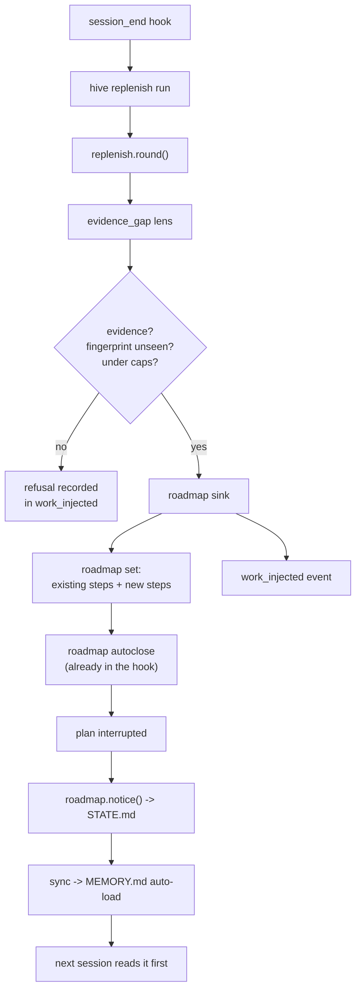

# feat: Adaptive work injection — phase 1 (core, evidence-gap lens, roadmap sink)

## Summary

Build the surface-agnostic replenishment core and its first sink. At session end,
the core asks the ledger whether work the record proves outstanding is still
unaddressed, gates each candidate on evidence, and lands survivors as steps on the
session's roadmap plan, marked `new`. The existing roadmap interruption machinery
then carries those steps into the next session's auto-loaded state.

Covers R1–R6, R10, R13, R14, R15, R16 and AE1, AE2, AE5 from the origin. The loop
sink (R11), the graph sink (R12), backpressure (R17), the relay extensions (R18,
R19), skill attribution (R20), and lenses beyond evidence-gap (R7–R9) stay in the
design and out of this plan.

---

## Problem Frame

The origin establishes the cost: 132 `code_change` events against 6 `verification`
events in this project's ledger, and nothing that turns that gap into work anyone
must act on. It also establishes why the interactive session is the first surface:
across all 54 namespaces in the store there are zero `loop_*` events.

Planning research found more already built than the origin assumed. `roadmap.py`
carries `sync_from_todos` (a session's TodoWrite state becomes a plan whose
`plan_id` is the session id), `autoclose_session` (unfinished steps at session end
become an `interrupt`), and `notice()` (every interrupted plan renders into
STATE.md, which `sync` folds into the auto-loaded MEMORY.md). The persistent home
and the forcing channel the origin asked for exist and are wired into
`hooks/session_end.ps1` today.

That reduces phase 1 to three genuinely new things: a core that decides what is
outstanding, a way to attach steps to a plan and mark them `new`, and the hook leg
that runs the core before the plan is closed.

---

## Requirements

Traced from the origin.

**Core**

- R1. Surface-agnostic decision layer — no sink knowledge in the core.
- R2. Evidence mandatory; refusals recorded with a reason.
- R3. Fingerprint dedup across rounds and sessions.
- R4. Every injection recorded with lens, evidence, score, round, fingerprint.
- R5. Reads over injection history stay total.

**Lens**

- R6. `evidence-gap` proposes work when code changed with no mechanical test
  evidence recorded since.

**Sink and marking**

- R10. Survivors land on a plan that outlives the session that created them.
- R13. Injected steps are marked `new` wherever rendered, permanently.

**Bounds**

- R14. Caps per round and per surface invocation.
- R15. A truncating cap is recorded, never silent.
- R16. Two consecutive empty rounds end replenishment for that surface.

---

## Key Technical Decisions

**Reuse the roadmap registry rather than inventing a work store.** `roadmap.py`
already gives persistence past session end, a STATE.md notice with a NEXT pointer,
an Oversee panel, and an interruption lifecycle. Building a parallel store would
duplicate all four and let them disagree.

**`plan_id` is the session id.** That is the existing convention
(`sync_from_todos`), it makes the injected steps ride the session's own Oversee
card while it is alive, and it means a session that already has a TodoWrite plan
gets its injected steps appended rather than a competing second plan.

**`new` is a fourth key on the step dict, not a text prefix or a note.** `note` is
human-facing prose and a text prefix would corrupt the step text every consumer
reads. The key threads through `_norm_steps`, the fold, `notice()`, the Oversee
API, and the roadmap panel. Steps without the key read as `new: false`, so every
historical event folds unchanged.

**The evidence-gap lens produces one candidate, not one per file.** The condition
is "the newest in-scope code change is newer than the newest passing verification".
That is a single outstanding fact; emitting 126 steps would bury the plan and blow
`MAX_STEPS`.

**The fingerprint keys on the condition instance, not the condition.** For
evidence-gap that is the timestamp of the newest covered `code_change`. Once the
suite runs, the condition clears; a later code change mints a new instance and the
lens may fire again. Keying on the bare condition name would fire once ever.

**The core writes no sidecar.** Round counters, spent fingerprints, and refusals
are recovered by folding `work_injected`. The origin requires this (R4, and R19 in
a later phase); a sidecar would be a second source of truth that drifts.

**`work_injected` is deterministic, not semantic.** It is machine-generated audit
telemetry and can be many rows; semantic membership would put a LEDGER file, a
Memory-view row, and a recall-corpus entry on disk per injection. The work itself
is already semantic — it lands as a `roadmap` event.

---

## High-Level Technical Design



The hook ordering is load-bearing: `replenish run` must precede
`roadmap autoclose` (so injected steps exist when the plan is closed) and both must
precede `project` (so the notice reaches STATE.md in the same session-end pass).

Directional shape of a round — not implementation specification:

```
round(project, session_id, surface, cfg):
    evs      = read_all(project)
    history  = fold_injections(evs)          # fingerprints, round no., dry count
    if history.dry_rounds >= cfg.dry_rounds_to_exit: return Round(skipped)
    cands    = [c for lens in enabled_lenses for c in lens(evs)]
    kept, refused = gate(cands, history.fingerprints, cfg)   # evidence, dedup, score
    kept, truncated = cap(kept, cfg.max_per_round)
    landed   = sink.land(kept)               # sink is injected, not imported
    record(landed, refused, truncated, round_no)
    return Round(...)
```

---

## Implementation Units

### U1. Register the `work_injected` event type

**Goal.** The audit row the core's state is folded from exists and is contract-checked.

**Requirements.** R4, R5.

**Dependencies.** None.

**Files.** `src/mindhive/events.py`, `docs/DATA_MODEL.md`,
`tests/test_events.py`.

**Approach.** Add `work_injected` to `DETERMINISTIC_TYPES` with the why-comment the
neighbouring entries carry, explaining the deterministic choice and the
never-merge exemption. Payload: `lens`, `title`, `evidence` (list of strings),
`score`, `round`, `fingerprint`, `surface`, `outcome` (`landed` | `refused` |
`truncated`), `reason` (present when refused), `plan_id` and `step_index` (present
when landed). Register the payload contract in `_PAYLOAD_CONTRACTS` pointing at
the new module so the raw-append surfaces enforce it. Document the type in
`docs/DATA_MODEL.md` per its §6 procedure.

**Patterns to follow.** The `verification` and `policy_denied` entries in
`events.py` — both carry a why-comment justifying deterministic membership. The
two-validator split in `verify.py` is *not* needed here; nothing about this type
is self-attestable.

**Test scenarios.**
- Appending a valid `work_injected` payload succeeds and round-trips through
  `read_all`.
- A payload missing `lens` is refused at the raw-append surface with a corrective
  hint.
- A payload whose `evidence` is present but not a list is refused.
- `refused` outcome without a `reason` is refused.

**Verification.** The type appears in `VALID_TYPES`; `hive append work_injected`
with a malformed payload exits non-zero with the hint.

---

### U2. The replenishment core

**Goal.** A module that decides what is outstanding, gates it, and hands survivors
to an injected sink — with no knowledge of which surface called it.

**Requirements.** R1, R2, R3, R4, R5, R14, R15, R16.

**Dependencies.** U1.

**Files.** `src/mindhive/replenish.py`, `tests/test_replenish.py`.

**Approach.** A frozen `Candidate` dataclass (`lens`, `title`, `evidence`, `score`,
`fingerprint`). A `gate` function that refuses any candidate with empty evidence or
a fingerprint already present in history, returning kept and refused lists with
reasons. A `history` fold over `work_injected` returning spent fingerprints, the
last round number, and the consecutive dry-round count. A `round` entry point
taking the sink as a parameter. Caps are plain integers on a small config
dataclass with defaults; when a cap truncates, the dropped count is recorded as a
`truncated` row rather than dropped silently.

The fold is total: a row whose payload is not a dict, or whose `fingerprint` is not
a string, is skipped.

**Patterns to follow.** `roadmap.fold` for the total-fold idiom;
`mindnet/decompose.py` for the "validate before anything is appended" stance and
the frozen-dataclass proposal shape.

**Test scenarios.**
- A candidate with empty evidence is refused, and the refusal carries the reason.
- Covers AE2. A candidate whose evidence pointer is an empty string is refused.
- A candidate whose fingerprint appears in a prior `work_injected` row is refused
  as a duplicate.
- Covers AE3-precursor. History folded from events alone reproduces the spent
  fingerprint set with no sidecar present.
- Covers AE5. With `max_per_round=1` and two qualifying candidates, one lands and a
  `truncated` row records the dropped count.
- Two consecutive rounds yielding zero kept candidates set the dry count to 2, and
  the third round returns without invoking any lens.
- A malformed `work_injected` row in the ledger is skipped by the fold, which
  returns normally.
- The core never imports a sink module; passing a stub sink drives a full round.

---

### U3. The evidence-gap lens

**Goal.** Turn "code changed and nothing verified it since" into one candidate with
checkable evidence.

**Requirements.** R6, R2.

**Dependencies.** U2.

**Files.** `src/mindhive/replenish.py` (lens function),
`tests/test_replenish_lenses.py`.

**Approach.** Find the newest `code_change` event and the newest `verification`
event whose recorded outcome is a pass. When the code change is newer, emit one
candidate whose title names the change-set and whose evidence carries both
timestamps and the changed file list (bounded). The fingerprint is derived from the
newest `code_change` timestamp so the candidate reappears only after new code
changes land. Emit nothing when there is no `code_change`, or when the newest
verification is newer.

A `verification` event counts as a pass only when its recorded exit code is zero.
An absent or unparsed count field does not make it a failure and does not make it a
pass — the exit code is the observed fact (`verify.py` is explicit that the stamp
attaches to the exit code, not the counts).

**Patterns to follow.** `changelog.unlogged_files` for the in-scope filter and the
"newest covering entry" comparison shape.

**Test scenarios.**
- Newest `code_change` after newest passing `verification` produces exactly one
  candidate.
- Newest passing `verification` after newest `code_change` produces none.
- A `verification` with a non-zero exit code does not count as a pass.
- A `verification` whose counts failed to parse but whose exit code is zero counts
  as a pass.
- An empty ledger produces none and does not raise.
- The candidate's evidence contains both timestamps and at least one file path.
- The fingerprint is stable across two calls on the same ledger, and differs after
  a newer `code_change` is appended.

---

### U4. Roadmap sink and the `new` step flag

**Goal.** Land survivors as steps on the session's plan, marked `new` permanently,
without disturbing existing steps or their statuses.

**Requirements.** R10, R13.

**Dependencies.** U2.

**Files.** `src/mindhive/roadmap.py`, `src/mindhive/replenish.py` (sink),
`tests/test_roadmap.py`, `tests/test_replenish_sink.py`.

**Approach.** Thread a `new` boolean through the roadmap step contract:
`_norm_steps` preserves it (defaulting to `False`), `validate_payload` accepts it
and rejects a non-boolean, the fold carries it, and `notice()` renders it inline on
the step line. The flag is never cleared by a status change — that is what
"permanent" means in R13.

The sink appends steps by re-`set`ting the plan with its existing steps plus the
new ones, preserving each existing step's text, status, note, and flag. When no
plan exists for the session, it creates one whose prompt is the session's first
`user_prompt` headline, following `_session_prompt`. Tags are
`["roadmap", "auto", "replenish"]` — `auto` is required for
`autoclose_session` to close the plan at session end.

When appending would exceed `MAX_STEPS`, the sink lands what fits and reports the
remainder to the core so U2 records a `truncated` row.

**Execution note.** Write the `new`-flag tests before threading the flag — the
change touches a fold every projection reads, and a characterization test on the
existing step shape protects it.

**Patterns to follow.** `sync_from_todos` for the upsert-with-material-change
shape; `roadmap.record` for the guard-then-append ordering.

**Test scenarios.**
- A step dict carrying `new: true` survives `_norm_steps`, the fold, and `notice()`.
- A step with no `new` key folds as `new: false` (historical events unchanged).
- `validate_payload` rejects a non-boolean `new`.
- A status change on a `new` step leaves the flag set.
- Covers AE1. The sink on a session with no plan creates one whose only step is
  marked `new` and whose prompt is the session's first prompt headline.
- The sink on a session with an existing three-step plan produces a four-step plan
  with the original three unchanged in text, status, note, and flag.
- `notice()` output for an interrupted plan visibly distinguishes a `new` step from
  an ordinary one.
- Appending past `MAX_STEPS` lands the fitting steps and reports the remainder.

---

### U5. CLI command and session-end wiring

**Goal.** `hive replenish` exists and the session-end hook runs it at the right
point in the sequence.

**Requirements.** R14, R16, and the interactive trigger.

**Dependencies.** U3, U4.

**Files.** `src/mindhive/__main__.py`, `hooks/session_end.ps1`,
`tests/test_replenish_cli.py`.

**Approach.** Add a `replenish` subcommand with `run` (execute one round for the
given session) and `status` (report the last rounds, spent fingerprints, and dry
count). `run` takes `--session` and `--dry-run`; `--dry-run` performs the full
round and prints what would land without appending anything, matching the
dry-run-is-the-default stance `mindnet decompose` takes for model-driven writes.

In `hooks/session_end.ps1`, insert the `replenish run` call **before**
`roadmap autoclose` and therefore before `project`. Keep the existing
`| Out-Null` and the surrounding `try {} catch {}` so the hook stays hang-proof
and fail-open; a replenish failure must never cost the operator their session-end
projections.

**Patterns to follow.** The `log queue` / `review queue` subcommands in
`__main__.py` for the session-scoped queue-command shape, and their lines in
`session_end.ps1` for the hook idiom.

**Test scenarios.**
- `hive replenish run --session <id>` on a ledger with an outstanding gap exits 0
  and appends both a `roadmap` and a `work_injected` event.
- `--dry-run` prints the candidate and appends nothing.
- `run` on a ledger with nothing outstanding exits 0 and appends only the round's
  dry record.
- `status` reports the dry-round count and the spent fingerprints.
- An exception inside the round is reported on stderr and exits non-zero, so the
  hook's `catch` swallows it rather than the module hiding it.

**Verification.** The `replenish` line appears in `session_end.ps1` above
`roadmap autoclose`; running the command by hand on this ledger produces the
events.

---

### U6. Render `new` in Oversee

**Goal.** The marker is visible where the operator actually looks.

**Requirements.** R13.

**Dependencies.** U4.

**Files.** `src/mindhive/dashboard.py`, `src/mindhive/dashboard_page.py`,
`tests/test_dashboard.py`.

**Approach.** Carry the step's `new` flag through the Oversee payload, and render a
`new` pill ahead of the step text in the roadmap panel's step rows. The pill uses
the existing pill styling; no new section, no new colour vocabulary.

**Patterns to follow.** `rmPanel` / `rmGlyph` in `dashboard_page.py`, and the
existing `pill` class used by `ovCard`.

**Test scenarios.**
- The Oversee API response for a plan with a `new` step carries the flag.
- The served page contains the new render hook.
- A plan with no `new` steps renders unchanged from today's output.

**Verification.** Serve the dashboard from this worktree on a side port and grep
the page for the new hook alongside `showOversee` and `renderOversee`. Port 54461
is the operator's live process and must not be touched.

---

### U7. Real-flow verification and change-log

**Goal.** Prove the feature on the real ledger, not on fixtures, and satisfy the
project's mandatory gates.

**Requirements.** All of the above.

**Dependencies.** U1–U6.

**Files.** none new.

**Approach.** Run the full suite and read the count. Run `hive replenish run`
against the live ledger for a session that changed code without a verification, and
show the resulting `work_injected` event and the roadmap step. Confirm the step
appears in `roadmap.notice()` output. Record the change-set with `hive log`.

**Test expectation: none — this unit runs existing tests and the real flow rather
than adding coverage.**

**Verification.** Full pytest green with the count reported from an observed run;
the `work_injected` event and the `new`-marked step shown from the real store; the
served page grepped; `hive log` recorded.

---

## Scope Boundaries

**In this plan.** The core, the evidence-gap lens, the roadmap sink, the `new`
flag end to end, the caps, the CLI, the hook leg, and the render.

### Deferred to Follow-Up Work

- The loop sink and the loop trigger (origin R11) — phase 3, gated on one proven
  end-to-end `hive loop` run.
- The graph sink (origin R12) — phase 4.
- The `repair`, `caveat`, `debt`, `audit`, and `coverage` lenses (origin R7, R8) —
  phase 2 and 4.
- Model-driven lenses and their parallel agents (origin R9) — phase 4.
- Threshold backpressure (origin R17) — phase 2. Phase 1 ships a fixed
  `min_score`.
- Relay extensions carrying injector state and the `new` flag through
  `steps_from_plan_items` (origin R18, R19) — phase 2, because the loop path that
  consumes them is phase 3.
- Injector-directed skills and the `source` field on `skill_directed` (origin R20)
  — phase 4.

**Non-goals.** No change to the Stop hook or the rotation machinery. No injection
across project namespaces. No new Oversee section.

---

## Risks & Dependencies

**The `new` flag touches a fold every projection reads.** `roadmap.fold` feeds the
Oversee API, the STATE.md notice, and the loop interruption snapshot. The
mitigation is the characterization test in U4's execution note plus the
default-false rule that keeps historical events folding unchanged.

**Hook ordering is silent when wrong.** If `replenish run` lands after
`roadmap autoclose`, the injected steps exist but the plan is already closed and
the notice never renders them. U5's verification checks the file, not just the
behaviour.

**The session-end hook is on every session on this machine.** It is already
fail-open; the new leg must stay inside the existing `try {} catch {}` and must not
add a blocking wait.

**A cap set too low reads as "nothing found".** R15 exists for this; U2's
truncation row is the mitigation and has its own test.

---

## Open Questions

**Deferred to implementation.**

- Whether `status` renders as text or JSON by default; follow whichever the
  neighbouring `hive` subcommands do.
- The exact default for `max_per_round`. Start at a small number and let the phase
  2 backpressure work tune it.

---

## Sources & Research

- Roadmap registry, session auto-sync, autoclose, and the STATE.md notice:
  `src/mindhive/roadmap.py`.
- Session-end hook sequence: `hooks/session_end.ps1`.
- Mandatory-gate marker pattern to mirror: `src/mindhive/changelog.py`.
- Mechanical verification contract and the exit-code-not-counts rule:
  `src/mindhive/verify.py`.
- Event registry and payload-contract dispatch: `src/mindhive/events.py`.
- Untrusted-proposal validation stance: `src/mindhive/mindnet/decompose.py`.
- Oversee render path: `src/mindhive/dashboard_page.py`.
- Module ownership map: `docs/session-legend.md`; store contract:
  `docs/DATA_MODEL.md`.
