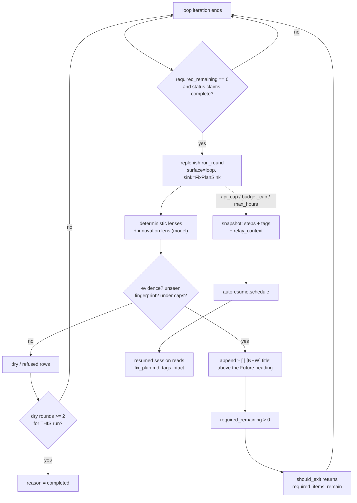

# feat: The loop sink, the model lens, and the estafet (phase 3)

## Summary

Give the headless loop the same replenishment mechanism the interactive session
already has: when its checklist empties, a round runs, and anything that lands
becomes an unchecked required item — which the exit gate already refuses to pass.
Add the model-driven lens that proposes innovation and repair work, carry the
provenance tag through the interruption snapshot into the resumed session, and
show the expansion on Oversee.

This is the operator's "Adaptive Forced-Injection Loop with Estafet" master
prompt, mapped onto the mechanism built in phase 1 rather than rebuilt beside it.

---

## Problem Frame

The master prompt asks for `loop/injector.py`, a `task_injected` event, and
`[NEW]` markdown prefixes as a new provenance vocabulary. Phase 1 already shipped
the equivalents: `replenish.py` decides (surface-agnostic, sink as a parameter),
`work_injected` is the audit row, and roadmap steps carry a `new` boolean that
five renderers now read through one shared helper.

Building the master prompt literally would put two injectors, two audit event
types, and two provenance markers in one codebase — the same "two contradictory
designs" hazard that had to be removed from `docs/` earlier today. The outcome
the master prompt describes is reachable with one mechanism; that is what this
plan builds.

**Two facts constrain the sequencing, and both are checkable.**

`hive loop` has never recorded a run. A fold over all 54 namespaces in
`~/.mindhive` returns zero `loop_run_start`, `loop_iteration` and `loop_run_end`
events. Everything in this plan attaches to a surface that has never carried
work, so the plan opens by proving the surface runs at all.

The master prompt's own verification commands do not exist.
`hive loop run --force --max-iterations 2` fails to parse — verified:
`argument loop_cmd: invalid choice: 'run' (choose from init, status)`. The runner
is `hive loop` with no subcommand; iteration limits live in
`.hive-loop/loop.toml`, not on the command line. Its UI check also targets the
live dashboard on port 54461, which `CLAUDE.md` forbids for previewing unmerged
work — that rule exists because doing it once made the whole Oversee section
vanish.

---

## Requirements

From the origin PRD, plus the master prompt's components.

**The loop surface**

- R11. The loop sink appends survivors to the run's required checklist so the
  exit gate refuses to exit while any remains.
- MP-2.1. `fix_plan.md` items carry a provenance tag, parsed rather than
  displayed raw. Untagged items behave exactly as today.
- MP-2.2. A model-driven lens proposes edge cases, missing coverage,
  parameterisation, and fixes for recorded tool failures. Bounded per round.

**The relay**

- R18. On `api_cap`, `budget_cap` or `max_hours` the open plan is marked
  interrupted with its remaining steps, provenance preserved, and delivery
  scheduled.
- R19. Injector state needed to resume is derivable from the injection events
  alone.
- MP-2.4. The interruption record carries a `relay_context`, and a resumed
  session is told it is resuming a loop and what was outstanding.

**The view**

- R13. Injected steps are marked wherever rendered, permanently.
- MP-2.3. Oversee strips the tag from the display text, shows it as a badge, and
  the card carries an injected count.

---

## Key Technical Decisions

**One injector, one audit event, one marker.** `work_injected` already records
lens, evidence, score, round, fingerprint and outcome; a `task_injected` event
would duplicate it and split the fold that recovers the injector's state.
`[NEW]` in `fix_plan.md` is the loop surface's *serialisation* of the same fact
the roadmap step's `new` boolean carries — the tag is parsed at the boundary and
becomes that flag, so the five renderers wired in phase 1 need no new cases.

**The forcing mechanism is the count, not the tag.** An unchecked item before the
`Future` heading raises `task.required_remaining_count`, and
`safeguards.should_exit` already returns `required_items_remain`. The tag is
provenance for humans; the count is what makes the loop continue. Nothing in the
prompt text asks an agent to keep going (SOP `agentic-loops` §1).

**The dry-round exit belongs here, and needs the scope fix first.** Phase 1
shipped it defaulting off because a session runs one round and nothing could
reset the counter. A loop runs rounds back to back, so this is the surface it was
designed for — but the streak still folds over the surface's whole history, so
the first run recording two dry rounds would disable `surface="loop"`
project-wide forever. Scoping it to `run_id` is a prerequisite of enabling it,
not a follow-up.

**The model lens is a lens, not a second engine.** It registers in the existing
`LENSES` map and returns `Candidate`s, so it inherits the value gate, the
fingerprint dedup, the caps, the normalisation, and the lens-error channel
already built. `reason` is nullable per SOP `prompt-structured-output` §2 —
requiring a field the model cannot fill is hallucination by schema design.

**`progress.py` must learn to name what changed.** `MtimeTracker.changed()`
returns a bool. The lens needs the changed paths to say anything useful, so the
tracker gains a method that reports them. This is a real gap in the master
prompt's assumption, not a detail.

**Parallel delegation is deferred, and the reason is evidence.** Master prompt
component 2.5 routes isolated tasks to `mindnet/orchestrator.py`. The MindNetwork
task graph holds exactly one row across the entire store, in a namespace named
`mn18-demo`. Building loop orchestration on it would repeat precisely the mistake
this project's phase ordering was rewritten to avoid.

---

## High-Level Technical Design

The `[NEW]` tag survives three hops that each drop it today: the parse in
`task.plan_items`, the conversion in `roadmap.steps_from_plan_items`, and the
prompt built by `autoresume.resume_prompt`. All three are in scope.

---

## Implementation Units

### U1. Prove the loop runs end to end

**Goal.** Establish that `hive loop` completes a real run before anything is
built on it.

**Requirements.** Prerequisite for every unit below.

**Dependencies.** None.

**Files.** none — this unit produces evidence, not code.

**Approach.** Scaffold a throwaway repo with `hive loop init`, give
`fix_plan.md` one trivial checkable item and `AGENT.md` a real test command, set
a small `max_iterations` in `loop.toml`, and run `hive loop --force` against an
isolated `MINDHIVE_HOME`. Read the ledger and confirm the event sequence.

If the run cannot complete, this plan stops here and the failure becomes its own
work — building an injector onto a loop that does not run would produce untested
code attached to nothing.

**Test expectation: none — this unit runs the real flow rather than adding
coverage.**

**Verification.** `loop_run_start`, at least one `loop_iteration`, and
`loop_run_end` present in an isolated store, with the run's `reason` read from
the event rather than inferred. Record the observed sequence.

---

### U2. Parse provenance tags in the loop checklist

**Goal.** `fix_plan.md` items carry a tag through every consumer instead of
being raw text.

**Requirements.** MP-2.1, R13.

**Dependencies.** U1.

**Files.** `src/mindhive/loop/task.py`, `src/mindhive/loop/state.py`,
`src/mindhive/roadmap.py`, `tests/test_loop_task.py`,
`tests/test_loop_state.py`.

**Approach.** `plan_items` returns per-item dicts (`text`, `tag`, `status`)
instead of bare strings. An untagged item yields `tag: None` and text unchanged,
so every historical `fix_plan.md` parses exactly as before.
`required_remaining_count` keeps counting unchecked pre-`Future` items and does
not care about tags.

Every consumer moves together, because the shape change is the risk:
`loop.state._fix_plan_items` (feeds the Oversee card),
`roadmap.steps_from_plan_items` (feeds the interruption snapshot, and is where
the tag becomes the roadmap step's `new` flag), and
`engine._snapshot_interrupted_plan`.

Recognised tags: `NEW`, `INNOVATION`, `FIX:<signature>`, `PARALLEL`. An
unrecognised bracket prefix is left in the text rather than swallowed — silently
eating an unknown tag would hide a typo'd one forever.

**Execution note.** Characterisation-first: pin the current string-list return
and the existing consumers before changing the shape.

**Patterns to follow.** `roadmap._norm_steps`, which added a key with a safe
default so historical events fold unchanged.

**Test scenarios.**
- An untagged item parses with `tag: None` and its text intact.
- `- [ ] [NEW] title` parses to `tag: "NEW"`, `text: "title"`.
- `- [ ] [FIX:lens:evidence-gap] title` parses the full signature.
- An unrecognised prefix like `- [ ] [WAT] title` keeps the bracket in the text.
- A tagged item under the `Future` heading lands in `not_yet`, not `planned`.
- `required_remaining_count` is unchanged by the presence of tags.
- Covers R13. A `[NEW]` item reaching `steps_from_plan_items` produces a roadmap
  step with `new: True`.
- An item whose text itself contains a bracket later in the line is untouched.

**Verification.** The existing loop and roadmap suites stay green with no
assertion loosened; the new parse cases pass.

---

### U3. The fix-plan sink

**Goal.** Land survivors as required checklist items so the exit gate refuses to
exit.

**Requirements.** R11.

**Dependencies.** U2.

**Files.** `src/mindhive/replenish_sinks.py`, `tests/test_replenish_sink.py`.

**Approach.** A `fix_plan_sink(loop_dir, run_id, append=True)` beside
`roadmap_sink`, same contract: called with kept candidates, returns
`(placements, dropped)`. It builds the absolute path from `loop_dir` and refuses
to write if the file is absent (SOP `tool-failure-prevention` §3 — never rely on
cwd). Lines are inserted immediately before the first `Future`/`Optional`
heading, or appended when there is none, so deferred items stay deferred.

Writes go through `paths.write_text_atomic`, and the known Windows
`PermissionError` on the destination is handled — a half-written `fix_plan.md`
would corrupt the loop's only source of required work.

Placements carry `plan_id = run_id` and the item's index in the required list.

**Patterns to follow.** `replenish_sinks.roadmap_sink` for the sink contract and
the `append=False` preview flag; `loop.task._FUTURE_HEADING` for the boundary.

**Test scenarios.**
- Two candidates append two `- [ ] [NEW] …` lines and `required_remaining_count`
  rises by two.
- Covers R11. After landing, `safeguards.should_exit` with a completing status
  returns `(False, "required_items_remain")`.
- Existing `Future`/`Optional` items are still present and still under the
  heading afterwards.
- A file with no `Future` heading appends at the end.
- A missing `fix_plan.md` returns everything as dropped and writes nothing.
- `append=False` computes identical placements and leaves the file byte-identical.
- A title containing a newline or a checklist marker cannot break the file
  structure.

**Verification.** A real `.hive-loop` directory before and after, with
`required_remaining_count` read from the file.

---

### U4. Wire the loop trigger, and scope the dry streak

**Goal.** The loop runs a replenishment round instead of exiting, and the exit
that ends it is bounded to the run.

**Requirements.** R11, R16.

**Dependencies.** U3.

**Files.** `src/mindhive/loop/engine.py`, `src/mindhive/replenish.py`,
`tests/test_loop_engine.py`, `tests/test_replenish.py`.

**Approach.** In `run_loop`, when `should_exit` returns done with reason
`completed`, run a round on `surface="loop"` with the fix-plan sink before
honouring the exit. Anything landed means the run continues; the breaker is
closed, because finding evidence-backed work IS progress and letting the
no-progress counter trip here would kill the feature it exists to protect.

The breaker gains a public `reset()` rather than the engine calling `_close()`
across the module boundary.

**The streak scope is part of this unit, not a follow-up.** `history` gains a
`run_id` filter and `run_round` passes it, so a dry streak belongs to one run. As
it stands the streak folds over the surface's whole history and only a landed row
resets it — enabling the exit for `surface="loop"` without this would disable the
loop surface project-wide after the first run that went quiet twice.

The round's config for this surface sets `dry_rounds_to_exit = 2` and reads its
caps from a `[replenish]` section in `loop.toml`.

**Execution note.** Test-first on the exit-overturn: the assertion that a run
with an injected item does not end is the whole feature.

**Patterns to follow.** The existing `run_loop` control flow and its
`heuristic_blocked` handling, which already distinguishes "responsive but not
finished" from "stuck".

**Test scenarios.**
- A run whose checklist empties and whose round injects one item does not end;
  the next iteration sees `required_remaining == 1`.
- A run whose round injects nothing ends with `reason == "completed"`.
- Two consecutive dry rounds in one run end it; a *different* run starts with a
  clean streak.
- Injecting resets the breaker's no-progress counter.
- An injector exception does not end the run abnormally — the run completes and
  the failure is recorded.
- `loop_iteration` events still bracket every iteration, including the ones after
  an injection.
- The round is not run when the exit reason is anything other than `completed`.

**Verification.** A scripted run with a stub driver, asserting the iteration
count and the terminal `reason` from the ledger.

---

### U5. The innovation lens

**Goal.** A model-driven lens that proposes work the deterministic lenses cannot
see, bounded and untrusted.

**Requirements.** MP-2.2, R9.

**Dependencies.** U4.

**Files.** `src/mindhive/replenish.py` (lens), `src/mindhive/loop/progress.py`,
`tests/test_replenish_lenses.py`, `tests/test_loop_progress.py`.

**Approach.** A lens registered in `LENSES` that gathers the run's prompt, the
paths `MtimeTracker` reports as changed, recent `tool_failed` rows, and the
completed checklist items; asks a model through `claude_cli.run_headless` on a
light tier; and parses tolerantly (find the first `{` and last `}`, as
`mindnet/decompose.parse` does) into `Candidate`s.

`MtimeTracker` gains a method returning the changed paths. `changed()` keeps its
boolean contract so the engine's progress detection is untouched.

Bounds: at most five proposals per round, evidence mandatory (the changed paths
and failure signatures the proposal rests on), `reason` nullable. A proposal
with no evidence is refused by the gate that already exists, not by new code.

Every failure mode returns no candidates and records the lens error through the
channel built in phase 1 — an unparseable reply must read as "the lens failed",
never as "the system is robust".

**Patterns to follow.** `mindnet/decompose.py` end to end: the untrusted-output
stance, the tolerant parser, the refusal-with-reason shape.

**Test scenarios.**
- A stub runner returning two proposals yields two candidates with evidence.
- A reply wrapped in markdown fences parses.
- An empty `injected_tasks` list yields no candidates and no error.
- Unparseable output yields no candidates and one recorded lens error.
- A timeout or non-zero exit from the runner yields no candidates and one error.
- More than five proposals are truncated to five and the truncation is recorded.
- A proposal with `reason: null` is accepted; one with no title is skipped.
- A proposal whose evidence is empty is refused by the value gate.
- `MtimeTracker` reports the changed paths and `changed()` still returns a bool.

**Verification.** The lens registered in `LENSES`, driven by a stub runner
through a full `run_round`.

---

### U6. The estafet

**Goal.** An interrupted run hands the baton on with its injected work and its
provenance intact.

**Requirements.** R18, R19, MP-2.4.

**Dependencies.** U4.

**Files.** `src/mindhive/loop/engine.py`, `src/mindhive/roadmap.py`,
`src/mindhive/autoresume.py`, `tests/test_loop_engine.py`,
`tests/test_autoresume.py`.

**Approach.** `_snapshot_interrupted_plan` already fires on `api_cap` and
`budget_cap`; `max_hours` joins them, because a run that ran out of wall clock
has exactly the same unfinished plan. The steps it builds carry the `new` flag
from U2's parse. The roadmap payload gains `relay_context` — what the run was
doing when it stopped, in one bounded string — which `roadmap.validate_payload`
must accept and cap like its neighbours.

`autoresume.resume_prompt` gains a leading paragraph when the interrupted plan
came from a loop: that this is a resumed run, what stopped it, and that steps
marked `(new)` were added by the injector rather than planned. The marker itself
already renders — that was fixed in phase 1.

`fix_plan.md` is left untouched on interrupt, so the resumed agent parses the
same file with the same tags.

**Test scenarios.**
- Covers R18. A run ending in `api_cap` with an injected item produces a roadmap
  `interrupt` whose steps keep the `new` flag.
- The same holds for `budget_cap` and for `max_hours`.
- `relay_context` is present, non-empty, and within the contract cap.
- An oversized `relay_context` is rejected by `validate_payload` rather than
  silently truncated into the ledger.
- Covers R19. The injector's spent fingerprints for the run are recoverable from
  the injection events alone after the process ends.
- `resume_prompt` for a loop-origin plan names the stop cause and the `(new)`
  convention; for a session-origin plan it is unchanged.
- `fix_plan.md` is byte-identical before and after the interrupt snapshot.
- A snapshot failure still lets `loop_run_end` be written — the run must never be
  stranded as running.

**Verification.** A run driven to `budget_cap` against an isolated store, with
the `roadmap` payload and the `autoresume` record read from the ledger.

---

### U7. Show the expansion on Oversee

**Goal.** The operator sees the loop growing its own plan.

**Requirements.** MP-2.3, R13.

**Dependencies.** U2.

**Files.** `src/mindhive/loop/state.py`, `src/mindhive/dashboard_page.py`,
`tests/test_replenish_dashboard.py`.

**Approach.** `state.list_runs` folds `work_injected` rows by `run_id` into an
`injected_count` on the run record, skipping malformed rows — the fold stays
total. The step text reaching the card keeps its tag; the client strips it and
renders a badge, escaping the text and emitting only the badge as markup. The
card gains an injected-count pill.

**Patterns to follow.** The `new` pill added to `rmPanel` in phase 1, and
`ovCard`'s existing pill construction.

**Test scenarios.**
- A run with three `work_injected` landed rows shows `injected_count: 3`.
- Rows for a different `run_id` do not count toward it.
- A malformed `work_injected` row is skipped and the fold returns normally.
- A run with no injections carries no pill.
- The served page contains the badge hook.
- A step text containing HTML is escaped; the badge is the only markup.
- An untagged step renders exactly as it does today.

**Verification.** The dashboard served from this worktree on a side port —
**never 54461**, which is the operator's live process — and the page grepped for
the badge hook alongside `showOversee` and `renderOversee`.

---

### U8. Real-flow verification and change-log

**Goal.** Prove the whole chain on a real run, and satisfy the project's gates.

**Requirements.** All of the above.

**Dependencies.** U1–U7.

**Files.** none new.

**Approach.** Full suite green with the count read from an observed run. A real
`hive loop --force` (not `hive loop run`, which does not parse) against an
isolated store, with a `fix_plan.md` that empties, showing the injection, the
refused exit, and the continued run. A second run configured with
`window_cost_budget_usd = 0.01` to hit the cap and produce the relay. Then
`hive log`.

**Test expectation: none — this unit exercises the real flow.**

**Verification.** The observed event sequence, the `fix_plan.md` before and
after, the roadmap `interrupt` payload, the `autoresume` record, the grepped
page, and the change-log entry.

---

## Scope Boundaries

**In this plan.** Tag parsing through every consumer, the fix-plan sink, the loop
trigger with a run-scoped dry streak, the innovation lens, the estafet with
`relay_context`, and the Oversee badge and count.

### Deferred to Follow-Up Work

- Master prompt component 2.5 — parallel delegation to `mindnet/orchestrator.py`
  for `[PARALLEL]` tasks. The tag is parsed by U2 so nothing has to change later,
  but the orchestrator is not wired: the task graph holds one row across the whole
  store. Revisit when the graph carries real work.
- The graph sink (origin R12) — same reason.
- Hoisting the per-round ledger passes. Measured at ~38ms against a ~250–400ms
  base; worth doing when several lenses each add a pass, not before.

**Non-goals.** No second injector, no `task_injected` event, no second provenance
marker. No change to the Stop hook or the rotation machinery. No use of the live
dashboard on port 54461 for any verification step.

---

## Assumptions

Recorded because this plan was written in pipeline mode without a confirmation
round. Each is a bet a reviewer can overturn.

- The master prompt's `task_injected` is satisfied by the existing
  `work_injected`, and its `[NEW]` prefix by the existing `new` step flag. If the
  operator specifically wants the two names in the ledger, that is a rename, not
  a second mechanism.
- `[PARALLEL]` is parsed but not acted on in this plan.
- The innovation lens runs on the light or mid tier, not Opus, per the master
  prompt's own routing guidance.
- The loop surface enables the dry-round exit at 2, matching the master prompt's
  "two consecutive evaluations yield no viable tasks".

---

## Risks & Dependencies

**U1 may fail, and that is the point.** `hive loop` has never run. If it cannot
complete a trivial run, every unit after it is building on an assumption.

**The `plan_items` shape change touches three consumers at once.** The Oversee
card, the interruption snapshot and the engine all read it. U2's
characterisation-first note exists for this.

**Enabling the dry exit without the run scope would be worse than not enabling
it.** It would silently disable the loop surface project-wide after one quiet
run. The two changes ship together in U4.

**The injector spends model calls inside a loop that is already spending them.**
The caps and the light tier bound it, but a lens that fires every round on a long
run is a real cost the operator should be able to see — which is what U7's count
is for.

---

## Open Questions

**Deferred to implementation.**

- Whether `relay_context` is free text or a small structured record. Start with
  the bounded string the contract can validate; structure it if a reader needs
  more.
- Whether the innovation lens should see file *contents* or only paths. Paths
  first — contents are a context-budget decision better made with a real run's
  numbers in hand.

---

## Sources & Research

- Exit gate and the required-items rule: `src/mindhive/loop/safeguards.py`,
  `src/mindhive/loop/engine.py`, `src/mindhive/loop/task.py`.
- Checklist scaffold and the `Future / Optional` boundary:
  `src/mindhive/loop/scaffold.py`.
- Progress detection, and its boolean-only contract:
  `src/mindhive/loop/progress.py`.
- The phase 1 mechanism this maps onto: `src/mindhive/replenish.py`,
  `src/mindhive/replenish_sinks.py`.
- Untrusted-model-output stance to reuse: `src/mindhive/mindnet/decompose.py`.
- Relay legs: `src/mindhive/roadmap.py`, `src/mindhive/autoresume.py`.
- Oversee projection and render: `src/mindhive/loop/state.py`,
  `src/mindhive/dashboard_page.py`.
- Store contract and the event-type procedure: `docs/DATA_MODEL.md`; module map:
  `docs/session-legend.md`.
- Zero-loop-runs and one-task-graph-row counts: folded from the live store on
  2026-08-05 across all 54 namespaces.
- `hive loop run` non-existence: verified by running it; the parser rejects the
  subcommand.
