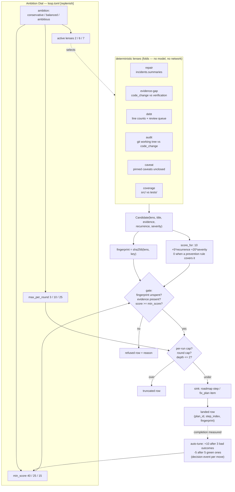

# feat: The remaining lenses, the scoring gate, and the Ambition Dial (phase 4)

## Summary

Phase 1 shipped the replenishment core with one lens and one sink. Phase 3
(`docs/plans/2026-08-05-002-feat-loop-sink-and-estafet-plan.md`) plans the loop
sink, the loop trigger, the model-driven innovation lens, the estafet and the
Oversee badge.

This plan covers everything the operator's master execution prompt asks for that
neither of those two touches: the five remaining deterministic lenses, a real
scoring algorithm behind the value gate, content-addressed fingerprints, the
Ambition Dial that configures all of it, the measured auto-tuning that moves the
threshold, the run-scoped injection bounds, and the honest trail for a skill the
injector directed.

The mechanism does not change. Every unit here plugs into the `LENSES` registry,
the `Candidate` shape, `refusal_reason`, and the `work_injected` audit row that
already exist.

---

## Problem Frame

The injector currently proposes one thing: "the suite has not run since the last
code change". That is one of seven questions the master prompt asks it to ask,
and it is the only one the ledger can answer today.

Three gaps make the rest unreachable rather than merely unwritten.

**There is no scoring.** `Candidate.score` defaults to `1.0` and
`ReplenishConfig.min_score` to `0.5`, so the gate's score branch has never
rejected anything — a candidate either has evidence or it does not. The master
prompt's ranking (base 10, +5 per recurrence, +20 for a blocking incident, 0 when
a prevention rule already covers the signature) is what lets six lenses coexist
without burying the plan, and it does not exist.

**Fingerprints are hand-built strings.** `evidence_gap` returns
`f"evidence-gap:{newest_ts}"`. That works for one lens whose condition instance is
a timestamp. A debt lens keyed on a file path and a line count, or a repair lens
keyed on a failure signature, each invent their own convention, and two lenses
that disagree about what "the same condition" means break the dedup that is the
injector's only guard against re-proposing spent work.

**There is no configuration surface.** `ReplenishConfig` is constructed with its
defaults at every call site. Nothing reads `loop.toml`, so an operator cannot make
the injector quieter or bolder, and the auto-tuning the PRD requires (R17) has
nowhere to write its adjustment.

**One checkable premise, stated because it reorders the work.** `hive loop` has
never recorded a run — a fold across all namespaces in `~/.mindhive` returns zero
`loop_run_start` events, and the PRD records the same count. Everything in this
plan therefore lands on the **session** surface first, where 27k events already
live, and the loop surface inherits it through the config path when phase 3's
trigger arrives. No unit here depends on a loop run existing.

---

## Requirements

Master-prompt components are cited as `MP-<n>`; PRD requirements as `R<n>` from
`docs/brainstorms/2026-08-05-adaptive-work-injection-requirements.md`.

**Lenses**

- R7 / MP-2.1.1. The `repair` lens proposes work for a recurring failure
  signature with no resolution and no prevention rule.
- R8 / MP-2.1.5. The `caveat` lens proposes work from pinned caveats that nothing
  has closed.
- R8 / MP-2.1.3. The `debt` lens proposes work for files past the size threshold
  and files sitting in the thermo-nuclear review queue.
- R8 / MP-2.1.4. The `audit` lens proposes work for source files edited in the
  working tree with no `code_change` entry covering them.
- R8 / MP-2.1.6. The `coverage` lens proposes work for source modules with no
  test counterpart.

**Scoring and identity**

- MP-2.2. A candidate's score is computed, not assumed: base, plus recurrence,
  plus severity, dropped to zero when a prevention rule already covers the
  signature.
- MP-2.2. The value gate admits candidates at or above a threshold the Ambition
  Dial sets.
- MP-2.2. A candidate's fingerprint is a SHA-256 over `(lens, evidence)` so every
  lens identifies a condition instance the same way.

**Configuration**

- MP-7.1 / MP-7.2. A `[replenish]` section in `loop.toml` carries `enabled` and
  `ambition` ∈ {conservative, balanced, ambitious}, and the ambition level sets
  the threshold (40 / 25 / 15), the active lens set (2 / 6 / 7 lenses) and the
  per-round cap (3 / 10 / 25).
- R17 / MP-7.3. The threshold moves with the measured outcome of previously
  injected work, in bounded steps, and every move is recorded.

**Bounds**

- R14 / MP-6.2. Injection is capped per run and by round count, and injected work
  may not inject beyond depth 2.
- R15. A cap that truncates is recorded.

**Attribution**

- R20 / MP-5. A direction the injector issues is recorded before the invocation,
  identifies the injector as its source, and renders as recorded fact — never a
  synthesized motive, never attributed to the prompt gate.

---

## Key Technical Decisions

**Scores become integers on the master prompt's scale, and `min_score` becomes
the threshold.** The existing `score: float = 1.0` field and
`ReplenishConfig.min_score: float = 0.5` are kept as the same fields with new
values, not replaced. `refusal_reason` already compares `candidate.score <
cfg.min_score` and records the reason; that comparison is exactly the value gate
the master prompt describes. Introducing a second `threshold` field beside
`min_score` would leave two numbers that must agree, and the failure when they
drifted would be silent — work that stopped being proposed. The `evidence-gap`
lens's implicit `1.0` becomes an explicit computed score so it competes on the
same scale as the newcomers.

**The scoring lives in the core, keyed off what the lens declares — not inside
each lens.** A lens returns its evidence, a `recurrence` count and a `severity`
flag; `replenish.score_for(...)` turns those into a number. Six lenses each
implementing "base 10, +5 per repeat" is six places for the arithmetic to drift,
and the auto-tuner has to reason about one formula, not six.

**A prevention rule zeroes the score rather than suppressing the candidate.**
Returning nothing would make "we already have a rule for this" indistinguishable
from "the lens found nothing", and the dry-round exit reads exactly that
distinction. A zero score is refused by the gate that already exists, and the
refusal row records the reason — so `hive replenish status` can show that the
repair lens is working and being correctly declined.

**Fingerprints are `sha256(lens + "\x00" + evidence_key)`, and the lens supplies
the key.** Content-addressing removes the per-lens convention, but the *choice of
what to hash* stays with the lens because only the lens knows what a condition
instance is: for `repair` it is the failure signature, for `debt` the path plus
its size bucket, for `evidence-gap` the newest covered timestamp. Hashing the
whole evidence list would be wrong — evidence carries incidental detail (a
changed-file sample) that varies while the condition holds, and the fingerprint
would never dedup.

**Existing spent fingerprints are not migrated.** The store already holds
`evidence-gap:<ts>` strings. Rewriting history is forbidden by the ledger
contract, and a compatibility shim that recognised both forms would carry
forever. The one-time cost is that a condition proposed under the old scheme may
be proposed once more under the new one — bounded, visible in the audit rows, and
cheaper than a permanent dual-format reader.

**The Ambition Dial is read where the surface's config already lives.**
`loop.toml` for the loop surface via `loop/config.py`; for the interactive
session, `hive replenish run` gains explicit flags plus the same `[replenish]`
section read from the project's `.hive-loop/loop.toml` when one exists. The
session surface has no config file of its own, and inventing one would be a
second place to look.

**Auto-tuning measures roadmap step completion, not self-report.** The PRD is
explicit that completion is already recorded per roadmap step (R17). The tuner
folds `work_injected` landed rows, follows each `plan_id`/`step_index` into
`roadmap.fold`, and asks whether that step reached `done`. A `decision` event
records each move, which is the transparency the master prompt asks for and is a
type that already exists — no new event type is needed.

**Injector-directed skills reuse `skill_directed` with a new `source` field, and
`_skill_why` branches on it.** The event type, the consume-once pairing, and the
trail render already exist. A `source` field defaulting to the prompt gate keeps
every historical row folding unchanged, and `_skill_why`'s honesty ordering is
preserved: the invocation args still win, and the injector branch produces
`"directed by autonomous replenish loop"` — a recorded fact, not a motive.

---

## High-Level Technical Design

The five new lenses, the scorer, the fingerprint helper, the dial, the tuner and
the bounds are the work. Everything drawn below `GATE` already exists.

---

## Implementation Units

### U1. Content-addressed fingerprints

**Goal.** One way to identify a condition instance, used by every lens.

**Requirements.** MP-2.2 (fingerprinting).

**Dependencies.** None.

**Files.** `src/mindhive/replenish.py`, `tests/test_replenish.py`.

**Approach.** A `fingerprint(lens, key)` helper returning a hex SHA-256 over the
lens name and the caller-supplied key, joined by a separator that cannot occur in
either. `evidence_gap` moves onto it, keying on the newest covered `code_change`
timestamp — the same condition instance it keys on today, expressed the shared
way.

The helper is a pure function so a test can assert the exact digest for a known
input rather than only that two calls agree.

**Execution note.** Characterisation-first: pin `evidence_gap`'s current
fingerprint behaviour (fires once per newest-change timestamp, re-fires after a
later change) before swapping the string for the digest, so the migration is
proven not to change *when* the lens fires.

**Patterns to follow.** `src/mindhive/signature.py` for the project's existing
stance on deriving a stable key from a failure.

**Test scenarios.**
- The same `(lens, key)` yields the same digest across calls.
- Two different lenses with an identical key yield different digests — the lens
  name is inside the hash, not a prefix on it.
- A key containing the separator character cannot collide with a different
  `(lens, key)` split.
- An empty key raises rather than producing a digest — a lens that cannot name
  its condition instance is a defect, and a silent digest would dedup unrelated
  conditions together.
- Covers the migration: `evidence_gap` still emits exactly one candidate per
  newest-change timestamp, and a later `code_change` produces a different
  fingerprint.
- Non-ASCII in the key is hashed deterministically (explicit encoding, not
  platform default).

**Verification.** The full replenish suite green with the digest in place, and
`hive replenish status --dry-run` showing the new fingerprint form.

---

### U2. The scoring gate

**Goal.** A candidate's admission is decided by a computed number, not by
presence of evidence alone.

**Requirements.** MP-2.2 (scoring, threshold).

**Dependencies.** U1.

**Files.** `src/mindhive/replenish.py`, `tests/test_replenish.py`.

**Approach.** `Candidate` gains `recurrence: int = 0` and `severity: bool = False`
— what the lens observed, not what it concluded. `score_for(candidate,
rule_covered)` returns `0` when a prevention rule covers the candidate's
signature, else `BASE + RECURRENCE_STEP * recurrence + (SEVERITY_BONUS if
severity else 0)` with the master prompt's constants named at module level.

`ReplenishConfig.min_score` moves from `0.5` to the balanced threshold. The
existing `refusal_reason` comparison is unchanged — this unit gives it numbers
worth comparing.

Scoring happens in `gate`, immediately after `normalise`, so a lens cannot ship a
number the core did not compute. `Candidate` is frozen, so `gate` rebuilds the
candidate with its computed score rather than mutating it.

**Execution note.** Test-first on the ordering: the assertion that a rule-covered
candidate is refused with the rule reason *before* the score reason is the whole
behaviour.

**Patterns to follow.** `refusal_reason`'s existing ordered-reasons structure and
its docstring explaining why the order is not arbitrary.

**Test scenarios.**
- A candidate with no recurrence and no severity scores the base value.
- Three recurrences add three steps.
- A severity flag adds the severity bonus, and stacks with recurrence.
- A candidate whose signature is covered by a prevention rule scores zero and is
  refused, with a reason naming the rule — not the generic below-threshold text.
- A candidate scoring exactly the threshold is admitted; one a single point below
  is refused.
- Covers R15. Raising the threshold above every candidate's score produces a
  round that is `dry` — no landed rows, and the dry outcome is recorded when the
  surface consumes it.
- A lens that sets `score` directly has that value overwritten by the computed
  one.
- A negative or absurd `recurrence` from a malformed lens is clamped rather than
  producing a negative score.

**Verification.** A round driven with stub lenses at known recurrence/severity
values, asserting the admitted set from the ledger rows rather than the return
value alone.

---

### U3. Ledger lenses: repair and caveat

**Goal.** Two lenses whose evidence is entirely inside the event store.

**Requirements.** R7, R8, MP-2.1.1, MP-2.1.5.

**Dependencies.** U2.

**Files.** `src/mindhive/replenish.py`, `tests/test_replenish_lenses.py`.

**Approach.** `repair` folds `incidents.summaries(project)`, which already
resolves a failure signature's occurrence count, status, and its
`prevention_rule` field. A signature with occurrences at or above the incident
threshold and an empty `prevention_rule` becomes a candidate whose `recurrence`
is the occurrence count and whose `severity` is set when the incident's status
marks it blocking. Evidence is the signature plus the occurrence count plus the
incident file path.

`caveat` folds `caveat` events tagged `pinned` and drops any whose text is
matched by a later `experiment_result` or `code_change` referencing it. The
matching rule is deliberately conservative — a pinned caveat with no closing
evidence stays open, because a false "still open" costs one refused candidate and
a false "closed" loses a safety-critical note. `recurrence` is how many times the
caveat has been re-appended; `severity` is always true for a pinned caveat, which
is what pinning means.

Both lenses take `evs` like every existing lens and read nothing from disk beyond
what `incidents` already reads.

**Patterns to follow.** `evidence_gap`'s shape end to end: one candidate per
condition instance, evidence as human-checkable pointers, total reads (`.get`,
`isinstance`).

**Test scenarios.**
- Covers R7. A signature with occurrences over the threshold and no prevention
  rule yields one candidate whose recurrence equals the occurrence count.
- The same signature *with* a prevention rule yields a candidate that the gate
  refuses at score zero — the lens still reports, the gate still declines.
- A signature below the incident threshold yields nothing.
- Two distinct signatures yield two candidates with different fingerprints.
- A malformed incident summary (missing keys, non-dict) is skipped and the lens
  returns the rest.
- Covers R8. A pinned caveat with no closing evidence yields one candidate with
  severity set.
- An unpinned caveat yields nothing.
- A pinned caveat followed by an `experiment_result` naming it yields nothing.
- A caveat re-appended three times yields one candidate with recurrence 3, not
  three candidates.
- Both lenses return `[]` on an empty ledger without raising.

**Verification.** Both lenses registered in `LENSES` and exercised through a full
`run_round` against a fixture store, with the landed/refused rows read back from
the ledger.

---

### U4. Filesystem lenses: debt and coverage

**Goal.** Two lenses whose evidence is the tree, bounded so a large repo cannot
stall the round.

**Requirements.** R8, MP-2.1.3, MP-2.1.6.

**Dependencies.** U2.

**Files.** `src/mindhive/replenish.py`, `tests/test_replenish_lenses.py`.

**Approach.** `debt` counts lines in in-scope source files and proposes work for
any past a module-level threshold, and separately for any file sitting in the
thermo-nuclear review queue (`review.load_pending`) — the queue entry is the
`severity` case, since STATE.md already treats it as blocking. `recurrence` is
derived from how far past the threshold the file is, bucketed, so a 3000-line
file outranks a 1100-line one without the score being unbounded.

`coverage` maps `src/mindhive/<name>.py` to `tests/test_<name>.py` and proposes
work for modules with no counterpart. Package modules
(`src/mindhive/<pkg>/<name>.py`) map to `tests/test_<pkg>_<name>.py` and then to
`tests/test_<name>.py` as a fallback, because the repo uses both.

Both lenses take an injectable root so tests never touch the real tree, and both
bound their walk: an explicit ignore set matching `loop/progress.py`'s, a file
count ceiling, and a per-file byte ceiling. Any `OSError` degrades that file to
skipped rather than failing the lens — a lens that raises costs the round every
other lens found, and the lens-error channel would report a filesystem quirk as a
defect.

The size threshold and the fingerprint key are chosen so a file that keeps
growing is not re-proposed every round: the key is the path plus the size bucket,
so crossing into a worse bucket is a genuinely new condition instance and growth
within one is not.

**Execution note.** The injectable-root parameter comes first; a lens that can
only be tested against the real repo would make every assertion depend on the
current state of this checkout.

**Patterns to follow.** `src/mindhive/review.py` for `in_scope` and its line
counting; `src/mindhive/loop/progress.py` for the ignore set and the bounded
walk.

**Test scenarios.**
- A file over the threshold in a fixture tree yields one candidate naming the
  path and the line count.
- A file under the threshold yields nothing.
- A file in the review queue yields a candidate with severity set even when it is
  under the size threshold.
- A file both oversized and queued yields ONE candidate, not two.
- Growth inside one size bucket keeps the fingerprint stable; crossing into the
  next bucket changes it.
- An unreadable file is skipped and the other files still produce candidates.
- A tree exceeding the file-count ceiling stops walking and the truncation is
  visible in the evidence rather than silent.
- `src/mindhive/foo.py` with no `tests/test_foo.py` yields a coverage candidate.
- `src/mindhive/pkg/foo.py` matched by `tests/test_pkg_foo.py` yields nothing.
- `src/mindhive/pkg/foo.py` matched only by `tests/test_foo.py` yields nothing.
- `__init__.py` and `__main__.py` are excluded from coverage proposals.
- Both lenses return `[]` for a tree with no `src/` directory.

**Verification.** Both lenses driven through `run_round` against a temporary tree
with a known shape, asserting the candidate set and the fingerprints.

---

### U5. The audit lens

**Goal.** Source edited in the working tree with no change-log entry covering it
becomes work, closing the loop the project's own mandatory gate opens.

**Requirements.** R8, MP-2.1.4.

**Dependencies.** U2.

**Files.** `src/mindhive/replenish.py`, `tests/test_replenish_lenses.py`.

**Approach.** `changelog.unlogged_files(evs, session_id)` and
`changelog._git_changed_files()` already answer this question for the session-end
gate. The lens reuses them rather than shelling out again, so the injector and
the blocking STATE.md notice can never disagree about which files are unlogged.

One candidate for the whole change-set, not one per file — the outstanding fact
is singular ("this change-set has no entry") and a candidate per file would blow
the round cap on a busy branch. `recurrence` is the file count; `severity` is set
because the project treats an unlogged change as blocking.

The lens must not fire on a tree with nothing changed, and must not fire when a
`code_change` event already covers every changed file. Both are the same check
`changelog.queue` performs.

Git unavailability (no repo, `git` missing, a non-zero exit) yields no candidates
and no lens error: "I could not look" is not "there is nothing", but it is also
not a defect worth minting a `tool_failed` row for on every round of a
non-git checkout. It is recorded in the evidence of nothing — that is, the lens
returns empty and the round's own dry accounting covers it.

**Patterns to follow.** `src/mindhive/changelog.py` — `unlogged_files`,
`_covered_map`, `_git_changed_files`, and `in_scope`.

**Test scenarios.**
- Changed in-scope files with no covering `code_change` yield one candidate whose
  evidence names the files (bounded sample) and the count.
- The same files with a covering `code_change` yield nothing.
- Only out-of-scope files changed (docs, plans) yields nothing.
- A clean tree yields nothing.
- Git unavailable yields no candidates and records no lens error.
- The fingerprint is stable while the same file set is unlogged, and changes when
  a new file joins the set.
- More changed files than the evidence cap produces a bounded evidence list and
  says so.

**Verification.** Driven against a temporary git repo with a controlled index
state, asserting the candidate and the fingerprint, plus one run against this
checkout confirming the lens agrees with `hive log pending`.

---

### U6. The Ambition Dial

**Goal.** One setting an operator can turn that changes how bold the injector is.

**Requirements.** MP-7.1, MP-7.2.

**Dependencies.** U3, U4, U5.

**Files.** `src/mindhive/replenish.py`, `src/mindhive/loop/config.py`,
`src/mindhive/loop/scaffold.py`, `src/mindhive/__main__.py`,
`tests/test_replenish.py`, `tests/test_loop_config.py`.

**Approach.** An `AMBITION` table in `replenish.py` mapping each level to its
threshold, its active lens names, and its per-round cap, plus
`ReplenishConfig.from_ambition(level)`. The table is data, so adding a level is
one entry and the levels cannot drift from each other.

`LoopConfig` gains `replenish_enabled` and `replenish_ambition` read from a
`[replenish]` section, with the existing `load_config` fallback behaviour — a
missing section yields the defaults and every historical `loop.toml` loads
unchanged. `scaffold.py`'s template gains the section, commented with what each
level does.

`run_round` gains a lens-name filter so an ambition level selects which registered
lenses run, rather than each caller assembling a dict. An unknown ambition string
falls back to balanced and says so on stderr — refusing to run because a config
string was misspelled would take the injector out entirely, and silently running
at maximum would be worse.

`hive replenish run` gains `--ambition` to override for one round, and reads the
project's `.hive-loop/loop.toml` when present.

**Patterns to follow.** `loop/config.py`'s section-by-section `load_config` with
per-key defaults; `loop/scaffold.py`'s commented template.

**Test scenarios.**
- Each of the three levels yields its documented threshold, lens set and cap.
- Conservative runs only the repair and evidence-gap lenses; balanced runs all six
  deterministic ones; ambitious additionally admits the model lens name (which
  phase 3 registers — absent here, the filter must tolerate a name with no
  registered lens rather than raising).
- An unknown ambition string falls back to balanced and warns.
- `enabled = false` produces a skipped round with the existing `disabled` reason.
- A `loop.toml` with no `[replenish]` section loads with the defaults and no
  error.
- A `loop.toml` with a partial section takes defaults for the missing keys.
- The scaffold template parses as valid TOML and round-trips through
  `load_config`.
- `--ambition` on the CLI overrides the file for that round only.

**Verification.** `hive loop init` in a scratch directory, the generated
`loop.toml` read back through `load_config`, and `hive replenish run --dry-run
--ambition conservative` showing a different admitted set from `--ambition
ambitious` against the same ledger.

---

### U7. Auto-tuning the threshold

**Goal.** An injector whose work never gets done gets quieter; one whose work
lands gets bolder.

**Requirements.** R17, MP-7.3, AE6.

**Dependencies.** U6.

**Files.** `src/mindhive/replenish.py`, `tests/test_replenish.py`.

**Approach.** `outcomes(evs, surface)` walks landed `work_injected` rows newest
first, resolves each row's `plan_id` and `step_index` through `roadmap.fold`, and
classifies the step: `green` when it reached `done` and a passing `verification`
followed, `bad` when the run that owned it ended in `breaker_open` or the step is
followed by a `tool_failed` cascade, `open` otherwise.

`tune(threshold, outcomes)` applies the master prompt's rule — the last three
outcomes all bad raises the threshold by 10, the last five all green lowers it by
5 — clamped to a bounded range so repeated moves cannot drive it to zero or past
every candidate. Only a *change* is recorded, as a `decision` event carrying the
old value, the new value and the evidence that moved it.

The tuner is a pure function over folded outcomes; the fold and the append are
separate, so a test asserts the arithmetic without a store and asserts the
recording separately.

An `open` outcome is neither green nor bad. That matters: treating unfinished
work as failure would ratchet the threshold up during any long-running plan, and
treating it as success would do the opposite.

**Execution note.** Test-first on the clamp — an unclamped tuner is a slow,
silent way to switch the injector off.

**Patterns to follow.** `roadmap.fold` for the step lookup; `incidents`' existing
classify-then-act split.

**Test scenarios.**
- Covers AE6. Three consecutive bad outcomes raise the threshold by 10 and append
  one `decision` event.
- Five consecutive green outcomes lower it by 5.
- A mixed sequence moves nothing and appends nothing.
- `open` outcomes are ignored for both rules, and a sequence of three opens does
  not trigger the raise.
- Repeated raises stop at the upper clamp; repeated drops stop at the lower one.
- The `decision` event carries the old and new values and is under the memo size
  cap.
- A landed row whose `plan_id` no longer resolves is classified `open`, not
  `green` — a missing plan is unknown, not success.
- A landed row with no `step_index` is skipped without raising.
- The fold is total against a malformed `work_injected` row.

**Verification.** A fixture store with a known landed/completed history, the
tuned threshold read from the returned config, and the `decision` row read back
from the ledger.

---

### U8. Run-scoped injection bounds

**Goal.** The injector cannot run away, and the bound that stopped it is on the
record.

**Requirements.** R14, R15, MP-6.2.

**Dependencies.** U6.

**Files.** `src/mindhive/replenish.py`, `tests/test_replenish.py`.

**Approach.** `ReplenishConfig` gains `max_per_run`, `max_rounds` and
`max_depth`, all folded out of the ledger like everything else — `history` gains
the per-run landed count and round count, scoped by a `run_id` the caller passes
(phase 3's U4 introduces the same scoping for the dry streak; if that has landed
first, this unit extends it rather than duplicating it).

Depth is carried on the `work_injected` row: a candidate produced while working
on an injected step records `depth = parent_depth + 1`, and the gate refuses
anything past `max_depth`. Depth is *derived* — the sink reports the placement,
and the round asks whether the step it is replenishing from was itself injected.

Each bound that bites produces a `truncated` row with the count it cut, reusing
the outcome that already exists rather than adding vocabulary. The round result
distinguishes "capped" from "dry" — the two look identical from the outside and
mean opposite things.

**Test scenarios.**
- A run at `max_per_run` lands nothing more and records the truncation.
- A run at `max_rounds` skips the round with a reason naming the bound.
- A candidate at depth 2 lands; one at depth 3 is refused with a depth reason.
- Bounds are per run: a second `run_id` starts with a clean count.
- Covers R15. A capped round is not reported as dry.
- The per-run fold is total against malformed rows and rows with no `run_id`.
- A candidate the cap cut keeps its fingerprint unspent, so the next round may
  propose it again.

**Verification.** A scripted multi-round sequence against a fixture store,
asserting the landed count, the truncated rows and the terminal reason.

---

### U9. Injector-directed skills and the honest trail

**Goal.** When the injector points at a skill, the trail says so — and says
nothing it cannot support.

**Requirements.** R20, MP-5.1, MP-5.2.

**Dependencies.** U6.

**Files.** `src/mindhive/replenish.py`, `src/mindhive/oversee.py`,
`tests/test_replenish.py`, `tests/test_oversee.py`.

**Approach.** A `direct_skill(candidate, ...)` helper in `replenish.py` picks a
skill for a landed candidate and appends one `skill_directed` event carrying
`{"skills": [...], "source": "replenish_injector"}` BEFORE the invocation.
Selection is deterministic: `plugins.call_status(project)` removes skills
currently failing, `oversee.consumed_directions(project)` prefers skills whose
prior directions were actually followed, and ties break on the name so the choice
is reproducible.

`oversee._skill_why` gains a source branch: an injector-sourced direction renders
`"directed by autonomous replenish loop"`. The existing honesty ordering is
untouched — invocation args still win, and a row with no `source` still renders
the prompt-gate text, so every historical event folds exactly as before.
`consumed_directions` needs no change: it already pairs on the skill name and does
not read the source.

The one thing this unit must not do is invent a motive. If no skill is a
defensible pick — every candidate skill is failing, or none matches — it directs
nothing and records nothing. A direction with no basis would be exactly the
fabricated trail R20 forbids.

**Execution note.** Test-first on the render: the assertion that a source-less
historical row still says "directed by prompt-gate" is what proves the change is
additive.

**Patterns to follow.** `promptgate.record_direction` for the event shape and its
best-effort stance; `oversee._skill_why`'s ordered honesty docstring.

**Test scenarios.**
- Covers R20. A `skill_directed` row with `source: "replenish_injector"` renders
  as "directed by autonomous replenish loop" in the trail.
- A row with no `source` renders as "directed by prompt-gate" — unchanged.
- A row with an unknown `source` falls back to the prompt-gate text rather than
  echoing the raw value into the UI.
- Invocation args still outrank both — the args branch is reached first.
- A skill marked failing by `call_status` is not selected.
- Between two viable skills, the one with more consumed directions wins; an exact
  tie breaks on the name.
- With no viable skill, nothing is appended and nothing is rendered.
- The direction is appended before the invocation is recorded, so the pairing
  consumes correctly.
- `consumed_directions` counts an injector-sourced direction the same as a
  gate-sourced one.

**Verification.** `hive skills trail` output read directly, showing the injector
reason on a directed call and the unchanged reason on a historical one.

---

### U10. Real-flow verification, docs, and the change-log

**Goal.** Prove the chain on the real store and satisfy the project's gates.

**Requirements.** All of the above.

**Dependencies.** U1–U9.

**Files.** `docs/DATA_MODEL.md`, `docs/session-legend.md`.

**Approach.** Full `pytest` green with the count read from the run, not asserted
from memory. Then `hive replenish run --dry-run` against the real `mindhive`
namespace at each of the three ambition levels, reading the admitted set and
confirming it changes with the dial — this is the flow's own output, not a proxy.
`hive replenish status` confirming the new fingerprint form and the lens list.

`docs/DATA_MODEL.md` gains the `work_injected` payload's new fields (`depth`, and
the `source` field on `skill_directed`) per its §6 extension procedure.
`docs/session-legend.md` gains the new lens surface under the replenish entry.

Then `hive log` for the change-set.

**Test expectation: none — this unit exercises the real flow.**

**Verification.** The pytest summary line; the three dry-run outputs side by side;
the `status` JSON; the change-log entry present in `hive log list`.

---

## Scope Boundaries

**In this plan.** The five remaining deterministic lenses, content-addressed
fingerprints, the scoring gate, the Ambition Dial with its config surface, the
measured auto-tuner, the run-scoped bounds, and injector-sourced skill
attribution.

### Deferred to Follow-Up Work

- The model-driven innovation lens (MP-2.1.7) — planned as U5 of
  `docs/plans/2026-08-05-002-feat-loop-sink-and-estafet-plan.md`. This plan makes
  the `ambitious` level *admit* its name so the two can land in either order.
- The loop sink, the loop trigger, the estafet, and the Oversee injected-count
  badge — all planned in the phase 3 document.
- The graph sink (PRD R12) and parallel delegation to
  `src/mindhive/mindnet/orchestrator.py` — the task graph holds one row across
  the whole store; deferred for the same evidence reason phase 3 records.
- Hoisting the per-round ledger passes. Six lenses each folding `evs` is six
  passes; worth measuring once they all exist, not before.

**Non-goals.** No second injector, no second audit event type, no second
provenance marker. No migration of existing fingerprints. No change to the Stop
hook or the rotation machinery. No use of the live dashboard on port 54461 for
any verification step.

---

## Assumptions

Recorded because this plan was written in pipeline mode without a confirmation
round. Each is a bet a reviewer can overturn.

- The master prompt's `[replenish]` schema names only `enabled` and `ambition`;
  the caps and threshold are derived from the level rather than separately
  settable. A per-key override is a small addition if an operator wants one.
- The master prompt's "score 0 = immediate drop" is implemented as a refusal with
  a recorded reason rather than a silent skip, because the dry-round exit needs
  to distinguish "declined" from "found nothing".
- The interactive session reads the same `[replenish]` section from
  `.hive-loop/loop.toml` when the project has one; a project with no `.hive-loop`
  runs at the balanced defaults.
- `incidents.summaries` is the right source for the repair lens's recurrence
  count and prevention-rule check, rather than folding `tool_failed` directly.
- Auto-tuning classifies an unfinished step as `open`, which moves nothing.

---

## Risks & Dependencies

**Six lenses on one ledger read is a real cost.** Each lens currently takes `evs`
and walks it. Six passes over a 27k-event store is measurable; the mitigation is
the deferred hoist above, and the trigger for doing it is a measured round time,
not a guess.

**The filesystem lenses can be slow or hostile.** `debt` and `coverage` walk a
tree that the injector does not control. The bounded walk, the ignore set and the
per-file ceilings are in U4 for that reason; a lens that stalls the session-end
hook is worse than a lens that does not exist.

**The auto-tuner can quietly disable the injector.** A threshold that ratchets up
past every candidate's score produces silent dry rounds forever. The clamp in U7
is the guard, and the `decision` rows are what make the drift visible.

**Depth derivation depends on the sink reporting placement.** `Placement` carries
`plan_id` and `step_index` today; U8 reads the step back to ask whether it was
itself injected. If a future sink returns a placement it cannot resolve, depth
degrades to 0 — which is permissive. The test for a depth-3 refusal is what keeps
that honest.

**`_skill_why` is on a hot render path.** U9 adds a branch to a function every
Oversee render and every `hive skills trail` call goes through. The change is a
dict lookup, and the historical-row test is what proves it did not change existing
output.

---

## Open Questions

**Deferred to implementation.**

- The exact line-count threshold for the `debt` lens. `review.BATCH_LINE_LIMIT`
  is 1500 and the master prompt says 1000; pick against the real distribution in
  this repo at implementation time and record which.
- Whether the caveat lens's "closed" test should also consider a `sop` entry
  covering the caveat. Start with `experiment_result` and `code_change`; widen
  only if the real store shows caveats being closed that way.
- Whether `max_rounds` should skip the round or end the surface. Start with skip
  and a recorded reason — ending a surface is what the dry-round exit is for.

---

## Sources & Research

- The mechanism this extends: `src/mindhive/replenish.py`,
  `src/mindhive/replenish_sinks.py`, and their five test files.
- Phase 1 plan and the phase 3 plan this deliberately does not duplicate:
  `docs/plans/2026-08-05-001-feat-adaptive-work-injection-phase1-plan.md`,
  `docs/plans/2026-08-05-002-feat-loop-sink-and-estafet-plan.md`.
- Requirements and acceptance examples:
  `docs/brainstorms/2026-08-05-adaptive-work-injection-requirements.md`.
- Failure signatures, recurrence counts and prevention rules:
  `src/mindhive/incidents.py`, `src/mindhive/signature.py`,
  `src/mindhive/reflect.py`.
- The review queue and its line counting: `src/mindhive/review.py`.
- The unlogged-change gate the audit lens reuses: `src/mindhive/changelog.py`.
- Config loading and the scaffold template: `src/mindhive/loop/config.py`,
  `src/mindhive/loop/scaffold.py`.
- Skill direction, the consume-once pairing and the trail render:
  `src/mindhive/promptgate.py`, `src/mindhive/oversee.py`,
  `src/mindhive/plugins.py`.
- Step completion for the auto-tuner: `src/mindhive/roadmap.py`.
- Store contract and the event-extension procedure: `docs/DATA_MODEL.md §6`;
  module map: `docs/session-legend.md`.
- Zero-loop-runs premise: folded from the live store across all namespaces on
  2026-08-05, and recorded independently in the origin PRD.
