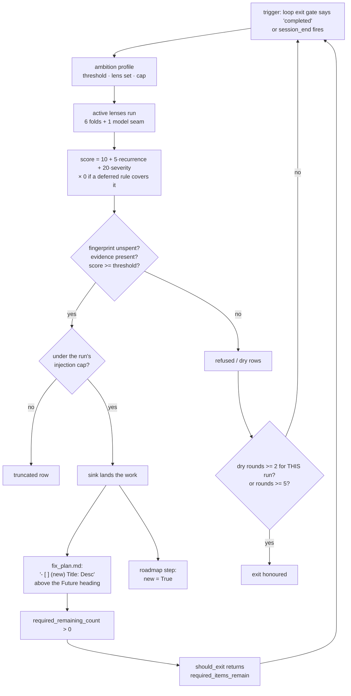
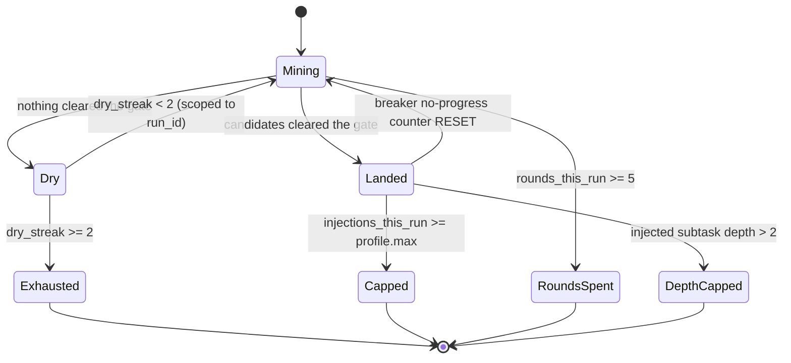
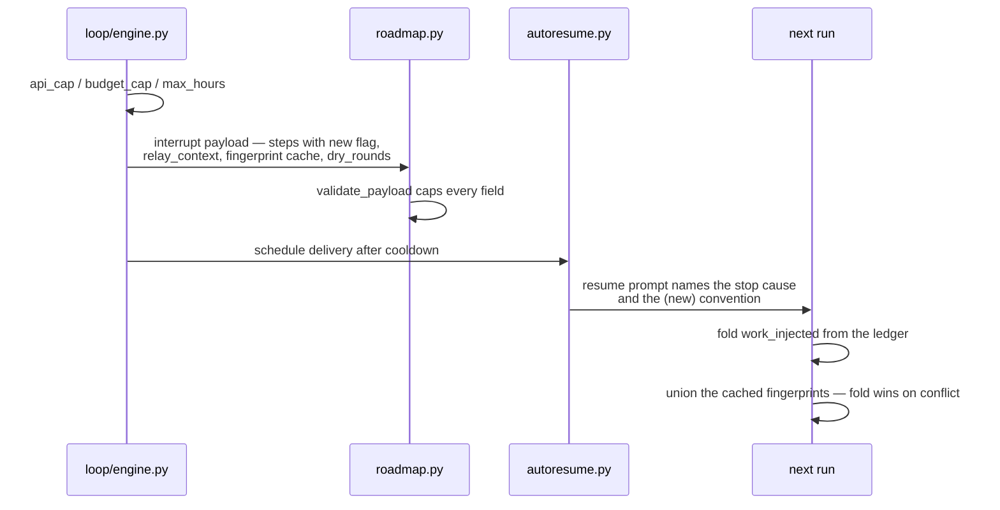

# feat: The seven lenses, the ambition dial, and the relay (phase 4)

## Summary

Phase 1 shipped the replenishment mechanism: one lens, one sink, one audit event,
and a value gate that refuses candidates with nothing to point at. This plan
finishes it. Six more lenses give the injector something to see; a scoring
algorithm and an operator-set ambition dial decide how much of what it sees
becomes work; the loop surface gains the sink that makes its exit gate refuse to
pass; and the relay carries the injector's state across an interruption.

The outcome: a run that empties its checklist mines its own record, injects
evidence-backed work marked `(new)`, and declines to exit — bounded by four
structural stops so it cannot spin.

**This plan supersedes plan 002**, which was written for the same surface and was
never implemented. Its eight units are carried forward here with two corrections
(the checklist marker vocabulary, and the score scale) and joined by the phase 4
units. There must be one executable plan for this work, not two.

---

## Problem Frame

Work in this system ends quietly. An interactive session stops when the human
stops typing; a `hive loop` run stops when its checklist empties. Neither moment
asks whether the ledger still holds proof of unfinished work, so debt accrues
while every individual ending looks correct.

Phase 1 built the part that asks, and deliberately built it thin: one lens
(`evidence-gap`), one sink (the session roadmap), `max_per_round = 3`, and the
dry-round exit defaulted off. That thinness is now the constraint. An injector
with one lens can only ever notice one kind of debt, and the surface that most
needs it — the headless loop, which runs rounds back to back — has no sink at
all.

Three facts from the record shape the sequencing, and each is checkable:

- **`hive loop` has never recorded a run.** Plan 002 folded all 54 namespaces in
  `~/.mindhive` and found zero `loop_run_start` / `loop_iteration` /
  `loop_run_end` events. Every unit that attaches to the loop attaches to a
  surface that has never carried work, so this plan opens by proving it runs.
- **The master prompt's verification commands do not all exist.** `hive loop run
  --force` fails to parse — the runner is `hive loop` with no subcommand, and
  iteration limits live in `.hive-loop/loop.toml`. SOP `execution-discipline` §10
  exists because of exactly this class of error.
- **The MindNetwork task graph holds one row across the whole store.** Parallel
  delegation stays deferred for the same reason plan 002 deferred it.

---

## Requirements

Carried from the origin PRD (R-IDs) and the operator's master execution prompt
(MP-IDs, renumbered to this plan's sections).

**The lenses**

- R1. The repair lens proposes work for `tool_failed` signatures that carry no
  active prevention rule.
- R2. The evidence-gap lens's candidate detection is unchanged; its score stops
  being a lens-supplied default and comes from the shared scorer (R8).
- R3. The technical-debt lens proposes work for source files past the
  thermo-nuclear line threshold and for files sitting uncleared in the review
  queue.
- R4. The audit lens proposes work for source files modified in the working tree
  with no `code_change` event covering them — a SOP `change-audit` §1 violation
  the record can prove.
- R5. The caveat lens proposes work for pinned caveats nothing later resolved.
- R6. The coverage lens proposes work for source modules with no test module.
- R7. The innovation lens proposes work a fold cannot see, through the model
  seam, and every proposal is validated before it becomes a candidate.

**The gate**

- R8. Every candidate carries an integer score computed from the record: a base,
  a recurrence term, a severity term, and a redundancy veto.
- R9. The operator sets one dial — `ambition` — which selects the score
  threshold, the active lens set, and the per-run injection cap.
- R10. The gate self-tunes: repeated failure after injection raises the
  threshold, repeated green verification lowers it, and each shift is recorded.

**The loop surface**

- R11. The loop sink appends survivors to the run's required checklist so the
  exit gate refuses to exit while any remains.
- R12. Checklist items carry a parsed provenance marker. Untagged items behave
  exactly as they do today.
- R13. Injected work is marked wherever it is rendered, permanently — including
  after it completes.
- R14. Four structural stops bound a run: consecutive dry rounds, injections per
  run, mining rounds per run, and injected-subtask depth.

**The relay**

- R15. On `api_cap`, `budget_cap` or `max_hours` the open plan is snapshotted
  with its remaining steps and their provenance, and delivery is scheduled.
- R16. The injector state a resumed run needs is derivable from the injection
  events alone; any cached copy is a hint, never the authority.

---

## Key Technical Decisions

### KTD1. One event, one marker, one injector — extend, never fork

The master prompt specifies a `work_injected` payload of `{run_id, lens, title,
evidence, score, round, task_id, fingerprint}`. The shipped contract in
`src/mindhive/events.py` is `{outcome, round, surface, lens, title, evidence,
fingerprint, score, plan_id, step_index}`, and `outcome` ∈ (`landed`, `refused`,
`truncated`, `dry`) is load-bearing: `replenish.history()` folds the spent-
fingerprint set, the round counter and the dry streak out of those rows. `dry` in
particular exists so that "this round found nothing" is a recorded fact rather
than the absence of one.

**Decision:** add `run_id` as an optional field for the loop surface and treat
the existing `plan_id` + `step_index` pair as the task address the prompt calls
`task_id`. Do not replace the outcome vocabulary. Rewriting it would break the
fold and contradict `docs/DATA_MODEL.md` §1 — corrections are new events, not
edited ones.

The provenance marker is likewise already chosen: `roadmap.NEW_MARKER = "(new) "`
shipped in phase 1 and five renderers read it through one helper. That is
*exactly* the marker the master prompt asks for, so the checklist serialisation
follows it — `- [ ] (new) <Title>: <Description>` — and plan 002's proposed
`[NEW]` / `[FIX:sig]` / `[PARALLEL]` bracket vocabulary is dropped. One marker,
spelled one way, on both surfaces. A bracket-tag vocabulary can be added later
if a second provenance kind ever earns one; inventing it now would put two
spellings of the same fact in one codebase.

### KTD2. The score is an integer, and the old float scale goes away

Phase 1 shipped `Candidate.score: float = 1.0` against `ReplenishConfig.min_score
= 0.5` — a placeholder, not a scale. The master prompt's integers (base 10, +5
per recurrence, +20 severity, thresholds 40/25/15) are a real scale with
meaningful distances, and the event contract already accepts `int` or `float`.

**Decision:** migrate to the integer scale wholesale. `min_score` becomes
`min_score: int`, defaulted from the ambition profile. Existing tests asserting
the float scale are updated, not kept alongside — two live scales for one field
is the ambiguity the naming discipline in this project exists to prevent.
Historical `work_injected` rows carrying `score: 1.0` still fold: nothing reads
the score back out of the ledger, and the contract accepts both types.

### KTD3. The ambition dial is a profile, not three scattered conditionals

Three settings vary together (threshold, lens set, cap) across three named
positions. A `dataclass` per position, selected by name, keeps the relationship
in one readable place and makes an unknown name a validation error rather than a
silent fallthrough to whichever branch happened to be last.

| Position | Threshold | Active lenses | Max injections/run |
|---|---|---|---|
| `conservative` | 40 | repair, evidence-gap | 3 |
| `balanced` (default) | 25 | all six deterministic | 10 |
| `ambitious` | 15 | all seven, incl. innovation | 25 |

An unrecognised `ambition` value falls back to `balanced` **and records the
fallback**, because a typo'd dial that silently runs at a different aggression
than the operator set is worse than a loud one.

### KTD4. There is no sidecar; the snapshot carries a cache, and the fold wins

`replenish.py` states the reason in its own docstring: a sidecar would be a
second source of truth, and the failure mode when it drifted would be invisible —
work that quietly stopped being proposed. The master prompt asks for
`consumed_fingerprints` serialized into the interrupt snapshot and rehydrated by
`autoresume.py`.

**Decision:** keep the ledger authoritative. The snapshot carries the
fingerprints and the dry-round count as a **cache** whose only purpose is to save
a re-mine after a cooldown; on rehydration it is unioned with the freshly folded
set, and where they disagree the fold wins. A cache that can only *add* to the
spent set cannot cause the invisible failure the docstring warns about — the
worst it can do is skip a candidate the ledger would also have skipped.

### KTD5. Reuse `_FUTURE_HEADING`; do not write a second parser

The master prompt says "before any `# Future` or `# Optional` heading".
`src/mindhive/loop/scaffold.py` writes a single `## Future / Optional` heading,
and `loop/task.py` already holds
`_FUTURE_HEADING = re.compile(r"^\s*#+\s*(future|optional)", re.IGNORECASE)`,
which matches both spellings at any depth. The sink imports that regex. A second
parser would be a divergence waiting to happen the first time the scaffold text
changes.

### KTD6. The four stops are structural, and the breaker must not fire on success

Dry rounds, injections per run, mining rounds per run, and injected-subtask depth
are all counters in config or folded from events — none is prose in a prompt (SOP
`agentic-loops` §1). The dry streak **must** be scoped to `run_id` before the
exit is enabled: as shipped it folds over the surface's whole history, so the
first run to go quiet twice would disable `surface="loop"` project-wide forever.

Separately, a landed injection must **reset** the loop breaker's no-progress
counter. Finding evidence-backed work is progress; letting the breaker trip there
would kill the feature it exists to protect.

### KTD7. The innovation lens is a lens, not a second engine

It registers in the existing `LENSES` map and returns `Candidate`s, so it
inherits the value gate, the fingerprint dedup, the caps, the normalisation and
the lens-error channel. Its output is untrusted and passes the same validation
shape `mindnet/decompose.py` uses (id pattern, node ceiling, depth ceiling, cycle
check) before any proposal becomes a candidate. Fields the model may not be able
to fill are nullable, per SOP `prompt-structured-output` §2 — requiring them
would be hallucination by schema design.

---

## Excluded from this plan (and why)

Two items in the master execution prompt are deliberately not planned.

- **"Completely erase all active automated model provider data before continuing
  the setup."** Refused. The instruction is irreversible and has no defined
  target in this codebase — there is no provider-data store; `mindnet/agent.py`
  and `claude_cli.py` hold no provider state to erase — and nothing in the
  innovation lens requires it. If a specific file is meant, it needs to be named
  before anything deletes it.
- **The `xiomi/mimo-v2-pro` routing ban.** Vacuous. `loop/config.py` routes only
  `claude-haiku-4-5` / `claude-sonnet-5` / `claude-opus-4-8`, and the agentic
  seam runs headless `claude` through `claude_cli.py`. No non-Claude provider is
  reachable, so a denylist would be dead config asserting a constraint the
  architecture already guarantees.

---

## High-Level Technical Design

### The round, end to end

### The four structural stops

Each terminal state is a counter comparison, not a judgement about prose.

### The relay

---

## Implementation Units

Grouped into phases for readability. U-IDs are stable and do not renumber.

### Phase A — prove the surface

#### U1. Prove `hive loop` completes a real run

**Goal.** Establish that the loop surface works before anything is built on it.

**Requirements.** Prerequisite for U7–U12.

**Dependencies.** None.

**Files.** none — this unit produces evidence, not code.

**Approach.** Scaffold a throwaway repo with `hive loop init`, give `fix_plan.md`
one trivially checkable item and `AGENT.md` a real command, set a small
`max_iterations` in `loop.toml`, and run `hive loop --force` against an isolated
`MINDHIVE_HOME`. Read the ledger and record the observed event sequence.

Verify the command spelling with `--help` before writing it anywhere (SOP
`execution-discipline` §10). Subprocesses from this worktree need
`PYTHONPATH=<worktree>/src`.

**Test expectation: none — this unit runs the real flow rather than adding
coverage.**

**Verification.** `loop_run_start`, at least one `loop_iteration`, and
`loop_run_end` present in an isolated store, with the terminal `reason` read from
the event rather than inferred. If the run cannot complete, this plan stops here
and the failure becomes its own work.

---

### Phase B — the gate and the dial

#### U2. The value-gate scoring algorithm

**Goal.** Every candidate carries an integer score derived from the record, and
the gate compares it against a threshold instead of a placeholder.

**Requirements.** R8.

**Dependencies.** None.

**Files.** `src/mindhive/replenish.py`, `tests/test_replenish.py`,
`tests/test_replenish_lenses.py`.

**Approach.** A `ScoreBreakdown` frozen dataclass (`base`, `recurrence`,
`severity`, `vetoed`, `total`) rather than a bare int, so a refusal can say which
term decided it and a test can assert one term without reverse-engineering the
sum. `score_candidate(candidate, evidence_index) -> ScoreBreakdown`, where
`EvidenceIndex` is a frozen dataclass built once per round holding the
recurrence counts, the hard-blocking signatures, and the deferred-rule set —
built once because a per-candidate ledger pass would be a fold per candidate.

Terms: base 10; `+5 × (occurrences - 1)` for a signature the ledger repeats;
`+20` when the condition is hard-blocking (an uncleared review-queue entry, or
code changed with no passing verification since); total forced to 0 when an
active prevention rule or a caveat covers the signature and marks it deferred.

**Scoring moves out of the lenses.** A lens currently sets `Candidate.score`
itself, defaulting to `1.0` — which under the new scale is below every threshold,
so leaving it there would silently refuse everything the shipped lens finds.
`run_round` scores every candidate through `score_candidate` *before* calling
`gate()`, replacing whatever the lens supplied. Lenses stop setting `score` at
all; the field becomes an output of the round, not an input to it.

**Three additions to `Candidate`**, all defaulted so no existing construction
breaks:

- `recurrence_key: str = ""` — what the recurrence term counts. A lens whose
  condition has no meaningful recurrence (coverage, technical debt) leaves it
  empty and scores `recurrence = 0`. Without this the `+5 × occurrences` term has
  no defined input for four of the seven lenses.
- `severity: bool = False` — the lens asserts the hard-blocking fact it observed;
  the scorer turns it into the `+20`. The lens knows *why* its condition blocks;
  the scorer must not re-derive it.
- `depth: int = 1` — the injection depth U8's fourth stop bounds.

`ReplenishConfig.min_score` becomes an `int`. `Candidate.score` stays a number
the contract already accepts; existing float-scale assertions are migrated, not
duplicated (KTD2).

**Two caps, not one.** `ReplenishConfig.max_per_round` (shipped, default 3) trims
a single round; the profile's `max_injections_per_run` bounds the run's total
across rounds and is enforced in U8 by folding the run's own landed rows. The
profile sets `max_per_round` to the same number unless `loop.toml` overrides it
separately — one dial, two enforcement points, so a five-round run cannot inject
five times the cap.

**Execution note.** Test-first on the veto: score-to-zero is the term that
prevents the injector re-proposing work a human already declined, and it is the
one term whose absence would be invisible in a green suite.

**Patterns to follow.** `replenish.refusal_reason` for the ordered-reasons shape;
`incidents.audit` for reading rule status without re-implementing it.

**Test scenarios.**
- A single-occurrence candidate with no severity scores exactly 10.
- A signature appearing four times in the ledger scores 10 + 15 = 25.
- A file in the review queue adds 20; a candidate with both terms sums both.
- A candidate whose signature has an active prevention rule marked deferred
  scores 0 and is refused with a reason naming the rule.
- A candidate whose signature has an active rule *not* marked deferred is not
  vetoed.
- `ScoreBreakdown.total` always equals `base + recurrence + severity` unless
  `vetoed`, in which case it is 0.
- A malformed ledger row (payload not a dict, missing signature) is skipped by
  the index build without raising.
- `EvidenceIndex` is built once per round: a round with N candidates performs one
  ledger pass, asserted by counting calls to the read seam.
- A candidate scoring exactly at the threshold is kept; one below is refused.
- A lens that sets `score` itself has that value overwritten by the scorer before
  `gate()` sees it — asserted with a lens returning `score=999`.
- A candidate with an empty `recurrence_key` scores `recurrence = 0` regardless
  of what the ledger repeats.
- `severity=True` adds exactly 20; `severity=False` adds 0.
- The shipped `evidence_gap` lens, unchanged in detection, now clears the
  `balanced` threshold — the regression the scale migration could have caused.

**Verification.** `gate()` driven with a synthetic ledger, asserting kept/refused
partition and the reason text for each refusal class.

---

#### U3. The ambition dial

**Goal.** One operator setting selects threshold, lens set, and per-run cap.

**Requirements.** R9.

**Dependencies.** U2.

**Files.** `src/mindhive/loop/config.py`, `src/mindhive/replenish.py`,
`tests/test_loop_config.py`, `tests/test_replenish.py`.

**Approach.** An `AmbitionProfile` frozen dataclass (`name`, `min_score`,
`lens_names`, `max_injections_per_run`) and a module-level mapping of the three
positions, living in `replenish.py` beside the `LENSES` registry it selects from
— the profile names lenses, so it belongs where the lenses are, not in the loop's
config module.

`loop/config.py` gains `replenish_enabled: bool = True` and
`replenish_ambition: str = "balanced"`, read from a `[replenish]` section
following the existing per-section pattern in `load_config`. An unrecognised
ambition resolves to `balanced` and returns the fallback so the caller can record
it (KTD3).

`ReplenishConfig` gains a constructor from a profile so the round's caps and
threshold come from one place.

**Patterns to follow.** `loop/config.py load_config` section-by-section reads
with per-key defaults; `LoopConfig`'s comment style, which explains why a default
is what it is.

**Test scenarios.**
- A `loop.toml` with no `[replenish]` section yields enabled=True,
  ambition="balanced".
- Each of the three names resolves to its documented threshold, lens set and cap.
- `conservative` activates exactly repair and evidence-gap — asserted against the
  `LENSES` keys, so adding a lens cannot silently join the conservative set.
- `ambitious` is the only position that includes the innovation lens.
- An unknown ambition string resolves to `balanced` and reports the fallback.
- `enabled = false` makes `run_round` return `skipped="disabled"` and write no
  events.
- A malformed `loop.toml` (`[replenish]` present but not a table) falls back to
  defaults without raising.
- Every lens name in every profile exists in `LENSES` — a typo in a profile is a
  test failure, not a silently inactive lens.

**Verification.** A real `loop.toml` on disk parsed through `load_config`, and a
`run_round` whose active lens set is asserted per position.

---

### Phase C — the deterministic lenses

#### U4. The ledger lenses: repair and caveat

**Goal.** The injector notices recorded failures with no rule, and pinned caveats
nothing resolved.

**Requirements.** R1, R5.

**Dependencies.** U2.

**Files.** `src/mindhive/replenish.py`, `tests/test_replenish_lenses.py`.

**Approach.** Both are pure folds over `evs`, registered in `LENSES`, following
`evidence_gap`'s shape exactly: one candidate per condition instance, evidence
mandatory, fingerprint keyed on the instance rather than the lens name.

*Repair* groups `tool_failed` rows by canonical signature (`signature.py`
already computes it — do not re-derive), then drops any signature with an active
prevention rule. Evidence is the signature plus the timestamps of the failures
that produced it, capped at `_EVIDENCE_FILES`-style bounds. Fingerprint:
`repair:<signature>:<newest failure ts>`, so a signature that recurs after being
fixed mints a fresh instance. `recurrence_key` is the bare signature — this is
the lens the recurrence term was designed for, and the one where a signature
seen four times must outscore one seen once.

*Caveat* takes `caveat` rows tagged `pinned` and drops those a later
`experiment_result`, `code_change` or resolution row addressed. "Addressed" is
decided by the existing resolution signals rather than a new convention.
Fingerprint: `caveat:<row id or ts>`.

Both stay total: `isinstance(payload, dict)`, `.get()` throughout, malformed rows
skipped.

**Patterns to follow.** `replenish.evidence_gap` for the whole lens shape;
`incidents._active_rules` / `incidents.audit` for rule status.

**Test scenarios.**
- A `tool_failed` signature with no rule yields one candidate whose title names
  the signature and whose evidence lists the failure timestamps.
- The same signature with an active prevention rule yields nothing.
- Four failures of one signature yield ONE candidate, not four, and its evidence
  carries the timestamps.
- Two distinct signatures yield two candidates.
- A `tool_failed` row whose payload is not a dict is skipped; the lens returns
  the candidates from the well-formed rows.
- A signature that recurs after its rule expired mints a fingerprint distinct
  from the pre-fix one.
- A pinned caveat with no later resolution yields one candidate titled with the
  caveat headline.
- A pinned caveat followed by an `experiment_result` addressing it yields
  nothing.
- An unpinned caveat is ignored — the lens is scoped to pinned by design.
- A caveat row missing its text yields no candidate rather than an untitled one.
- Neither lens raises on an empty event list.

**Verification.** Both lenses driven through a full `run_round` against a
synthetic ledger, with the resulting `work_injected` rows read back.

---

#### U5. The surface lenses: technical debt, audit, and coverage

**Goal.** The injector notices debt the filesystem and the working tree prove.

**Requirements.** R3, R4, R6.

**Dependencies.** U2.

**Files.** `src/mindhive/replenish.py`, `tests/test_replenish_lenses.py`.

**Approach.** Three folds that read the tree rather than the ledger, so each
takes an injectable root instead of resolving one internally — the project's test
pattern for collectors, and the only way these are testable without touching the
real repo.

*Technical debt* walks `src/mindhive/*.py`, flags any file over 1000 lines
(`review._line_count` already counts them the way the review gate does), and
reads `review.load_pending()` for files sitting uncleared in the queue. A queue
entry carries the `+20` severity term from U2.

*Audit* compares `git status --porcelain` paths under `src/` or `tests/` against
`code_change` events, reusing `review.in_scope` for the scope test and
`review.touched_files` for the covered set. One candidate for the whole
uncovered set, not one per file — the outstanding fact is singular ("this
change-set has no change-log entry") and per-file candidates would blow the
roadmap step ceiling on a busy day.

*Coverage* maps each `src/mindhive/<module>.py` to `tests/test_<module>.py` and
proposes the missing ones. Package modules under `mindhive/loop/` and
`mindhive/mindnet/` and `mindhive/rotation/` follow the existing test naming in
`tests/`, which is read rather than assumed.

Git is invoked through one seam so the lens is testable without a repo, and a
git failure yields no candidates plus one recorded lens error — never a silent
empty result.

**Execution note.** Characterisation-first on the audit lens: pin what
`review.touched_files` returns for a known session before building on it.

**Patterns to follow.** `review.py`'s `in_scope` / `_line_count` /
`touched_files`; the injectable-root convention in the existing collector tests.

**Test scenarios.**
- A 1200-line module yields one debt candidate whose evidence is its path and
  line count; a 400-line module yields none.
- The 1000-line boundary is exclusive-below and inclusive-above at exactly the
  documented threshold.
- A file in `pending_review.json` yields a candidate carrying the severity term.
- An empty or absent `pending_review.json` yields no queue candidates and does
  not raise.
- A modified `src/mindhive/foo.py` with no covering `code_change` yields ONE
  audit candidate listing it.
- Two modified files with no coverage yield one candidate listing both, capped
  at the evidence-item limit.
- A modified file already covered by a `code_change` event yields nothing.
- A modified `README.md` yields nothing — out of `in_scope`.
- A git invocation that fails yields no candidates and one recorded lens error.
- A module with no matching test file yields a coverage candidate; one with a
  test file yields none.
- `__init__.py` and private modules are excluded from the coverage lens by an
  explicit rule, asserted rather than incidental.
- All three lenses return `[]` on an empty tree without raising.

**Verification.** A temporary tree with known file sizes and a stubbed git seam,
driven through `run_round`.

---

### Phase D — the loop surface

#### U6. Parse the `(new)` marker in the loop checklist

**Goal.** Checklist items carry a parsed provenance marker through every
consumer instead of raw text.

**Requirements.** R12, R13.

**Dependencies.** U1.

**Files.** `src/mindhive/loop/task.py`, `src/mindhive/loop/state.py`,
`src/mindhive/roadmap.py`, `tests/test_loop_task.py`,
`tests/test_loop_state.py`, `tests/test_roadmap.py`.

**Approach.** `plan_items` returns a `PlanItem` dataclass per item (`text`,
`is_new`, `status`) instead of a bare string. An untagged item yields
`is_new=False` with text unchanged, so every historical `fix_plan.md` parses as
before. `required_remaining_count` keeps counting unchecked pre-`Future` items
and does not consult the marker — the count is the forcing mechanism, the marker
is provenance (KTD1).

The marker parsed is `roadmap.NEW_MARKER` — `(new) ` — imported, not re-spelled.
Every consumer moves in the same commit because the shape change is the risk:
`loop.state._fix_plan_items` (feeds the Oversee card),
`roadmap.steps_from_plan_items` (feeds the interrupt snapshot, and is where the
marker becomes the step's `new` boolean), and `engine._snapshot_interrupted_plan`.

**Execution note.** Characterisation-first: pin the current string-list return
and all three consumers before changing the shape.

**Patterns to follow.** `roadmap._norm_steps`, which added a key with a safe
default so historical events fold unchanged.

**Test scenarios.**
- An untagged item parses with `is_new=False` and its text intact.
- `- [ ] (new) Title: Description` parses to `is_new=True` with the marker
  stripped from `text`.
- Marker matching is case-insensitive and tolerates extra internal whitespace.
- A marker appearing mid-line, not at the start, is left in the text.
- A tagged item under the `Future` heading lands in `not_yet`, not `planned`.
- `required_remaining_count` returns the same number with and without markers.
- Covers R13. A `(new)` item reaching `steps_from_plan_items` produces a roadmap
  step with `new: True`.
- A checked `- [x] (new) …` item lands in `done` and keeps `is_new=True` — the
  marker survives completion.
- An item whose description itself contains parentheses is untouched.
- `loop.state._fix_plan_items` returns the new shape and the Oversee card
  projection still folds without raising.

**Verification.** The existing loop and roadmap suites green with no assertion
loosened, plus the new parse cases.

---

#### U7. The fix-plan sink

**Goal.** Survivors land as required checklist items so the exit gate refuses to
exit.

**Requirements.** R11.

**Dependencies.** U6.

**Files.** `src/mindhive/replenish_sinks.py`, `tests/test_replenish_sink.py`.

**Approach.** `fix_plan_sink(loop_dir, run_id, append=True)` beside
`roadmap_sink`, same contract: called with kept candidates, returns
`(placements, dropped)`. Lines are inserted immediately before the first
`_FUTURE_HEADING` match (imported from `loop/task.py`, KTD5), or appended when
there is none, so deferred items stay deferred.

The line format is `- [ ] (new) <Title>: <Description>`. Title and description
are sanitised so neither can introduce a newline or a checklist marker — a title
that could forge a second item would let one candidate inflate the required
count.

Writes go through `paths.write_text_atomic`; a missing `fix_plan.md` returns
everything as dropped and writes nothing, rather than creating a file the loop
never scaffolded. `append=False` runs identical placement math and leaves the
file byte-identical.

Placements carry `plan_id = run_id` and the item's index in the required list.

**Patterns to follow.** `replenish_sinks.roadmap_sink` for the sink contract, the
guard-before-write stance, and the `append=False` preview flag.

**Test scenarios.**
- Two candidates append two `- [ ] (new) …` lines and `required_remaining_count`
  rises by exactly two.
- Covers R11. After landing, `safeguards.should_exit` with a completing status
  returns not-exiting with the required-items reason.
- Existing `Future`/`Optional` items remain present and remain under the heading.
- A file with no `Future` heading appends at the end and the count still rises.
- A missing `fix_plan.md` returns everything dropped, writes nothing, and does
  not raise.
- `append=False` computes identical placements and leaves the file byte-identical
  (compared as bytes, not lines).
- A title containing `\n` or `- [ ]` cannot produce a second checklist item.
- A title longer than the cap is truncated before it reaches the file, and the
  audit row reports the truncated title — the row must not misreport the file.
- Placement indices match the item's position among required items, not its line
  number.
- A Windows `PermissionError` on the destination is surfaced, not swallowed into
  a half-written file.

**Verification.** A real `.hive-loop` directory read before and after, with
`required_remaining_count` computed from the file on disk.

---

#### U8. Wire the loop trigger, scope the dry streak, add the four stops

**Goal.** The loop mines instead of exiting, and the run is bounded.

**Requirements.** R11, R14.

**Dependencies.** U3, U7.

**Files.** `src/mindhive/loop/engine.py`, `src/mindhive/loop/safeguards.py`,
`src/mindhive/replenish.py`, `tests/test_loop_engine.py`,
`tests/test_loop_safeguards.py`, `tests/test_replenish.py`.

**Approach.** In the engine's loop, when `should_exit` reports done with reason
`completed`, run a round on `surface="loop"` with the fix-plan sink before
honouring the exit. Anything landed means the run continues.

`history()` gains a `run_id` filter and `run_round` passes it, so the dry streak
belongs to one run (KTD6). This ships in the same unit as enabling
`dry_rounds_to_exit = 2` for the loop surface — enabling it without the scope
would disable the loop surface project-wide after one quiet run.

The other three stops: injections-per-run from the ambition profile, enforced by
folding the run's own landed rows (distinct from the per-round trim — see U2's
two-caps note); a mining-round ceiling of 5 per run, folded from the same rows;
and a depth ceiling of 2 read from `Candidate.depth` (added in U2), so a step
injected by an injected step cannot recurse further.

The loop breaker gains a public `reset()` — the engine must not reach across the
module boundary into `_close()` — called when an injection lands.

**Execution note.** Test-first on the exit overturn: the assertion that a run
with an injected item does not end is the whole feature.

**Patterns to follow.** The existing `run_loop` control flow and its
`heuristic_blocked` handling, which already separates "responsive but not
finished" from "stuck".

**Test scenarios.**
- A run whose checklist empties and whose round injects one item does not end;
  the next iteration sees `required_remaining == 1`.
- A run whose round injects nothing ends with `reason == "completed"`.
- Two consecutive dry rounds in one run end it; a different `run_id` starts with
  a clean streak.
- A landed injection resets the breaker's no-progress counter.
- The injection cap from the active profile is enforced, and the overflow is
  recorded as `truncated` rather than dropped silently.
- A sixth mining round in one run does not run, and the ceiling is recorded.
- A candidate at depth 3 is refused with a depth reason; one at depth 2 is kept.
- An injector exception does not end the run abnormally — the run completes and
  the failure is recorded as a lens error.
- `loop_iteration` events still bracket every iteration, including those after an
  injection.
- The round does not run when the exit reason is anything other than
  `completed` — asserted for `api_cap` and `max_iterations`.
- With `replenish_enabled = false` the exit is honoured immediately and no
  `work_injected` row is written.

**Verification.** A scripted run with a stub driver, asserting the iteration
count and the terminal `reason` read from the ledger.

---

### Phase E — the model seam and the feedback loop

#### U9. The innovation lens

**Goal.** A model-driven lens proposes work the folds cannot see, bounded and
untrusted.

**Requirements.** R7.

**Dependencies.** U8.

**Files.** `src/mindhive/replenish.py`, `src/mindhive/loop/progress.py`,
`tests/test_replenish_lenses.py`, `tests/test_loop_progress.py`.

**Approach.** A lens registered in `LENSES`, active only under `ambitious`, that
gathers the run's prompt, the paths `MtimeTracker` reports changed, recent
`tool_failed` rows and the completed checklist items; asks a model through the
existing `mindnet/agent.py` → `claude_cli.py` seam on a light or mid tier; and
parses tolerantly (first `{` to last `}`, as `mindnet/decompose.parse` does).

Every proposal passes the `mindnet/decompose.validate` rule set — id pattern,
node ceiling, depth ceiling, cycle check — before becoming a `Candidate`.
Proposals that fail validation are dropped with a recorded reason.

`MtimeTracker` gains a method returning the changed paths; `changed()` keeps its
boolean contract so the engine's progress detection is untouched.

Bounds: at most five proposals per round; evidence mandatory (the changed paths
and failure signatures the proposal rests on); optional fields nullable. A
proposal with no evidence is refused by the gate that already exists, not by new
code. Every failure mode returns no candidates and records a lens error — an
unparseable reply must read as "the lens failed", never as "the system is
robust".

**Patterns to follow.** `mindnet/decompose.py` end to end: the untrusted-output
stance, the tolerant parser, the refusal-with-reason shape, the validation rules.

**Test scenarios.**
- A stub runner returning two valid proposals yields two candidates with
  evidence.
- A reply wrapped in markdown fences parses.
- Unparseable output yields no candidates and exactly one recorded lens error.
- A timeout or non-zero exit from the runner yields no candidates and one error.
- More than five proposals are truncated to five and the truncation is recorded.
- A proposal failing the id pattern is dropped with a reason naming the rule.
- A proposal graph containing a cycle is rejected wholesale, not partially
  accepted.
- A proposal exceeding the depth ceiling is rejected.
- A proposal with a nullable field absent is accepted; one with no title is
  skipped.
- A proposal whose evidence list is empty is refused by the value gate, not by
  the lens.
- The lens is absent from the `conservative` and `balanced` lens sets.
- `MtimeTracker` reports the changed paths and `changed()` still returns a bool.

**Verification.** The lens registered in `LENSES` and driven by a stub runner
through a full `run_round` — no real model call in the suite.

---

#### U10. The auto-tuning feedback loop

**Goal.** The threshold moves in response to what injected work actually did.

**Requirements.** R10.

**Dependencies.** U8.

**Files.** `src/mindhive/replenish.py`, `tests/test_replenish.py`.

**Approach.** A `ThresholdAdjustment` frozen dataclass (`delta`, `reason`,
`window`) computed by a fold over the outcomes that followed the most recent
landed injections. `+10` when the last three landed injections were followed by
`breaker_open` or a `tool_failed` cascade; `-5` when the last five were followed
by passing `verification` events. The adjustment is applied to the profile's
threshold for the round, clamped so it can never drive the effective threshold
below the base score of 10 — a threshold under the minimum possible score would
admit everything.

Each shift appends a `decision` event naming the delta, the reason and the window
it was computed over, so the tuning is auditable rather than emergent. Neutral
rounds append nothing — a `decision` row per round would flood the ledger and
every future briefing.

**Patterns to follow.** `replenish.history` for the total-read fold shape;
`incidents.signal_stats` for reading outcome sequences off the ledger.

**Test scenarios.**
- Three landed injections each followed by `breaker_open` raise the threshold by
  10 and append one `decision` event.
- Five landed injections each followed by a passing `verification` lower it by 5.
- A mixed window produces no adjustment and appends nothing.
- Fewer landed injections than the window needs produces no adjustment.
- The adjustment is clamped: repeated raises cannot make the threshold unbounded,
  and repeated lowers cannot take it below 10.
- The `decision` payload names the delta, the reason and the window size.
- A malformed row inside the window is skipped and the fold returns normally.
- Adjustments compose with the profile: `conservative` + 10 is 50, `ambitious`
  − 5 is 10.
- The adjustment is recomputed per round rather than accumulated in memory
  across rounds.

**Verification.** A synthetic ledger with each window shape, asserting the
returned adjustment and the appended `decision` payload.

---

### Phase F — the relay and the view

#### U11. The estafet

**Goal.** An interrupted run hands the baton on with its injected work, its
provenance, and its spent fingerprints intact.

**Requirements.** R15, R16.

**Dependencies.** U8.

**Files.** `src/mindhive/loop/engine.py`, `src/mindhive/roadmap.py`,
`src/mindhive/autoresume.py`, `tests/test_loop_engine.py`,
`tests/test_autoresume.py`, `tests/test_roadmap.py`.

**Approach.** `_snapshot_interrupted_plan` already fires on `api_cap` and
`budget_cap`; `max_hours` joins them, because a run out of wall clock has the
same unfinished plan. The steps it builds carry the `new` flag from U6's parse.

The roadmap payload gains three bounded fields: `relay_context` (what the run was
doing when it stopped), the spent-fingerprint cache, and the dry-round count.
`roadmap.validate_payload` caps each like its neighbours; an oversized field is
rejected rather than silently truncated into the ledger.

`autoresume` rehydration unions the cached fingerprints with the freshly folded
set and lets the fold win on conflict (KTD4). `resume_prompt` gains a leading
paragraph for a loop-origin plan: that this is a resumed run, what stopped it,
and that `(new)` steps were injected rather than planned.

`fix_plan.md` is left untouched on interrupt, so the resumed agent parses the
same file with the same markers.

**Test scenarios.**
- Covers R15. A run ending in `api_cap` with an injected item produces a roadmap
  `interrupt` whose steps keep `new: True`.
- The same holds for `budget_cap` and for `max_hours`.
- `relay_context` is present, non-empty and within the contract cap.
- An oversized `relay_context` is rejected by `validate_payload`.
- Covers R16. The spent fingerprints for the run are recoverable from the
  injection events alone after the process ends, with the cache absent.
- A cache disagreeing with the fold loses: a fingerprint the fold does not know
  is still honoured as spent (union), but a fingerprint the fold marks spent is
  never un-spent by an absent cache entry.
- A corrupt or non-list cache is ignored and the fold alone is used.
- `resume_prompt` for a loop-origin plan names the stop cause and the `(new)`
  convention; for a session-origin plan it is unchanged.
- `fix_plan.md` is byte-identical before and after the snapshot.
- A snapshot failure still lets `loop_run_end` be written — a run must never be
  stranded as running.

**Verification.** A run driven to `budget_cap` against an isolated store, with
the `roadmap` payload and the `autoresume` record read from the ledger.

---

#### U12. Oversee provenance and the injected count

**Goal.** The operator sees the loop growing its own plan, permanently.

**Requirements.** R13.

**Dependencies.** U6.

**Files.** `src/mindhive/loop/state.py`, `src/mindhive/oversee.py`,
`src/mindhive/dashboard_page.py`, `tests/test_replenish_dashboard.py`.

**Approach.** `state.list_runs` folds `work_injected` rows by `run_id` into an
`injected_count` on the run record, skipping malformed rows so the fold stays
total — a raising fold 500s the dashboard projection.

The `new` pill renders in `ovGroup`, `ovRow` and `rmPanel`, and persists when a
task moves `planned` → `done`: the flag lives on the step record, not on its
status, so the renderers read it unconditionally. Step text is escaped and the
pill is the only markup emitted.

**Patterns to follow.** The `new` pill already added to `rmPanel` in phase 1 and
its shared helper; `ovCard`'s existing pill construction.

**Test scenarios.**
- A run with three landed `work_injected` rows shows `injected_count: 3`.
- Rows for a different `run_id` do not count toward it.
- Rows with outcome `refused` or `dry` do not count toward it.
- A malformed `work_injected` row is skipped and the fold returns normally.
- A run with no injections carries no pill.
- The served page contains the pill hook in all three renderers.
- A step that moved from `planned` to `done` still renders the pill.
- Step text containing HTML is escaped; the pill is the only markup.
- An untagged step renders exactly as it does today.

**Verification.** The dashboard served from this worktree on a side port —
**never 54461**, which is the operator's live process — and the page grepped for
the pill hook alongside `showOversee` and `renderOversee`.

---

### Phase G — verification

#### U13. Real-flow verification and the change-log

**Goal.** Prove the chain on a real run and satisfy the project's gates.

**Requirements.** All of the above.

**Dependencies.** U1–U12.

**Files.** none new.

**Approach.** Full suite green, with the count read from an observed run rather
than asserted. A real `hive loop --force` against an isolated store with a
`fix_plan.md` that empties, showing the injection, the refused exit and the
continued run. A second run configured to hit a budget cap to produce the relay.
Then `hive log <category> "…"` for the change-set, and `hive review clear` if the
review queue fires on the core-file edits.

**Test expectation: none — this unit exercises the real flow.**

**Verification.** The observed event sequence, `fix_plan.md` before and after,
the roadmap `interrupt` payload, the `autoresume` record, the grepped page, and
the change-log entry.

---

## Scope Boundaries

**In this plan.** Six deterministic lenses and one agentic lens; the integer
scoring algorithm and its evidence index; the ambition dial in `loop.toml`; the
auto-tuning feedback loop; the `(new)` marker parsed through every loop consumer;
the fix-plan sink; the loop trigger with a run-scoped dry streak and four
structural stops; the estafet with the fingerprint cache; the Oversee pill and
injected count.

### Deferred to Follow-Up Work

- Parallel delegation of injected tasks to `mindnet/orchestrator.py`. The task
  graph holds one row across the entire store; wiring loop orchestration onto it
  would repeat the mistake this project's phase ordering was rewritten to avoid.
  Revisit when the graph carries real work.
- The graph sink (origin R12) — same reason.
- A richer bracket-tag provenance vocabulary (`[FIX:sig]`, `[PARALLEL]`). One
  marker is enough until a second provenance kind exists (KTD1).
- Hoisting the per-round ledger passes. Measured at ~38 ms against a ~250–400 ms
  base; worth doing when several lenses each add a pass, which U2's shared
  `EvidenceIndex` partly pre-empts.
- Splitting `__main__.py`. It is already ~3.4k lines and past the thermo-nuclear
  threshold; this plan adds nothing to it, but it remains a standing caveat.

**Non-goals.** No second injector, no `task_injected` event, no second provenance
marker. No change to the Stop hook or the rotation machinery. No use of the live
dashboard on port 54461 for any verification step. No deletion of provider data
and no non-Claude routing config (see *Excluded from this plan*).

---

## Risks & Dependencies

**U1 may fail, and that is the point.** `hive loop` has never recorded a run. If
it cannot complete a trivial one, U7–U12 are building on an assumption and the
failure becomes the work.

**The `plan_items` shape change touches three consumers at once.** The Oversee
card, the interrupt snapshot and the engine all read it. U6's
characterisation-first note exists for that reason.

**Enabling the dry exit without the run scope would be worse than not enabling
it.** It would silently disable the loop surface project-wide after one quiet
run. Both changes ship in U8.

**The scoring migration touches existing green tests.** Changing `min_score` from
float to int is the kind of change that passes by loosening an assertion. U2
migrates the assertions to the new scale rather than widening them; a reviewer
should check that no test got weaker.

**The injector spends model calls inside a loop already spending them.** The
`ambitious`-only gating, the five-proposal cap and the light tier bound the
innovation lens, but a lens firing every round on a long run is a real cost — the
injected count in U12 is what makes it visible.

**Auto-tuning is a feedback loop on a feedback loop.** A bug there degrades
slowly and silently. The clamp in U10 and the `decision` audit row are the two
things that make it recoverable.

---

## Open Questions

**Deferred to implementation.**

- Whether `relay_context` is free text or a small structured record. Start with
  the bounded string `validate_payload` can check; structure it if a reader needs
  more.
- Whether the innovation lens sees file contents or only paths. Paths first —
  contents are a context-budget decision better made with a real run's numbers.
- Whether the audit lens should read `git status` or the harvested touched-file
  set as its primary source. Both are available; the plan reuses
  `review.touched_files` for the covered set and git for the modified set, but
  which is authoritative when they disagree is a question a real run answers.
- Exactly which resolution signals count as "addressed" for the caveat lens.
  The existing resolution vocabulary is reused; whether it is sufficient is
  visible only once the lens runs against the real ledger.

---

## Assumptions

Recorded because this plan was written in pipeline mode without a confirmation
round. Each is a bet a reviewer can overturn.

- The master prompt's `task_injected` is satisfied by the existing
  `work_injected`, and its `task_id` by the existing `plan_id` + `step_index`
  pair. If the operator specifically wants those field names, that is a rename,
  not a second mechanism.
- The `(new)` marker is the single provenance spelling on both surfaces,
  superseding plan 002's `[NEW]` proposal.
- The float score scale is dead and its tests migrate. No caller outside
  `replenish.py` reads `score` back out.
- The innovation lens runs on the light or mid tier, not Opus.
- The loop surface enables the dry-round exit at 2, matching the master prompt's
  two-consecutive-empty-rounds stop.
- Excluding the provider-data erasure and the Xiaomi routing ban is correct; if
  either was meant literally, it needs a named target before anything acts on it.

---

## Sources & Research

All paths repo-relative; every claim below was read in this worktree at
`HEAD = d0756f8`.

- The shipped mechanism this plan extends: `src/mindhive/replenish.py`
  (`history`, `refusal_reason`, `gate`, `run_round`, `evidence_gap`, the payload
  contract docstring), `src/mindhive/replenish_sinks.py` (`roadmap_sink`).
- The event registry: `work_injected` present in `events.VALID_TYPES` and
  `events._PAYLOAD_CONTRACTS` — verified by import.
- The marker already shipped: `roadmap.NEW_MARKER = "(new) "` and the shared
  `new`-flag helper in `src/mindhive/roadmap.py`.
- The exit gate and the required-items rule: `src/mindhive/loop/safeguards.py`,
  `src/mindhive/loop/engine.py` (`_snapshot_interrupted_plan` at line 24),
  `src/mindhive/loop/task.py` (`_FUTURE_HEADING`, `plan_items`,
  `required_remaining_count`).
- The checklist scaffold's single `## Future / Optional` heading:
  `src/mindhive/loop/scaffold.py`.
- Config section pattern to follow: `src/mindhive/loop/config.py` (`LoopConfig`,
  `load_config`).
- Lens data sources: `src/mindhive/review.py` (`pending_path`, `load_pending`,
  `in_scope`, `_line_count`, `touched_files`), `src/mindhive/incidents.py`
  (`audit`, `_active_rules`, `signal_stats`, `summaries`),
  `src/mindhive/signature.py`.
- Untrusted-model-output stance to reuse: `src/mindhive/mindnet/decompose.py`;
  the seam: `src/mindhive/mindnet/agent.py`, `src/mindhive/claude_cli.py`.
- Relay legs: `src/mindhive/roadmap.py`, `src/mindhive/autoresume.py`.
- Oversee projection and render: `src/mindhive/loop/state.py`,
  `src/mindhive/oversee.py`, `src/mindhive/dashboard_page.py`.
- Store contract and the event-type procedure: `docs/DATA_MODEL.md`; module
  ownership map: `docs/session-legend.md`.
- Superseded predecessor: `docs/plans/2026-08-05-002-feat-loop-sink-and-estafet-plan.md`
  (units carried forward; zero-loop-runs and one-task-graph-row counts folded
  from the live store on 2026-08-05 across all 54 namespaces).
- Phase 1 origin PRD:
  `docs/brainstorms/2026-08-05-adaptive-work-injection-requirements.md`.
