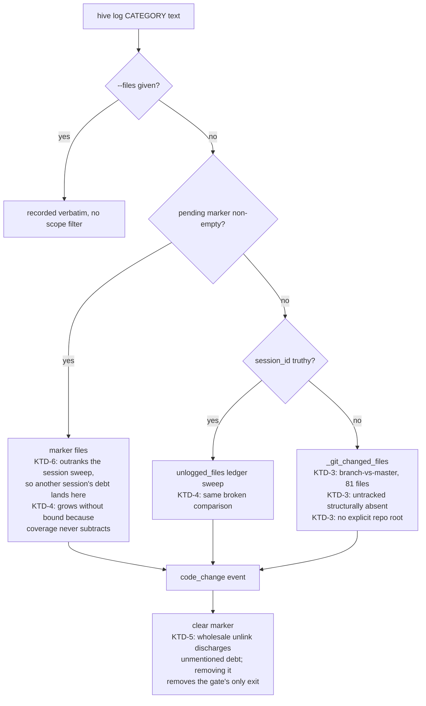

# fix: bound the recurrence term, and make the change-log's file list the actual change-set

## Summary

Two defects, both measured on the real store, both deferred out of the phase that
found them because the honest next step was to measure rather than to tune. A
third, documentation-and-veto-only item rides along (U5) to stop the injector
re-proposing work that has been deliberately deferred.

The **recurrence term is unbounded**: one failure signature carries a recurrence
term of 1310, giving it a total score of 1118 while every other candidate in the
round sits between 25 and 63. The measurement that deferral asked for has run, and
it settled one question while opening a sharper one. Capping does not change which
candidates clear which dial position — but the metric that showed that is blind to
the thing that actually constrains the ceiling, which is whether a *fully decayed*
candidate can still clear the *highest* dial it runs under. So the ceiling is
derived from that constraint, not picked from a range.

The **change-log's file auto-detection reports the wrong change-set**. It recorded
61 files for a 14-file change and omitted three new files entirely. The cause is
three independent bugs in `src/mindhive/changelog.py`: the git fallback diffs the
whole branch against `master` rather than the working tree, `git diff` structurally
cannot list untracked files, and the coverage fold compares worktree-absolute
ledger paths against repo-relative ones so it almost never subtracts — leaving the
pending marker to grow without bound.

Splitting `src/mindhive/replenish.py` (2676 lines) is **not** in this plan. The
research found a concrete blocker to design around first; recording it — and
vetoing the injector's standing re-proposal of it — is in scope.

---

## Problem Frame

Phase 4 of adaptive work injection shipped (see origin) and its follow-up closed
the dead tech-debt condition. Both remaining items were left deliberately, with
written reasons, as pinned caveats. This plan discharges them.

**Why the recurrence term matters now.** The score exists so a threshold means
something, and so an audit row explains itself. A term that reaches 1310 while
every sibling term is capped at 20 does not participate in that scale — it
replaces it. Two consequences follow, and only one of them is the one an earlier
draft of this plan claimed:

- **Real, and the reason to act:** the audit row becomes uninterpretable. A reader
  seeing `total 1118` cannot tell whether the record insists on this work or the
  arithmetic ran away, and `hive replenish explain` exists precisely so that
  question is answerable at a glance.
- **Not real, and corrected here:** the dial positions do *not* stop
  discriminating. Measurement shows the same candidates clear the same positions
  before and after capping. What changes is rank within the admitted set, and
  therefore which candidates survive a per-round cap — see KTD-1.

**Why the change-log matters now.** SOP `change-audit` §1 makes the entry mandatory
and the ledger append-only. An entry that names files a change never touched is a
false record that cannot be edited, only corrected by a following entry — which is
what happened on 2026-08-06. The same broken comparison makes the pending marker
cumulative, so the blocking STATE.md notice drifts away from reality in the
direction of always claiming debt.

---

## Requirements

Traced from the origin document's R-series where applicable, plus the two pinned
caveats this plan discharges and one plan-local item (R-G).

- **R-A.** The recurrence term is bounded, and the bound is **derived** from a
  liveness constraint rather than chosen from a range. (Discharges the pinned
  caveat "the repair lens's recurrence term is UNBOUNDED".)
- **R-B.** Bounding recurrence must not make **any** lens unable to clear **any**
  dial position it runs under, including under maximum auto-tuner drift and
  maximum temporal decay. The verification set is every lens that feeds
  `occurrences`: `repair`, `evidence-gap`, `coverage`, `innovation`. The dead-lens
  class has recurred five times and a scale change is exactly its shape.
- **R-C.** The score remains one integer scale whose `total` is the sum of its
  named terms, and the bound is visible in the `terms` audit payload rather than
  applied invisibly.
- **R-D.** `hive log` without `--files` records the files the change-set actually
  touched — including files new to git, and including files inside directories new
  to git — and nothing else. When it cannot determine a change-set it says so
  specifically rather than generically.
- **R-E.** The pending-unlogged marker shrinks when work is logged. A path logged
  under one spelling counts as logged under every spelling of the same path.
- **R-F.** Clearing the marker after an entry removes only what that entry
  covered, **and** the operator retains an audited way to discharge debt no honest
  entry will ever name. A gate with no exit is a wedge.
- **R-G.** The blocker preventing a `replenish.py` split is recorded where the next
  session will find it, **and** the injector stops re-proposing the split every
  round.

---

## Key Technical Decisions

### KTD-1. The recurrence ceiling is 20 steps, derived from the liveness constraint

**Decision.** Add `RECURRENCE_MAX_STEPS = 20` and clamp `occurrences - 1` to it
inside `score_candidate`, not inside the `repair` lens.

**Why in the scorer.** Scoring already lives in the round rather than the lens so
one scale governs every lens (origin decision, carried forward). A ceiling inside
`repair` would be a second lens deciding what a score means.

**Why 20, and why not 12.** An earlier draft picked 12 because the measured table
below shows every ceiling from 4 to 40 producing **zero** change in top-10
membership, and 12 brought the outlier's score closest to its neighbours. That
reasoning was wrong, because top-10 membership is blind to the binding constraint.

The binding constraint is the worst reachable case for the lens with the least
score support. `repair` sets no `severity` and always sets `observed_ts`, so a
signature whose newest failure is older than `DECAY_STALE_DAYS` keeps only half its
history-derived weight. At the ceiling:

```text
total = BASE_SCORE + RECURRENCE_STEP*ceiling - round(RECURRENCE_STEP*ceiling * 0.5)
      = 10 + 5*ceiling - round(5*ceiling*0.5)
```

| ceiling | aged `repair` total | clears `conservative` (40)? | clears 40 + `TUNE_MAX_DRIFT` (60)? |
|---|---|---|---|
| 4 | 20 | **no** | no |
| 8 | 30 | **no** | no |
| 12 | 40 | yes, by **zero** margin | **no** |
| **20** | **60** | yes | **yes, by zero margin** |
| 40 | 110 | yes | yes |

A ceiling below 12 makes an aged, highly-recurring `repair` candidate unable to
clear `conservative` at all — which is the dead-condition class this subsystem has
already shipped five times. A ceiling of exactly 12 clears the untuned bar with no
margin and fails the moment the auto-tuner raises it, and the tuner raising it is
not hypothetical: `TUNE_RAISE_DELTA` fires after three bad outcomes and
`TUNE_MAX_DRIFT` allows +20. Twenty is the smallest ceiling that survives both
decay and maximum drift.

**Cost of 20 over 12, stated plainly.** The outlier's score lands at 95 rather than
61, so it sits above the existing 52-63 cluster instead of inside it. That is worse
scale hygiene and better liveness. Liveness wins: hygiene is a readability
preference, a dead lens is a defect. 95 is still an 11-fold improvement on 1118.

**The measured table (real ledger, 274 `repair` candidates, 28.5k events).**

| ceiling | actual top score | signatures demoted | top-10 membership changes |
|---|---|---|---|
| 4 | 30 | 10 | 0 |
| 8 | 50 | 6 | 0 |
| 12 | 61 | 2 | 0 |
| **20** | **95** | **2** | **0** |
| 40 | 179 | 1 | 0 |
| uncapped | 1118 | 0 | 0 |

Distribution: 223 signatures at one occurrence, 35 at 2-3, 11 at 4-10, 4 at 11-50,
one outlier at 263.

**What the membership column does and does not establish.** It establishes that no
candidate's *admission* changes — the same candidates clear the same thresholds.
It does **not** establish that nothing reorders, and in fact the outlier
necessarily moves from rank 1 into the 52-63 cluster. Rank matters because
`run_round` trims by `sorted(kept, key=score, reverse=True)[:ceiling]` and the
per-round ceilings are 3 (`conservative`), 10 (`balanced`), 25 (`ambitious`). The
263-occurrence signature losing rank 1 is therefore a real behavioural change and
is **the intended one**: it stops monopolising a 3-slot round.

### KTD-2. The bound is a term-level clamp, visible in the audit row

**Decision.** The clamp applies to the recurrence *steps*; the resulting
`recurrence` value is what the `terms` payload already reports. No new field.

**Rationale.** `ScoreBreakdown.total` must stay the sum of its named terms — the
reason a refusal is explainable at all. A separate "capped" flag would be a second
source of truth about one number. A reader comparing `terms.recurrence` against
`RECURRENCE_STEP` and the evidence line's occurrence count can already see the
clamp fired.

**Scope note.** The clamp is per-candidate. `_fuse` sums its members' already-
clamped recurrence values, so a fused systemic candidate can exceed
`RECURRENCE_STEP * RECURRENCE_MAX_STEPS` in total. That is correct — it is a sum
across distinct conditions, not one condition's recurrence — but it is asserted
rather than left implicit (see U1 scenarios).

### KTD-3. The git fallback reads the working tree, with an explicit root

**Decision.** Replace the two `git diff` calls in `changelog._git_changed_files()`
with a single `git status --porcelain -uall` read against an explicitly resolved
repo root, degrading to `[]` when no root can be resolved.

**Rationale.** Today the second call is
`git diff --name-only <merge-base master HEAD> HEAD` — the whole committed history
of the branch. Measured in this worktree: `git diff --name-only HEAD` returns 0
files, the merge-base form returns 81. That is the direct cause of the 61-file
entry. `git diff` also cannot list untracked paths in any form, which is why three
new test files were absent.

**`-uall` is decided here, not deferred.** With the default `-unormal`,
`git status --porcelain` collapses a new untracked directory into a single
`?? src/mindhive/newpkg/` entry, and `review.in_scope` rejects it because it does
not end in `.py`. Every source file in a new package would stay invisible — the
same silent-omission class R-D exists to eliminate, and this repo does add packages
(`loop/`, `mindnet/`, `rotation/`).

**The root has to be a parameter, and its failure has to be a decision.**
`_git_changed_files()` currently takes no arguments and inherits the process
working directory. `record()`'s only location-ish argument is `project`, and
`paths.project_dir(project)` is the *store* directory, not the checkout. The one
available resolver, `paths.worktree_root()`, itself shells
`git rev-parse --show-toplevel` from `Path.cwd()` and returns `None` outside a
repo. So the signature becomes `_git_changed_files(root=None)`, resolving
`root or paths.worktree_root()`, and returning `[]` when that is `None` rather than
silently falling back to the inherited cwd — reusing the documented
degrade-to-empty contract instead of inventing a new failure mode.

**Explicitly not doing.** Sharing one git seam with `replenish.py`: `replenish`
deliberately raises on git failure so its audit lens can distinguish "nothing
modified" from "I could not look", while `changelog` deliberately degrades to
empty. Merging them would force one contract onto the other.

### KTD-4. Path equivalence moves to `paths.py` as a shared primitive

**Decision.** Move `normalise_path` and `_path_spellings` out of `replenish.py`
into `src/mindhive/paths.py`, and call the shared pair from both `changelog.py` and
`replenish.py`.

**Rationale, corrected.** An earlier draft duplicated the logic into
`changelog.py`, justified by "`tests/test_replenish.py` asserts `replenish` has a
narrow import graph". That justification does not hold: the only import assertion
there is `test_the_core_does_not_import_a_sink`, which parses `replenish.py`'s own
AST and asserts it does not import `roadmap` or `replenish_sinks`. A
`changelog → replenish` edge would not change `replenish`'s imports at all. The
real objection to that edge is dependency direction — the change-log should not
depend on the injector — and `paths.py` resolves it properly, since both modules
already import it.

The cost of duplicating instead is concrete: the repo would carry two definitions
of path equivalence, and the `lstrip("./")` bug that once ate leading dots from
hidden paths would have to be guarded twice.

**Measured scale of the defect this fixes.** In the live store, `file_touched`
paths are 3716 worktree-absolute against 3 relative, while `code_change` file
entries are 1026 repo-relative against 17 absolute. The two sets essentially never
intersect, so `_covered_map` almost never subtracts anything.

### KTD-5. `clear()` becomes subtractive, and the gate gains an exit

**Decision.** After recording an entry, remove from the marker only the paths that
entry named, preserving the marker's original `created_at`; delete the file only
when it empties. Add `hive log dismiss --files <paths>` as an audited discharge
path.

**Rationale for subtracting.** Today one `hive log` unlinks the whole marker
regardless of what it covered, so debt for unmentioned files is silently
discharged and then rebuilt by the next `session_end`.

**Why `created_at` must survive.** `queue()` uses the marker's `created_at` as the
coverage floor and only drops a carried-forward file when
`covered.get(k, "") >= floor`. A rewrite that stamps a fresh `created_at`
invalidates every covering entry recorded before this log run, reintroducing
phantom debt — the exact failure the subtraction exists to fix.

**Why the dismiss path is required, not optional.** Removing the wholesale unlink
removes the gate's only exit. There is no `hive log clear` today (the CLI exposes
`queue`, `show`, `pending` — compare `hive review clear`, which does exist). After
subtraction, any path no honest future entry will name — a reverted experiment, a
file touched in an abandoned worktree, debt already accumulated by the very bug
being fixed — becomes permanent blocking debt. The operator's remaining options
would be hand-deleting a sidecar (which the project instructions forbid) or writing
an entry naming files they did not change, which is the false-record failure this
plan exists to eliminate. `dismiss` appends a ledger event recording what was
dismissed, so the escape is audited rather than silent.

### KTD-6. The marker stops outranking the session sweep

**Decision.** In `record()`, when `--files` is absent and a `session_id` is
available, derive the file list from `unlogged_files(evs, session_id=...)` and use
the pending marker only as the fallback for a session-less invocation.

**Rationale.** This is a consequence of KTD-5 that has to be decided in the same
change. Today the marker is usually absent (the wholesale unlink keeps it that
way), so its precedence over the session sweep rarely bites. Once the marker
legitimately retains another session's undischarged debt — which is R-F's whole
point — that precedence means the next bare `hive log` names files the current
change-set never touched. The false record would arrive by a new route this plan
created.

---

## High-Level Technical Design

The change-log's file list has four failure points on one path. This is the shape
being repaired, with the deciding KTD on each:



The scoring change is one clamp on one term:

```text
recurrence = RECURRENCE_STEP * min(RECURRENCE_MAX_STEPS, max(0, occurrences - 1))
```

Directional guidance, not implementation specification — the point is that the
clamp sits on the *steps*, so the ceiling reads in the unit the constant is named
for.

---

## Implementation Units

U1 touches `replenish.py`; U2-U4 and U6 touch `changelog.py`. They share no code
dependency — only provenance — so U1 is expected to land as its own commit rather
than waiting on the change-log review cycle.

### U1. Bound the recurrence term

**Goal.** No single term can dwarf the scale, and no lens loses a dial position.
Advances R-A, R-B, R-C.

**Dependencies.** None.

**Files.**
- `src/mindhive/replenish.py`
- `tests/test_replenish_scoring.py`
- `tests/test_replenish_liveness.py`
- `docs/session-legend.md`

**Approach.** Add `RECURRENCE_MAX_STEPS = 20` beside `RECURRENCE_STEP` with a
why-comment carrying the **derivation** from KTD-1, not just the measured table —
an unexplained ceiling is the next session's mystery, and a ceiling whose
derivation is lost is one someone will "tidy" down to 12 again. Clamp the step
count in `score_candidate`. Update the `session-legend.md` `replenish.py` row so
the scale description names the bound.

Then extend the liveness guard, because it currently cannot answer R-B:
`_lowest_threshold_running()` returns `min(...)` over the profiles running a lens,
which is 15 for both `repair` and `evidence-gap`, so the table proves only that
each lens clears its *easiest* dial. Parameterise the liveness assertions over
**every** profile that runs each lens.

**Patterns to follow.** The scoring constants and their why-comments in the
`# --- the score ---` span; `_whole()` for coercion discipline; the existing
table-driven shape of `tests/test_replenish_liveness.py`.

**Test scenarios.**
- A candidate at exactly `RECURRENCE_MAX_STEPS + 1` steps scores the same as one at
  `RECURRENCE_MAX_STEPS`.
- A candidate one step below the ceiling is unaffected — the clamp bites only at
  the ceiling.
- The gradient below the ceiling is preserved: occurrences 1, 5, 12, 21 produce
  four strictly increasing scores.
- `ScoreBreakdown.total` still equals the sum of its named terms with the clamp
  active.
- The clamped `recurrence` is what `as_terms()` reports — no separate flag, no
  discrepancy between the audit row and the arithmetic.
- Decay is charged against the **clamped** history terms, not the pre-clamp ones.
- **Covers R-B, per lens.** For each of `repair`, `evidence-gap`, `coverage` and
  `innovation`, a candidate at the ceiling with `observed_ts` past
  `DECAY_STALE_DAYS` still clears the **highest** threshold that lens runs under,
  at `threshold + TUNE_MAX_DRIFT`. `repair` is the binding case (no severity); this
  is the scenario that would have caught a ceiling of 12.
- The liveness table asserts every profile that runs a lens, not only the most
  permissive — driven from `PROFILES`, so adding a position cannot silently escape
  the check.
- A fused systemic candidate whose members each hit the ceiling scores the sum of
  their clamped recurrences plus resonance, and is **not** clamped again at the
  fusion level.

**Verification.** Compare the **injected set per dial position** before and after
the clamp — `conservative` 3 slots, `balanced` 10, `ambitious` 25 — not top-10
membership, and not "top-10 order unchanged", which KTD-1's own table shows is
impossible. The single expected difference is the 263-occurrence signature moving
from rank 1 into the 52-63 cluster. Record the before/after injected sets so the
comparison has a stored artifact rather than a remembered one.

### U2. Make the git fallback report the working-tree change-set

**Goal.** `hive log` without `--files` stops claiming the whole branch, stops
dropping new files, and says something useful when it cannot tell. Advances R-D.

**Dependencies.** None.

**Files.**
- `src/mindhive/changelog.py`
- `tests/test_changelog.py`

**Approach.** Replace the `git diff` pair in `_git_changed_files()` with
`git status --porcelain -uall`, parsed the way `replenish.git_modified_paths` does
(two status characters, a space, the path; rename arrow yields the new name; strip
surrounding quotes). Change the signature to `_git_changed_files(root=None)` per
KTD-3 and update **both** existing monkeypatch stubs — they are `lambda: []` and
will raise `TypeError` otherwise. Keep the `in_scope` filter and the
degrade-to-empty contract.

Distinguish the clean-tree case from the cannot-look case in `record()`'s error
text: today both reach `no changed files detected — pass them explicitly with
--files`, which is unhelpful for the common "I committed, then logged" flow.

**Patterns to follow.** `replenish.git_modified_paths()` for the porcelain parse;
the existing `OSError`/`SubprocessError` guard in `_git_changed_files()` for the
failure contract; `tests/test_mindnet_worktree.py:34-53` (the `_git` helper and
`repo` fixture that runs `git init`, sets `user.email`/`user.name`, and commits a
seed file) for building a real scratch repo — the suite's existing real-git
harness, which U2's scenarios need and should not reinvent.

**Test scenarios.**
- A modified tracked file in scope is reported.
- An **untracked** in-scope file is reported. This is the regression that omitted
  three new test files.
- An untracked in-scope `.py` file inside a **newly created untracked directory**
  is reported. This one fails under the default `-unormal` and is the reason KTD-3
  decides `-uall`.
- A file committed earlier on the branch but untouched in the working tree is
  **not** reported. This is the 61-file over-claim.
- An out-of-scope path (docs, config) is filtered out.
- A renamed file reports its new name, not `old -> new`.
- A quoted path containing a space is unquoted correctly.
- A git failure yields an empty list rather than raising.
- Called from outside any git worktree — `paths.worktree_root()` returns `None` —
  yields an empty list rather than inheriting the process cwd.
- A clean working tree produces the specific "working tree is clean" message, not
  the generic one.

**Verification.** Exercise the **real** `_git_changed_files` against a scratch
repo containing one committed-then-unmodified file, one modified file, one
untracked file, and one untracked file inside a new directory; the detected list is
exactly the last three. The existing suite stubs this function at
`tests/test_changelog.py:71,138` — those are the only two tests that reach the git
branch, and the other 31 never exercise it, which is precisely why this defect was
never caught. A scenario that keeps stubbing it proves nothing.

### U3. Make path equivalence a shared primitive

**Goal.** A path logged under one spelling counts as logged under every spelling,
using one definition repo-wide. Advances R-E.

**Dependencies.** None.

**Files.**
- `src/mindhive/paths.py`
- `src/mindhive/replenish.py`
- `src/mindhive/changelog.py`
- `tests/test_paths.py`
- `tests/test_changelog.py`
- `tests/test_replenish_lenses.py`

**Approach.** Move `normalise_path` and `_path_spellings` from `replenish.py` into
`paths.py` per KTD-4, keeping the why-comments (they record that `lstrip("./")` is
a character-class strip that ate leading dots). Re-point `replenish.py`'s call
sites and its existing tests at the new home in the same commit. Apply the shared
pair on both sides of the `_covered_map` / `unlogged_files` comparison and in
`queue()`'s carry-forward. Add a comment citing the measured 3716-vs-3 skew so the
next reader knows this is a reconciliation, not a tidy-up.

Also decide which spelling `record()` **writes**, not only how comparison reads:
without that, the skew keeps growing on both sides and R-E holds only for readers
that expand spellings.

**Patterns to follow.** The existing `replenish.normalise_path()` /
`_path_spellings()` implementations and their comments — this is a move, not a
rewrite.

**Test scenarios.**
- A `file_touched` recorded worktree-absolute is covered by a `code_change` naming
  the same file repo-relative.
- The reverse direction also holds.
- A hidden path (`.claude/...`) survives normalisation with its leading dot.
- A path of only dots (`...`) is not annihilated.
- Two genuinely different files sharing a suffix are **not** treated as the same
  path.
- `queue()` does not carry forward a file a later entry already covered under a
  different spelling.
- A malformed or empty path entry is skipped rather than raising.
- `replenish`'s existing path tests still pass against the relocated functions.

**Verification.** Build a ledger with absolute `file_touched` rows and relative
`code_change` rows for the same file; `unlogged_files` returns empty. Before the
fix it returns the file. Record the live marker's size before and after the first
`queue()` run under the fix — a large accumulated marker collapsing in one step is
the intended behaviour and will otherwise read as debt vanishing.

### U4. Clear only what the entry covered, and give the gate an exit

**Goal.** Recording an entry discharges that entry's debt, not everyone's — without
turning the gate into a wedge. Advances R-F.

**Dependencies.** U3 — the subtraction is only correct once the comparison works.

**Files.**
- `src/mindhive/changelog.py`
- `src/mindhive/__main__.py`
- `tests/test_changelog.py`

**Approach.** Replace the `clear(project)` call in `record()` with a subtractive
update: remove the recorded paths (spelling-aware, per U3) from the marker,
**preserving `created_at` and `session_id`**, and unlink only when `files` empties.

Note that `record()` is `clear()`'s **only** caller — `queue()` empties the marker
with a direct `path.unlink(missing_ok=True)`, not via `clear()`. So `clear()` is
left with no production caller and should be retired or kept only as the
subtractive writer's empty-case. This matters for coverage:
`tests/test_changelog.py:218-228` monkeypatches `changelog.clear` to raise
`OSError` and asserts `record()` still returns its event; once `record()` stops
calling it, that test passes vacuously and the locked-marker guard stops guarding
the write path — which is the path this plan flags as `PermissionError`-prone on
Windows. Re-point it at the new writer.

Then add `hive log dismiss --files <paths>` per KTD-5: subtract the named paths and
append a ledger event recording the dismissal.

Write via the module's existing idiom. `changelog.py` does **not** call
`paths.write_text_atomic` anywhere — it imports `paths` only for `project_dir`, and
`queue()` writes with `tmp.write_text(...)` then `tmp.replace(path)`. Either reuse
that idiom or standardise both writes on `paths.write_text_atomic`, but do not
describe the latter as what the module already does.

**Patterns to follow.** `queue()`'s existing temp-file-plus-`replace` write;
`hive review clear` for the shape of an operator-facing discharge subcommand.

**Test scenarios.**
- An entry naming one of three queued files leaves the other two queued.
- An entry naming all queued files removes the marker file entirely.
- An entry naming a file that was never queued is a no-op on the marker, not an
  error.
- The subtractive rewrite **preserves `created_at`**, so `queue()`'s coverage floor
  does not move and previously-covered files are not re-queued.
- A marker holding an **earlier session's** debt does not contribute files to a
  later session's `code_change` payload. Guards the KTD-6 consequence.
- `hive log dismiss --files` removes the named paths and appends a ledger event
  naming them.
- A queued path that no entry will ever cover is dischargeable via `dismiss` — the
  gate has an exit.
- An explicit `--files` list containing out-of-scope paths does not corrupt the
  marker.
- An absent or corrupt marker is tolerated.
- The write path survives a locked marker file on Windows, asserted against the new
  writer rather than the retired `clear()`.
- The blocking STATE.md notice reflects the reduced set after a partial log.

**Verification.** Queue three files, log an entry naming one, read `hive log
pending` — two remain, with the original `created_at`. Dismiss one, confirm the
ledger event. Log the rest and confirm the notice clears.

### U5. Stop the injector re-proposing the deferred split

**Goal.** The next session does not re-derive the blocker, **and** the injector
stops minting the same refactor every round. Advances R-G.

**Dependencies.** None.

**Files.**
- `docs/session-legend.md`
- `tests/test_replenish_lenses.py`

**Approach.** Two halves, because a documentation edit alone does not achieve the
goal. The injector proposes `Refactor and reduce line count in
src/mindhive/replenish.py` at score 40 carrying only the tech-debt lens's three
evidence lines — a note in a map file is invisible to it, so R-G's "where the next
session will find it" would be asserted rather than engineered.

**Half one — the veto, using the mechanism that already exists.** Record a pinned
caveat naming the module path. `build_deferral_index` collects pinned caveats
matching `_DEFERRAL_RE` and `veto_reason_for` matches them against `deferral_key`,
which for the tech-debt lens is the repo-relative module path. A pinned caveat
therefore vetoes the candidate and rides MEMORY.md automatically:

```text
hive append caveat "Splitting src/mindhive/replenish.py is DEFERRED: the module's
test seam is module-global rebinding, which breaks silently across submodules, and
events.py hardcodes '.replenish' for the work_injected payload contract." --tags pinned
```

The caveat text must contain a word `_DEFERRAL_RE` matches (`defer`/`deferred`) or
the veto does not fire — that is the load-bearing detail.

**Half two — the map.** Add a note to the `replenish.py` row in
`docs/session-legend.md` stating the size, that a split is wanted, and the three
constraints to design around: the module-global rebinding test seam
(`monkeypatch.setattr(replenish, "lenses_for", ...)` and the same for
`git_modified_paths`, `resolve_trees`, `run_round`) which works only because
internal callers reference those names unqualified and therefore breaks silently
across submodules; `events.py` hardcoding `".replenish"` for the `work_injected`
contract; and the fact that `loop/`, `mindnet/` and `rotation/` re-export nothing,
so the precedent offers no compatibility shim to copy.

**Test expectation.** The caveat's veto is behaviour, so assert it: a tech-debt
`lines` candidate for a module named in a pinned deferral caveat is refused with
`already declined`. The `session-legend.md` note is documentation and needs no
test.

**Verification.** Run `hive replenish explain` and confirm the `replenish.py`
tech-debt candidate now reports `[vetoed]`. The note names all three constraints
and is discoverable from the `replenish.py` row.

---

## Scope Boundaries

**In this plan.** The derived recurrence ceiling and its per-position liveness
re-verification; the four change-log defects (branch-vs-working-tree, untracked
omission, path-spelling coverage, wholesale clear) plus the marker-precedence
consequence and the operator discharge path; the recorded and vetoed split blocker.

### Deferred to Follow-Up Work

- **Splitting `src/mindhive/replenish.py`.** Wanted — 2676 lines. Blocked on
  designing around the module-global rebinding seam that ~60 test attribute
  references and six `monkeypatch.setattr` sites depend on, plus the `events.py`
  hardcoded contract path. Needs its own plan. U5 records the constraint and stops
  the round re-proposing it.
- **Readable failure signatures.** `hive replenish explain` shows `repair` titles
  like `raw:e5637cbd18`, because 260 historical `tool_failed` rows carry no
  parseable `tool` field (SOP `tool-mcp-integration` §1). This is the **next
  operator-facing item** and outranks the other deferrals: after U1 the top-ranked
  proposal is a credible number attached to an opaque hash, so the operator still
  cannot tell what work is being proposed. Fixing the capture shape is a change to
  `hookcapture.py`, not a scoring change.
- **Sharing one git seam between `changelog.py` and `replenish.py`.** The two need
  opposite failure contracts (raise vs degrade). See KTD-3.
- **A module-size assertion in `tests/test_architecture_drift.py`.** That file
  currently carries no size or boundary assertions; adding one is a policy decision
  about the whole tree.
- **Migrating debt already in the live marker.** `queue()`'s carry-forward only
  drops a path when coverage postdates `created_at`, so pre-existing entries can
  survive U3. The `dismiss` path from KTD-5 is the intended discharge; a bulk
  migration is not attempted.

**Not in scope at all.** No change to the `code_change` or `work_injected` payload
contracts, the ambition dial's numbers, or the lens set.

---

## Assumptions

Recorded here rather than as decisions because this plan was written in a pipeline
run with no synchronous confirmation.

- **The ceiling belongs to the scale, not to `repair`.** Assumed from the
  established "one scale governs every lens" decision. A per-lens ceiling would
  make KTD-1 the wrong shape.
- **`conservative` plus a strained tuner is a state this project reaches.** KTD-1
  sizes the ceiling against `40 + TUNE_MAX_DRIFT = 60` on that basis. If the
  project never runs `conservative`, 12 would be sufficient and the ceiling could
  be tightened for better scale hygiene. This is the single assumption the ceiling
  value rests on.
- **The 263-occurrence signature losing rank 1 is desired, not a regression.** It
  stops monopolising a 3-slot `conservative` round. The plan treats this as the
  point of the change rather than a side effect.
- **`hive log` is expected to work after committing.** U2's clean-tree message and
  the `--files` escape assume the operator sometimes logs post-commit. If logging
  is strictly pre-commit, the specific message is unnecessary.
- **Untracked in-scope files should be logged.** They are new source files, and
  omitting them is what made the 2026-08-06 entry incomplete.
- **`clear()` may be retired.** U4 leaves it callerless. If some out-of-tree
  consumer depends on it, keep it as a thin wrapper.

---

## Risks & Dependencies

- **The scale change is the dead-lens shape.** Five recurrences say a scoring
  change is exactly when a lens silently stops being able to land. The liveness
  table **as it stands cannot catch it** — `_lowest_threshold_running()` returns
  the most permissive position, and the `repair` fixture uses four same-day
  failures so the clamp never fires in it. The entire table would pass unchanged
  for any ceiling down to 2. U1 must extend the guard before relying on it.
- **Four lenses feed `occurrences`, not two.** `repair`
  (`len(timestamps[sig])`), `evidence-gap` (`count`), `coverage`
  (`max(1, churn)`) and `innovation` (`len(evidence)`). `coverage`'s liveness is
  entirely recurrence-derived — its own comment records that base 10 alone left it
  dead — so it belongs in the R-B verification set even though the arithmetic
  survives at 20.
- **Resonance amplifies the clamp at 1.5×.** `_fuse` sums member recurrences and
  adds `combined.total // RESONANCE_DIVISOR`, so a fused audit row moves by more
  than the clamp. The KTD-1 simulation scored `repair` in isolation and never ran
  `resonate`.
- **The KTD-1 simulation is not reproducible from the repo.** The script is not
  checked in, and the table's columns mix decayed and undecayed candidates. U1's
  verification must store its own before/after artifact rather than comparing
  against a remembered measurement, and the live store moves between measurement
  and verification as new `tool_failed` rows land.
- **Only 2 of 33 changelog tests reach the git branch** (`tests/test_changelog.py:71,138`),
  and both stub it. The other 31 pass `--files`, seed the marker, or supply a
  `session_id`. The seam has never been asserted; U2's scenarios are its first
  coverage.
- **Changing `_git_changed_files`'s signature breaks both stubs.** They are
  `lambda: []`; a silent `TypeError` in a monkeypatched test is a confusing
  failure. Update both in the same commit.
- **U4 writes a sidecar on Windows.** The standing `write_text_atomic`
  `PermissionError` caveat applies, and the existing regression guard for it will
  go vacuous unless re-pointed at the new writer.
- **Worktree namespace collapse.** The pending marker is one file shared by every
  worktree of this repo. U3 and U4 must not assume one worktree owns it, and
  neither has a scenario for two worktrees logging against one marker.
- **U3 changes coverage across 28.5k events at once**, so the first `queue()` after
  the fix may drop a large accumulated marker in a single step. Intended, but it
  will read as debt vanishing unless the before/after size is recorded.
- **Operator mental model shifts.** "One `hive log` clears the notice" stops being
  true with U4. The first sessions after the change will look like the gate is
  broken rather than newly accurate; the `dismiss` subcommand is what makes that
  survivable.

---

## Open Questions

Deferred to implementation rather than pretended resolved:

- Whether `queue()`'s carry-forward needs the same subtractive treatment as
  `record()`'s clear, or whether fixing the comparison (U3) suffices. Answerable
  only by reading the fold with the fix in place.
- Which spelling `record()` should write once `paths.py` owns the equivalence — the
  comparison is fixed by U3 either way, but the stored skew keeps growing until
  this is decided.
- Whether two checkouts' copies of the same repo-relative path should be one path
  for the shared marker. The `_path_spellings` prior art collapses them, which is
  probably right given the marker is per-repo, but it has never been asserted.
- Whether `clear()` is retired outright or kept as the empty-case writer.

---

## Sources & Research

- Origin: `docs/brainstorms/2026-08-05-adaptive-work-injection-requirements.md`
- Predecessor plan:
  `docs/plans/2026-08-05-003-feat-replenish-lenses-and-ambition-dial-plan.md`
- **Recurrence distribution and ceiling simulation** — run against the live store
  (274 `repair` candidates, 28.5k events) on 2026-08-06. Produced the measured
  table and the zero-membership-change finding. Not checked in; see Risks.
- **Ceiling derivation** — computed from `RECURRENCE_STEP = 5`, `DECAY_FLOOR = 0.5`,
  `AmbitionProfile("conservative", 40, ...)` and `TUNE_MAX_DRIFT = 20` in
  `src/mindhive/replenish.py`. This, not the membership metric, is what selects 20.
- **`changelog.py` resolution-order audit** — `record()` at
  `src/mindhive/changelog.py:205-266`; `elif` precedence at `:230-242`;
  `_git_changed_files()` at `:143-167` (hardcoded `master`, `git diff` only, no
  `cwd`); `_norm()` at `:34-35`; `_covered_map()` at `:75-85`; `queue()` at
  `:88-123` (direct `unlink` at `:111-112`, hand-rolled tmp+`replace` at
  `:120-122`, `created_at` coverage floor at `:104-107`); `clear()` at `:136-140`,
  called only from `record()` at `:259`. Measured: `git diff --name-only HEAD` → 0
  files vs merge-base form → 81 files on this branch.
- **`in_scope` `.py` requirement** — `src/mindhive/review.py:35`, which is why
  `-unormal`'s directory-collapsed entry would be filtered out.
- **Path-spelling skew** — live store census: 3716 absolute vs 3 relative `.py`
  `file_touched` paths; 1026 relative vs 17 absolute `code_change` entries.
- **Liveness-guard limitation** — `_lowest_threshold_running()` returns `min(...)`
  in `tests/test_replenish_liveness.py`; the `_live_repair` fixture uses four
  same-day failures.
- **Veto mechanism for U5** — `build_deferral_index` / `DeferralIndex.veto_reason_for`
  in `src/mindhive/replenish.py`, matched against the tech-debt lens's
  `deferral_key=relative`.
- **Import-graph assertion actually present** — `test_the_core_does_not_import_a_sink`
  in `tests/test_replenish.py`, which constrains `replenish.py`'s own imports only.
- **Real-git test harness** — `tests/test_mindnet_worktree.py:34-53`.
- **Split-blocker evidence** — `events.py:208` hardcodes `".replenish"`; ~60
  distinct `replenish.<name>` attribute references across `tests/`; module-global
  rebinding seams in `tests/test_loop_replenish_trigger.py`,
  `tests/test_replenish_tuning.py`, `tests/test_replenish_cli.py`,
  `tests/test_replenish_liveness.py`, `tests/test_loop_engine.py`;
  `loop/__init__.py` empty, `mindnet/__init__.py` and `rotation/__init__.py`
  docstring-only.
- No external research was run. Local patterns are strong for both surfaces.
- **Document review, 2026-08-06.** Five reviewers (coherence, feasibility,
  scope-guardian, adversarial, product-lens). Their load-bearing corrections are
  incorporated above: the ceiling moved 12 → 20 on a derivation the original
  measurement was blind to; the liveness guard was found unable to verify R-B; U4's
  `queue()`-calls-`clear()` premise was false; U5's doc-only mechanism was replaced
  with the existing veto; KTD-6 and the `dismiss` path were added as consequences
  the plan had created but not handled.
