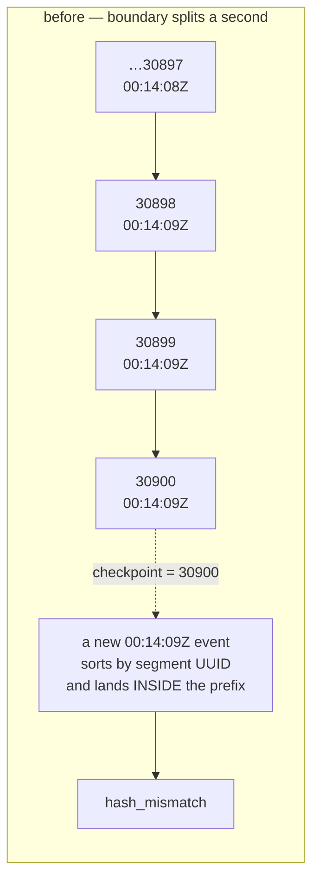
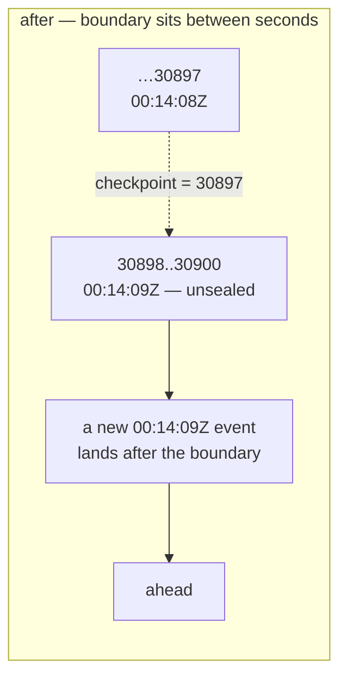

# fix: seal the chain checkpoint at a second boundary

## Summary

`hive verify` reports `hash_mismatch` permanently on this store. The tamper alarm is therefore useless: a real tamper cannot be distinguished from the standing red.

The cause is not corruption and not ambiguous ordering. It is that the checkpoint count can fall inside a group of events sharing one timestamp, and a later append can land *inside* that group — shifting the prefix the checkpoint attests to.

The fix is to stop the checkpoint mid-second: seal only whole seconds. A later same-second arrival then lands after the boundary, the prefix stays reproducible, and `verify` reports `ahead` instead of `hash_mismatch`.

---

## Problem Frame

`chain.verify` is prefix-consistent by design: it recomputes the head over the first `stored["count"]` events and compares it to `stored["head"]`. Events past the checkpoint are legitimate appends, reported as `ahead`. That design is right — full equality flagged every normal append as tampering, which is the failure this replaced.

But `events.read_all` orders rows by `(ts, segment_name, line_index)`. That order is total and deterministic for a fixed set of files. It is **not append-monotonic**: ledger timestamps are second-resolution, and the tie-break is the segment's UUID filename. An event appended now, with a `ts` equal to events already on disk, sorts by segment UUID — so it can be inserted *before* rows already counted inside the checkpoint prefix.

Measured on the live store:

```
stored count : 30900       boundary ts: 2026-08-10T00:14:09Z
events sharing that ts: 3  -> indices 30898 .. 30900
boundary falls INSIDE the tie group: True
recompute head@30900 == stored head: False
```

The store appends roughly three events per second from its own hooks, so almost every checkpoint lands mid-second and is stale the moment it is written. Re-stamping does not help — the new stamp lands in the next tie group.

**Two earlier theories were tested and refuted. Do not revisit them.** The six torn `command_run` rows (2026-07-19, 2026-08-07) are a separate and much smaller issue — `read_all` skips them and the only consumer is an Oversee activity count. Tie ordering is not ambiguous; it is total.

---

## Requirements

- R1. A checkpoint written at time T stays valid as events arrive with `ts` equal to the newest event at T.
- R2. `verify` reports `ahead` for legitimate appends and `hash_mismatch` only when sealed history changed.
- R3. Tamper and deletion of a **sealed** event are still caught.
- R4. No event ordering changes; no `events/*.jsonl` is ever edited (SOP `ledger-schema` §1).
- R5. The narrowed guarantee is stated where a reader will meet it, not left implicit.

---

## Key Technical Decisions

**Seal whole seconds, not event counts.** `write_chain` drops every trailing event whose `ts` equals the last event's `ts`, then stamps the count and head of what remains. The sealed set becomes "every event strictly before the newest second" — a boundary later arrivals in that second cannot reach into.

**This narrows what the checkpoint attests to, and that is the cost.** Events in the newest second are unattested until a later projection seals them. That window already existed (`ahead` events were never attested); this widens it by at most one second's worth of events. The trade is a bounded, self-healing blind spot in exchange for an alarm that works at all. A permanently-red alarm attests to nothing.

**Store the boundary count only — not a boundary timestamp.** `verify` already recomputes at `stored["count"]`; adding a `ts` field would introduce a second source of truth about where the seal is, and the two could disagree. The count is sufficient because the sealed set is now stable.

**Every event sharing one timestamp is a legitimate degenerate case.** A store whose events all land in one second seals nothing: count 0, head the zero digest. `compute_chain(evs, checkpoint=0)` already returns the zero head, and `verify` compares it correctly, so this needs no special case — but it does need a test, because "seals nothing" must be a deliberate outcome rather than an accident.

---

## High-Level Technical Design





The sealed prefix ends where a second ends, so nothing that arrives later can be sorted into it.

---

## Implementation Units

### U1. Seal only complete seconds

**Goal.** A checkpoint that a later same-second append cannot invalidate.

**Requirements.** R1, R2, R4.

**Dependencies.** None.

**Files.** `src/mindhive/chain.py`, `tests/test_chain.py`.

**Approach.** `write_chain` computes the sealable prefix before hashing: walk back from the end while the trailing event's `ts` equals the last event's `ts`, and stamp the count and head of the remainder. `compute_chain` is unchanged — it already takes whatever list it is given. `verify` is unchanged — it already compares a recomputed prefix head against the stored one.

An empty ledger and an all-one-second ledger both seal count 0. That is correct, not a guard to add.

**Execution note.** Test-first on the invalidation case: the assertion that a checkpoint survives a later same-second append is the whole fix, and it fails against today's code.

**Patterns to follow.** `chain.verify`'s existing prefix-consistency contract and the comment block explaining why full equality was wrong — the new comment belongs beside it and should explain the second boundary in the same voice.

**Test scenarios.**
- Covers R1. Two events at `10:00:00Z`, `write_chain`, then a third event also at `10:00:00Z` appended into a different segment: `verify` is ok and reports `ahead`. Fails today with `hash_mismatch`.
- Covers R2. Events at `10:00:00Z` and `10:00:01Z`, `write_chain` seals only the first: `stored["count"] == 1`.
- Covers R3. Seal two seconds, then tamper an event inside the sealed prefix: `hash_mismatch`.
- Covers R3. Seal two seconds, then corrupt a sealed event's line so `read_all` skips it: `hash_mismatch`.
- A tamper on an event in the UNSEALED trailing second does not raise `hash_mismatch` — the checkpoint does not claim it. Asserted explicitly so the narrowed guarantee is pinned rather than discovered.
- All events share one timestamp: `stored["count"] == 0`, `verify` ok, `ahead` equals the event count.
- An empty ledger seals count 0 and verifies ok.
- `write_chain(evs=...)` with pre-parsed events produces the same stamp as reading from disk — the existing no-double-read contract still holds.

**Verification.** The chain suite green, and `stored["count"]` read from the written `chain.json` rather than inferred.

---

### U2. Update the sealed-prefix tests to the narrowed contract

**Goal.** The existing tamper tests keep proving tamper detection, against a sealed event.

**Requirements.** R3, R5.

**Dependencies.** U1.

**Files.** `tests/test_chain.py`, `tests/test_verify.py`.

**Approach.** Several existing tests append a single event, `write_chain`, then tamper it. Under U1 that event is in the unsealed second, so the checkpoint no longer attests to it and the test would fail for the right reason. Each needs a later-timestamped event so the tampered one falls inside the sealed prefix.

This is a contract change, not a test weakened to pass. Each updated test keeps asserting `hash_mismatch`; only the fixture gains a second event.

**Execution note.** Characterisation-first: before changing a fixture, confirm the test fails because the event is unsealed and not for another reason.

**Test scenarios.**
- Every existing chain test that asserts `hash_mismatch` still does so, with the tampered event inside the sealed prefix.
- `test_appended_garbage_keeps_verify_ok_but_shows_in_corrupt_rows` still passes unchanged — an unparseable trailing line is not an event and does not move the boundary.

**Verification.** Full pytest green against the branch baseline of 4490.

---

### U3. Prove it on the real store, and write the guarantee down

**Goal.** The alarm is green on the live ledger, and the next reader learns what it now promises.

**Requirements.** R2, R5.

**Dependencies.** U1, U2.

**Files.** `docs/DATA_MODEL.md`.

**Approach.** Run the projector against the real store to re-stamp, then read `hive verify`'s actual output. Expect `ok: true` with an `ahead` count, and `corrupt_rows` still listing the six known torn rows — those are unaffected and must keep showing.

`docs/DATA_MODEL.md` gains one paragraph on the chain checkpoint: it seals whole seconds, so the newest second is unattested until the next projection, and `ahead` is the normal steady state.

**Test expectation: none — this unit exercises the real flow.**

**Verification.** `hive verify` output read directly, showing `ok: true`, a non-zero `ahead`, and the six corrupt rows still reported. Then `hive log`.

---

## Scope Boundaries

**In this plan.** The checkpoint boundary, its tests, one documentation paragraph, and a verified green run on the real store.

**The six corrupt rows need no work, and this is a decision, not an omission.** They are already surfaced by `events.corrupt_rows()` and reported by `hive verify` separately from the chain verdict — which is the correct shape: reads stay total, corruption is loud, and the two signals do not contaminate each other. Repairing the rows would mean editing `events/*.jsonl`, which SOP `ledger-schema` §1 forbids. They stay as history.

### Deferred to Follow-Up Work

- The torn-write cause itself. Six `command_run` rows across three segments suggests appends without locking on that path. Worth diagnosing on its own evidence; not a rider on the checkpoint fix.
- Making the order append-monotonic (a sequence number, or sub-second timestamps). That removes the blind spot entirely rather than bounding it, but it changes the canonical event order and re-bases every chain head ever computed. A deliberate migration, not this.

**Non-goals.** No change to event ordering. No edit to any `events/*.jsonl`. No new field in `chain.json`.

---

## Risks

**The newest second is unattested.** A tamper confined to events written in the same second as the last projection is not caught until the next projection seals that second. Bounded and self-healing, and strictly better than the current state where nothing is attested because the alarm is always red. U1's explicit test pins the boundary so nobody later mistakes it for a bug.

**A burst could widen the window.** The window is one second of events, not a fixed count. A process appending heavily in one second leaves more unsealed. The mitigation is projection frequency, which is unchanged by this plan.
