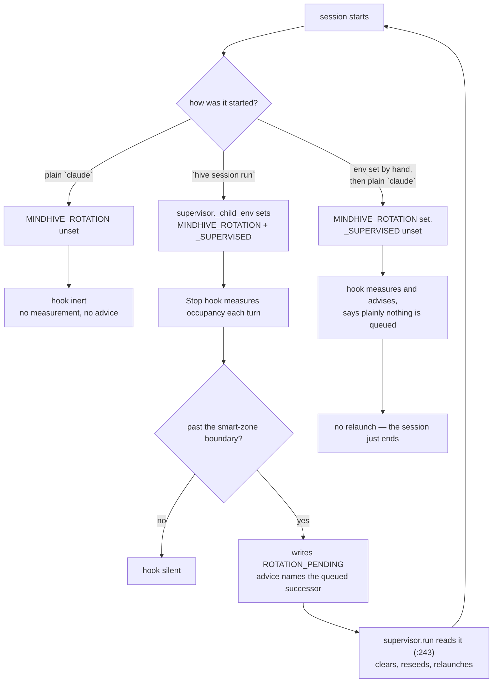

# feat: close the five gaps the five-surfaces plan left open

## Summary

Five gaps survive the five-surfaces plan. Four are cheap and one turned out to
be already built. This plan closes all five: it makes the dashboard performance
claim measurable by command instead of by ritual, retires a roadmap card without
claiming a step nobody performed, writes the rotation options down and records
that the chosen one already ships, justifies running pytest from the web server,
and pushes SOP-injection status onto the surface that loads itself.

## Problem Frame

The five-surfaces work shipped its code and stopped short of its evidence. The
performance branch has a before-profile and no after-profile — the plan wrote
the measurement conditions and left the table empty. The roadmap machinery can
retire a card on proof, and the one live card has no proof to retire on. The
rotation advisory stopped lying about a successor, which is honesty, not the
feature. The dashboard's dead buttons became live jobs, minus a justification
and minus an empty-case message that explains itself. And the injection status
that took a session to build reaches nobody who does not type the command.

Each gap has the same shape: the mechanism landed and the thing a person would
actually read did not. The rotation gap turned out to be the purest case of it —
the mechanism is complete and the writing about it never happened.

---

## Requirements

### Evidence and measurement

R1. The four dashboard endpoints are measured after the perf work under
conditions comparable to the before-profile, and the numbers land where the
before-numbers live.

R2. The measurement is repeatable by command. Anyone suspecting the dashboard
slowed down again can produce a comparable table without reconstructing a
method.

R3. Every measurement carries the conditions it was taken under — including the
client method, the namespace folded, and the cache state of each sample. A
number without its conditions is not evidence here; the before-profile differs
by 6.7x between two condition sets.

### Roadmap honesty

R4. The rotation card leaves the board without any step being marked done that
a human did not perform.

### Rotation

R5. The four rotation options are written down with their costs and the
evidence each can produce, and the outcome is recorded in the ledger — including
the finding that the chosen option already ships.

### The dashboard's two remaining gaps

R6. Running pytest as a subprocess from the web server is justified where a
reader will find it, naming what holds it safe and what would revoke that.

R7. Reflect's empty case explains the rule that makes zero the healthy answer,
not just that the answer was zero.

### Always-on injection status

R8. Injection status reaches the digest that loads itself — MEMORY.md, and
STATE.md with it — when the injection is degraded, and costs zero lines when it
is healthy.

---

## Key Technical Decisions

K1. **The bench measures and never fixes.** It issues requests and reads
timings. It does not start, stop, restart, or mutate anything. A benchmark that
repairs its subject cannot be re-run to confirm a regression. It is, however,
part of the load it measures — see Risks; that is bounded by `--reps`, not
denied.

K2. **The bench runs from the CLI, not from inside the dashboard.** A load
generator hosted in the process being measured competes for the GIL it is
measuring — the exact mechanism the before-profile identified.

K3. **Cache misses and cache hits are reported as separate rows, never
averaged.** The perf work under test *is* a fingerprint-keyed memo layer
(`_STATS_MEMO`, `_SESSIONS_MEMO`, `_CATS_MEMO`, `dashboard.py:452-462`, gated at
`:438-445`). The first request per endpoint is the miss that pays the fold; the
rest are hits. The before-profile was taken on code without those memos, so
every one of its samples was a miss. Discarding the first sample would throw
away the only measurement of the thing being measured and average the hit path;
mixing them yields a figure that moves with the hit/miss ratio, which on a live
ledger is nondeterministic. So both are reported, and the miss row is the one
that compares to the before-profile.

K4. **No rotation launcher is built, because rotation already has one.**
`hive session run` runs an interactive session under smart-zone rotation,
detects the project from cwd, and carries the spin guard; `supervisor.run`
closes the loop by reading `ROTATION_PENDING`
(`src/mindhive/rotation/supervisor.py:243`), clearing it, reseeding, and
relaunching. A second command wrapping it would add a name, a module, and a test
file for zero new behavior. The rejected sub-variant — set `MINDHIVE_ROTATION`
and exec plain `claude` — is worse than doing nothing: the hook then measures
and advises, but nothing relaunches.

K5. **`MINDHIVE_ROTATION_SUPERVISED` keeps its single writer.**
`supervisor._child_env` remains the only place it is set. Cutting the launcher
removes the only thing in this plan that could have become a second one.

K6. **The injection notice is composed at build time, through
`projector.compose_state`.** `cmd_state` does not build STATE.md — it prints the
file (`__main__.py:282-284`). `compose_state` is `build_state`'s only caller,
and it feeds both the STATE.md rebuild and `sync.py`, which writes MEMORY.md.
Threading the notice there is what makes it reach the digest that loads without
being asked. The verdict is therefore as of the last rebuild — the same property
the review, change-log, and roadmap notices already have.

K7. **The notice renders only for degraded states, and says the verdict is
global.** `verbatim` renders the empty string. `sopgate.probe` ignores its
`project` argument and reads the *global* mandatory-SOP sidecar by design
(`sopgate.py:192`, `:207`, and the comment at `:174-179`), while STATE.md is
per-namespace — so the block names it as a global verdict rather than letting a
reader assume it describes their project.

K8. **The notice reads `sopgate.probe`, not a second computation.** The probe
already counts the same `plan()` the hook path renders.

K9. **The archive reason cites the written evaluation, and no work link is
attached.** A work link would let the retire sweep mark the human TUI step done
on the strength of a merged PR — `_add_work_link_flags` is attached to
`roadmap archive`, so this is a live hazard, not a hypothetical.

K10. **The bench writes no ledger events.** It is a diagnostic. Recording every
curiosity as a measurement event would make the `verification` count meaningless.

---

## High-Level Technical Design

What sets `MINDHIVE_ROTATION`, and what each path actually gives you. Drawn
because the middle branch is the one this plan nearly built:



The loop through `J` is closed in shipped code. The one link never exercised by
a human is the 30-second terminal check in
`scripts/rotation/MANUAL_TUI_CHECK.md`, and no unit here claims it.

Where the injection notice has to enter, given that `cmd_state` only prints:

```
sopgate.probe()  ──►  sopgate.notice(result)  ──►  projector.compose_state(..., injection=)
                                                        │
                                          ┌─────────────┴─────────────┐
                                          ▼                           ▼
                                   STATE.md rebuild            sync.py  ──► MEMORY.md
                                   (read by `hive state`,       (the digest that loads
                                    which only cat's it)         itself each session)
```

---

## Implementation Units

### U1. `hive bench dashboard` — the measurement as a command

**Goal.** One command produces the four-endpoint table plus the concurrency
test, against a server the caller names.

**Command shape.** `hive bench dashboard --url <origin> --token <t>
--label <condition> [--project NAME] [--reps N] [--timeout S]
[--endpoint PATH ...] [--json]`.

`--token` is required and not optional: every target route sits behind the token
gate, which is checked *above* route dispatch (`dashboard.py:1216-1218`) with
only `/` exempt. Without it the bench prints four tidy 403 rows and exits zero —
a clean-looking run that measured nothing. The token lives at
`store_home()/dashboard.token`; the command reads it from there by default and
`--token` overrides.

`--project` selects the namespace, because the routes are project-scoped
(`proj = (qs.get("project") or [None])[0] or default_project()`,
`dashboard.py:1222`) and which namespace is folded is the largest single
determinant of fold cost. It is recorded in the output whether or not it was
passed.

`--timeout` (default 30s) is required behavior, not polish: `urllib.request`
defaults to no timeout, and the subject has known lock contention and 12s p50s.
Without it one wedged endpoint hangs the whole run.

`bench` is a new top-level group, not a subcommand of `dashboard`: `dashboard`
is a leaf parser taking only `--port` and `--no-browser` (`__main__.py:3917`),
and `python -m mindhive dashboard` must keep working as a bare invocation — the
mechanism CLAUDE.md protects.

**Requirements.** R2, R3.

**Dependencies.** None.

**Files.**
- `src/mindhive/bench.py` (new — owns both the measurement and its parser)
- `src/mindhive/__main__.py` (~2 lines: call `bench.register(sub)`)
- `tests/test_bench.py` (new)
- `docs/session-legend.md`, `README.md`

**Parser placement.** `bench.py` exposes `register(subparsers)` and wires its own
flags; `__main__.py` only calls it. Every other group registers inline there
(`context` `:3184`, `repo` `:3211`, `packs` `:3226`, `mindnet` `:3577`), so this
is a deliberate deviation and needs a one-line comment saying so. The reason is
size: `__main__.py` is 4115 lines. Note for accuracy — the tech-debt lens does
*not* flag this file (`replenish._python_modules` skips `__`-prefixed names), so
the argument is the measured line count, not a tool's verdict.

**Why a command and not a script.** This repo already ships four read-only
diagnostics as fully-tested commands — `hive repo`, `hive context`, `hive
packs`, `hive verify` — and `repo stale` is nearly the same shape. A script in
`scripts/` would be smaller but would be the only diagnostic treated
differently, and R2's "anyone can reproduce it" then depends on someone browsing
a folder.

**Approach.** A module owning three things: timing one endpoint over N
repetitions, running the four requests concurrently to measure serialization,
and rendering both as a table comparable to the before-profile. HTTP goes
through an injectable transport so error paths are testable without a live
server. `--json` for machine reading, plain text by default.

Stdlib only (`urllib.request`, `concurrent.futures`, `time.perf_counter`). This
project ships no HTTP client dependency, and a diagnostic is the worst possible
reason to add the first one.

**Miss and hit are separate rows.** The first request per endpoint is reported
as the `cold/miss` sample; the remaining `reps` as `warm/hit`. Nothing is
discarded. The miss row is what compares to the before-profile, whose samples
were all misses; the hit row is what a user actually experiences. The output
states how many samples landed in each, because on a live ledger an auto-harvest
append invalidates the fingerprint mid-run and a "hit" row may contain a miss.

Conditions ride with the numbers: target URL, namespace, repetition count,
timeout, run timestamp, client method (`urllib`, mean over N — *not* the
before-profile's `curl -w` reported as ranges), and a caller-supplied `--label`
naming the load condition. The client method is recorded because it changed;
`--label` only captures the server condition.

The bench cannot read the server's uptime — nothing exposes it — so it prints
its own run timestamp and the caller records the restart time beside it.

`--endpoint` is repeatable and defaults to the four routes the before-profile
measured. A renamed route surfaces as a non-200; an *added* slow route leaves no
trace, and a fixed list would keep printing four healthy rows while a fifth
regressed. The output names which set was used.

**Patterns to follow.** `repo.py` for the injectable seam and the never-raises
contract; `cmd_repo_stale` for a read-only diagnostic that exits zero even when
the news is bad. Note the limit of the analogy: `repo.py`'s runner returns data
with no time dimension, and the bench's whole output *is* the time dimension.

**Test scenarios.**
- A connection error on one endpoint reports that endpoint as unreachable and
  still renders the others, rather than aborting the run.
- A non-200 response is reported with its status, not silently timed as if it
  succeeded. A 403 in particular is called out as a probable token problem —
  it is the failure a missing `--token` produces, and it must not read as a
  fast endpoint.
- Every endpoint unreachable renders a table of failures and says so, rather
  than an empty table that reads as a clean run.
- A hanging endpoint is cut off at `--timeout` and reported as timed out; the
  run completes.
- The miss row and the hit rows are reported separately, and the sample counts
  add up to `1 + reps`.
- `--json` emits every condition field the text table shows: url, project,
  label, method, timeout, timestamp, endpoint set.
- The recorded project is the one passed, and the default is named explicitly
  when none was.
- The command exits zero when an endpoint is slow.
- Missing `--label` is refused with a message naming why the label matters.
- With no `--endpoint`, exactly the four before-profile routes are timed, in
  order; repeated `--endpoint` replaces the set rather than appending; a single
  `--endpoint` runs one row.
- **Wiring:** the group is reachable from the real CLI — `hive bench dashboard
  --help` exits 0 and names `--label` and `--token`. A `register()` written but
  never called leaves every unit test above green and the command missing.

*Deliberately not unit-tested:* the concurrency ratio. Against instant fakes,
`ThreadPoolExecutor` measures the executor, not the server — a test that asserts
`concurrent.futures` works while looking like it proves serialization. The
serial-vs-concurrent figure is verified against a real server in the step below,
and the unit tests cover only that both figures are reported and that a failed
member of the four is named rather than silently dropped from the denominator.

**Verification.** The command runs against the isolated dashboard on 54471 with
a real token and prints a table with real numbers, including a concurrency ratio
that is not 1.0.

---

### U2. The after-measurement, taken and recorded

**Goal.** The empty half of the T1 result gets its numbers.

**Requirements.** R1, R3.

**Dependencies.** U1. Also gated on restarting the live dashboard on 54461 so it
serves merged code (approved by the user; the restart is plain, and the served
page is grepped for `showOversee` / `renderOversee` before the measurement is
trusted).

**Files.**
- `docs/plans/2026-08-10-001-fix-feedback-loop-five-surfaces-plan.md` (new
  `T1 AFTER` section)

**Approach.** Two servers, as before: the live 54461 under real load with a
browser attached and both pollers live, against an isolated 54471 from this
worktree with no browser. The isolated server needs `PYTHONPATH=<worktree>/src`
explicitly — the venv installs mindhive editable against
`C:/Users/hanif/mindhive`, so a worktree-started server without it serves master.
The live 54461 is never repointed this way.

The section records, for each server: the commit served, the restart time, the
run timestamp, the namespace, the condition label, and the miss and hit rows
separately. It states plainly that the client method changed from the
before-profile's `curl -w` ranges to `urllib` means, so the comparison is
between the miss rows and is approximate by construction.

It also records the commit skew: by the time U2 runs, 54471 serves this plan's
code and 54461 does not. None of U1/U4/U5/U6 touch the four measured endpoints,
so the skew is not expected to move the numbers — but "not expected to" is
recorded as an assumption, not omitted.

The honest-reporting rule applies without exception: any endpoint that did not
improve is written as not improved. A measurement that only reports the wins is
the failure this whole plan exists to correct.

**Test scenarios.** None — this unit produces evidence, not behavior.

**Verification.** The `T1 AFTER` section exists, carries miss and hit rows for
four endpoints plus the concurrency numbers, names both commits, both restart
times, the namespace, and the method change, and states which endpoints improved
and which did not.

---

### U3. The rotation evaluation, written and recorded

**Goal.** The four options stop being an unwritten choice, and the record says
plainly that the chosen one already ships.

**Requirements.** R5.

**Dependencies.** None.

**Files.**
- `docs/rotation-options.md` (new)
- ledger: one `decision` event

**Approach.** Each option gets its cost, its blast radius, and the evidence it
can produce: supervisor always-on, launcher shim, signal-plus-handoff, and
stating the limit as the result. The evaluation records the finding that settled
it — the launcher option is already satisfied by `hive session run` plus
`supervisor.run`'s `ROTATION_PENDING` consumption — and why the
env-var-plus-plain-`claude` variant is rejected rather than merely not chosen.

The one thing still unproven is named: the human TUI step in
`scripts/rotation/MANUAL_TUI_CHECK.md`.

Recorded with `hive append decision`, one line, headline first.

**Test scenarios.** None — a document and a ledger append.

**Verification.** `hive recall "rotation options"` returns the decision.

---

### U4. Why pytest runs from the web server

**Goal.** The justification the five-surfaces review asked for.

**Requirements.** R6.

**Dependencies.** None.

**Files.**
- `src/mindhive/dashboard.py` (docstring of `_job_selftest`)
- `docs/DATA_MODEL.md`

**Approach.** State the true shape first: this is not pytest in-process. It is a
real subprocess (`verify.default_argv`, `verify.py:69`) spawned through
`subprocess.Popen` (`verify.py:141`) from a worker thread, single-flight-locked,
streamed line by line, and sealed as `job_abandoned` if the process dies
mid-run.

Then name what holds it safe, accurately:
- the **server-wide** token (`make_handler(token)` `dashboard.py:527`,
  `_check_token` `:592-598`) — one token for the whole server, not per-route,
  and normally delivered in the URL query string (`stable_url` `:1888-1894`). A
  URL-borne bearer token is a materially weaker hold than "per-route" implies,
  and the docstring says so rather than overselling it;
- the single-flight lock `_SELFTEST_LOCK` (`dashboard.py:88`, passed at `:1824`);
- the server being local-only.

Then state plainly that a browser click starts a multi-minute CPU-heavy
subprocess. Remove any one of the three holds and the justification is revoked.
That last sentence is the point of writing it down.

**Test scenarios.** None — documentation of existing behavior.

**Verification.** The docstring and the data-model section name all three holds,
the URL-borne-token weakness, and the revocation condition.

---

### U5. Reflect's empty case explains its rule

**Goal.** Zero reads as healthy, not as broken.

**Requirements.** R7.

**Dependencies.** None.

**Files.**
- `src/mindhive/dashboard.py` (around `:1740`)
- `tests/test_dashboard.py` (beside `test_reflect_noop_on_empty_store` `:1829`,
  which uses the `dashboard_server` fixture and asserts `outcome` and `result`
  but never the summary text — which is why it stays green through this change
  and why a new test asserting the sentence is red at baseline)

**Approach.** The current text reports the count. The new text names what was
counted — active incidents whose `rule_source` is `none` (`dashboard.py:1736`) —
and why an empty set is the good state: every active failure already produced a
lesson. The outcome stays `nothing_to_do`; only the sentence changes.

**Test scenarios.**
- With no eligible incidents, the report is `nothing_to_do` and its summary
  names both what was counted and why zero is healthy.
- With eligible incidents present, the message is not the empty-case one.
- The empty-case summary is non-empty (`outcomes.Report` already rejects an
  empty summary, `outcomes.py:82-88`; this asserts the specific text survives).

**Verification.** The Reflect button on a store with no eligible incidents
prints the new sentence.

---

### U6. Injection status on the digest that loads itself

**Goal.** The status stops requiring a command.

**Requirements.** R8.

**Dependencies.** None.

**Files.**
- `src/mindhive/sopgate.py` (a notice renderer beside `render_probe`)
- `src/mindhive/projector.py` (`build_state` gains `injection=None`;
  `compose_state` `:134` threads it and calls the probe)
- `src/mindhive/sync.py` (the MEMORY.md path, `:126`, gets it too)
- `src/mindhive/__main__.py` (both stale copies of the 0.4s budget comment —
  `cmd_state` `:259` and the UserPromptSubmit path `:179` — corrected together)
- `tests/test_sopgate.py`, `tests/test_projector.py`, `tests/test_sync.py`
- `docs/DATA_MODEL.md`, `docs/session-legend.md`

**Where it enters, and why not where I first said.** `cmd_state` does not build
STATE.md; it prints the file (`__main__.py:282-284`). `build_state`'s only
caller is `projector.compose_state`, which serves both the STATE.md rebuild and
`sync.py`'s MEMORY.md write. MEMORY.md is the digest that loads without being
asked, so composing the notice anywhere else would satisfy a `hive state` test
while missing the surface R8 exists for.

Consequence accepted deliberately: the verdict is as of the last rebuild, not as
of read time. The review, change-log, and roadmap notices already work this way
(`projector.py:36`, `:41`, `:47`), and `hive sync` runs at session end.

**Approach.** A renderer turning `sopgate.probe` into a short block for
`pointers_only`, `partial`, and `silent`, and `""` for `verbatim`. It names the
verdict, the procedure that lost its body, and a command that exists — and it
says the verdict is **global**, because `probe` ignores `project` and reads the
global mandatory-SOP sidecar by design (`sopgate.py:192`, `:207`, comment
`:174-179`) while STATE.md is per-namespace.

**Reuse before adding.** `sopgate` already has two presentation layers for these
same verdicts: `render_probe` (`:250`) and `_surface_probe` (`:306-343`), the
latter registered in the outcomes registry with degraded sentences already
written for `pointers_only` and `partial`. The notice reuses that wording rather
than inventing a third phrasing of the same three states; K8 refuses a second
computation and this refuses a second vocabulary.

**Cost.** `probe()` is one `sop.read_global_sidecar()` plus pure `plan`/`render`
over a handful of rows (`sopgate.py:205-213`) — a small JSON read, not the two
git subprocesses that made the tracking probe cost 85ms. It is paid at rebuild,
not on every prompt, which is the cheaper path anyway. The measured number is
still recorded.

**The budget comments.** Both copies are corrected in this unit, not one.
`cmd_state:259` and `__main__.py:179` state the same ~0.4s figure; the measured
baseline is 465ms without the tracking probe and 587ms with it, min of 5 — 47%
over. The replacement records the measured numbers, the date, and states plainly
that the path is over the figure it names, rather than relabelling it as if the
target had merely been wrong.

**Test scenarios.**
- `verbatim` renders the empty string, and composed output contains no injection
  section at all.
- Each of `pointers_only`, `partial`, and `silent` renders a block naming the
  verdict and the affected procedure.
- The block states the verdict is global rather than project-scoped.
- The block names a command that exists.
- Its wording matches `_surface_probe`'s existing sentences rather than a third
  variant.
- `build_state` places the notice without displacing the review, change-log, or
  roadmap notices; all four can be present at once.
- The healthy path adds zero lines, asserted by comparing rendered line counts.
- A junk or missing `injection` value (None, `{}`, a non-dict) renders no block
  and leaves the digest otherwise complete. `probe` itself cannot raise
  (`sopgate.py:209`, `:214`), so the guard belongs on the renderer.
- **Wiring, both surfaces:** a rebuild writes the block into STATE.md, and
  `hive sync` writes it into MEMORY.md, when the sidecar is degraded — and
  neither carries it when the sidecar is `verbatim`. The MEMORY.md half is the
  one that matters; a renderer reached only by STATE.md passes every test above
  while the auto-loaded digest stays silent.

**Verification.** With the shortened SOP in place both digests gain nothing;
with an oversized SOP forced, the block appears in MEMORY.md and names
`pointers_only`.

---

### U7. Retire the roadmap card

**Goal.** The card leaves the board honestly.

**Requirements.** R4.

**Dependencies.** U3 — the archive reason cites the evaluation.

**Files.** None. Ledger only.

**Approach.** `hive roadmap archive smart-zone-interactive-rotation --reason
"<cites the evaluation, states that rotation already ships end to end, and
states that the human TUI step was not performed>"`. No `--branch`, no `--pr`,
no `--commit`: `_add_work_link_flags` is attached to this command, and a work
link would let the retire sweep mark step 11 done on the strength of a merged
PR. No human ran the terminal check.

The reason text is shown to the user before the command runs.

**Test scenarios.** None — a ledger operation using an existing, tested command.

**Verification.** `hive roadmap list` no longer shows the card as active, and
`hive roadmap show` records the archive reason with step 11 never marked done.

---

## Scope Boundaries

**In scope.** The five gaps above, their tests, their change-log entries, and
one PR.

**What already exists (and is reused, not rebuilt).**
- `hive session run` + `supervisor.run` — a rotating session in one command,
  loop closed at `rotation/supervisor.py:243`. R5's implementation half is
  satisfied by this, not by new code.
- `hive session install-hook` — idempotent Stop-hook registration whose help
  text already states the opt-in and the Windows-only limit.
- `_SELFTEST_LOCK` (`dashboard.py:88`, passed `:1824`) — U4's single-flight
  hold. Documented, not added.
- `sopgate.probe` / `render_probe` / `_surface_probe` — U6 renders from the
  first and reuses the third's wording.
- `repo.py`'s injectable-runner seam — U1 follows it, with the time-dimension
  caveat noted.
- `hive repo`, `hive context`, `hive packs`, `hive verify` — the precedent for
  shipping a read-only diagnostic as a tested command.

**Not in scope.**
- **A rotation launcher command (cut during review).** `hive session run`
  already is the one-command rotating session.
- Changing how SOP injection itself works, or making it project-scoped. The
  global sidecar is deliberate; U6 reports it accurately rather than changing it.
- A dashboard panel for injection status — only visible when the dashboard is
  open, which is the complaint that started this.
- Rotation options 1 and 3 (supervisor always-on, signal-plus-handoff). The
  evaluation records them; neither is built.
- Any change to the ledger event contract.

### Deferred to follow-up work

- Rotation discoverability. `hive session run` exists and nobody is told about
  it. Set aside: it would add work to the prompt path U6 has not finished
  measuring.
- A browser-tier probe for the job polling flow.
- `jobs.orphans()` and its single-writer-per-namespace assumption.
- A defined replacement budget for the session-start hook path. U6 corrects the
  stale figure and states the overage; choosing the new target needs a decision
  about what that path is allowed to cost, which is bigger than this plan.

---

## Risks and Dependencies

**The bench is part of the load it measures.** The before-profile's own finding
is that the 6.7x amplification *is* concurrent request pressure against
GIL-serialized folds. Issuing `(1 + reps) × 4` heavy requests at the live 54461
makes the bench a third poller. `--reps` defaults low (3) for exactly this
reason, and the T1 AFTER section records the value used.

**The restart seals in-flight jobs.** Restarting 54461 for U2 makes any job
running at that moment read as `job_abandoned` on the next boot. The boot seal
working, not a fault — but it should not surprise anyone reading the Log
section afterwards.

**The two servers will not be on the same commit.** The before-profile pinned
"same store, same commit". U2 runs 54471 from this worktree, which by then
carries U1/U4/U5/U6, against 54461 which does not. None of those touch the four
measured endpoints, so the skew should not move the numbers — recorded as an
assumption in the section, not omitted.

**The isolated server can silently measure master.** The editable install
resolves to `C:/Users/hanif/mindhive` unless `PYTHONPATH=<worktree>/src` is set.
A measurement taken without it describes the wrong branch and looks normal.

**A live ledger moves mid-run.** Auto-harvest appends invalidate the memo
fingerprint, so a nominal "hit" sample can be a miss. The bench reports the
sample counts so this is visible rather than averaged away.

**The rotation work stays clear of the machine-wide hook.** The Stop hook fires
in every Claude Code session on this machine. No unit here touches the hook,
`_child_env`, or either environment variable; U3 and U7 only write documents and
ledger rows. The existing fail-open and opt-in tests must stay green without
modification.

---

## Verification Strategy

Every unit that touches `src/` or `tests/` gets a `hive log` entry with explicit
`--files` before it is called done. Only U1, U4, U5 and U6 touch `src/` or
`tests/`.

New tests must fail against the pre-change source. Where a test is a
forward-looking invariant guard that the baseline satisfies, it is shown to bite
by breaking the invariant it watches — asserting the guard, not assuming it.
Tests that cannot fail meaningfully are not written: the concurrency ratio
against instant fakes is named as such and left to real-server verification.

Three tiers before the work ships, each reported with its count: the default
suite, `-m node`, and `-m browser`. A tier that was not run is named as not run.

The units that produce evidence rather than behavior (U2, U3) are verified by
reading their artifacts, and U7 by reading the roadmap after the fact.

---

## Open Questions

**What should the session-start hook path actually be allowed to cost?** U6
corrects the stale 0.4s figure and records the 587ms reality, but does not set a
new target. Deferred above, deliberately.

---

## Implementation Tasks

Synthesized from this review's findings. Each derives from a specific finding
above. Checkbox as you ship.

- [ ] **T1 (P1, human: ~1h / CC: ~15min)** — bench — require `--token`, defaulting from `store_home()/dashboard.token`
  - Surfaced by: Outside voice #3 — the token gate at `dashboard.py:1216` sits above route dispatch; all four endpoints 403 without it
  - Files: `src/mindhive/bench.py`, `tests/test_bench.py`
  - Verify: `hive bench dashboard --url http://127.0.0.1:54471 --label isolated` returns timings, not 403 rows
- [ ] **T2 (P1, human: ~1h / CC: ~15min)** — bench — report cold/miss and warm/hit as separate rows; discard nothing
  - Surfaced by: Outside voice #2 — the perf work *is* the memo layer (`dashboard.py:452-462`); discarding request 1 averages the cache-hit path
  - Files: `src/mindhive/bench.py`, `tests/test_bench.py`
  - Verify: table shows both rows and the sample counts sum to `1 + reps`
- [ ] **T3 (P1, human: ~2h / CC: ~25min)** — projector — thread `injection` through `compose_state` and `sync.py`, not `cmd_state`
  - Surfaced by: Outside voice #1 — `cmd_state` only prints STATE.md (`__main__.py:282-284`); MEMORY.md is written by `sync.py:126`
  - Files: `src/mindhive/projector.py`, `src/mindhive/sync.py`, `src/mindhive/sopgate.py`, `tests/test_projector.py`, `tests/test_sync.py`
  - Verify: with a degraded sidecar, `hive sync` puts the block in MEMORY.md
- [ ] **T4 (P2, human: ~20min / CC: ~5min)** — bench — add `--timeout` (default 30s)
  - Surfaced by: Outside voice #4 — `urllib` has no default timeout; the subject has 12s p50s and lock contention
  - Files: `src/mindhive/bench.py`, `tests/test_bench.py`
  - Verify: a hanging endpoint is cut off and the run completes
- [ ] **T5 (P2, human: ~30min / CC: ~8min)** — bench — add `--project`, record the namespace in the conditions
  - Surfaced by: Outside voice #3 — routes are project-scoped (`dashboard.py:1222`); namespace dominates fold cost
  - Files: `src/mindhive/bench.py`, `tests/test_bench.py`
  - Verify: output names the namespace even when it was defaulted
- [ ] **T6 (P2, human: ~30min / CC: ~8min)** — bench — `--endpoint` repeatable, defaulting to the four routes
  - Surfaced by: Review A2 — a fixed list stays blind to an added slow route
  - Files: `src/mindhive/bench.py`, `tests/test_bench.py`
  - Verify: one `--endpoint` runs one row; output names the set used
- [ ] **T7 (P2, human: ~45min / CC: ~12min)** — sopgate — reuse `_surface_probe` wording; state the verdict is global
  - Surfaced by: Outside voice #8, #11 — `probe` ignores `project` and reads the global sidecar; `_surface_probe` already phrases these states
  - Files: `src/mindhive/sopgate.py`, `tests/test_sopgate.py`
  - Verify: block wording matches the registry sentences; says "global"
- [ ] **T8 (P2, human: ~20min / CC: ~5min)** — cli — correct BOTH stale 0.4s budget comments
  - Surfaced by: Outside voice #9 — the figure appears at `__main__.py:179` and `:259`; fixing one leaves the drift
  - Files: `src/mindhive/__main__.py`
  - Verify: neither copy still claims ~0.4s without naming the 587ms measurement
- [ ] **T9 (P2, human: ~20min / CC: ~5min)** — dashboard — docstring says server-wide URL-borne token, not "per-route"
  - Surfaced by: Outside voice #12 — `make_handler(token)` `:527`, delivered via query string (`stable_url :1888`)
  - Files: `src/mindhive/dashboard.py`, `docs/DATA_MODEL.md`
  - Verify: the docstring names the weakness rather than overselling the hold
- [ ] **T10 (P2, human: ~1.5h / CC: ~20min)** — tests — command-level wiring tests
  - Surfaced by: Review T1 — three gaps of one class: component correct, never reached
  - Files: `tests/test_bench.py`, `tests/test_sync.py`, `tests/test_cli.py`
  - Verify: `hive bench dashboard --help` exits 0; MEMORY.md carries the block
- [ ] **T11 (P3, human: ~30min / CC: ~8min)** — docs — T1 AFTER records the client-method change and the commit skew
  - Surfaced by: Outside voice #6, #7 — method changed from `curl -w` ranges to `urllib` means while claiming "same method"; the two servers differ by this plan's code
  - Files: `docs/plans/2026-08-10-001-fix-feedback-loop-five-surfaces-plan.md`
  - Verify: the section names both commits, both restart times, and the method change
- [ ] **T12 (P3, human: ~40min / CC: ~10min)** — bench — `register(subparsers)` in the module, with a comment naming the deviation
  - Surfaced by: Review Q1 — `__main__.py` is 4115 lines; four other groups register inline
  - Files: `src/mindhive/bench.py`, `src/mindhive/__main__.py`
  - Verify: `__main__.py` grows by ~2 lines

_No JSONL artifact was written: `jq` is not installed on this machine, and this
skill forbids hand-rolling JSONL. `/autoplan` cannot aggregate this phase until
`jq` is available._

---

## GSTACK REVIEW REPORT

| Review | Trigger | Why | Runs | Status | Findings |
|--------|---------|-----|------|--------|----------|
| CEO Review | `/plan-ceo-review` | Scope & strategy | 0 | — | — |
| Codex Review | `/codex review` | Independent 2nd opinion | 1 | ISSUES FOUND | 12 findings; 3 verified against source and folded |
| Eng Review | `/plan-eng-review` | Architecture & tests (required) | 1 | CLEAR | 8 issues, 0 critical gaps, 1 unit cut |
| Design Review | `/plan-design-review` | UI/UX gaps | 0 | — | — |
| DX Review | `/plan-devex-review` | Developer experience gaps | 0 | — | — |

**CODEX:** Codex CLI is not installed; the outside voice ran as a fresh-context
Claude subagent with the user's explicit approval. It returned 12 findings. Three
were verified line-by-line before acceptance and each invalidated a decision this
review had already made: `cmd_state` never calls `build_state`
(`__main__.py:282-284`), the four bench endpoints sit behind a token gate checked
above route dispatch (`dashboard.py:1216`), and the memo layer under test
(`dashboard.py:452-462`) means a discarded warm-up throws away the only
cache-miss sample. Nine further findings were folded; one — that `U1` is
oversized and belongs in `scripts/` — was put to the user and declined on the
precedent of four existing diagnostic commands.

**CROSS-MODEL:** Two tension points went to the user rather than being
auto-applied. On the warm-up discard, the outside voice contradicted this
review's own accepted recommendation and won. On U1's size, this review's
position held, with the counter-evidence (`hive repo`, `hive context`, `hive
packs`, `hive verify` all ship as tested read-only commands) stated in the
question. The outside voice's vacuous-test finding was accepted without a
question: the concurrency assertion against instant fakes measures
`ThreadPoolExecutor`, not the server, and has been moved to real-server
verification.

**VERDICT:** ENG CLEARED — ready to implement. Scope reduced: the rotation
launcher unit was cut after `hive session run` plus
`rotation/supervisor.py:243` were verified to close the loop already. CEO,
Design, and DX reviews were not run and do not gate this work.

NO UNRESOLVED DECISIONS
