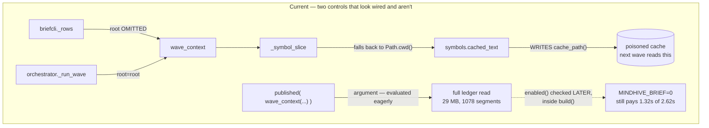
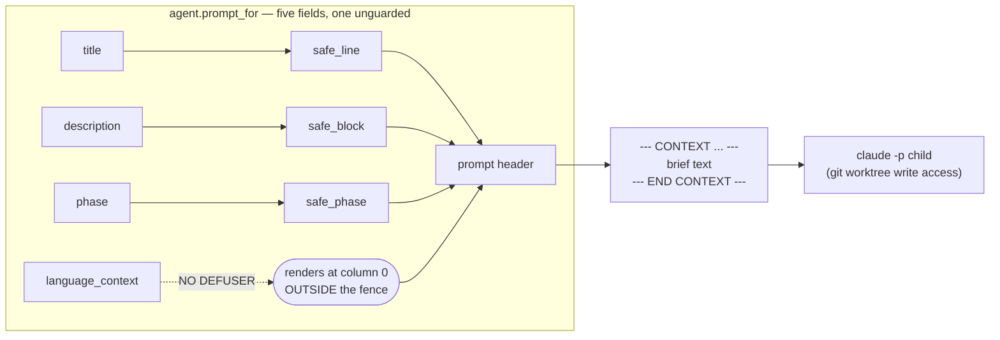

# fix: Land Lintester Branch 1 — close 3 blockers, repair 6 vacuous tests

**Target branch:** `claude/lintester-mindhive-orchestration-77909c` (draft PR #119, base `master`)

---

## Summary

Branch 1 adds a `brief(task)` composer that assembles skills, SOPs and recorded
constraints from the ledger and injects them into spawned `claude -p` children
inside a labelled fence. The work is committed, pushed, and green
(5946 passed / 2 skipped / 154 deselected, exit 0).

A full `/autoplan` review decided 46 findings and produced 21 tasks. This plan
executes them. Three are landing blockers — a hole in the fence the branch exists
to build, a breach of a rule written in this repo's own `CLAUDE.md`, and a
"read-only" command that writes.

The largest non-blocker is not a defect at all: **six of eight named
test-vacuity hypotheses are confirmed vacuous or absent.** The suite's green is
softer than its size suggests, so the instruments get repaired before the fixes
they are meant to certify.

---

## Problem Frame

The branch's own safety control is partial, and a partial fence reads to a
reviewer as a whole one. Three specific failures, each verified by probe or by
reading the seam — not inferred:

1. **`language_context` never touches the defuser.** Four of five prompt fields
   go through `safe_line`/`safe_block`/`safe_phase`. This one does not, and it
   renders at column 0 **outside** the fence. A probe landed both a fence close
   and a forged `[mindnet]` directive header three lines above the branch's own
   "Do NOT commit, push" rule, in a child holding git worktree write access.

2. **`wave_context` reads the whole ledger.** `CLAUDE.md:224` says: "No unbounded
   scans. Do not call `events.read_all()`." Measured: 1078 segments, 29 MB — the
   rule's own text cites 930 / ~20 MB, so the store outgrew the number that
   motivated the rule.

3. **The preview command writes.** `hive mindnet brief` is documented read-only.
   It omits `root=` where the orchestrator passes it, indexes the caller's cwd,
   and overwrites the symbol cache the next real wave reads.

Behind those: the off-switch bills half price, a parent-process composer fault
writes a permanent BLOCKED row that deletes a task's subtree, the fence's
rule-character enumeration leaks 6 of 7 glyphs tried, and the brief artifact key
collides with one the product's own decomposer can mint.

---

## Requirements

Traced to the origin review. Each is a landing condition, not a preference.

| ID | Requirement | Source |
|---|---|---|
| R1 | No prompt field reaches a spawned child undefused | origin §3 threat 3-A, Phase 3 E3-1 |
| R2 | No code path calls `events.read_all()` to answer a question | `CLAUDE.md:224`, origin §0.5 C-1 |
| R3 | `hive mindnet brief` performs no writes | Phase 3 E3-2 |
| R4 | `MINDHIVE_BRIEF=0` costs nothing, not half | Phase 3 E3-3, Phase 3.5 D-3 |
| R5 | A brief that comes back empty names its true cause | origin 1-A / 2-A / 8-A |
| R6 | A parent-process fault never writes a child's status row | origin 4-B, Phase 3 E3-4, `orchestrator.py:495-498` |
| R7 | The fence resists rule-glyph forgery by effect, not by enumeration | Phase 3 E3-5, origin §4.3 |
| R8 | A brief artifact cannot be overwritten by a sibling task's transcript | Phase 3 E3-6 |
| R9 | Every repaired test asserts at the seam and ships a canary | Phase 3 §3 |
| R10 | The TODOS 23 measurement gate lives in `TODOS.md` | origin 10-A; owner decision at gate |
| R11 | `src/mindhive/__main__.py` stays under its 4237 ratchet | origin §6.1 |
| R12 | The suite is green and the change-log entry is written | `CLAUDE.md`, project standing rule |

---

## Key Technical Decisions

**KTD1 — Defuse `language_context` per element, before the join.**
Not on the joined string. A post-join `safe_line` would flatten a hostile newline
and pass the two security assertions, but it sorts on the **raw** values and
cannot drop an entry that defuses to nothing, leaving a dangling separator in the
rendered line. Per-element is the shape that is both safe and correct.

**KTD2 — A composer fault returns the shape the isolation branch already returns.**
Not a revert of the §3.2 move, and not acceptance of the false status row. The
review settled this by probe: both adversarial agents were right about different
consequences of one line. `orchestrator.py:499-501` already returns
`RunResult(result="refused", executed=False, ...)`, which maps to `skipped` and
writes nothing, and `NON_EXECUTING_RESULTS` at `:82` already carries the concept.
Reuse both. *(see origin: §4.2, settled)*

**KTD3 — Define the fence rule by effect, not by enumeration.**
`_RULE_CHARS` is a hand-enumerated glyph string and 6 of 7 glyphs tried leak
through to a visible line inside the fence. Replace with a run-of-identical
non-alphanumeric rule. This is the origin's own §4.3 conclusion, applied.
Overturns the review's Phase 1 defer, which rested on the leak being theoretical.

**KTD4 — Repair the test instruments before landing the fixes they certify.**
Six of eight vacuity hypotheses confirmed. `test_mindnet_worktree.py:463-510` is
the in-repo model: an assertion paired with a canary that proves the assertion
can fail. Every repaired test gets that pair. Without this, the fixes below land
against a suite that cannot tell whether they worked.

**KTD5 — Hoist `sops` and `incidents` into `WaveContext`; leave `list(ctx.evs)` alone.**
Both hoisted values are task-blind — the fold and the glob do not depend on which
task is asking — so each is one field on an existing frozen dataclass.
`list(ctx.evs)` is different: it touches `advice.resolve`'s signature, owned by
MN-3 and outside this branch's blast radius. Deferred, not forgotten.

**KTD6 — Size the ratchet trim to buy room, not to clear the line.**
`__main__.py` is at 4236 against a 4237 cap and the DX fixes add lines to the same
file. A trim sized only to clear the line puts the ratchet and the DX work in
conflict during the rebase.

---

## High-Level Technical Design

Two of the branch's defects are the same class: **a control that appears to be in
the path and is not.** Neither is visible in a module diagram, which is why 77
prior findings missed both.

The prompt-composition path, showing where the fence does and does not reach:

Prose above is authoritative where the two disagree.

---

## Implementation Units

Grouped into phases. Each unit is one atomic commit.

### Phase A — Landing blockers

#### U1. Defuse `language_context` per element

**Goal:** No prompt field reaches a spawned child undefused.
**Requirements:** R1
**Dependencies:** none
**Files:** `src/mindhive/mindnet/agent.py`, `tests/test_mindnet_agent.py`
**Approach:** At `agent.py:161`, route each `language_context` entry through
`brief.safe_line` before `sorted()` and the join, and drop entries that defuse to
empty. Update the adjacent comment block to name the defect, matching the
existing comment convention at `:154-158` and `:162-167` which cite the review
that found each.
**Execution note:** Test-first. The regressions are already written and confirmed
RED in the working tree — apply the fix against them, do not rewrite them.
**Patterns to follow:** `safe_phase` at `:168` is the same shape for the same
reason (a sidecar value rendered in the header); its comment is the model.
**Test scenarios:**
- Forged fence close in a `language_context` entry: `FENCE_CLOSE` absent from the
  prompt entirely (with no wave context published there is no legitimate fence,
  so any occurrence is forged — an exact assertion, not a count).
- Forged `[mindnet]` directive header: no prompt line starts with `[mindnet]`,
  and the standing "commit" rule still reaches the agent.
- Per-element discrimination: entries `("python", "​​", "rust")` render
  both real languages with no dangling separator — this fails a post-join
  implementation, so it pins KTD1's shape rather than the defect.
- Canary: revert the per-element `safe_line`; the first two must go RED.
**Verification:** The three tests pass; reverting the one-line fix in place turns
two of them red and the third stays green.

#### U2. Stop the unbounded ledger read

**Goal:** No code path calls `events.read_all()` to answer a question.
**Requirements:** R2
**Dependencies:** none
**Files:** `src/mindhive/mindnet/brief.py`, `src/mindhive/mindnet/briefcli.py`,
`tests/test_mindnet_brief.py`
**Approach:** Two sites. `brief.py:256` already has an `evs is not None` branch
that costs nothing — audit which callers pass `None` and give them rows.
`briefcli.py:100` performs its own `read_all` before passing the result as `evs`;
that one needs a bounded source. Prefer the projections and sidecars
`CLAUDE.md` names over re-folding raw segments.
**Patterns to follow:** the `evs is not None` short-circuit already in
`wave_context`; the sidecar read at `:264-273` is the model for a bounded source.
**Test scenarios:**
- Given rows, `wave_context` never calls `read_all` (spy asserts zero calls).
- The whole-graph CLI path composes without a full-ledger read.
- Canary: restore the unconditional read; the spy test must go RED.
**Verification:** No `read_all` call is reachable from `wave_context` or
`briefcli._rows` with a bounded source available.

#### U3. Stop the preview command writing

**Goal:** `hive mindnet brief` performs no writes.
**Requirements:** R3
**Dependencies:** none
**Files:** `src/mindhive/mindnet/briefcli.py`, `tests/test_cli_mindnet.py`
**Approach:** `briefcli.py:106` calls `wave_context(project=project, evs=evs)`
with `root` omitted where `orchestrator.py:587` passes `root=root`. Pass an
explicit root, or refuse when one cannot be determined. Also correct the
"read-only" claim in `--session`'s help text, which this defect falsifies.
**Patterns to follow:** `orchestrator.py:587` is the correct call shape;
`brief.py:147-152`'s comment states why the explicit root exists.
**Test scenarios:**
- Run from a temp directory with `MINDHIVE_SYMBOLS=1`: the indexed root is the
  repo root, not the cwd.
- `write_text_atomic` receives zero calls during a preview.
- Canary: drop the explicit root; both must go RED.
- **Do not assert on cache file contents.** `write_text_atomic` is this repo's
  recorded Windows-flaky path (`PermissionError WinError 5` on the destination).
  Assert on the call, not the artifact.
**Verification:** A preview run from an unrelated directory leaves the symbol
cache byte-identical.

---

### Phase B — Correctness and telemetry

#### U4. Make the off-switch skip the work

**Goal:** `MINDHIVE_BRIEF=0` costs nothing.
**Requirements:** R4
**Dependencies:** U2 (same call sites)
**Files:** `src/mindhive/mindnet/orchestrator.py`,
`src/mindhive/mindnet/briefcli.py`, `tests/test_mindnet_orchestrator.py`
**Approach:** `wave_context(...)` is an argument to `published(...)` at
`orchestrator.py:587`, so Python evaluates it before anything consults
`enabled()` at `brief.py:596`. Early-return an empty `WaveContext` when
`brief.enabled()` is false, in both `_run_wave` and `briefcli._rows`.
**Test scenarios:**
- With `MINDHIVE_BRIEF=0`: `read_all`, `plugins.recommend_for` and
  `symbols.cached_text` each receive zero calls.
- With the switch on, all three still run (the off-path must not become the only
  path).
- Canary: remove the early return; the zero-call assertions go RED.
**Verification:** Measured wall-clock with the switch off drops to the
no-composer baseline rather than roughly half.

#### U5. Name the source that raised

**Goal:** An empty brief names its true cause.
**Requirements:** R5
**Dependencies:** U2
**Files:** `src/mindhive/mindnet/brief.py`, `src/mindhive/mindnet/agent.py`,
`tests/test_mindnet_brief.py`
**Approach:** Four rescues in `wave_context` (`:257`, `:262`, `:273`, `:310`)
record nothing, and one actively misreports: when `read_all` raises, `rows`
becomes `()`, `advice` resolves nothing, and the telemetry says "every source
resolved empty for this task" — false, and it points a debugger at
`advice.resolve`. Add a `degraded` tuple naming each source that raised, carried
into `Stats` **and** into the `mindnet_brief` event payload.
**Patterns to follow:** `Stats.gated` is the same idea already built for symbols
— `brief.py:290-296` states the reasoning; this extends it to the other three.
**Test scenarios:**
- One test per source (events, plugins, sidecar, symbols): inject a raise,
  assert `degraded` names it and `empty_reason` does not claim "resolved empty".
- The `mindnet_brief` event payload carries `degraded`.
- A genuinely empty resolve still reports "resolved empty" with `degraded` empty
  — the two causes stay distinguishable.
- Canary: revert to the silent rescue; the four go RED.
**Verification:** A raise inside `wave_context` is distinguishable from an honest
empty in both the CLI output and the ledger row.

#### U6. A composer fault writes no status row

**Goal:** A parent-process fault never marks a child's task.
**Requirements:** R6
**Dependencies:** none
**Files:** `src/mindhive/mindnet/orchestrator.py`,
`tests/test_mindnet_orchestrator.py`
**Approach:** KTD2. Catch the `payload_of` raise separately from the `runner`
raise and return `RunResult(result="refused", executed=False, ...)` — the shape
already returned at `:499-501` for a failed isolation, which maps to `skipped`
and writes nothing. `NON_EXECUTING_RESULTS` at `:82` is the existing concept.
**Patterns to follow:** the isolation branch at `:495-501` and its comment, which
already states the rule this restores.
**Test scenarios:**
- A `payload_of` raise: the task appears in `skipped`, not `blocked`, and no
  status row is persisted.
- The task's subtree survives (BLOCKED would delete it — this is the MN-7 P0).
- Sibling agents' finished work is still kept, preserving what the §3.2 move
  bought.
- **Rewrite** `test_a_composer_fault_costs_one_task_not_the_whole_wave`
  (`tests/test_mindnet_orchestrator.py:2084`): it asserts only
  `set(fake.calls) == {"b","c"}` and `out is not None`, which certifies the
  defect. Add the no-status-row assertion.
- Canary: restore the merged handling; the status-row assertion goes RED.
**Verification:** A composer fault leaves the graph exactly as a skipped task
would, with the subtree intact.

#### U7. Fence rule by effect, not enumeration

**Goal:** Rule-glyph forgery fails as a class, not glyph by glyph.
**Requirements:** R7
**Dependencies:** none
**Files:** `src/mindhive/mindnet/brief.py`, `tests/test_mindnet_brief.py`
**Approach:** KTD3. Replace the `_RULE_CHARS` frozenset at `:359-364` with a
run-of-identical-non-alphanumeric rule. Six glyphs are known to leak: FULL BLOCK,
BLACK RECTANGLE, LOWER ONE EIGHTH BLOCK, MODIFIER LETTER MINUS, UPPER ONE EIGHTH
BLOCK, HANGUL LETTER EU.
**Test scenarios:**
- Parametrised over all six leaked glyphs plus the two that already fail:
  `FENCE_CLOSE` count is exactly 1 after `render()`, not just after `_defused` —
  the leak was confirmed at the render layer.
- Honest prose containing an em-dash run or `---` in a legitimate description is
  not destroyed (the rule must not eat real content).
- Canary: restore the frozenset; the six go RED.
- Parametrise so adding a glyph is a data change, not a new test — this is the
  enumeration-bypass pattern the origin's §4.3 names.
**Verification:** A glyph not in any list, chosen at review time, also fails to
forge a fence.

#### U8. Move the artifact suffix outside `ID_RE`

**Goal:** A brief artifact cannot be silently overwritten.
**Requirements:** R8
**Dependencies:** none
**Files:** `src/mindhive/mindnet/agent.py`, `tests/test_mindnet_brief.py`
**Approach:** `decompose.slugify('Brief', parent_id='t1')` mints `t1-brief`, and
`run_key(0, 't1-brief')` equals `_brief_key('t1', wave=0)`. `runlog.write_once`
resolves both to one path and keeps whichever wrote last. Put the suffix where a
task id cannot reach it — e.g. `#` is outside `ID_RE` — or use a separate
`artifact_path` namespace.
**Approach note (carried from the review's DX row 5):** this changes a **durable**
key shape. The unit must state what happens to artifacts already written under
the old key — nothing reads them today, but the answer belongs in the commit
message and `docs/DATA_MODEL.md`, not in a reader's head.
**Patterns to follow:** `agent.py:231-235`'s comment already names this hazard.
**Test scenarios:**
- The collision above yields two distinct paths.
- A subtask literally titled "Brief" under parent `t1` cannot reach the brief's
  artifact path.
- Canary: restore the old suffix; the collision test goes RED.
**Verification:** No task id expressible under `ID_RE` can produce a brief's key.

---

### Phase C — Performance and the second spawn path

#### U9. Hoist `sops` and `incidents` into `WaveContext`

**Goal:** Task-blind work runs once per wave, not once per task.
**Requirements:** R4 (cost), and the origin's C-4
**Dependencies:** U5 (same dataclass)
**Files:** `src/mindhive/mindnet/brief.py`, `src/mindhive/mindnet/advice.py`,
`tests/test_mindnet_brief.py`
**Approach:** KTD5. `advice.py:279` folds ~49k events per task; `advice.py:303`
does an uncapped `sorted(d.glob("*.md"))` plus `read_text` per file, per task —
396 files measured. Neither depends on which task is asking. Add two fields to
the existing frozen `WaveContext`. At 10x this is 40 tasks × (49k-row fold +
396-file read), GIL-held in the parent while 12 lanes wait to spawn.
**Patterns to follow:** `evs`, `reco`, `records`, `tasks` and `symbols` are
already hoisted in `wave_context` — this is the fifth and sixth of the same shape.
**Test scenarios:**
- `sop.current` and `incidents.summaries` each receive exactly one call per wave
  regardless of task count (drive with 3 tasks, assert 1 call).
- The composed brief is byte-identical to the pre-hoist output for the same
  inputs — a hoist must not change what agents receive.
- Canary: revert the hoist; the one-call assertions go RED.
**Verification:** Call counts are flat in task count.

#### U10. Harden the second spawn path

**Goal:** Both prompt-composition paths are fenced, or the gap is written down.
**Requirements:** R1
**Dependencies:** U1 (same helpers)
**Files:** `src/mindhive/mindnet/decompose.py`, `tests/test_mindnet_brief.py`
**Approach:** `decompose.prompt_for` renders raw `title` and multi-line `desc` at
column 0 with no fence — everything U1 establishes applies verbatim. The review's
Eng voice reads this as two call sites (`safe_line` / `safe_block`), not the
shared-fence extraction an earlier phase assumed.
**Conditional — this is the one unit that may legitimately not land.** If
implementation shows it needs the extraction rather than two calls, stop, revert
to deferred, and write the TODOS entry instead. A deferred risk that is written
down is a decision; one silently omitted is the failure the origin's §9 names.
**Test scenarios:**
- A description cannot impersonate the prompt's own voice (mirror
  `test_a_description_cannot_impersonate_the_prompts_own_voice`, which is one of
  the branch's genuinely discriminating tests).
- A title carrying a newline cannot reach column 0.
- Canary: revert both calls; both go RED.
**Verification:** Either both call sites are hardened with tests, or `TODOS.md`
names `decompose.prompt_for` as unhardened with the reason.

---

### Phase D — Repair the instruments

#### U11. Repair the six vacuous tests

**Goal:** The suite's green means something.
**Requirements:** R9
**Dependencies:** none — **land this first within its phase**; it is what
certifies the rest
**Files:** `tests/test_mindnet_brief.py`, `tests/test_cli_mindnet.py`,
`tests/test_mindnet_orchestrator.py`, `src/mindhive/mindnet/briefcli.py`
(docstring only)
**Approach:** Six confirmed vacuous or absent. Each repair moves the assertion to
the seam and adds a canary.
**Patterns to follow:** `tests/test_mindnet_worktree.py:463-510` — an
absence-assertion paired with a presence-proving canary. This is the model
KTD4 names.
**Test scenarios:** one per repair.
- `test_the_composer_routes_its_text_through_inject_safe_text`
  (`tests/test_mindnet_brief.py:140`): replace
  `assert "safe_text" in inspect.getsource(br_mod)` with the AST walk
  `test_the_composer_has_one_advice_source:161-170` already demonstrates. The
  module mentions `safe_text` 11 times and calls it twice (`:478`, `:481`), so
  deleting both calls currently leaves it green on prose alone.
- `tests/test_mindnet_brief.py:332-347` (symbol root spy): the spy returns a bare
  string, so `text, _reason = cached_text(...)` raises `ValueError` and
  `brief.py:310` swallows it — `ctx.symbols` is `''`, `gated` is `()`, and the
  root assertion still passes. Return the real contract shape and additionally
  assert `ctx.symbols` is non-empty. **This is the same defect
  `brief.py:298-300` records as history, left in place one test away from where
  it was fixed.**
- `tests/test_mindnet_brief.py:549-557` (`_brief_key`): asserts the helper
  directly four times; move to `_record_brief`'s call site (`agent.py:277`) with
  a `runlog.write_once` spy.
- `test_the_brief_artifact_key_differs_from_the_child_transcript_key:352`: both
  assertions are tautologies over an f-string built in the test. Replace with a
  production-path assertion or delete.
- briefcli defusing (absent): `briefcli.py:167-169` defuses phase and task id
  with zero coverage. One test — a hostile sidecar phase produces exactly
  `len(rows)` output lines.
- `stats.symbols` (absent): zero assertions anywhere in `tests/`. Pin
  `build(...).stats.symbols == 1` for a multi-line slice. This lands on an
  append-only hash-chained ledger, so a wrong meaning is recorded permanently.
- `tests/test_cli_mindnet.py:1733-1749` (`--project`): partially vacuous —
  assert against a namespace holding a task the default namespace does not.
- `tests/test_mindnet_orchestrator.py:1127` (isolation ordering): run it with
  `isolate=True` and assert zero `mindnet_brief` rows for the isolation-failed
  task. The justification at `orchestrator.py:514-521` currently has no test.
- Also correct `briefcli.py:54-55`, which cites
  `test_briefcli_refuses_like_its_siblings` — a name that greps to nothing. The
  real test is `tests/test_cli_mindnet.py:1685`
  `test_brief_refuses_a_missing_task_the_way_its_siblings_do`.
**Verification:** For each repaired test, the mutation it names is applied in
place, the test goes RED, and the mutation is restored. Per the origin's §8
lesson, two of sixteen mutations previously came back green from a half-reverted
mutation — confirm each mutant reproduces the true pre-fix state.

---

### Phase E — Docs, ergonomics, records

#### U12. Fix the runbook, DATA_MODEL and design doc

**Goal:** The runbook's first command works, and the docs stop lying about the
artifact key.
**Requirements:** R12
**Dependencies:** U8 (the key shape must be final first)
**Files:** `docs/runbook-empty-brief.md`, `docs/DATA_MODEL.md`,
`docs/designs/lintester-orchestrator.md`
**Approach:** Four corrections. (a) `docs/runbook-empty-brief.md:11` opens with a
command that fails twice on this machine — no `cd`, no `PYTHONPATH`, no `py`, and
the `hive` binary is editable against the main checkout where `brief` does not
exist. Add a three-line preamble and one sentence naming the editable-install
trap. (b) Both `docs/runbook-empty-brief.md:91-93` and `docs/DATA_MODEL.md:133-135`
give the artifact key as `<task_id>-brief`; the real key is wave-scoped. Correct
both, state the directory, give a literal read command. (c) The runbook's only
telemetry step returns `backend_unavailable` here — lead with a file-ledger
command and keep `pg` as the optional fast path. (d) The design doc's ratchet
number is stale and its DX row reads `NOT RUN`; refresh both.
**Test expectation:** none — documentation. Verified by execution, below.
**Verification:** Every command in `docs/runbook-empty-brief.md` is executed
verbatim from a clean shell and produces its documented output. This is the one
unit whose verification is *running the doc*, because the defect is that nobody
did.

#### U13. Fix the CLI ergonomics findings

**Goal:** The command family agrees with itself.
**Requirements:** R12
**Dependencies:** U3, U5
**Files:** `src/mindhive/mindnet/briefcli.py`, `src/mindhive/__main__.py`,
`tests/test_cli_mindnet.py`
**Approach:** Seven small fixes. Union the two `gated` scopes and rename the
top-level JSON key — `briefcli.py:141` uses `gated` for the context and `:150`
for the task, one key name for two scopes, contradictory values, directly under a
comment warning against "two shapes one consumer has to tell apart at runtime".
Interpolate `--project` into both the refusal and empty messages (the hard-coded
remedy at `:135-136` sends the operator to the wrong namespace). Drop the no-op
`--session`, whose help text defends it with a false claim about its siblings.
Add a remedy per empty reason plus a runbook pointer — this is the only command
in the family whose empty case gives cause without fix. Filter `CLOSED_STATUSES`
by default and add `--all`, matching `list`. Name `MINDHIVE_BRIEF` and
`MINDHIVE_SYMBOLS` in the help epilog. Add one sentence to `orchestrate --help`
naming the brief and its switch.
**Patterns to follow:** `__main__.py:2008-2009` — `list`'s empty case with its
remedy — is the house style this command misses.
**Test scenarios:**
- `--json` carries one unambiguous key per scope; with the switch off, symbol
  gating is still reported.
- A refusal under `--project X` names `X` in its remedy.
- Closed tasks are excluded by default and included under `--all`, matching
  `list`'s corpus.
- `--session` is gone (argparse rejects it).
**Verification:** `brief` and `list` return the same corpus for the same bare
invocation.

#### U14. Trim `__main__.py` under the ratchet

**Goal:** The file-size cap holds through the rebase.
**Requirements:** R11
**Dependencies:** U13 (which adds lines to this file)
**Files:** `src/mindhive/__main__.py`, `tests/test_file_size_cap.py`
**Approach:** KTD6. Currently 4236 against a 4237 cap; the rebase makes it 4238
and U13 adds more. Size the trim to leave headroom. Measure with
`review._line_count`, never `wc -l`.
**Test expectation:** none beyond the existing
`test_no_allowlisted_module_has_grown`, which is the verification.
**Verification:** `test_no_allowlisted_module_has_grown` passes after the rebase
with U13 applied, with headroom remaining.

#### U15. Record the deviations

**Goal:** The written record matches what shipped.
**Requirements:** R12
**Dependencies:** none
**Files:** `docs/prds/2026-08-30-001-lintester-branch-1-landing-prd.md`,
`docs/designs/lintester-orchestrator.md`
**Approach:** Three record corrections the review found. The design doc says E8
"lands first and alone" at `:147` and `:171`, while `a234fb8` is 18 files and
2943 insertions — record the deviation and its reason, or amend the doc.
`pgschema.py`'s one-line change is absent from the PRD's §2.1 file table. And
§4.2 must be rewritten from "unresolved contradiction" to "settled, fix
specified" so a future reader does not redo the probe.
**Test expectation:** none — documentation.
**Verification:** No document on the branch contradicts the shipped history.

#### U16. Write the TODOS 23 gate into `TODOS.md`

**Goal:** The measurement gate outlives this review.
**Requirements:** R10
**Dependencies:** none
**Files:** `TODOS.md`
**Approach:** The owner chose default-ON **conditional on this unit**. `TODOS.md`
is where the gate lives; the PRD is a review artifact that gets archived. State
that TODOS 23 is unmeasured, that no harness exists, and that Branch 2's rolling
frontier, `hive lintester` front door and repair loop are gated on it.
**Test expectation:** none — project record.
**Verification:** `TODOS.md` states the gate without needing the PRD to explain it.

---

## Scope Boundaries

### In scope
U1-U16 above: the three landing blockers, five correctness and telemetry fixes,
two performance/spawn-path units, the test-instrument repair, and the four
docs/records units.

### Deferred to Follow-Up Work
Real work, out of this branch's blast radius. Each has a task id in the origin
artifact.

- **T16** — pass the event tuple through instead of `list(ctx.evs)` per task.
  Touches `advice.resolve`'s signature, owned by MN-3. *(KTD5)*
- **T17** — count unsettled defusings rather than dropping the field silently.
  New telemetry on a security path; would entangle with U5's change.
- **T18** — bound the whole-graph preview. Interactive command, small graph, and
  U9 cuts its worst case substantially on its own.
- **T19** — `hive mindnet artifact <key>` reader. No command prints run
  artifacts today; this is a new command.
- **T20** — `docs/ENVIRONMENT.md` for all 56 `MINDHIVE_*` switches (5 documented
  today). A documentation project, not a branch item.

### Non-goals
- Splitting `__main__.py`. A standing TODOS item; a module split on a landing
  branch is boiling the whole ocean.
- Building the TODOS 23 A/B harness. U16 writes the gate; building the harness is
  Branch 2's opening move.
- Draining workflow `wf_be81d3eb-308`. `resumeFromRunId` is same-session-only and
  that session is gone — permanently unavailable, not pending.

---

## Risks & Dependencies

| Risk | Likelihood | Impact | Mitigation |
|---|---|---|---|
| U10 needs the shared-fence extraction, not two calls | Med | Med | The unit is explicitly conditional — revert to deferred and write the TODOS entry rather than growing scope mid-branch |
| U8's key change orphans artifacts written under the old key | Low | Med | Nothing reads them today; the unit must still state the answer in the commit and `DATA_MODEL.md` |
| U14's trim fights U13's additions during the rebase | Med | Low | KTD6 — size the trim for headroom, and sequence U14 after U13 |
| `write_text_atomic` flakes on Windows in U3's tests | Med | Low | Assert on the call, never the artifact — this repo has the `WinError 5` failure on record |
| A repaired test in U11 is itself vacuous | Low | High | Every repair ships a canary; every mutation is applied in place and restored |
| The rebase conflicts beyond `__main__.py` | Low | Med | `comm -12` of branch-changed against master-changed files yields exactly `src/mindhive/__main__.py` |

**Sequencing:** U11 (instrument repair) should land early — it is what certifies
everything else. U1-U3 are the blockers. U14 must follow U13. U12 must follow U8.

---

## Verification Strategy

- **Per unit:** the canary discipline in KTD4 — assertion at the seam, mutation
  applied in place, RED confirmed, mutation restored.
- **Batched suite:** the full run takes ~7 minutes. Do not run it per fix. Batch
  per phase. Baseline to beat: 5946 passed, 2 skipped, 154 deselected, exit 0.
- **Real flow, not a proxy:** `hive mindnet brief <a real task id> --verbose`
  must compose, close the fence exactly once, and report non-zero counts for at
  least one source.
- **Change-log:** `hive log <category> "<what changed>"` before the work is
  called done. Mandatory for any change to `src/mindhive/` or `tests/`.
- **Dashboard:** if restarted, restart it plainly and grep the served page for
  `showOversee` and `renderOversee`. Never repoint the process on port 54461.

---

## Open Questions

Deferred to implementation — each depends on seeing real code, not on a decision
that can be made now.

- **U2:** which bounded source replaces `read_all` at each site. The projections
  and sidecars `CLAUDE.md` names are the candidates; which one fits depends on
  what each caller actually needs from the rows.
- **U3:** whether the explicit root should be the repo root or a refusal when
  indeterminate. Depends on whether a determinate root exists in every CLI
  invocation path.
- **U7:** the exact rule expression, and whether it damages honest prose
  containing legitimate rule-like runs. A test scenario covers this; the
  threshold is an implementation call.
- **U10:** two call sites or an extraction. This is the unit's stated conditional.

---

## Assumptions

Recorded because this plan ran in pipeline mode with no confirmation gate.

- The owner's gate decisions hold: default-ON conditional on U16, and
  push-then-work (the push is done, PR #119 is open and draft).
- U1's regressions already in the working tree are correct as written and should
  be kept, not regenerated.
- The branch stays a draft PR until at least U1-U3 land.

---

## Sources & Research

Local research only. No external research ran and none was warranted: every fix
has a named seam in this repo and an in-repo model to copy, and the request
carried no signal pointing outside the codebase.

- **Origin review:** `docs/prds/2026-08-30-001-lintester-branch-1-landing-prd.md`
  — the `/autoplan` pass that decided all 46 findings this plan executes.
- **Task artifact:**
  `~/.gstack/projects/hanifridho62-rgb-Lintester-project/tasks-autoplan-20260830-220426.jsonl`
  (21 tasks) and the paired test plan
  `claude-lintester-mindhive-orchestration-77909c-test-plan-20260830-220426.md`.
- **Project standing rules:** `CLAUDE.md` — the no-unbounded-scans rule at `:224`
  that U2 restores, the mandatory change-log entry, and the port-54461 rule.
- **In-repo test model:** `tests/test_mindnet_worktree.py:463-510`.

**Cross-model coverage is MISSING, not clean.** `codex` is not installed,
`$CODEX_API_KEY` is unset and `~/.codex` does not exist, so all three review
phases that produced this plan's findings ran `[subagent-only]` and every
consensus table reads 0/6. Findings were corroborated by two Claude subagents
plus direct verification — a weaker instrument than a second model, and recorded
as weaker.

Also unverified and not verifiable on this machine: the Postgres tier (no Docker;
the mirror answers `backend_unavailable`), the python 3.14 CI leg (Actions is
billing-blocked on this account), and TODOS 22's free-threaded-interpreter
dependency.
