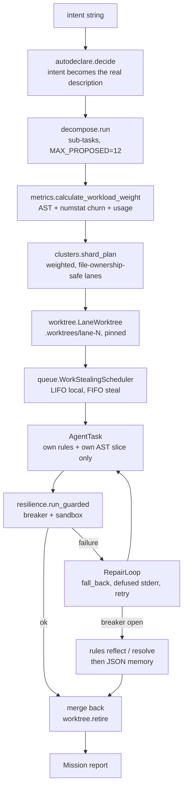
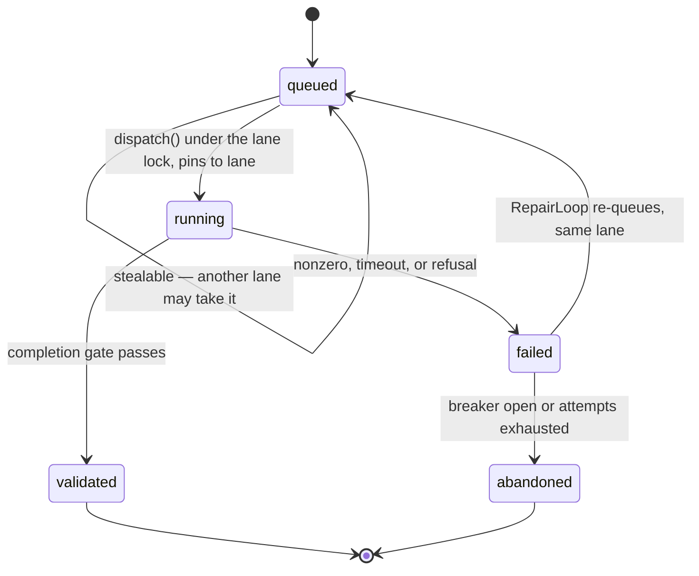

# feat: Lintester orchestrator — close all 22 open PRD conformance items

**Target repo:** this repo. **Branch:** `claude/lintester-mindhive-orchestration-77909c` (HEAD `bd6ccf3`, PR #119 already open against `master` — no new PR is opened by this plan).

---

## Summary

The original PRD specifies a single orchestrator agent, `lintester`, behind six Workbenches. A conformance audit against the real tree found 5 items built, 6 partially built, and 16 absent. This plan closes all 22 open items as one connected mechanism rather than six disconnected modules: a mission pipeline that takes one natural-language intent and carries it through decomposition, quantitative weighting, lane isolation, dynamic scheduling, sandboxed execution, autonomous repair, and merge-back.

The plan deliberately overrides five documented "not in scope" decisions. That override is the owner's, made explicitly after reading the audit. Section [Key Technical Decisions](#key-technical-decisions) records what each rejection said, why it said it, and what this plan does about the underlying engineering objection — because an override that ignores the objection just re-earns the bug the objection predicted.

---

## Problem Frame

`hive mindnet orchestrate` runs a wave of sub-agents against an already-declared task graph. Everything upstream of that — turning an intent into a graph, weighting the work, assigning lanes, isolating them — is either manual, absent, or reachable only as separate commands the operator chains by hand. There is no `lintester`, no `execute_mission`, and no front door: `hive lintester` answers `invalid choice`.

The consequence is not that the pieces are missing. Most of them exist and are good. The consequence is that **nothing composes them**, so the PRD's central claim — one instruction to one orchestrator, everything below it automatic — is unbacked.

Three secondary gaps matter as much as the missing facade:

1. **The AST scope injection ships inert.** `src/mindhive/mindnet/brief.py:154` documents that the symbol slice is off unless `MINDHIVE_SYMBOLS` is set. Information Hiding, the PRD's third principle, is therefore only half-delivered: rules and SOPs reach the sub-agent, the structural slice does not.
2. **Failure is captured but never acted on.** `fall_back` exists (`src/mindhive/mindnet/controller.py:478`), stderr is captured (`src/mindhive/mindnet/executor.py:448`), and a three-state `CircuitBreaker` exists (`src/mindhive/loop/safeguards.py:88`). Nothing chains them, so "Define Errors Out of Existence" stops at "record the error".
3. **Load is distributed statically.** `orchestrate` builds waves up front and hands them to a `ThreadPoolExecutor` (`src/mindhive/mindnet/orchestrator.py:624`). A lane that stalls stays stalled while other lanes idle.

---

## Requirements

Traced to the PRD conformance audit. Status is the verified state at `bd6ccf3`; every BELUM and SEBAGIAN is in scope.

| ID | Requirement | Status now | Unit |
|---|---|---|---|
| WB1.1 | `src/mindhive/orchestrator/lintester.py` and `tests/test_lintester.py` exist | BELUM | U1, U8 |
| WB1.2 | `LintesterOrchestrator.execute_mission(intent)` is the single public entry | BELUM | U8 |
| WB1.3 | Execution yields independent `AgentTask` objects | SEBAGIAN | U8 |
| WB1.4 | `AgentTask` carries only its own rules and AST scope, never global repo state | SEBAGIAN | U8, U9 |
| WB1.5 | `tests/test_lintester.py` green on isolation and decapsulation | BELUM | U8 |
| WB2.1 | `src/mindhive/orchestrator/metrics.py` exists | BELUM | U2 |
| WB2.2 | `ComplexityVisitor(ast.NodeVisitor)` counts If/For/While branching | BELUM | U2 |
| WB2.3 | `git log --numstat` drives historical volatility | BELUM | U2 |
| WB2.4 | `calculate_workload_weight(file_path)` fuses AST, churn, usage telemetry | BELUM | U2 |
| WB3.1 | `src/mindhive/orchestrator/queue.py` on `asyncio` | BELUM | U3 |
| WB3.2 | `WorkerLane` holds a `collections.deque` behind an `asyncio.Lock` | BELUM | U3 |
| WB3.3 | LIFO local retrieval via `pop()` | BELUM | U3 |
| WB3.4 | FIFO stealing via `popleft()` from a loaded lane | BELUM | U3 |
| WB3.5 | Interrupt preserves the remainder to a JSON sidecar | BELUM | U4 |
| WB4.1 | `src/mindhive/orchestrator/worktree.py` exists | SEBAGIAN | U5 |
| WB4.2 | Deterministic `git worktree add .worktrees/lane-N <branch>` | SUDAH (task-keyed) | U5 |
| WB4.3 | `WorkerLane` lifecycle physically pinned to its worktree | BELUM | U5 |
| WB4.4 | `git worktree remove` leaves no dirty index on the main branch | SUDAH | U5 |
| WB5.1 | `src/mindhive/orchestrator/resilience.py` exists | BELUM | U6 |
| WB5.2 | Circuit breaker tracks Closed / Open / Half-Open | SUDAH (loop only) | U7 |
| WB5.3 | Sandbox via `subprocess.run` fenced by `resource.setrlimit` | SEBAGIAN | U6 |
| WB5.4 | Sub-agent failure becomes a status event, never a fatal exception | SUDAH | U8, U10 |
| WB5.5 | Autonomous repair loop: fall back, inject stderr, force self-resolution | BELUM | U10 |
| WB6.1 | Promptgate forces `MUST USE: <skill>` onto the agent's task description | SUDAH (global) | U9 |
| WB6.2 | Breaker-detected anomaly runs `hive rules reflect` / `resolve` unattended | SEBAGIAN | U11 |
| WB6.3 | Resolutions persist to JSON memory | SEBAGIAN | U11 |
| WB6.4 | `hive selftest` clean, no regression in the old mindswarm module | SUDAH (no such module) | U13 |

---

## Key Technical Decisions

### KTD1 — The `src/mindhive/orchestrator/` package is built, and the design doc is amended rather than left contradicting the code

`docs/designs/lintester-orchestrator.md:178-184` lists five things as "Explicitly NOT in scope". The owner has overridden five of them after reading the conformance audit. The dangerous outcome is not the override; it is a design doc that says "not in scope" while the tree ships the thing. U12 amends that section in the same PR, dated, naming the override as the owner's, so the doc and the code stop disagreeing.

### KTD2 — New modules wrap incumbents; they never fork them

The rejection's stated reason was "Six of its proposed modules have shipped incumbents." That reason is correct and survives the override. Every new module delegates:

| New | Delegates to |
|---|---|
| `orchestrator/metrics.py` | `clusters.file_complexity`, `clusters.git_churn`, `mindnet.telemetry` |
| `orchestrator/worktree.py` | `mindnet.worktree.add` / `retire` (which own the git calls) |
| `orchestrator/resilience.py` | `loop.safeguards.CircuitBreaker` (state machine is not re-implemented) |
| `orchestrator/lintester.py` | `mindnet.autodeclare`, `mindnet.decompose`, `mindnet.orchestrator.orchestrate`, `mindnet.brief` |

No incumbent is deleted, renamed, or bypassed. A duplicated state machine or a second git-worktree driver would be the actual regression the rejection was protecting against.

### KTD3 — Work-stealing is real, but only queued work is stealable

The rejection at `docs/designs/lintester-orchestrator.md:180-181` says stealing "contradicts a written, reasoned rejection at `orchestrator.py:29-35`, and work cannot be stolen from a child holding a written stdin." The second clause is a true statement about physics, not a preference: once `executor.execute` has written a prompt to a child's stdin, that task is committed to that process.

So the scheduler adopts the invariant instead of arguing with it. An `AgentTask` is stealable **only** while `state == "queued"`. `dispatch()` flips it to `"running"` under the lane's lock, and a running task is pinned to its lane for life. Stealing is therefore a queue-rebalancing mechanism, which is where the latency win actually lives — a lane holding eight queued tasks behind one slow child is exactly the case the PRD describes, and those eight are all stealable.

`orchestrator.py:29-35`'s rejection of asyncio is about the *existing* wave runner, which shells `subprocess.run` and is correctly a thread pool. This plan does not convert it. `asyncio` governs the new scheduling layer only; the blocking child call is reached through `run_in_executor`, so both statements stay true at once.

### KTD4 — `setrlimit` ships POSIX-guarded and reports its own absence

`import resource` raises `ModuleNotFoundError` on Windows, which is this machine and half of CI. The sandbox therefore returns a `Limits` value that says explicitly whether kernel enforcement is `enforced` or `unavailable`, and the caller records which. The failure mode to design out is the silent one: a sandbox that reports success on Windows while enforcing nothing is worse than no sandbox, because it launders an unenforced run as a fenced one. The timeout cap in `executor.execute` remains the cross-platform floor.

### KTD5 — Runtime dependencies stay empty

`pyproject.toml:6` is `dependencies = []` deliberately, and this plan does not change it. The circuit breaker is the one already in `loop/safeguards.py`; no `pybreaker`. Everything new is stdlib: `ast`, `asyncio`, `collections`, `subprocess`, `json`, `resource` (guarded).

### KTD6 — Injected stderr is untrusted text and goes through the defuser

The repair loop's whole point is putting a failed run's stderr into the next prompt. Stderr contains attacker-influenceable content — a filename, a test fixture, a dependency's error string. `docs/designs/lintester-orchestrator.md:188-192` already names this trust boundary as accepted risk for ledger text. The repair loop must not widen it: every injected byte passes `brief.safe_block` first, which is the same defuser that closes the fence for skills, SOPs and constraints. A repair loop that pastes raw stderr into a child with write access to a git worktree is a prompt-injection channel, not a feature.

### KTD7 — The JSON memory is a derived projection, never a second source of truth

WB6.3 asks for resolutions in JSON memory. The repo invariant is that the ledger is the source of truth and every sidecar is derived (`src/mindhive/mindnet/sidecar.py:4-5`). The resolution is appended to the ledger first; the JSON sidecar is written from the fold. It can be deleted and rebuilt at any time, and nothing reads it as authoritative.

### KTD8 — New CLI surface self-registers

`src/mindhive/__main__.py` measures 4186 lines against the 4237 ratchet in `tests/test_file_size_cap.py:158` — 51 lines of headroom, but the ratchet is shrink-only in intent. `hive lintester` follows the `bench` / `briefcli` / `clusterscli` / `ab` pattern: the argparse block lives in `orchestrator/cli.py`, and `__main__.py` gains an import plus one `register(...)` call.

---

## High-Level Technical Design

### The mission pipeline

One intent in, one `Mission` out. Every box is either an existing module or a new one that delegates to it.



### Task state, and what makes a task stealable

The single invariant that lets stealing coexist with the written-stdin objection in KTD3.



### Weight composition

Directional, not a specification. Each term is total: a term that cannot be computed contributes 0 rather than raising.

```
weight(f) = w_ast * cyclomatic(f)        # ComplexityVisitor, decision points
          + w_churn * volatility(f)      # git log --numstat, added+deleted lines
          + w_usage * iterations(f)      # mindnet.telemetry, observed agent turns
```

---

## Output Structure

```
src/mindhive/orchestrator/
    __init__.py        # package docstring; re-exports the public surface
    lintester.py       # AgentTask, Mission, LintesterOrchestrator.execute_mission
    metrics.py         # ComplexityVisitor, churn, calculate_workload_weight
    queue.py           # WorkerLane, WorkStealingScheduler, Checkpoint
    worktree.py        # LaneWorktree — lane-N naming, lifecycle pinning
    resilience.py      # Limits/sandbox, ToolCircuitBreaker, RepairLoop
    cli.py             # register(subparsers) for `hive lintester`
tests/
    test_lintester.py
    test_orchestrator_metrics.py
    test_orchestrator_queue.py
    test_orchestrator_worktree.py
    test_orchestrator_resilience.py
    test_cli_lintester.py
```

---

## Implementation Units

Four phases. Phase A is leaf modules with no cross-dependencies and can be built in any order; Phase B composes them; Phase C wires autonomy; Phase D verifies and lands.

### Phase A — leaf modules

### U1. Package skeleton

**Goal:** `src/mindhive/orchestrator/` exists as an importable package with the public surface named in one place, so later units import from a stable address.
**Requirements:** WB1.1, WB2.1, WB3.1, WB4.1, WB5.1.
**Dependencies:** none.
**Files:** `src/mindhive/orchestrator/__init__.py`.
**Approach:** Docstring states plainly that this package is the owner's documented override of `docs/designs/lintester-orchestrator.md:178-184`, and that every module here delegates to a shipped incumbent rather than forking it (KTD2). Re-export only what the CLI and tests need. No logic.
**Patterns to follow:** `src/mindhive/mindnet/__init__.py`.
**Test scenarios:** `Test expectation: none -- pure package scaffolding, no behavior.` Import coverage arrives with U2.
**Verification:** `py -c "import mindhive.orchestrator"` succeeds with `PYTHONPATH=src`.

### U2. `metrics.py` — quantitative workload weighting

**Goal:** A real AST-based complexity metric, a real `--numstat` churn metric, and one function fusing them with usage telemetry.
**Requirements:** WB2.2, WB2.3, WB2.4.
**Dependencies:** U1.
**Files:** `src/mindhive/orchestrator/metrics.py`, `tests/test_orchestrator_metrics.py`.
**Approach:** `ComplexityVisitor(ast.NodeVisitor)` counts decision points — `If`, `For`, `AsyncFor`, `While`, `ExceptHandler`, `With`, `BoolOp` (each extra value beyond the first), `IfExp`, and comprehension `if` clauses — via `generic_visit` recursion, giving a cyclomatic count rather than the keyword-regex proxy `clusters.file_complexity` documents itself as. `churn(rel_posix, root)` shells `git log --numstat --format=` and sums added+deleted, guarded by `shutil.which("git")` and `paths.NO_WINDOW` exactly as `clusters.git_churn` is. `usage(path)` folds `mindnet.telemetry` activity rows. `calculate_workload_weight(file_path, root=None, evs=None)` returns a frozen `Weight(complexity, churn, usage, total)`. Every term is total: syntax error, missing file, absent git, or unreadable ledger yields 0 for that term, never an exception — the caller is a scheduler, and a weighting function that raises takes down the mission.
**Patterns to follow:** `src/mindhive/clusters.py:105` for the "score only needs to order correctly" framing; `src/mindhive/clusters.py:142` for the git guard.
**Test scenarios:**
- A file with three nested `if` statements and one `for` scores strictly higher than a flat file of the same line count — pins that this is branching, not size.
- A `BoolOp` with four values contributes three decision points, not one.
- A comprehension with an `if` clause contributes a decision point.
- A file that fails to parse (deliberate syntax error) returns complexity 0 and does not raise.
- `churn` on a temp repo with a file edited three times returns the summed added+deleted lines from `--numstat`, not the commit count — the discriminating case against the incumbent.
- `churn` returns 0 when `shutil.which("git")` is patched to `None`.
- `calculate_workload_weight` on a missing path returns a `Weight` whose total is 0.
- Weights order a big branchy file above a small flat one when all three terms are live.
**Verification:** the ordering test and the parse-failure test both pass; no term can raise.

### U3. `queue.py` — WorkerLane and work stealing

**Goal:** Dynamic load balancing that steals queued work from a loaded lane without ever stealing a task already committed to a child process.
**Requirements:** WB3.1, WB3.2, WB3.3, WB3.4.
**Dependencies:** U1.
**Files:** `src/mindhive/orchestrator/queue.py`, `tests/test_orchestrator_queue.py`.
**Approach:** `WorkerLane(lane_id)` holds a `collections.deque` and an `asyncio.Lock`. `take()` pops from the right (`pop()`, LIFO) to keep directory locality. `steal()` takes from the left (`popleft()`, FIFO) so the thief and the owner contend on opposite ends. `WorkStealingScheduler(lanes)` runs lanes as tasks; an empty lane inspects sibling depths and steals from the deepest. The stealability invariant from KTD3 is enforced in `steal()` itself, not by convention: it skips any entry whose state is not `queued`, and `dispatch()` transitions to `running` while holding the lane lock. The blocking child call is reached via `loop.run_in_executor`, so the existing `subprocess.run` path is untouched.
**Execution note:** write the "a running task is never stolen" test first — it is the invariant the whole override rests on, and a scheduler that passes every other test while violating this one looks correct and corrupts work.
**Patterns to follow:** `src/mindhive/mindnet/orchestrator.py:29-35` for why the incumbent stayed threaded; the new module must not contradict it.
**Test scenarios:**
- `take()` returns the most recently pushed task (LIFO), `steal()` the least recently pushed (FIFO), on the same populated lane.
- An idle lane steals from the deepest sibling and the total task count across lanes is conserved — nothing is duplicated or dropped.
- A task in state `running` is never stolen, even when it is the only entry in the deepest lane; the thief comes back empty.
- Two lanes stealing concurrently from the same victim get disjoint tasks — no task is handed to two lanes.
- A lane whose sibling list is empty completes rather than spinning.
- Stealing from an empty victim returns `None` without raising.
- A task that raises inside its runner marks that task failed and leaves the other lanes running.
**Verification:** the concurrency tests pass repeatedly (run the file three times); no task appears in two lanes' completion lists.

### U4. `queue.py` — partial-state checkpoint sidecar

**Goal:** An interrupted mission resumes from what was left, instead of re-running completed work.
**Requirements:** WB3.5.
**Dependencies:** U3.
**Files:** `src/mindhive/orchestrator/queue.py`, `tests/test_orchestrator_queue.py`.
**Approach:** A per-lane JSON sidecar recording queued task ids, states, and the mission id. Written on interrupt — timeout, usage-limit refusal, or `KeyboardInterrupt` — and on every state transition if cheap enough to do without contention. `resume(mission_id)` reloads and re-queues only entries still `queued` or `failed`. Written through `paths.write_text_atomic`, one path per lane: the ledger records that helper as flaky on Windows when two writers contend on one destination, so lanes must never share a checkpoint path. The sidecar is derived state (KTD7) — losing it costs re-work, never correctness.
**Patterns to follow:** `src/mindhive/mindnet/sidecar.py` for the derived-projection contract; `src/mindhive/paths.py:75` for the atomic write.
**Test scenarios:**
- A scheduler interrupted after two of five tasks writes a checkpoint naming exactly the three unfinished ids.
- `resume` on that checkpoint re-queues three tasks and does not re-queue the two completed ones.
- A `validated` task is never re-queued by `resume`.
- A corrupt or truncated checkpoint file yields an empty resume rather than raising — a bad sidecar must not brick a mission.
- Two lanes checkpoint concurrently to distinct paths without either write failing.
- A missing checkpoint resumes as an empty set.
**Verification:** the interrupt/resume round-trip test passes and the corrupt-file test proves the fail-open path.

### U5. `worktree.py` — lane-scoped isolation

**Goal:** Every lane owns one physical worktree for its whole life, named as the PRD specifies, cleaned up without dirtying the main branch.
**Requirements:** WB4.1, WB4.2, WB4.3, WB4.4.
**Dependencies:** U1, U3.
**Files:** `src/mindhive/orchestrator/worktree.py`, `tests/test_orchestrator_worktree.py`.
**Approach:** `LaneWorktree(root, lane_id, branch)` resolves to `.worktrees/lane-N` and delegates creation and teardown to `mindnet.worktree.add` / `retire`, which already own the git invocations, the never-raise contract (`src/mindhive/mindnet/worktree.py:28`) and the `--force` teardown path. The new layer contributes the lane-N naming, and the binding: a `WorkerLane` acquires its worktree before its first dispatch and releases it after its last, so no task ever executes outside its lane's tree. Dirty-state preservation is delegated, not reimplemented.
**Patterns to follow:** `src/mindhive/mindnet/worktree.py:130` (`path_for`) and `:206` (the `add` call).
**Test scenarios:**
- `LaneWorktree` for lane 2 resolves to a path ending `.worktrees/lane-2`.
- Creating and retiring a lane worktree in a temp repo leaves `git status --porcelain` on the origin branch empty.
- A failed `git worktree add` yields a `LaneWorktree` reporting not-ok with a reason, and raises nothing.
- A lane bound to a worktree reports that path on every task it dispatches; two lanes never report the same path.
- Retiring twice is a no-op, not an error.
- A worktree deliberately left dirty is reported as kept rather than silently force-removed, matching `Orchestration.kept`.
**Verification:** the clean-index test passes against a real temp git repo, not a mock.

### U6. `resilience.py` — sandbox with honest limits

**Goal:** Kernel-enforced memory and CPU ceilings where the OS provides them, and an explicit statement of non-enforcement where it does not.
**Requirements:** WB5.1, WB5.3.
**Dependencies:** U1.
**Files:** `src/mindhive/orchestrator/resilience.py`, `tests/test_orchestrator_resilience.py`.
**Approach:** `Limits(memory_bytes, cpu_seconds)` and `run_sandboxed(argv, limits, timeout_s, ...)`. On POSIX, `import resource` succeeds and a `preexec_fn` applies `RLIMIT_AS` and `RLIMIT_CPU`; the result carries `enforcement="kernel"`. On Windows the import fails, no `preexec_fn` is passed, and the result carries `enforcement="timeout-only"` plus a reason. The caller records which it got. Per KTD4 the design goal is that a Windows run can never be mistaken for a fenced one. The timeout path reuses the semantics already in `executor.execute` — killed at the cap is not a pass.
**Execution note:** the Windows leg must assert the *degradation is reported*, not skip. A test that skips on Windows leaves the platform this repo actually runs on uncovered.
**Test scenarios:**
- On POSIX, a child allocating past `RLIMIT_AS` is killed and the result reports a nonzero outcome rather than raising.
- On POSIX, a child spinning past `RLIMIT_CPU` is killed.
- On Windows, `run_sandboxed` returns `enforcement="timeout-only"` and a reason mentioning the missing module — asserted on Windows, not skipped.
- On every platform, a child exceeding `timeout_s` is killed and reported as timeout, proving the cross-platform floor holds.
- A well-behaved child returns its stdout and a zero outcome on both platforms.
- `run_sandboxed` never raises for a missing executable; it reports a spawn failure, matching `executor.RUN_RESULTS`.
**Verification:** the platform matrix in this file passes on both Windows and WSL Ubuntu — this is the unit most likely to pass on one and fail on the other.

### U7. `resilience.py` — per-target circuit breaker

**Goal:** Repeated failures against one tool or target stop being retried, without inventing a second state machine.
**Requirements:** WB5.2 extended from loop iterations to sub-agent tool calls.
**Dependencies:** U1, U6.
**Files:** `src/mindhive/orchestrator/resilience.py`, `tests/test_orchestrator_resilience.py`.
**Approach:** `ToolCircuitBreaker` keeps a `loop.safeguards.CircuitBreaker` per target key and exposes `allow(key)` / `record(key, ok, error_sig)`. The CLOSED → OPEN → HALF_OPEN transitions, thresholds and cooldown are the incumbent's; this class owns only the keying and the fail-fast return. No `pybreaker` (KTD5).
**Patterns to follow:** `src/mindhive/loop/safeguards.py:88-150`.
**Test scenarios:**
- N consecutive failures on one key open that key's breaker while a different key stays closed — proves the keying.
- An open breaker returns fail-fast from `allow` without invoking the callable.
- After the cooldown, `allow` reports HALF_OPEN and permits exactly one probe.
- A success in HALF_OPEN closes the breaker; a failure re-opens it.
- `record` with an unparseable error signature does not raise.
- The breaker's own state names match `loop.safeguards` — this class must not introduce a parallel vocabulary.
**Verification:** state transitions asserted against the incumbent's constants, not against string literals typed here.

### Phase B — composition

### U8. `lintester.py` — AgentTask, Mission, and the single public entry

**Goal:** `LintesterOrchestrator.execute_mission(intent)` — one call, everything below it automatic.
**Requirements:** WB1.1, WB1.2, WB1.3, WB1.4, WB1.5, WB5.4.
**Dependencies:** U2, U3, U4, U5, U6, U7.
**Files:** `src/mindhive/orchestrator/lintester.py`, `tests/test_lintester.py`.
**Approach:** `AgentTask` is a frozen dataclass carrying `task_id`, `title`, `description`, `brief_text`, `weight`, `lane_id`, `worktree_path`, `state`. It carries no ledger handle, no sibling list, no repo-global status — Information Hiding is enforced by the dataclass having nowhere to put those. `Mission` reports `outcome`, `tasks`, `lanes`, `completed`, `failed`, `kept`, `enforcement`. `execute_mission` chains the pipeline in the HTD diagram, delegating each step (KTD2): `autodeclare` for intent-to-task with the **real intent as the description** rather than the boilerplate the design doc flags at `:127`; `decompose.run` for sub-tasks; U2 for weights; `clusters.shard_plan(clusters, weights, lanes)` for lane packing; U5 for isolation; U3 for scheduling; `brief.build` per task for its own material; U6/U7 for guarded execution. Failure becomes a `Mission` field, never a raised exception (WB5.4).
**Execution note:** write the cross-task isolation test before the composition — it is the PRD principle this unit exists to deliver, and it is not observable from a passing happy path.
**Patterns to follow:** `src/mindhive/mindnet/orchestrator.py:414` for the "return a report, raise nothing" shape of `Orchestration`.
**Test scenarios:**
- `execute_mission` on a two-task intent returns a `Mission` whose `tasks` are two `AgentTask` objects with distinct `task_id`s.
- Task A's `brief_text` contains none of task B's resolved material, and vice versa — the isolation assertion, run with both tasks resolving non-empty briefs so the comparison is not two blanks.
- `AgentTask` exposes no attribute reaching global repo state; asserted structurally over the dataclass fields, so a future field addition that reintroduces one fails here.
- The auto-declared task's description is the caller's intent text, not the boilerplate — the discriminating assertion against the documented `AUTO_DESCRIPTION` defect.
- A sub-agent runner that raises yields a `Mission` reporting that task failed, with the other task still completed, and `execute_mission` itself raises nothing.
- A dry-run mission dispatches no child and reports a dry-run outcome.
- Two tasks weighted 10 and 1 land such that the heavier lane is not also given the lighter task when lanes == 2 — proves weights reach `shard_plan`.
- A mission whose graph is empty is refused with a reason rather than returning a hollow success.
**Verification:** `tests/test_lintester.py` green, with the isolation and description assertions both proven to discriminate by reverting each fix in place.

### U9. AST scope injection made live for the mission path

**Goal:** The symbol slice actually reaches the sub-agent, closing the half of Information Hiding that ships inert.
**Requirements:** WB1.4, WB6.1.
**Dependencies:** U8.
**Files:** `src/mindhive/orchestrator/lintester.py`, `src/mindhive/mindnet/brief.py`, `tests/test_lintester.py`.
**Approach:** `brief.py:154` documents `symbols` as gated off unless `MINDHIVE_SYMBOLS` is set, and `Stats.gated` reports it. The mission path passes the slice explicitly rather than mutating process env — an env write inside a scheduler is visible to every concurrent lane and to the parent shell, which is the same class of leak the A/B harness's `switched()` was written to avoid. So `wave_context` gains an explicit opt-in parameter, the global env gate stays exactly as it is for every other caller, and a mission-scoped slice is scoped to the mission. Promptgate's `MUST USE:` clause (already live, `src/mindhive/promptgate.py:505`) is composed into each `AgentTask.description` here so the clause is per-task rather than per-session.
**Test scenarios:**
- A mission-scoped brief reports `stats.symbols == 1` and `gated` empty, while a plain `wave_context` with no env set still reports `symbols` gated — proves the global default is untouched.
- The env variable is not present in `os.environ` after `execute_mission` returns, whatever it was before.
- Each `AgentTask.description` carries a `MUST USE:` clause naming a skill resolved for that task, and two tasks with different keywords carry different clauses.
- A task for which no skill resolves carries no empty `MUST USE:` stub.
- The symbol slice for task A does not contain task B's file scope.
**Verification:** the "global default untouched" assertion is the one that matters; prove it by running the existing brief suite unchanged.

### U10. `resilience.py` — the closed repair loop

**Goal:** A failed audit rolls the task back, feeds the defused stderr forward, and forces the sub-agent to resolve it — unattended.
**Requirements:** WB5.5, WB5.4.
**Dependencies:** U7, U8.
**Files:** `src/mindhive/orchestrator/resilience.py`, `src/mindhive/orchestrator/lintester.py`, `tests/test_orchestrator_resilience.py`.
**Approach:** `RepairLoop(breaker, max_attempts)` observes a failed `RunResult`, calls the incumbent `fall_back` action (`src/mindhive/mindnet/controller.py:478`) to move the task back one phase, extracts stderr from the `RunResult` (`src/mindhive/mindnet/executor.py:461`), passes it through `brief.safe_block` (KTD6 — mandatory, not optional), appends it to the next prompt as a quoted block, and re-queues the task in its own lane. Bounded by `max_attempts` and by the breaker: once the target's breaker opens, the task is abandoned with a reason rather than retried forever.
**Execution note:** write the forged-fence test first. The defuser is the security control here, and a repair loop that passes its functional tests while pasting raw stderr is the failure this unit must not ship.
**Patterns to follow:** the existing fence tests in `tests/test_mindnet_brief.py`; the quoted-block rendering in `src/mindhive/mindnet/decompose.py`.
**Test scenarios:**
- A task failing once is re-queued with the stderr text present in its next prompt, and succeeds on attempt two — the loop closes.
- Stderr containing a forged context fence cannot terminate the brief's block: the composed prompt still has exactly one fence close.
- Stderr containing a rule-run glyph sequence is defused, matching the existing fence-glyph cases.
- A task failing `max_attempts` times is abandoned with a reason naming attempt exhaustion, and the mission still reports the other tasks.
- Once the breaker for that target is open, no further attempt is dispatched even if attempts remain.
- The re-queued task returns to its own lane, never another lane's.
- `fall_back` is invoked exactly once per failed attempt, asserted on the recorded phase events rather than on a mock call count alone.
**Verification:** the forged-fence assertion proven to discriminate by reverting the `safe_block` call in place and observing the fence count change.

### Phase C — autonomy and surface

### U11. Breaker-triggered reflect/resolve and the JSON memory projection

**Goal:** An anomaly the breaker detects turns into a recorded lesson without anyone typing a command.
**Requirements:** WB6.2, WB6.3.
**Dependencies:** U7, U10.
**Files:** `src/mindhive/orchestrator/resilience.py`, `tests/test_orchestrator_resilience.py`.
**Approach:** On a breaker opening, invoke the incumbent reflect/resolve path in-process (the functions behind `hive rules reflect` / `resolve`, `src/mindhive/__main__.py:2992` and `:3006`), bounded and fail-open: a reflect that raises must never take down the mission, matching the fail-open discipline the repo already requires of its Stop hook. The resolution is appended to the ledger as the source of truth, then a JSON sidecar is written from the fold (KTD7) at a project-scoped path.
**Test scenarios:**
- Opening a breaker triggers exactly one reflect for that signature; a second failure on an already-open breaker does not trigger a second.
- A reflect that raises leaves the mission running and is reported in the `Mission` as a degraded field.
- The JSON memory file, after a resolution, contains that resolution keyed by signature.
- Deleting the JSON file and re-folding reproduces it byte-identically — proves it is derived, not authoritative.
- A malformed existing JSON file is overwritten from the fold rather than crashing the write.
- Nothing is written when no resolution was produced — no empty-shell file.
**Verification:** the rebuild-from-fold test is the one that proves KTD7 rather than asserting it.

### U12. `cli.py` — the `hive lintester "<intent>"` front door

**Goal:** The PRD's single user-facing instruction exists as a command.
**Requirements:** WB1.2 at the CLI boundary.
**Dependencies:** U8, U9, U10, U11.
**Files:** `src/mindhive/orchestrator/cli.py`, `src/mindhive/__main__.py`, `tests/test_cli_lintester.py`.
**Approach:** `register(subparsers)` on the top-level parser, following `bench` / `briefcli` / `clusterscli` / `ab`; `__main__.py` gains an import and one call (KTD8). Positional `intent`; flags `--lanes`, `--limit`, `--project`, `--json`, and an execute flag. Dry run is the default — a command that spawns agents on a bare invocation is not a front door, it is a hazard. Invariant 10 applies: the execute flag's dest is read as a direct attribute, and no phase-name synonym appears as a bare quoted literal anywhere in this module **including comments**, since the scan is over file text.
**Patterns to follow:** `src/mindhive/mindnet/ab.py:228` for the register/`cmd_` shape and the invariant-10 note.
**Test scenarios:**
- `hive lintester --help` exits 0 and shows the positional intent.
- A dry run against a seeded graph prints a mission report and dispatches no child.
- An empty intent is refused with a nonzero status and a message on stderr, matching sibling refusals.
- `--json` emits parseable JSON carrying outcome, lanes, and per-task state.
- `--lanes abc` is rejected as a caller error rather than silently defaulting, matching `clusters._clamp_lanes`.
- The top-level command list still resolves `lintester` after registration, and the did-you-mean suggestion test in `tests/test_cli_suggestions.py` still passes.
- `src/mindhive/__main__.py` grows by at most three lines against the `tests/test_file_size_cap.py` ratchet.
**Verification:** `hive lintester "<some real intent>"` run for real, and its actual printed report read — not an exit code alone.

### U13. Documentation reconciliation

**Goal:** The design doc, TODOS and data model stop contradicting the shipped tree.
**Requirements:** supports KTD1.
**Dependencies:** U12.
**Files:** `docs/designs/lintester-orchestrator.md`, `TODOS.md`, `docs/DATA_MODEL.md`, `docs/session-legend.md`.
**Approach:** Amend the "Explicitly NOT in scope" section in place with a dated override note naming what the owner overrode and what engineering objection each override answers (KTD2, KTD3, KTD4, KTD5) — never delete the original text, since the reasoning is what makes the override reviewable. Record the new `orchestrator/` package in the session legend, the JSON memory sidecar in the data model, and close the corresponding TODOS entries.
**Test scenarios:** `Test expectation: none -- documentation only. Covered indirectly by the docs-consistency checks already in the suite.`
**Verification:** the amended section names all five overridden bullets and the date.

### Phase D — verification and landing

### U14. Full verification and push

**Goal:** Every leg CI would have run, run here, because CI cannot run at all.
**Requirements:** WB6.4.
**Dependencies:** U13.
**Files:** none (verification only).
**Approach:** The nine-job stand-in established at `bd6ccf3`: windows py3.11/3.12/3.14 from clean short-path venvs, ubuntu py3.11/3.12/3.14 from a fresh ext4 clone in WSL, node tier, browser tier — every leg with `HOME` pointed at an empty directory so no local catalog props a test up. `hive selftest`. The pg tier remains unrunnable and is reported as unrun, never as passed. Change-log entries via `hive log` for every touched file before the work is called done. Push to PR #119.
**Execution note:** U6's platform matrix is the leg most likely to diverge between Windows and Linux; run both before believing either.
**Test scenarios:** `Test expectation: none -- this unit runs the suites the other units wrote.`
**Verification:** exit codes and pass counts read from real output for all eight runnable jobs; the ninth named as unrun with its reason.

### U15. Conflict check and manual merge

**Goal:** Land the branch without CI, as the owner asked, without discovering a conflict during the merge.
**Requirements:** owner's explicit final instruction.
**Dependencies:** U14.
**Files:** none.
**Approach:** Fetch `master`, compute the merge base, and run a **non-destructive** conflict probe first — `git merge-tree` against the merge base, or a merge with `--no-commit --no-ff` on a scratch branch that is then discarded — so the answer to "does this conflict" is obtained before anything is mutated. Report the file-level result. Only then perform the merge the owner asked for. This is the irreversible step in the plan and is sequenced last on purpose: everything before it is recoverable, this is not.
**Test scenarios:** `Test expectation: none -- repository operation, not code. Its verification is the probe output.`
**Verification:** the probe's actual output read and reported before any mutating command runs; post-merge, `git status` clean and the suite re-run on the merged tree.

---

## Scope Boundaries

### In scope
All 22 open conformance items, the `orchestrator/` package, the `hive lintester` front door, the documentation reconciliation, the nine-job verification stand-in, and the manual merge.

### Deferred to Follow-Up Work
- **The dashboard panel (E4).** Deferred in the design doc for want of a consumer; this plan does not create one.
- **Converting the incumbent wave runner to asyncio.** KTD3 keeps `mindnet/orchestrator.py` threaded on purpose. A later unification is possible; doing it inside this plan would put a rewrite of the shipped runner on the critical path of a 15-unit change.
- **`numpy` in the `dev` extra.** `tests/test_pgsearch.py` (43 tests) is skipped on every CI job because no extra provides numpy. Found during verification, reported, and left to the owner because `pyproject.toml` documents the minimal-extras policy at length.

### Out of scope
- **The pg tier.** No Postgres exists on this machine or in WSL. It cannot be verified here and will not be claimed as verified.
- **Unblocking GitHub Actions.** A billing setting on the owner's account; no code change reaches it.

---

## Risks

| Risk | Consequence | Mitigation |
|---|---|---|
| The sandbox silently enforces nothing on Windows | A run is recorded as fenced when it was not | KTD4: `enforcement` is a reported field; the Windows test asserts the degradation rather than skipping |
| Injected stderr becomes a prompt-injection channel | A failed test's output steers a child that has write access to a worktree | KTD6: mandatory `brief.safe_block`; U10's forged-fence test is written first and proven to discriminate |
| Work stealing takes a task already committed to a child's stdin | Duplicated or corrupted work, the exact failure the design doc predicted | KTD3: only `queued` tasks are stealable, enforced inside `steal()` and pinned by `dispatch()` under the lane lock |
| The new package duplicates an incumbent | Two git drivers or two breaker state machines drift apart | KTD2: every module delegates; U7 asserts against the incumbent's own state constants |
| `write_text_atomic` contention on Windows | Checkpoint writes fail under parallel lanes | U4: one checkpoint path per lane, never shared |
| 15 units land as one PR with no CI | A regression reaches `master` unreviewed by any automated gate | U14 runs all eight runnable CI jobs locally with an empty `HOME`; U15 probes for conflicts before merging |
| The design doc keeps saying "not in scope" | The next reader treats the shipped package as an accident and reverts it | U13 amends the doc in the same PR, dated, preserving the original reasoning |

---

## Assumptions

Recorded rather than asked, because this plan runs in a pipeline with no synchronous user.

1. The owner's instruction to build all 22 items overrides `docs/designs/lintester-orchestrator.md:178-184` for bullets (a) through (d). Bullet (e)'s dashboard panel stays deferred, since the owner's list did not include it.
2. "Merge manually via Claude Code" means merging the branch into `master` locally after a conflict probe, not merging PR #119 through the GitHub API — the API path would still be subject to the same account whose billing is blocked.
3. `resource.setrlimit` is expected to be genuinely exercised only on the WSL Ubuntu legs. Its Windows behaviour is a reported degradation, not a tested enforcement.
4. The existing `MINDHIVE_SYMBOLS` global gate stays default-off for all non-mission callers; only the mission path opts in.
