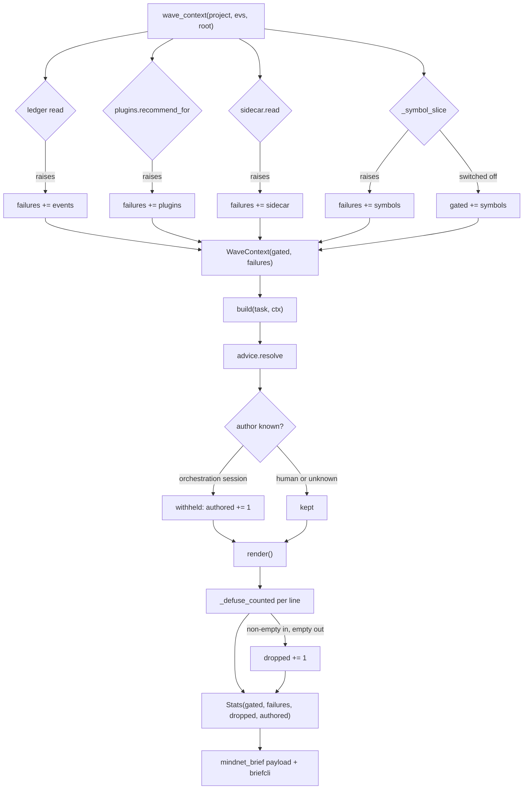

# feat: the brief reports its own failures, counts what it defused, and names who wrote what it composes

## Summary

Three things, all about the same block of text.

`brief.wave_context` swallows four exceptions and records none of them, so a
context in which every source failed is **observationally identical** to a healthy
context that legitimately matched nothing. `_defused` drops adversarial lines and
tells nobody, so the one signal that an injection attempt reached the composer is
discarded — the feature can be under active attack and every run still reports
success. And `advice.resolve_sops` renders SOP bodies verbatim without looking at
who wrote them, while every spawned child has `hive sop add` on PATH and its own
`MINDHIVE_SESSION` — so a prompt-injected wave-1 agent can write one row that is
composed into every later agent's brief, inside the fence, indistinguishable from
human-authored project history.

This plan closes TODOS 25 and TODOS 26, and corrects TODOS 27's remaining
paragraph, which the merge at `297374e` made factually false.

---

## Problem Frame

The brief exists because a silent no-op must be impossible. Its whole
justification — stated in `src/mindhive/mindnet/brief.py`'s own docstring and in
`_record_brief`'s — is that counts make an empty brief distinguishable from a
broken one. That justification does not currently hold.

**Failures are invisible.** `wave_context` has three `except Exception` branches
(the ledger read, `plugins.recommend_for`, the sidecar) and `_symbol_slice` has a
fourth. None records that it fired. A context where all four failed produces
`chars=0 skills=0 sops=0 constraints=0 gated=() empty_reason="every source
resolved empty for this task"` — byte for byte what a healthy context that matched
nothing produces. `gated` only ever names `symbols` and `brief`, and only for the
config-switch case, never for an error.

`_symbol_slice` is the sharpest version: its `except` returns `("", ())` — no
text and an EMPTY gated tuple. A symbols failure is currently reported as neither
gated nor failed. It is reported as nothing at all.

**Defusing is invisible.** `_defused` answers `""` for a line it dropped;
`_section` filters falsy results; `safe_block` drops lines; `Stats` counts the
resolver's rows rather than the rendered ones. Five hostile lines that defuse to
nothing render as `skills=3 chars=0` plus "every source resolved empty".

**Provenance is unread.** `sop.fold` already writes `session_id` onto every
record (sop.py:183, :202 — the latest event's session). `advice.resolve_sops`
reads `sop_id`, `title` and `text` and ignores it. Meanwhile
`orchestrator._run_wave` sets `kwargs["env"]["MINDHIVE_SESSION"] =
f"{wt_mod.PREFIX}-{tid}"` (orchestrator.py:520, `PREFIX = "mn9"`), and
`events.append_event` stamps `session_id` from that variable (events.py:480). The
marker that tells an agent-authored SOP from a human-authored one is already on
disk. Nothing looks at it.

The fence's docstring records the well-formed-imperative-sentence risk as
ACCEPTED. That argument was made about **humans and past sessions** writing the
ledger — a writer outside the blast radius. A previous agent in the same swarm is
inside it, and that is a different threat model the accepted risk does not cover.

---

## Requirements

| ID | Requirement | Source |
|---|---|---|
| R1 | A source that RAISED is distinguishable from a source that returned nothing, per source, at every surface that reports a brief | TODOS 25 |
| R2 | The four swallowed exceptions in `wave_context` / `_symbol_slice` each name themselves: `events`, `plugins`, `sidecar`, `symbols` | TODOS 25 |
| R3 | A line that was dropped by defusing is counted, and the count reaches the `mindnet_brief` payload and `hive mindnet brief` | TODOS 25 |
| R4 | A non-empty input that defuses to empty counts as dropped; an empty input does not | derived — see KTD3 |
| R5 | SOP rows authored by an orchestration session do not reach a sibling agent's brief | TODOS 26 |
| R6 | What was excluded for authorship is COUNTED and reported, never silently absent | TODOS 26, and `gated`'s own precedent |
| R7 | Incident provenance is captured on write and read back, so the same rule can apply where authorship is known | TODOS 26 |
| R8 | Unknown authorship fails OPEN — an old record with no recorded author is treated as human-authored | derived — see KTD5 |
| R9 | TODOS 27's open paragraph states what is true at `297374e` | TODOS 27 |
| R10 | Every new field on `mindnet_brief` is additive; no existing key changes meaning | `docs/DATA_MODEL.md`, append-only ledger |

---

## Key Technical Decisions

### KTD1 — `failures` is a sibling of `gated`, not a widening of it

`gated` means "switched off". A failure is not switched off; it is broken. Folding
both into one tuple would make `gated=("symbols",)` ambiguous between an operator
who never set `MINDHIVE_SYMBOLS` and an indexer that raised — which is precisely
the confusion `gated` was introduced to end. Two tuples, two vocabularies, one
each on `WaveContext` and `Stats`.

The vocabulary is fixed and small: `events`, `plugins`, `sidecar`, `symbols`. It
is the set of `except` branches that exist, so a new swallowed exception has to
add a name here to be reportable — which is the point.

### KTD2 — `_symbol_slice` returns a triple

It currently answers `(text, gated)` and cannot express "failed". Its `except`
returns an empty `gated`, so the one branch that most needs reporting reports
least. It answers `(text, gated, failures)` after this. Private function, three
call sites, all in this repository.

### KTD3 — "dropped" means a non-empty input that produced an empty output

`_defused` returns `""` in two unrelated cases: the adversarial drop (exhausted
`_DEFUSE_PASSES`, or a fence marker still present) and an input that was empty or
whitespace to begin with. Counting both would make `dropped` a number that goes up
when a resolver returns a blank row, which is noise, not signal.

The test is on the INPUT, not on the reason: any non-empty input that defuses to
nothing was materially changed by a control that exists to stop injection. That
covers the exhaustion drop, the whole-line strip, and the marker-collapse case
with one rule and no branch on internal state.

### KTD4 — a counting sibling, not a wider `_defused`

`_defused` has four callers (`safe_phase`, `safe_line`, `safe_block`, `_section`)
and is the most security-critical function in the module. Changing its arity edits
every one of them and every test that pins them.

`_defuse_counted(value, width) -> (text, dropped)` holds the logic;
`_defused` becomes a one-line wrapper returning `[0]`. Callers that need the count
take the pair. This is the same extraction shape `payoff._score` used for the same
reason — one implementation, two entry points, no possibility of the counted and
uncounted paths disagreeing about what they defused.

### KTD5 — exclude by author, and fail OPEN on unknown

Two options are on the table in TODOS 26: exclude agent-authored rows, or render
them under a heading naming the author. A heading inside the fence is weak — the
fence already says everything inside is background, so a second label adds a word,
not a control. **Exclusion is the control.** The row still exists in the ledger, in
`hive sop list`, and in STATE.md; it is only kept out of a sibling agent's prompt,
which is the exact edge the amplification travels along.

Exclusion alone would be silent, which this repository's own `gated` precedent
forbids. So exclusion is always PAIRED with a count: `authored` on `Stats`, naming
how many rows were withheld for authorship, per source.

Unknown authorship is treated as human-authored. An incident record written before
this change carries no author, and dropping every one of them would delete a
working feature to close a second-order hole — the honest degradation is to keep
the row and let the count say nothing was excluded.

### KTD6 — the orchestration-session test is a prefix FAMILY, not one string

`mn9-` is what `orchestrator._run_wave` sets today. `executor.run_key` mints
`mn-<task>-<n>` and `decompose` uses `mn11-<task>`. A single hardcoded literal
would go stale the first time a new spawner appears. The predicate lives in one
named function with the family as a module constant, so a new spawner has one
place to register and a test can assert the orchestrator's own constant is covered
by it.

### KTD7 — incident provenance is additive frontmatter, and the existing key does not move

`incidents.summaries()` already returns `sessions` as an INT count, and the
dashboard's Improvements view reads it. Changing that key's type to a list would
break a live consumer to serve a new one. A NEW key carries the ids, the old key
keeps its meaning, and `_FM_KEYS` gains one entry.

---

## High-Level Technical Design

The composition path, with the three new counters marked. Everything not marked is
unchanged.



The provenance decision, stated as the rule rather than the diagram:

```
author_of(row)          -> session_id, or None when the record predates capture
is_orchestration(sid)   -> sid starts with any prefix in ORCHESTRATION_PREFIXES
compose?                -> not is_orchestration(author_of(row))     # None -> compose
```

Directional. The implementer decides the call signatures.

---

## Implementation Units

### U1. `wave_context` names the source that raised

**Goal.** Each of the four swallowed exceptions records which source it was.

**Requirements.** R1, R2.

**Dependencies.** None.

**Files.**
- `src/mindhive/mindnet/brief.py`
- `tests/test_mindnet_brief.py`

**Approach.** Add `failures: tuple = ()` to `WaveContext`, beside `gated` and
documented against it (KTD1). Each `except` in `wave_context` appends its own name.
`_symbol_slice` returns `(text, gated, failures)` per KTD2 and its `except` returns
`("", (), ("symbols",))` — the branch that currently reports nothing at all.

Note the `enabled()` early-return path: it answers `gated=("brief",)` and must
answer `failures=()`, not inherit anything.

**Patterns to follow.** `gated`'s own field comment on `WaveContext` — it states
what the tuple means and why "switched off" and "found nothing" are different
problems. `failures` gets the same treatment, contrasted with `gated` rather than
described alone.

**Test scenarios.**
- A `wave_context` whose ledger read raises answers `failures` containing `events`, and `gated` unchanged.
- Same for `plugins.recommend_for` → `plugins`, and the sidecar → `sidecar`.
- `_symbol_slice` raising answers `failures` containing `symbols` and an empty `gated` — the two are not interchangeable.
- `MINDHIVE_SYMBOLS` unset answers `gated=("symbols",)` and `failures=()` — the switched-off case must NOT report a failure.
- All four raising at once answers all four names, deduplicated and in a stable order.
- A healthy context answers `failures=()`.
- The `MINDHIVE_BRIEF` off path answers `gated=("brief",)` and `failures=()`.
- `wave_context` still returns rather than raising when a source raises — the totality contract its docstring promises.

**Verification.** A context built against a store where every source is made to
raise reports four names; the same context with sources healthy reports none.

### U2. Defusing reports what it dropped

**Goal.** A line materially emptied by the defuser is counted.

**Requirements.** R3, R4.

**Dependencies.** None.

**Files.**
- `src/mindhive/mindnet/brief.py`
- `tests/test_mindnet_brief.py`

**Approach.** Extract `_defuse_counted(value, width) -> (text, dropped)` per KTD4;
`_defused` becomes the wrapper. `dropped` is `True` when the input was non-empty
and the output is empty (KTD3). `_section` and `safe_block` tally their drops and
return them alongside their rendered output.

`_section` and `safe_block` both currently return only their rendered result and
both have callers outside `render`. Prefer a counting sibling over a widened return
where an external caller exists, the same trade KTD4 makes.

**Execution note.** Write the forged-fence drop test first and prove it goes red
against the current code — the existing suite already has
`test_a_forged_fence_in_the_data_cannot_close_the_real_one`, and a counting test
that passes without the counter proves nothing.

**Patterns to follow.** `payoff._score` / `calibrate` / `folded` — one
implementation, two entry points.

**Test scenarios.**
- A line carrying `FENCE_CLOSE` verbatim defuses to empty and is counted dropped.
- A line that never settles within `_DEFUSE_PASSES` is counted dropped.
- An empty string in is NOT counted dropped.
- A whitespace-only string in is NOT counted dropped.
- An ordinary line that survives unchanged is NOT counted dropped.
- A line that is merely TRUNCATED at `MAX_LINE_CHARS` is NOT counted dropped — truncation is a bound, not a defusal.
- `safe_block` over five lines where three are hostile answers two rendered lines and a drop count of three.
- `safe_block` keeps its blank-line behaviour: a blank line is neither rendered as content nor counted dropped.
- `_section` over rows that all defuse to nothing answers `[]` AND a drop count equal to the row count — the case TODOS 25 names, where the heading correctly disappears and the attack currently leaves no trace.
- `_defused`'s own contract is unchanged: same input, same string out, for every existing case.

**Verification.** A brief composed from five hostile advice rows reports
`dropped=5` where it previously reported `skills=3 chars=0` and nothing else.

### U3. Both counts reach every surface that reports a brief

**Goal.** `failures` and `dropped` are visible to an operator and to the ledger.

**Requirements.** R1, R3, R10.

**Dependencies.** U1, U2.

**Files.**
- `src/mindhive/mindnet/brief.py`
- `src/mindhive/mindnet/agent.py`
- `src/mindhive/mindnet/briefcli.py`
- `src/mindhive/events.py`
- `tests/test_mindnet_brief.py`
- `tests/test_mindnet_agent.py`
- `tests/test_cli_mindnet.py`

**Approach.** `Stats` gains `failures: tuple = ()` and `dropped: int = 0`.
`build` carries `ctx.failures` through and sums the drops from `render`.
`_record_brief` adds both to the `mindnet_brief` payload — additive keys only
(R10), since the ledger is append-only and hash-chained. `briefcli._describe` names
failures the way it already names `gated`, and prints `dropped` only when non-zero
so the common line does not grow a permanent `dropped=0`. The `--json` branch
carries both unconditionally, because a machine reader wants the key present.

`empty_reason` needs revisiting: "every source resolved empty for this task" is
a false statement when the sources raised or the lines were dropped. It should say
which happened.

The `mindnet_brief` type comment in `events.py` documents the payload; it gains
the two new keys. `pgschema.py` classifies the type as `deterministic` and needs
no change — that is a membership class, not a field list. Confirm rather than
assume.

**Test scenarios.**
- The `mindnet_brief` payload carries `failures` and `dropped`.
- Every pre-existing key on that payload is unchanged in name and meaning.
- `hive mindnet brief` prints `failures=events,sidecar` when two sources raised.
- It prints no `dropped=` segment when nothing was dropped, and prints one when something was.
- `--json` carries both keys even at zero.
- A brief that is empty because sources RAISED reports a different `empty_reason` than one that is empty because nothing matched.
- A brief that is empty because every line was DROPPED reports a third, distinct reason.
- `_record_brief` stays total: a telemetry append that raises does not take down prompt composition.

**Verification.** `hive mindnet brief <task> --json` against a store with a broken
sidecar shows `sidecar` in `failures`; the same command against a healthy store
shows an empty list.

### U4. A SOP written by a spawned agent does not brief its siblings

**Goal.** Close the amplification edge TODOS 26 names.

**Requirements.** R5, R6, R8.

**Dependencies.** U3 (the count needs somewhere to land).

**Files.**
- `src/mindhive/mindnet/advice.py`
- `src/mindhive/mindnet/brief.py`
- `tests/test_mindnet_advice.py`
- `tests/test_mindnet_brief.py`

**Approach.** `sop.current` already hands `resolve_sops` a `session_id` per record
(sop.py:183, :202). Add `ORCHESTRATION_PREFIXES` and an `is_orchestration_session`
predicate per KTD6, filter the picks, and return the withheld count alongside the
rendered tuple.

`Advice` is a `NamedTuple` of three tuples and is serialized into the sidecar by
`to_dict`/`from_dict`. Adding a count to it changes a persisted shape — prefer
carrying the count out of band, or extend `to_dict`/`from_dict` together with a
round-trip test. The implementer decides; the constraint is that
`sidecar.rebuild` stays byte-idempotent, which
`test_rebuild_stays_byte_idempotent_with_advice` already pins.

**Execution note.** Test-first. The failing test is a SOP row stamped with
`session_id="mn9-t1"` appearing in a brief; it must go red before the filter
exists.

**Patterns to follow.** `advice.resolve`'s per-source isolation — the filter must
not be able to take down the resolver. A malformed `session_id` is unknown
authorship, which is R8's fail-open case, not an exception.

**Test scenarios.**
- A SOP row with `session_id="mn9-t1"` is not composed into a brief.
- A SOP row with `session_id="manual"` IS composed.
- A SOP row whose `session_id` is missing IS composed — R8, fail open.
- A SOP row whose `session_id` is `None`, an int, or an empty string IS composed and does not raise.
- The withheld count is reported, and equals the number of rows filtered.
- Filtering does not change the ORDER of the rows that survive — `_ranked`'s stability contract holds.
- A wave where every matching SOP is agent-authored produces an empty `sops` section AND a non-zero withheld count — the difference between "filtered" and "nothing matched".
- `orchestrator`'s own `f"{wt_mod.PREFIX}-{tid}"` is covered by the predicate — assert against the imported constant, not a copied literal, so a rename of `PREFIX` fails here rather than silently reopening the hole.
- `executor.run_key`'s and `decompose`'s families are covered.
- `sidecar.rebuild` stays byte-idempotent with advice.

**Verification.** A store carrying one `mn9-` authored SOP that matches a task
briefs that task without the row, and reports one withheld.

### U5. Incident provenance is captured and read back

**Goal.** The same rule can apply to constraints where authorship is known.

**Requirements.** R7, R8, KTD7.

**Dependencies.** U4 (shares the predicate).

**Files.**
- `src/mindhive/incidents.py`
- `src/mindhive/mindnet/advice.py`
- `tests/test_incidents.py`
- `tests/test_mindnet_advice.py`

**Approach.** `_collect` already builds a `sessions[]` list of ids from
`tool_failed` events, and the record body prints "Sample sessions". `summaries()`
drops the ids and returns only `_as_int(fm.get("sessions"))`. Per KTD7 the existing
`sessions` key does not move; a new frontmatter key carries the ids, `_FM_KEYS`
gains it, `summaries()` returns it, and `resolve_constraints` applies the U4
predicate to it.

**State plainly in the code comment what this does and does not close.** The
incident path is materially harder to exploit than the SOP path: the fields
`resolve_constraints` actually renders — `root_cause`, `lesson`, `active_rule` —
are written by the reflection pass, not by the failing agent. The agent controls
`excerpt`, which is not rendered. So this unit closes a second-order hole and
captures the provenance that makes the first-order one checkable; it is not the
same size of hole as U4's, and the comment should not imply it is.

Records written before this change have no ids. R8 governs: unknown is
human-authored.

**Test scenarios.**
- A record written after this change carries the session ids in frontmatter.
- `summaries()` returns them under the new key.
- `summaries()` still returns `sessions` as an INT — the dashboard's consumer is unchanged.
- A record written BEFORE this change parses without the new key and does not raise.
- A constraint whose ids are all `mn9-` is withheld and counted.
- A constraint with a mix of agent and human sessions is KEPT — a failure a human also hit is not agent-fabricated.
- A constraint with no recorded ids is kept.
- `summaries()` stays total over a hand-edited or truncated record.

**Verification.** A freshly written incident record round-trips its session ids
through `summaries()`; a record from before the change reads back with the new key
absent and the old count intact.

### U6. The TODOS entries say what is true

**Goal.** Close 25 and 26 with evidence; correct 27.

**Requirements.** R9.

**Dependencies.** U1–U5.

**Files.**
- `TODOS.md`
- `docs/plans/2026-09-01-002-feat-brief-observability-provenance-plan.md`

**Approach.** TODOS 27's open paragraph reads "Nothing in this repo records a real
child's wall time against its estimated weight." At `297374e` that is false:
`queue.QueueEntry` records `elapsed_ns`, `lintester._calibrate` pairs it with
`calculate_workload_weight`, `payoff.calibrate` scores them by Spearman rank, and
`hive lintester --calibration` prints the history. The instrument exists; what has
never happened is a real `--execute` mission feeding it. Rewrite the paragraph to
say exactly that, and do not claim the entry is closed — it is not.

25 and 26 get closure records naming what was measured, in the style the file
already uses for CLOSED entries.

**Test expectation: none — documentation only.**

**Verification.** Each claim in the new text traces to output read this session.

---

## Scope Boundaries

### In scope
TODOS 25 (both halves), TODOS 26 (both sources), and the TODOS 27 correction.

### Deferred to Follow-Up Work
- **TODOS 23 — the A/B measurement.** `hive mindnet ab` exists; running it needs a task graph whose tasks reach validation, and real agent spawns. It is a measurement, not a build, and the owner gated Branch 2 on it.
- **Rendering agent-authored rows under a naming heading.** KTD5 chose exclusion. If exclusion proves too blunt, the heading is the fallback, and the withheld count is the data that would show it.
- **A per-source breakdown of WHICH rows were withheld.** The count answers "did this happen"; naming the rows answers "which ones", and that is a bigger payload on a hash-chained ledger.

### Out of scope
- **TODOS 24.** An action on the user's global `~/.claude/plugins`, not an edit in this repo.
- **`numpy` in the `dev` extra.** `pyproject.toml` documents the minimal-extras policy at length; changing it is the owner's call, not a silent side effect of this plan.
- **The pg tier locally.** No Postgres on this machine. CI runs it.

---

## Risks

| Risk | Consequence | Mitigation |
|---|---|---|
| Exclusion is too blunt and hides a legitimate agent-written SOP | A useful procedure stops reaching briefs, silently | R6: exclusion is always paired with a count, at every surface. Never silent |
| `_defuse_counted` changes `_defused`'s behaviour while refactoring | The most security-critical function in the module regresses | KTD4: `_defused` becomes a wrapper with an unchanged contract, and U2 pins "same input, same string out" for every existing case |
| A new payload key breaks a ledger reader | Rows unreadable on an append-only, hash-chained store | R10: additive keys only; no existing key changes name or meaning |
| The `mn9-` literal is copied into the predicate and drifts | The hole silently reopens on a rename | KTD6 + U4's test asserts against the imported `worktree.PREFIX`, not a literal |
| `Advice` gains a field and the sidecar's byte-idempotence breaks | `sidecar.rebuild` mutates the ledger | U4 names the constraint; `test_rebuild_stays_byte_idempotent_with_advice` already pins it |
| Incident frontmatter change orphans existing records | Constraints vanish for every record written before today | R8/KTD7: unknown authorship is human-authored, and the old `sessions` int keeps its meaning |

---

## Assumptions

Recorded rather than asked — this plan runs in a pipeline with no synchronous user.

1. "Selesaikan semua build" means the open TODOS items that are code-build work inside this repo. TODOS 23 is a measurement and TODOS 24 is outside the repo, so both are named in Scope Boundaries rather than silently dropped.
2. Excluding agent-authored SOPs is the intended reading of TODOS 26's "either exclude … or render them under a heading". The entry offers both; KTD5 argues for the first and the second is recorded as the deferred fallback.
3. `mn9-` is the live orchestration session prefix, verified at `orchestrator.py:520` against `worktree.PREFIX`. Other `mn*` families are covered by the same predicate defensively, not because a spawn path was observed writing SOPs.
4. No consumer outside this repository parses the `mindnet_brief` payload, so additive keys are safe. The pg mirror classifies the type, not its fields.

---

## Verification Strategy

- The full default suite green from this worktree, with `PYTHONPATH` pointing at its own `src` — the editable install otherwise resolves `mindhive` to the main checkout and the branch's tests run against master's code.
- Each of the five behavioural fixes proven to DISCRIMINATE by reverting it in place and watching its tests go red. A test that passes against the defect it names proves nothing and reads exactly like one that does.
- The real command exercised, not a seam: `hive mindnet brief <task> --json` against a store with an injected `mn9-` SOP and a broken sidecar, reading the actual `failures`, `dropped` and withheld counts out of the output.
- Every change to `src/mindhive/` or `tests/` recorded with `hive log <category> "<explanation>"` before the work is called done.
