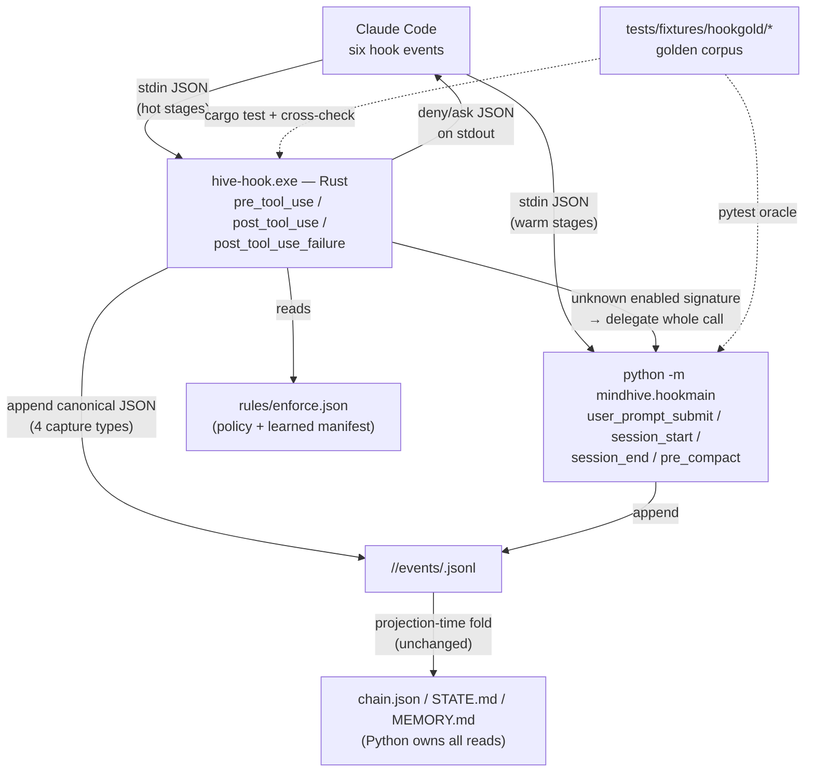

# PRD — Rust tool-interception hook engine (`hive-hook`)

> Status: **ready for execution** (next session, maximum output depth).
> Version: **1 (single-context, live-measured).** Every latency number quoted
> below was measured on this machine on 2026-07-21 against the live hook chain
> — not estimated, not quoted from the ECC PDF snapshot. An optional
> adversarial-verify workflow pass (the packs-PRD v1→v2 pattern) may be run
> before execution if the user asks; the defaults in §9 are chosen so
> execution never blocks on it.
> Source ideas: the ECC architecture review (`C:/Users/hanif/ECC/.ecc-review/`,
> runs `wf_549c1b09-86a` + `wf_cae37272-a5a`) — specifically the "Rust ecc2
> alpha" observation and the six-event hook interception study.
> Standing constraints (CLAUDE.md + SOPs): **copy the design, not the code;
> never overwrite existing MindHive code paths; the Python package stays
> stdlib-only; test-first; every `src/`+`tests/` change-set gets `hive log`;
> land green; never touch the live dashboard's process or repoint it via
> PYTHONPATH.**

---

## 0. The two ideas this PRD continues (brainstorm record)

### 0.1 Idea A — the "Rust ecc2 alpha" (extreme performance experiment)

ECC recognizes that running dozens of AI agents through per-event script
processes bottlenecks at scale, and its answer is `ecc2/` — a Rust rewrite
track. What `ecc2/` **actually is** (verified in the clone, see Appendix B):
a Rust **control-plane** alpha — session manager, SQLite session store, TUI
dashboard, background daemon, worktree-aware scaffolding. It is *not* a hook
engine; ECC has not yet applied Rust to its own worst measured hotspot.

What the idea licenses for MindHive is the strategic direction, not the
artifact: **move hot-path agent infrastructure out of scripting runtimes into
a native binary.** MindHive should apply that where *its own* measurements
say the fire is — the hook hot path — rather than cloning ecc2's control
plane (MindHive already has a session/ledger/dashboard layer; a second one is
duplication, not speed).

### 0.2 Idea B — tool interception via the hook system (Pre & Post Tool Use)

ECC wires hook scripts into the agent lifecycle so every tool call is checked
**before** (PreToolUse — can deny/ask) and **after** (PostToolUse — capture,
learning) execution. This mid-stream interception is the safety net that
stops an autonomous agent's fatal errors deterministically — SOP 1.2's "a
rule that must always hold goes into a hook, prompts drift, hooks don't."

The measured cost of ECC's implementation (hooks study, this machine):
**18 Node spawns per tool call ≈ 1.15 s of pure overhead** (8 PreToolUse +
10 PostToolUse × ~64 ms cold `node` spawn) before any hook does work.

MindHive already has the *architecturally correct* version: **one fail-open
dispatcher per event, six events live** (`SessionStart`, `PreToolUse`,
`UserPromptSubmit`, `PostToolUse`, `PreCompact`, `SessionEnd` in
`~/.claude/settings.json`, a seventh — `PostToolUseFailure` — built and
awaiting registration). But each dispatch pays a **double spawn**:
`powershell -NoProfile -File <shim>.ps1` → `python -m mindhive hook <stage>`
— measured **~395 ms per event**, ~0.8 s per typical Bash tool call
(PreToolUse + PostToolUse both fire).

### 0.3 The fusion insight — latency is *why* the safety net is narrow

The two ideas are one project. The interception net is deliberately
under-deployed today **because** every widening taxes every tool call:

- The PreToolUse matcher covers only `Grep|Bash|PowerShell`. Widening it to
  `Edit|Write|NotebookEdit` — which would activate the already-shipped
  `gateguard.protected_config_file` check (today dead code for file tools) —
  was explicitly deferred in the ECC integration wave with the note
  "~0.5 s/edit hook-latency cost — user's call".
- The PostToolUse matcher lists 7 tools rather than everything observable.
- `PostToolUseFailure` (structured `tool_failed` capture, the fix for the
  260-unparseable-events defect) is built but unregistered.

At agent scale the tax compounds: a `hive loop` iteration making ~40 tool
calls pays ~32 s of pure spawn overhead; a MindParallel wave multiplies that
CPU load per concurrent agent, and spawn cost degrades further under
contention. **Make interception ~free (≤5 ms) and the correct posture flips:
intercept everything, everywhere, always.** Performance is not vanity here —
it is what buys full-coverage safety.

### 0.4 Options considered

| # | Option | Verdict |
|---|---|---|
| A | **Collapse the shim (Python-only):** move the `.ps1` guards into a minimal Python entry, register the venv python directly in settings.json | **DO — WS1.** Already blessed as ECC-review Track 1 #13. Cuts ~395 → ~90–140 ms with zero new technology. Also becomes the permanent fallback engine and the parity oracle for the Rust build. |
| B | **Persistent daemon + thin client** (named pipe / localhost socket; near-zero marginal latency) | **DEFER.** Best steady-state number, worst operational surface on Windows: daemon lifecycle, stale-code-vs-checked-out-branch drift (the exact class of bug the editable-install dashboard rule exists for), headless/recursion semantics, cleanup on crash. Revisit only if WS2's per-spawn number misses target. |
| C | **Rust per-event binary** (`hive-hook.exe`, one cold spawn ≈ 1–3 ms) | **DO — WS2–WS4.** The ecc2-inspired experiment, scoped to the hot stages. Native cold start makes the daemon unnecessary; no lifecycle state; same process model as today. |
| D | **Full Rust port of the MindHive core** (ledger, projections, recall — an ecc2-style control plane) | **REJECT.** Violates copy-the-design-not-the-code economics: the ledger/projection layer is not latency-critical (runs at session boundaries), is deeply tested in Python, and a rewrite would fork the schema contract (SOP 7). |
| E | **Trim Python imports only** (no registration change, keep shims) | **REJECT as endpoint** (subsumed by A): the ~255 ms PowerShell wrapper is the single largest slice and no Python change removes it. |

The chosen ladder is **A then C**: A is cheap, reversible, and de-risks C by
giving the golden-parity harness a fast oracle; C is the experiment that
takes the hot path to ~free.

---

## 1. Current state — evidence (this machine, live)

### 1.1 The six live registrations

`~/.claude/settings.json` registers exactly six events, one command hook
each, every one `powershell -NoProfile -File C:/Users/hanif/mindhive/hooks/<stage>.ps1`.
The shims all share one shape: headless guard (`MINDHIVE_HEADLESS=1` → exit
0), stdin guard, pipe raw stdin to `python -m mindhive hook <stage>`
(hard-coded venv python), swallow all errors, exit 0 — fail-open + hang-proof
by construction. **The shim paths point at the main checkout
(`C:/Users/hanif/mindhive`), not any worktree** — cutover work in this PRD
can only touch live registration after its branch merges there (the
`PostToolUseFailure` precedent note in the ECC wave plan).

### 1.2 What each stage does

| Event | Matcher | Python work (via `cmd_hook`, `src/mindhive/__main__.py:92`) | Writes |
|---|---|---|---|
| PreToolUse | `Grep\|Bash\|PowerShell` | `enforce.hook_decision`: static policy tier (`gateguard` no-verify / config-protection / destructive-command, deny-before-ask) then learned manifest matchers (`rules/enforce.json`; `tool:ripgrep-timeout`, `git:worktree-locked`); prints deny/ask JSON on stdout only when firing | nothing |
| PostToolUse | `Edit\|Write\|NotebookEdit\|Bash\|PowerShell\|Skill\|TodoWrite` | `hookcapture.record_post_tool_use`: extract `file_touched` / `command_run` / `skill_used` (+/- line stats, truncation caps `CMD_MAX=180`/`DESC_MAX=120`, `plugin:skill` split), errors → `hooks_errors.log` | appends events |
| PostToolUseFailure | *(built, unregistered)* | `hookcapture.record_post_tool_use_failure`: categorize `{tool, category, retryable}`, infra-noise filter, dedup pre-seed | appends `tool_failed` |
| UserPromptSubmit | *(all prompts)* | `promptgate.hook_context` (prompt-quality gate over trained `rules/triggers.json`) + `enrich.extend_hook_context`; `record_direction` | appends `skill_directed` when firing |
| SessionStart | — | briefing/memory load surface | appends `session_start` |
| PreCompact | — | compaction marker | appends `compaction` |
| SessionEnd | — | session close: review queue, changelog gate, roadmap auto-close | appends `session_end` etc. |

### 1.3 Measured latency (2026-07-21, this machine, 3 runs each)

```
cold python spawn (python -c pass)                40 / 41 / 44 ms
python -m mindhive hook pre_tool_use ({} stdin)  136 / 140 / 142 ms
full live shim (powershell -NoProfile -File …)   389 / 398 / 399 ms
```

Decomposition of the ~395 ms: **~255 ms PowerShell 5.1 process + script
overhead** (the wrapper adds nothing functional — every guard it implements
is expressible in Python) + **~100 ms Python interpreter/import beyond bare
startup** (`python -m mindhive` imports `__main__`, which builds the full
~90-subcommand argparse tree before dispatching) + ~40 ms unavoidable
interpreter start. Per typical Bash tool call (PreToolUse + PostToolUse):
**~0.8 s**. The same double-spawn floor applies to all six events;
UserPromptSubmit additionally does inventory-backed gate work and an event
append when it fires (unmeasured, ≥ the ~395 ms floor) and its latency is
user-visible on every prompt submit.

Reference points: ECC's chain costs ~1.15 s/tool-call from 18 spawns; ECC's
own hardening plan targets ~0.13 s by collapsing to one dispatcher per event
— i.e. ECC's *target* is the architecture MindHive already has, and this PRD
starts from there.

### 1.4 The ledger contract a second writer must honor

- Append-only per-session segments: `<store>/<namespace>/events/<session_id>.jsonl`
  (`events.append_event`, `src/mindhive/events.py:112`). One canonical-JSON
  line per event: `{payload, session_id, tags, ts, type}` — `sort_keys=True`,
  separators `(",", ":")`, `ensure_ascii=False`, ts `%Y-%m-%dT%H:%M:%SZ` (UTC).
- Event types must be in the `VALID_TYPES` registry. The hot stages write only
  deterministic capture types: `file_touched`, `command_run`, `skill_used`,
  `tool_failed`.
- The hash chain (`chain.py`) is a **projection-time checkpoint**, not an
  append-time computation: `compute_chain` re-parses and re-canonicalizes
  events when folding. A second writer therefore does not compute hashes — it
  must only produce lines that parse to the same dicts Python would have
  written. `hive verify` is the arbiter.
- Session id: resolved exactly as the Python capture path resolves it today
  (payload/`MINDHIVE_SESSION`/`"manual"` — never fabricated, SOP 10.5). The
  golden corpus (WS3) encodes the precise precedence as executable fixtures
  rather than prose.
- Namespace: `paths.detect_project` — `MINDHIVE_PROJECT` env override, else
  `git rev-parse --git-common-dir` **with worktrees deliberately collapsing
  onto the main repo's namespace**, else toplevel/cwd-name fallbacks, all
  through `normalize()` (lowercase-kebab).
- `MINDHIVE_HEADLESS=1` → the hook must do nothing (no reads, no writes, no
  output) — the self-blocking/recursion guard for headless reflection runs.
- Secret redaction at capture time (ECC-review Track 1 #1) is **not yet
  implemented** in `hookcapture` — only `plugins.py` masks env-var-shaped
  secrets. See the ordering constraint in §8.

---

## 2. Problem statement

MindHive's six-event interception net is architecturally right (single
fail-open dispatcher per event, append-only audited ledger behind it) but
pays ~395 ms of process-spawn tax per event — ~0.8 s per tool call, every
tool call, every session. That tax is the stated reason the net's coverage
is frozen below where the safety design wants it (no file-tool PreToolUse
protection, no registered failure stage), and it scales linearly with agent
count in exactly the "dozens of agents" regime the hive loop, Self-Reliant,
and MindParallel are built for. ECC names the same disease in its own body
(18 Node spawns, 1.15 s) and gestures at Rust (`ecc2/`) without yet applying
it to hooks. MindHive can run the experiment properly: **rewrite the hook
hot path as a native Rust binary, prove behavioral parity with a golden
corpus, then spend the reclaimed latency on full-coverage interception.**

## 3. Goals

- **G1 — Hot-stage latency ≤ 5 ms p50 / ≤ 15 ms p95** per event for
  `pre_tool_use`, `post_tool_use`, `post_tool_use_failure` (engine spawn +
  decision/capture + append), measured by the WS3 benchmark harness on this
  machine. (~80× on today's 395 ms; per-tool-call overhead ~0.8 s → ~10 ms.)
- **G2 — Zero behavior change, proven not asserted.** A shared golden corpus
  of recorded/adversarial payloads runs against both engines; decisions,
  event lines (modulo `ts`), error-log behavior, and exit codes must match
  byte-for-byte. `hive verify` stays green over a store the Rust engine has
  appended to.
- **G3 — Spend the speed on coverage:** widen PreToolUse to
  `Edit|Write|NotebookEdit` (activating config-protection), register
  `PostToolUseFailure`, and record the before/after latency evidence that
  justifies both. The safety net's reach becomes a policy decision, never a
  latency decision.
- **G4 — Fail-open + kill-switch preserved.** Any engine error allows the
  tool call, appends nothing, prints nothing; one settings.json edit (or
  `MINDHIVE_HOOK_ENGINE=python`) reverts to the WS1 Python path with no other
  change. A stale binary is detected, not silently trusted.
- **G5 — WS1 lands even if Rust stalls.** The Python fast entry is a
  self-contained ~3–4× win (~395 → ~90–140 ms) and the permanent fallback
  engine; the experiment failing must still leave the system better than
  today.

## 4. Non-goals

- **Not** a daemon/IPC architecture (option B) — revisit only if G1 misses.
- **Not** porting `promptgate`/`enrich` (UserPromptSubmit) or the session
  lifecycle stages (SessionStart/SessionEnd/PreCompact) to Rust. They fire
  per-prompt/per-session, not per-tool-call, and drag the inventory,
  recommend, and briefing surfaces with them. They get the WS1 fast entry
  only. (Future candidate, explicitly out of scope: §9 Q5.)
- **Not** an ecc2-style control plane, TUI, SQLite store, or any second
  session manager (option D).
- **Not** touching `chain.py`, projections, `events.py` semantics, or the
  DATA_MODEL contract — the Rust engine is a *writer conforming to* the
  contract, never a schema owner (SOP 7).
- **Not** new Python dependencies (the package stays stdlib-only). The Rust
  crate pins the minimal set (`serde`, `serde_json`; std for everything else).
- **Not** editing the live `~/.claude/settings.json` from the worktree
  session — registration changes are a post-merge manual step (§7).
- **Not** dashboard work.

---

## 5. Target architecture



Split rule: **per-tool-call stages go native; per-prompt/per-session stages
stay Python.** Python remains the sole owner of reads, projections, and the
schema; Rust is a conforming fast writer/decider with a delegation escape
hatch. Both engines are registered alternatives for the same stages — the
dispatch choice lives in settings.json, nowhere else.

---

## 6. Technical plan

### WS1 — Python fast entry + shim collapse (the blessed quick win, and the fallback engine)

**Files:** `src/mindhive/hookmain.py` (new), `tests/test_hookmain.py` (new),
`hooks/*.ps1` (retired for the six events at cutover; kept in-tree until then),
`docs/prds/2026-07-21-002-rust-tool-interception-prd.md` (this file, §7 notes).

**Approach.**
- `hookmain` is a **minimal** `python -m mindhive.hookmain <stage>` entry:
  no argparse tree (a two-line `sys.argv` check), no top-level imports beyond
  `sys`/`os`; each stage lazy-imports exactly its module — the ~90-subcommand
  `__main__` import cost never runs.
- Absorb every shim guard, in order: `MINDHIVE_HEADLESS=1` → exit 0 before
  any import; stdin absent/empty → exit 0; whole body in one fail-open
  `try/except` → exit 0 silently (errors best-effort appended to
  `hooks_errors.log`, matching `hookcapture`'s existing pattern).
- **Stdout discipline** (a behavioral detail the shims currently own):
  `pre_tool_use` prints only a firing decision; `user_prompt_submit` prints
  only firing context; `post_tool_use`/`post_tool_use_failure` print
  **nothing** (today's shims pipe their JSON result to `Out-Null` — the
  suppression must move into `hookmain`, not be lost).
- Registration (post-merge, manual): each of the six events'
  settings.json command becomes
  `C:/Users/hanif/mindhive/.venv/Scripts/python.exe -m mindhive.hookmain <stage>`.
  `cmd_hook` in `__main__.py` stays (back-compat for scripts), delegating to
  the same stage functions.

**Test scenarios** (`tests/test_hookmain.py`, subprocess-driven with
`PYTHONPATH=<worktree>/src`, autouse `isolate_store`):
- headless: `MINDHIVE_HEADLESS=1` + a valid PostToolUse payload → exit 0, no
  stdout, no event appended, no store directory created.
- empty/absent stdin, malformed JSON, non-dict JSON → exit 0, silent.
- pre_tool_use allow → empty stdout; deny (unscoped Grep with the signature
  enabled in a fixture manifest) → the exact `hookSpecificOutput` JSON with
  `ENFORCED_MARK`.
- post_tool_use with a real Edit payload → `file_touched` appended with
  byte-identical `text`/caps vs `hookcapture.extract_events` called directly;
  **stdout empty**.
- post_tool_use_failure → structured `tool_failed` appended, stdout empty.
- user_prompt_submit: clear prompt → silent; underspecified prompt with a
  trained fixture manifest → context JSON printed.
- an induced internal exception (monkeypatched extraction) → exit 0, line in
  `hooks_errors.log`.
- import-cost guard: `python -m mindhive.hookmain pre_tool_use` completes a
  {} payload in < 250 ms in-suite (loose CI bound; the real number is read
  from the WS3 bench).

**Acceptance:** all new tests green; full suite green; measured shim-vs-entry
numbers recorded in the WS3 bench doc (expected ~90–140 ms/event, i.e.
~3–4×); `hive log minor_change` (or `update`) recorded.

### WS2 — the Rust engine: `rust/hive-hook/` (the ecc2-alpha experiment proper)

**Prerequisite P0 — toolchain (user-consented install).** `cargo` is ABSENT
on this machine (verified 2026-07-21). Install rustup + a stable toolchain
before WS2 starts; default recommendation `stable-x86_64-pc-windows-gnu`
(self-contained MinGW linker — avoids the multi-GB VS Build Tools
dependency), MSVC as the alternative if Build Tools are already wanted for
other work. The executing session must ask before downloading/installing,
or the user pre-installs. `rust-toolchain.toml` pins the choice in-repo
(ecc2 precedent).

**Files:** `rust/hive-hook/Cargo.toml`, `rust/hive-hook/rust-toolchain.toml`,
`rust/hive-hook/src/main.rs`, `.../src/payload.rs`, `.../src/decision.rs`,
`.../src/gateguard.rs`, `.../src/manifest.rs`, `.../src/capture.rs`,
`.../src/ledger.rs`, `.../src/store_paths.rs`, `.../src/errlog.rs`,
`.../tests/golden.rs`, `.gitignore` (add `bin/`, `rust/hive-hook/target/`).

**Crate shape.** One binary, stage as argv[1]
(`hive-hook.exe pre_tool_use|post_tool_use|post_tool_use_failure`), stdin →
stdout, exit 0 always (fail-open is the contract, not an aspiration).
Dependencies: `serde` + `serde_json` only. Release profile mirrors ecc2:
`lto = true`, `codegen-units = 1`, `strip = true`. Version handshake:
`hive-hook --version` prints `hive-hook <semver>+logic.<LOGIC_VERSION>`;
`LOGIC_VERSION` is an integer bumped whenever ported decision/capture logic
changes, mirrored as a constant in `src/mindhive/hookmain.py` so selftest
can detect a stale binary (WS4).

**Module boundaries (ports, with their Python sources of truth):**
- `payload.rs` — tolerant payload parse (`tool_name`/`toolName`,
  `tool_input`/`toolInput`, session-id precedence exactly as the corpus
  encodes it). Malformed → allow/no-op.
- `gateguard.rs` — port of `src/mindhive/gateguard.py`: quote-stripping,
  destructive classifier (incl. the GHSA adversarial shapes and the
  `Remove-Item -Recurse -Force` Windows addition), `check_no_verify`
  (value-consuming-option skipping), `protected_config_file` (basename set,
  first-creation allowed, non-ENOENT stat errors fail closed). Pure
  functions, no I/O except the stat.
- `decision.rs` — port of `enforce.evaluate_policies` + `evaluate` +
  `hook_decision`: policy tier first (deny before ask), per-id
  `policy:<id>` manifest overrides, learned matchers `tool:ripgrep-timeout`
  and `git:worktree-locked`, `ENFORCED_MARK` prefix, first match wins,
  fail-open everywhere. **Delegation rule:** if the manifest enables any
  signature the binary does not implement, exec the WS1 Python entry for
  this call and pipe its stdout through verbatim — correctness at old
  latency for exactly the not-yet-ported rule, never a silent divergence.
- `manifest.rs` — `rules/enforce.json` read; missing/corrupt → empty (allow).
- `capture.rs` — port of `hookcapture.extract_events` + failure
  categorization: the tool→type mapping, truncation caps (byte-identical
  `text` — harvest dedup depends on it), line stats incl. the
  structuredPatch-malformed fallback, skill `plugin:name` split, response
  ok/text extraction, infra-noise filter.
- `ledger.rs` — canonical-JSON append: keys sorted, compact separators,
  non-ASCII passed through (UTF-8), UTC `ts`, one `O_APPEND`/`FILE_APPEND_DATA`
  single-buffer write per line. Writes only the four capture types.
- `store_paths.rs` — `MINDHIVE_HOME`/`MINDHIVE_PROJECT`/`MINDHIVE_SESSION`
  env handling, `normalize()`, and **pure-filesystem git discovery** replacing
  the `git rev-parse` subprocess (spawning git would re-import ~40+ ms of the
  cost being removed): walk up to `.git`; when `.git` is a file, follow
  `gitdir:` → `commondir` → main repo — the linked-worktree collapse
  semantics `paths.detect_project` implements. Any ambiguity (env `GIT_DIR`,
  unreadable pointer files) → fall back to spawning `git rev-parse
  --git-common-dir` exactly as Python does; correctness beats speed on the
  rare path.
- `errlog.rs` — `hooks_errors.log` append parity; logging failure is itself
  swallowed.
- `MINDHIVE_HOOK_ENGINE=python` honored at entry: exec the WS1 Python entry
  and exit — the no-registration-change kill-switch.

**Execution note:** port module-by-module test-first — for each module, write
the cargo tests from the Python module's existing pytest cases *before* the
port, then make them green (red→green at the fixture level).

**Test scenarios (cargo tests, per module):**
- gateguard: the full adversarial table from `tests/test_gateguard.py`
  translated case-for-case (quoted words, newline separators, subshell/
  backtick, `sh -c`, combined short flags, `-m "use --no-verify"`
  non-firing, hookspath override, protected-config first-creation vs
  existing).
- decision: policy-before-learned ordering, deny-before-ask, manifest
  override text, disabled policy, unknown-enabled-signature → delegation
  marker (unit level: the delegation decision, not the spawn).
- capture: each tool → expected `(type, payload)` pairs; truncation caps at
  the exact boundary; malformed structuredPatch fallback; Skill split.
- ledger: canonical line for a fixture event byte-equals the committed
  Python-generated fixture; non-ASCII payload; append to an existing segment
  preserves prior bytes.
- store_paths: repo root, linked worktree (fixture `.git` file +
  `commondir`), env overrides, no-git cwd fallback — mirrored from
  `paths.detect_project` behavior fixtures generated in WS3.
- fail-open: malformed JSON stdin, unreadable store dir, read-only ledger
  file → exit 0, empty stdout, error-log line.

**Acceptance:** `cargo test` green; `cargo build --release` produces
`hive-hook.exe`; no Python file changed by WS2 itself except the
`LOGIC_VERSION` mirror constant (that change-set gets `hive log`).

### WS3 — golden parity + benchmark harness (the safety argument)

**Files:** `tests/fixtures/hookgold/*.json` (corpus),
`tests/test_hookgold.py` (oracle + cross-runner),
`scripts/bench_hooks.ps1` (benchmark), `rust/hive-hook/tests/golden.rs`
(corpus consumer), `docs/prds/2026-07-21-002-rust-tool-interception-prd.md`
(Appendix A updated with post-WS numbers at execution time).

**Corpus design.** Each fixture: `{stage, env: {…}, payload, expect:
{stdout, events: [{type, payload, tags}], errlog: bool}}`. Sources:
(a) every existing pytest case for `enforce`/`gateguard`/`hookcapture`
mechanically exported; (b) real recorded payloads from live transcripts
(scrubbed); (c) adversarial additions — unicode/emoji commands, ≥1 MB
payloads, deeply nested tool_input, CRLF, invalid UTF-8 bytes on stdin,
absent env, hostile session ids (path traversal attempts in `session_id` —
must be resolved to a safe segment name exactly as Python does).
- `tests/test_hookgold.py::test_python_engine_matches_corpus` — the WS1
  entry, run in-process per fixture, is the **oracle**: regenerating expected
  outputs is a deliberate reviewed act (a `--regen` conftest flag), never
  automatic.
- `…::test_rust_engine_matches_corpus` — invokes the built binary per
  fixture; **skips cleanly when the binary is absent** (the packs-PRD
  real-flow-test pattern), so CI without cargo stays green while local runs
  and the rust CI job enforce parity.
- `…::test_ledger_verifies_after_rust_appends` — real-flow test: Rust engine
  appends the corpus events into an isolated store; `chain.write_chain` +
  `chain.verify` over the result must be `ok: true` (G2's arbiter), and a
  Python re-read must round-trip every event.
- `rust/hive-hook/tests/golden.rs` consumes the same files by relative path —
  one corpus, two consumers, zero drift-by-copy.

**Benchmark harness** (`scripts/bench_hooks.ps1`): N=20 timed runs per
engine per stage (PowerShell-shim, WS1 entry, Rust) over three payload
sizes; emits a markdown table; PowerShell 5.1-safe (no `&&`, `$LASTEXITCODE`
gating). Run it before WS1 cutover, after WS1, after WS4 — the three rows
Appendix A will carry.

**Test scenarios:** corpus loader rejects a fixture missing required keys;
`--regen` refuses to run when the working tree is dirty (regeneration must
be reviewable); a deliberately perturbed Rust output (env-var fault
injection `MINDHIVE_HOOK_FAULT=1` compiled only in debug) fails the
cross-check — proving the harness can fail.

**Acceptance:** corpus ≥ 60 fixtures with every `gateguard`/`enforce`/
`hookcapture` pytest case represented; both engines green over it; the
ledger-verify real-flow test green; bench table generated and committed;
`hive log` recorded.

### WS4 — cutover, guard rails, and the coverage payoff

**Files:** `src/mindhive/selftest.py` (extend), `tests/test_selftest.py`
(extend), `.github/workflows/` rust job (build + `cargo test` + golden
cross-check, path-filtered to `rust/**` + the corpus), `docs/` §7 runbook
notes in this file.

**Approach.**
- **Deployment:** `cargo build --release`; copy to
  `C:/Users/hanif/mindhive/bin/hive-hook.exe` (git-ignored — the binary is
  built, not committed; §9 Q3). Registration (post-merge, manual, one event
  at a time): hot-stage commands become
  `C:/Users/hanif/mindhive/bin/hive-hook.exe <stage>`; warm stages get the
  WS1 python entry. Test first in a throwaway `CLAUDE_CONFIG_DIR` sandbox
  (the ECC-review Q1 pattern) before touching the real settings.json.
- **Selftest guards (extending the single-registration invariant, ECC-review
  Track 1 #8):** fail when a hot stage is registered to a missing binary;
  warn when `hive-hook --version`'s `logic.<N>` ≠ `hookmain.LOGIC_VERSION`
  (stale binary after a pull — the drift detector G4 requires); keep the
  existing >1-hook-per-event and stray-hooks.json checks.
- **The G3 payoff, in order, each with a bench row:** (1) register
  `PostToolUseFailure` (Rust engine); (2) widen PreToolUse matcher to
  `Grep|Bash|PowerShell|Edit|Write|NotebookEdit` — config-protection goes
  live; (3) optionally widen the PostToolUse matcher (§9 Q4).
- **Rollback runbook (one paragraph in §7):** repoint hot stages at the WS1
  python entry (or set `MINDHIVE_HOOK_ENGINE=python`); nothing else changes;
  the ledger has no engine-specific state.

**Test scenarios:** selftest missing-binary → fail with the registered path
in the message; version-skew → warn naming both versions; sandbox
registration smoke (fixture settings.json in `CLAUDE_CONFIG_DIR`, one real
tool call, deny fires, event lands, `hive verify` ok) — documented as the
manual acceptance script since it exercises the live harness.

**Acceptance:** selftest guards green in-suite; sandbox smoke performed with
output inspected (SOP 6.5); live registration flipped post-merge by the
user; before/after bench rows recorded in Appendix A; `hive log
major_change` for the cutover change-set.

---

## 7. Execution protocol for the next session (maximum output depth)

Order: **WS1 → WS2 (P0 first) → WS3 → WS4** — fallback engine before
experiment, experiment before parity harness completion (WS3's corpus starts
in WS1 and grows through WS2), parity proof before any cutover.

Per change-set discipline (non-negotiable):

1. Tests first (WS1/WS2 red→green; WS3 corpus-first for every port).
2. Full pytest suite green before each commit; worktree subprocess tests set
   `PYTHONPATH=<worktree>/src` (the editable-install trap).
3. `hive log <category> "<what & why>"` for every `src/`+`tests/` change-set
   before calling it done. Docs-only edits to this PRD need no entry.
4. Verify with real output: run the WS3 bench and paste its table; run
   `hive verify` after Rust appends and read the verdict; on cutover, grep
   the sandbox transcript for the actual deny/`ENFORCED_MARK` text — never
   infer from exit codes alone.
5. **Never** edit the live `~/.claude/settings.json` or the main-checkout
   `hooks/*.ps1` from the worktree session; registration flips only after
   merge, manually, one event at a time, sandbox-first.
6. **Never** touch the live dashboard process (port 54461) or repoint it via
   PYTHONPATH.
7. P0 toolchain install requires explicit user consent in-session (download
   + execute); if consent is not available, execute WS1 + WS3's
   Python-side corpus fully and stop before WS2 with a clear handoff note.
8. Commit per workstream on a feature branch; PR when the user asks.

Rollback at any point: settings.json back to the previous command strings —
the shims and `cmd_hook` remain in-tree and functional throughout.

## 8. Risks & mitigations

- **Dual-language logic drift** (the defining risk of any port): a new
  matcher/capture rule lands in Python and the binary silently diverges.
  Mitigations: the golden corpus is the single behavioral spec (a Python
  change without a corpus update fails the oracle test); `LOGIC_VERSION`
  skew warning in selftest; the delegation rule makes *learned-manifest*
  additions safe by construction (unknown enabled signature → Python
  handles the call).
- **Canonical-JSON mismatch corrupting perceived history:** chain folding
  re-canonicalizes parsed dicts, so only parse-equivalence matters — but
  harvest dedup keys need byte-identical `text` values. Mitigations: the
  byte-equality ledger fixtures + the `hive verify` real-flow test + a
  Python round-trip read in WS3.
- **Namespace/session resolution drift** (events landing in a wrong or
  freshly-minted namespace — the worst silent failure): pure-FS git
  discovery is ported with worktree fixtures, with subprocess-git fallback
  on any ambiguity; hostile session-id fixtures pin segment-name safety.
- **Toolchain absent / install friction:** cargo verified ABSENT; P0 is
  user-consented, GNU toolchain default avoids VS Build Tools; WS1+WS3
  deliver standalone value if P0 is declined (G5).
- **AV/Defender tax on a fresh unsigned exe:** real-time scanning can add
  tens of ms or more per spawn of a new binary. Mitigation: the bench
  measures the *real* number before cutover claims are made; if p95 misses
  G1 because of AV, surface it to the user (exclusion is their call, never
  applied silently) and fall back to WS1 latency meanwhile.
- **Concurrent appends** (parallel agents, same session segment): today's
  Python path does unlocked `open("a")` writes; Rust matches semantics with
  single-buffer `FILE_APPEND_DATA` writes — parity, no regression; noted as
  a pre-existing property, not fixed here (out of scope).
- **Secret redaction ordering** (Track 1 #1, unimplemented): if redaction
  lands in Python *after* the Rust port, the engines diverge on the highest-
  value safety behavior. Constraint: land redaction either **before WS2's
  capture port or simultaneously in both engines with corpus fixtures** —
  the executing session must check `hookcapture` for a `scrub` before
  porting and sequence accordingly.
- **UserPromptSubmit stays at ~WS1 latency** (~90–140 ms, user-visible per
  prompt): accepted for this PRD (§4); the WS3 bench records it so the
  follow-up decision (§9 Q5) is made on numbers.
- **Windows path/encoding edge cases** (UNC, non-ASCII usernames, CRLF
  stdin): corpus fixtures; `ensure_ascii=False` parity pinned by
  byte-equality tests.

## 9. Open questions (defaults chosen so execution never blocks)

1. Binary location/name? **Default: `bin/hive-hook.exe` under the main
   checkout, git-ignored, built locally.**
2. Unknown enabled learned-signature behavior? **Default: delegate the whole
   call to the Python entry (correctness at old latency); never
   ignore-and-allow silently.**
3. Commit prebuilt binaries to the repo? **Default: no** — source + pinned
   toolchain + CI build; the repo stays reviewable text.
4. Widen PostToolUse matcher beyond today's 7 tools once cheap? **Default:
   defer to a follow-up measurement** — capture volume (ledger growth), not
   latency, becomes the binding constraint.
5. Port UserPromptSubmit/promptgate to Rust later? **Default: defer** —
   re-decide on WS3 bench numbers; it drags inventory/recommend surfaces.
6. Rust toolchain flavor? **Default: `stable-x86_64-pc-windows-gnu`** (no VS
   Build Tools dependency); MSVC acceptable if the user prefers.
7. Run the adversarial-verify workflow over this PRD before execution (the
   packs v1→v2 pattern)? **Default: optional, user's call** — the plan is
   built on live measurements, but an 11-agent verify pass materially
   hardened the last PRD of this shape.

---

## Appendix A — measured latency baseline (2026-07-21, this machine, live)

```
cold python spawn (python -c pass)                 40 / 41 / 44 ms
python -m mindhive hook pre_tool_use ({} stdin)   136 / 140 / 142 ms
full live shim (powershell -NoProfile -File …)    389 / 398 / 399 ms

per typical Bash tool call (Pre + Post fire):     ~0.8 s
ECC reference (18 node spawns, same machine):     ~1.15 s per tool call
ECC's own hardening target (dispatcher collapse): ~0.13 s per tool call
WS1 projection (python fast entry, direct reg.):  ~90–140 ms per event
WS2 target (G1):                                  ≤ 5 ms p50 / ≤ 15 ms p95
```

Rows to append at execution time (WS3 bench, N=20): post-WS1 measured,
post-WS4 measured, per-stage and per-payload-size.

## Appendix B — what `ecc2/` actually is (verified in the clone)

`C:/Users/hanif/ECC/ecc2/` — "ECC 2.0 Alpha", a Rust control-plane scaffold:
ratatui TUI dashboard, rusqlite session store, session start/stop/resume,
background daemon, observability/risk-scoring primitives, worktree-aware
scaffolding (Cargo deps: tokio, ratatui, rusqlite, git2, serde, clap;
release profile `lto = true`, `codegen-units = 1`, `strip = true`). Its own
README scopes it as the layer *above* harness installs — managing many
sessions from one surface. **It contains no hook engine**; ECC's hooks
remain the 18-spawn Node chain its own review measured at ~1.15 s/tool-call.
This PRD borrows its direction (Rust for agent infrastructure, and its
release-profile choices) and none of its scope.

## Appendix C — per-stage disposition after this PRD

| Stage | Fires | Engine after WS4 | Why |
|---|---|---|---|
| PreToolUse | per tool call | **Rust** (delegates unknown learned sigs) | hot; decision logic is pure and portable |
| PostToolUse | per tool call | **Rust** | hot; capture extraction is pure + one append |
| PostToolUseFailure | per failed call | **Rust** (newly registered) | hot; structured `tool_failed` capture |
| UserPromptSubmit | per prompt | Python fast entry (WS1) | inventory-backed gate; user-visible but low frequency |
| SessionStart | per session | Python fast entry (WS1) | briefing surface; latency amortized |
| SessionEnd | per session | Python fast entry (WS1) | gates/roadmap close; correctness-heavy |
| PreCompact | rare | Python fast entry (WS1) | trivial frequency |

## Appendix D — deliverable inventory for the executing session

| # | Path | Kind |
|---|---|---|
| 1 | `src/mindhive/hookmain.py` | code (stdlib-only) |
| 2 | `tests/test_hookmain.py` | tests |
| 3 | `rust/hive-hook/Cargo.toml` + `rust-toolchain.toml` | build config |
| 4 | `rust/hive-hook/src/{main,payload,decision,gateguard,manifest,capture,ledger,store_paths,errlog}.rs` | code (Rust) |
| 5 | `rust/hive-hook/tests/golden.rs` | tests (Rust) |
| 6 | `tests/fixtures/hookgold/*.json` | golden corpus (≥ 60 fixtures) |
| 7 | `tests/test_hookgold.py` | tests (oracle + cross-runner + ledger-verify) |
| 8 | `scripts/bench_hooks.ps1` | benchmark harness |
| 9 | `src/mindhive/selftest.py` (+ tests) | edit (guards: missing binary, version skew) |
| 10 | `.github/workflows/` rust job | CI (path-filtered) |
| 11 | `.gitignore` | edit (`bin/`, `rust/hive-hook/target/`) |
| 12 | this PRD, Appendix A rows | doc (post-execution evidence) |

**Definition of done:** WS1–WS4 landed in order; golden corpus green under
both engines; `hive verify` green over Rust-appended store; bench table shows
G1 met (or the AV-attributed miss surfaced per §8); selftest guards green;
sandbox cutover smoke inspected; live registration flipped post-merge by the
user with before/after rows recorded; full suite green; `hive log` per
change-set.
